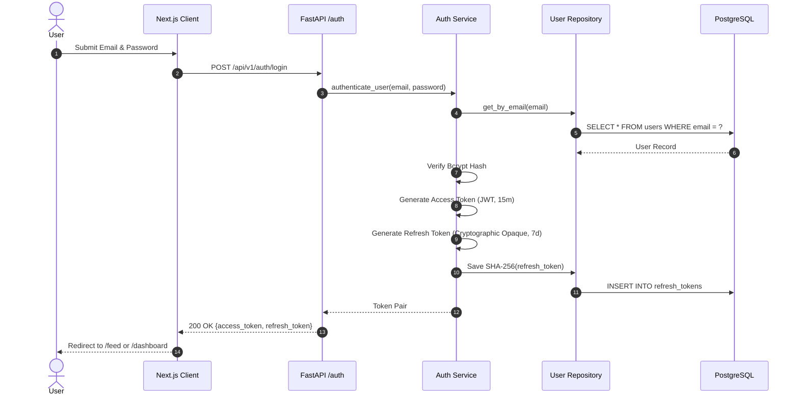
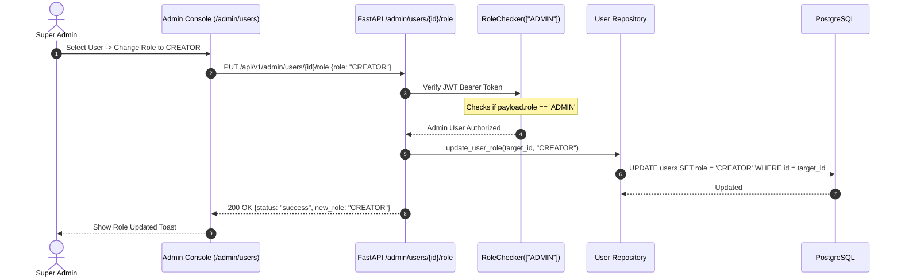
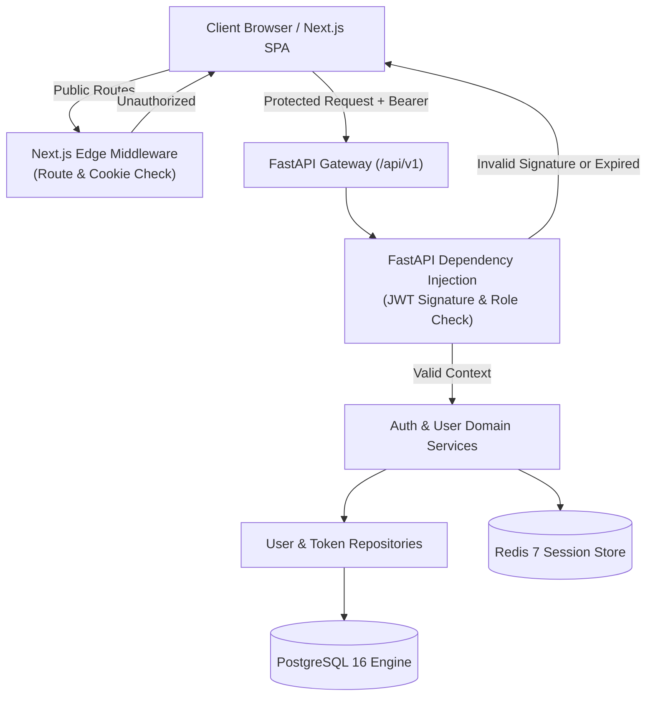
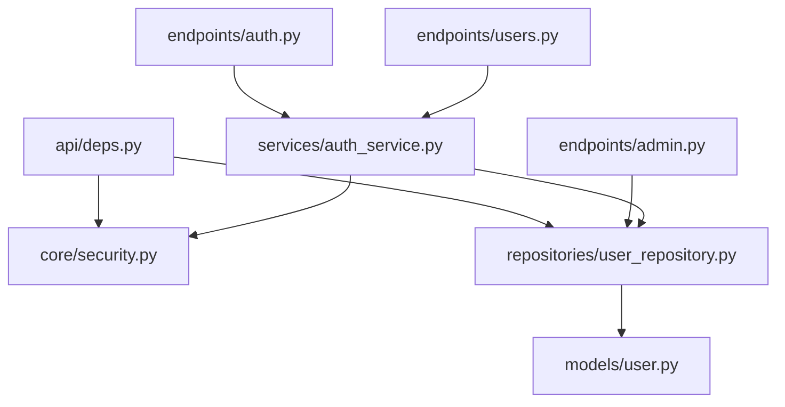

# Feature: 01 — Authentication & User Management (Student / Creator / Super-Admin RBAC)

> **Document Integrity & Verification:**  
> **Target Module:** Feature 01 — Core Identity, Session Lifecycle, Profile Management & Access Delegation  
> **Status:** Specification & Architectural Guidance Blueprint  
> **Target Audiences:** Open-Source Contributors, System Architects, Security Reviewers  
> **Cryptographic Reference Note:** See [Section 12.0](#120-cryptographic-hashing-standards--why-md5-is-obsolete) for cryptographic analysis and [Section 21](#21-final-architecture-recommendations--document-checksum) for document verification.

---

## 1. Feature Overview

The **Authentication & User Management** module is the foundational gatekeeper and identity provider for **RKSkillTube** — a hybrid video streaming and EdTech learning platform. It serves three primary platform personas:
1. **Students / Standard Users (`USER`):** Consumers who register, log in, manage their personal learner profiles, watch courses, take notes, and track learning progress.
2. **Creators (`CREATOR`):** Instructors and content creators who upload videos, manage curricula, and view channel performance.
3. **Super Administrators (`ADMIN`):** Global system overseers responsible for platform moderation, reviewing creator access requests, elevating/demoting user permissions, and auditing platform security.

### Core Objectives for Contributors:
- Provide robust, constant-time identity verification using salted password hashing.
- Support seamless onboarding via third-party identity federation (**Google OAuth 2.0**).
- Implement a modern **Dual-Token Lifecycle** (short-lived access tokens with rotating refresh tokens).
- Enforce strict **Role-Based Access Control (RBAC)** across both backend API routes and frontend Next.js App Router boundaries.
- Provide a responsive self-service profile management system for users and a centralized user management console for super administrators.

---

## 2. Project Architecture Context

RKSkillTube follows a decoupled, cloud-ready client-server architecture designed for high-concurrency video delivery and real-time interaction:

```
┌────────────────────────────────────────────────────────────────────────┐
│                      CLIENT TIER (Next.js 14+ / TS)                    │
│  • App Router (Route Groups: (auth), (main), (creator), (admin))       │
│  • Zustand Client State & Axios Interceptors with Silent Refresh       │
│  • Edge Middleware Route Guards & Role-Based Rendering                 │
└───────────────────────────────────┬────────────────────────────────────┘
                                    │ HTTPS REST JSON
                                    ▼
┌────────────────────────────────────────────────────────────────────────┐
│                   API GATEWAY / BACKEND TIER (FastAPI)                 │
│  • Presentation Layer: FastAPI Routers (/api/v1/auth, /users, /admin)  │
│  • Dependency Injection Security Layer: OAuth2Bearer & Role Checker     │
│  • Business Logic Layer: AuthService, UserService                      │
│  • Data Access Layer: UserRepository (Repository Pattern)              │
│  • Persistence Layer: SQLAlchemy 2.0 (Async) + Pydantic v2 Schemas     │
└───────────────────┬───────────────────────────────┬────────────────────┘
                    │                               │
                    ▼                               ▼
       ┌─────────────────────────┐     ┌────────────────────────┐
       │   PostgreSQL 16 DB      │     │    Redis 7 Cluster     │
       │   • users               │     │   • Rate Limiting      │
       │   • refresh_tokens      │     │   • Token Blacklist    │
       │   • user_profiles       │     │   • Active Sessions    │
       └─────────────────────────┘     └────────────────────────┘
```

The system strictly adheres to **Clean Layered Architecture**:
1. **Presentation Layer (Routers):** Validates incoming HTTP requests via Pydantic DTOs and delegates directly to services.
2. **Business Logic Layer (Services):** Coordinates credential hashing, token generation, role verification, and business rules.
3. **Data Access Layer (Repositories):** Abstracts all SQLAlchemy database queries from business rules.
4. **Persistence Layer (Entities / Models):** Defines database tables, foreign keys, and indexes.

---

## 3. Existing System Analysis

A thorough physical inspection of the codebase reveals that RKSkillTube is currently in its **foundational scaffolding stage**:

### Backend Codebase Reality (`backend/`):
- **Scaffolded Modules:** Folders exist with empty placeholder files:
  - `backend/app/main.py`: Entrypoint placeholder (empty).
  - `backend/app/config.py`: Settings/Environment configuration placeholder (empty).
  - `backend/app/api/deps.py`: Dependency injection placeholder (empty).
  - `backend/app/api/v1/router.py`: Central v1 API router aggregator (empty).
  - `backend/app/api/v1/endpoints/auth.py`, `users.py`, `admin.py`: Endpoint placeholders (empty).
  - `backend/app/core/security.py`, `database.py`, `redis.py`: Security and infrastructure placeholders (empty).
  - `backend/app/models/user.py`, `base.py`: Database entity models (empty).
  - `backend/app/repositories/user_repository.py`: Data-access repository (empty).
  - `backend/app/services/auth_service.py`: Business logic service (empty).
  - `backend/app/schemas/user.py`, `auth_service.py`: Pydantic schemas (empty).
- **Dependencies (`backend/requirements.txt`):** Currently unpopulated. Contributors must introduce foundational libraries: `fastapi`, `uvicorn`, `sqlalchemy>=2.0`, `asyncpg`, `pydantic>=2.0`, `passlib[bcrypt]`, `pyjwt`, `redis`, and `python-multipart`.

### Frontend Codebase Reality (`frontend/`):
- **Framework:** Next.js 16.4.3 with React 19 and Tailwind CSS v4 configured in `frontend/package.json`.
- **Route Groups Present:**
  - `frontend/src/app/(auth)/login/page.tsx` & `register/page.tsx`: Existing empty page placeholders.
  - `frontend/src/app/(admin)/admin/dashboard/page.tsx`: Admin page placeholder.
  - `frontend/src/app/(creator)/studio/...`: Creator studio route group.
  - `frontend/src/app/(main)/...`: Main application route group.
- **Client State & Services:**
  - `frontend/src/store/useAuthStore.ts`: Empty placeholder for Zustand authentication store.
  - `frontend/src/hooks/useAuth.ts`: Empty placeholder for auth hook.
  - `frontend/src/services/api.ts`: Empty placeholder for Axios/Fetch API client.

*Conclusion:* Contributors are building upon an established directory structure, making adherence to clean architectural boundaries essential from day one.

---

## 4. Functional Requirements

### A. Student / General User Capabilities
1. **Account Registration:** New users can sign up with an email, full name, and password. Default role assigned is `USER`.
2. **Credential Authentication:** Users log in using email and password, receiving a short-lived Access Token and a long-lived Refresh Token.
3. **Google OAuth 2.0 Integration:** Users can authenticate via Google Sign-In; if the account does not exist, an account is provisioned automatically with `is_verified = True`.
4. **Token Refreshing:** Seamless background rotation of expired access tokens using the refresh token.
5. **Self-Service Profile Management:** Users can inspect their account information (`/api/v1/users/me`), update bio/display name, upload profile avatars, and change passwords with prior password confirmation.
6. **Session Termination (Logout):** Revokes the active refresh token and purges client session state.

### B. Super-Admin Capabilities
1. **User Directory Governance:** View a paginated list of all registered platform users with filters (by role, active status, and email search).
2. **Role Elevation & Access Delegation:** Upgrade a standard `USER` to `CREATOR` or `ADMIN`, or demote an account.
3. **Account Suspension & Moderation:** Soft-deactivate an account (`is_active = False`), which triggers immediate termination of all active sessions and refresh tokens.

---

## 5. Non-Functional Requirements

- **Security & Integrity:** Passwords must never be stored in plain text or using weak/broken hashing algorithms (e.g., MD5 or SHA-1). Use adaptive hashing (`bcrypt` with $\ge 12$ rounds).
- **Low Latency:** Authentication checks via JWT signature verification must be sub-millisecond and stateless without requiring a database query on every micro-request.
- **Atomic Token Rotation:** Each refresh token can only be used once. Replay attempts must revoke the entire token lineage.
- **Scalability:** Stateless JWT validation allows horizontal scaling across multiple backend instances behind a load balancer.
- **Auditability:** Sensitive operations (role modifications, account suspensions, password changes) must emit structured audit logs.

---

## 6. Assumptions and Open Questions

### Assumptions:
- PostgreSQL 16 is the primary persistence engine, with UUIDv4 used as primary keys to prevent enumeration attacks.
- Redis 7 is available for distributed rate-limiting and token revocation lists.
- Email verification is initially asynchronous or soft-gated to avoid blocking onboarding.

### Open Questions for Maintainers / Contributors:
1. *Cookie vs. Authorization Header:* Should the Refresh Token be stored in a `SameSite=Strict` `HttpOnly` cookie or delivered in the JSON payload? *(Recommendation: Use `HttpOnly` cookies for maximum browser XSS protection).*
2. *Super-Admin Bootstrapping:* How should the very first `ADMIN` account be provisioned? *(Recommendation: An initial database migration script or CLI command via `app/commands/create_superuser.py`).*

---

## 7. Low-Level Design (LLD)

### 7.1 Component Design

```
┌────────────────────────────────────────────────────────────────────────┐
│                        FastAPI PRESENTATION LAYER                      │
│   • endpoints/auth.py:  POST /register, /login, /refresh, /logout      │
│   • endpoints/users.py: GET /me, PUT /me, PUT /me/password             │
│   • endpoints/admin.py: GET /admin/users, PUT /admin/users/{id}/role   │
└───────────────────────────────────┬────────────────────────────────────┘
                                    │ Injects Dependencies
                                    ▼
┌────────────────────────────────────────────────────────────────────────┐
│                      DEPENDENCY INJECTION & GUARDS                     │
│   • api/deps.py:                                                       │
│       - get_current_user(): Parses Bearer JWT, validates signature.    │
│       - get_current_active_user(): Asserts is_active == True.          │
│       - RoleChecker(["ADMIN"]): Asserts user.role in allowed_roles.    │
└───────────────────────────────────┬────────────────────────────────────┘
                                    │ Calls Business Rules
                                    ▼
┌────────────────────────────────────────────────────────────────────────┐
│                        SERVICES LAYER (Business Logic)                 │
│   • services/auth_service.py:                                          │
│       - authenticate_user(email, password) -> User                    │
│       - create_token_pair(user) -> (access_token, refresh_token)       │
│       - rotate_refresh_token(old_token) -> TokenPair                   │
│       - revoke_user_sessions(user_id) -> None                          │
│   • services/user_service.py:                                          │
│       - update_profile(user_id, profile_dto)                           │
│       - change_password(user_id, old_pw, new_pw)                       │
└───────────────────────────────────┬────────────────────────────────────┘
                                    │ Queries via Repository
                                    ▼
┌────────────────────────────────────────────────────────────────────────┐
│                   REPOSITORIES LAYER (Data Access Abstraction)         │
│   • repositories/user_repository.py:                                   │
│       - get_by_email(email), get_by_id(id)                             │
│       - create_user(user_entity)                                       │
│       - store_refresh_token(token_hash, user_id, expires_at)           │
│       - find_refresh_token(token_hash), revoke_token(token_hash)       │
│       - list_users_paginated(skip, limit, role_filter)                 │
└───────────────────────────────────┬────────────────────────────────────┘
                                    │ SQLAlchemy 2.0 ORM
                                    ▼
┌────────────────────────────────────────────────────────────────────────┐
│                           MODELS (Entities)                            │
│   • models/user.py: User, RefreshToken entities                        │
└────────────────────────────────────────────────────────────────────────┘
```

### 7.2 Design Patterns Applied
- **Repository Pattern:** Decouples SQLAlchemy database sessions from business services. Enables painless unit testing with mocked repositories.
- **Dependency Injection (FastAPI `Depends`):** Injects database sessions, user authentication state, and role permissions declaratively at the router signature.
- **Interceptor Pattern (Frontend Axios):** Automatically captures `401 Unauthorized` responses and silently requests a refreshed access token before retrying failed requests.

---

## 8. High-Level Design (HLD)

### User Authentication & Token Refresh Flow



### Super-Admin Access Elevation Flow



---

## 9. Architecture Diagrams

### System Layer Security Boundaries



---

## 10. Database Design

### 10.1 `users` Table
| Column | Type | Constraints | Description |
| :--- | :--- | :--- | :--- |
| `id` | `UUID` | Primary Key, `default=gen_random_uuid()` | Immutable unique identifier. |
| `email` | `VARCHAR(255)` | Unique, Indexed, Not Null | Normalized lowercase email. |
| `hashed_password` | `VARCHAR(255)` | Nullable | Bcrypt hash ($rounds \ge 12$). Nullable for pure OAuth accounts. |
| `full_name` | `VARCHAR(100)` | Not Null | User display name. |
| `role` | `VARCHAR(20)` | Not Null, Default `'USER'` | Enum: `'USER'`, `'CREATOR'`, `'ADMIN'`. |
| `avatar_url` | `VARCHAR(500)` | Nullable | CDN/Storage URL to profile image. |
| `bio` | `TEXT` | Nullable | User self-description. |
| `is_active` | `BOOLEAN` | Not Null, Default `TRUE` | Soft deactivation flag. |
| `is_verified` | `BOOLEAN` | Not Null, Default `FALSE` | Email confirmation status. |
| `created_at` | `TIMESTAMPTZ` | Not Null, Default `NOW()` | Audit creation timestamp. |
| `updated_at` | `TIMESTAMPTZ` | Not Null, Auto-update `NOW()` | Audit update timestamp. |

### 10.2 `refresh_tokens` Table
| Column | Type | Constraints | Description |
| :--- | :--- | :--- | :--- |
| `id` | `UUID` | Primary Key, `default=gen_random_uuid()` | Unique token tracking identifier. |
| `user_id` | `UUID` | Foreign Key (`users.id` ON DELETE CASCADE) | Owner reference. |
| `token_hash` | `VARCHAR(64)` | Unique, Indexed, Not Null | One-way **SHA-256** hash of the refresh token. |
| `expires_at` | `TIMESTAMPTZ` | Not Null | Absolute token expiration date (e.g., 7–30 days). |
| `revoked` | `BOOLEAN` | Not Null, Default `FALSE` | Revocation flag for logout or breach invalidation. |
| `created_at` | `TIMESTAMPTZ` | Not Null, Default `NOW()` | Token issuance timestamp. |

---

## 11. API Design

### Public Endpoints
- **`POST /api/v1/auth/register`**
  - *Purpose:* Register a new student user.
  - *Request Body:* `{ "email": "student@example.com", "password": "SecurePassword123!", "full_name": "Alex Smith" }`
  - *Response (201 Created):* `{ "id": "uuid", "email": "...", "role": "USER", "created_at": "..." }`
- **`POST /api/v1/auth/login`**
  - *Purpose:* Authenticate credentials and issue token pair.
  - *Request Body:* `{ "email": "student@example.com", "password": "SecurePassword123!" }`
  - *Response (200 OK):* `{ "access_token": "eyJhbG...", "refresh_token": "d8a1...", "token_type": "bearer" }`
- **`POST /api/v1/auth/refresh`**
  - *Purpose:* Rotate refresh token and issue fresh access token.
  - *Request Body:* `{ "refresh_token": "d8a1..." }`
  - *Response (200 OK):* `{ "access_token": "eyJ...", "refresh_token": "new_opaque_token..." }`
- **`POST /api/v1/auth/google`**
  - *Purpose:* Authenticate Google OAuth ID token.
  - *Request Body:* `{ "id_token": "eyJhbG..." }`

### Protected User Endpoints (Requires Bearer Header)
- **`GET /api/v1/users/me`** — Retrieve active user's profile and assigned role.
- **`PUT /api/v1/users/me`** — Update display name, bio, and avatar link.
- **`PUT /api/v1/users/me/password`** — Update password (`{ "current_password": "...", "new_password": "..." }`).
- **`POST /api/v1/auth/logout`** — Invalidate current refresh token in database.

### Super-Admin Endpoints (Requires Role == `ADMIN`)
- **`GET /api/v1/admin/users?page=1&limit=20&role=USER`** — Paginated user directory.
- **`PUT /api/v1/admin/users/{user_id}/role`** — Mutate user role (`{ "role": "CREATOR" }`).
- **`PATCH /api/v1/admin/users/{user_id}/status`** — Toggle user status (`{ "is_active": false }`).

---

## 12. Security Analysis

### 12.0 Cryptographic Hashing Standards & Why MD5 is Obsolete
> [!CAUTION]
> **Cryptographic Vulnerability Warning on MD5:**
> - **MD5 is completely broken for security purposes.** MD5 suffers from trivial collision vulnerabilities (where two different inputs produce the exact same MD5 hash) and pre-image attacks.
> - **Passwords:** MD5 can be cracked in seconds using precomputed rainbow tables or modern GPUs that calculate tens of billions of MD5 hashes per second. **Never use MD5 for password storage or session security.**
> - **Mandatory Standards for RKSkillTube:**
>   1. **User Passwords:** Must use **bcrypt** (minimum 12 cost rounds) or **Argon2id**. These algorithms include automatic random salting and are computationally expensive to prevent brute-force attacks.
>   2. **Refresh Token Storage:** Opaque tokens generated with Python `secrets.token_urlsafe(64)` stored in the database as **SHA-256** (`hashlib.sha256`) hashes, not MD5.
>   3. **Integrity Checksums:** MD5 may only be referenced as a legacy file-checksum algorithm, never for security boundaries.

### 12.1 Security Progression: Less Secure to Production Ready

```
┌─────────────────┐       ┌─────────────────┐       ┌─────────────────┐       ┌─────────────────┐
│     LEVEL 1     │       │     LEVEL 2     │       │     LEVEL 3     │       │     LEVEL 4     │
│   (Insecure)    │ ----> │   (Improved)    │ ----> │  (Production)   │ ----> │   (Advanced)    │
│ Single Long JWT │       │ Stateful Server │       │ Dual-Token with │       │ OAuth2 + OIDC   │
│ in localStorage │       │ Sessions/Cookie │       │ Atomic Rotation │       │ HttpOnly + MFA  │
└─────────────────┘       └─────────────────┘       └─────────────────┘       └─────────────────┘
```

#### Level 1 — Basic / Insecure (Vulnerable Baseline)
- *Mechanism:* Server issues a single long-lived JWT (30 days); frontend stores it in browser `localStorage`.
- *Vulnerabilities:*
  - **XSS Vulnerability:** Any cross-site scripting flaw exposes `localStorage`, allowing total account takeover.
  - **Zero Revocation:** Tokens cannot be revoked prior to expiration even if compromised.

#### Level 2 — Improved Security
- *Mechanism:* Stateful sessions stored in Redis or Database; session identifier sent via an `HttpOnly`, `SameSite=Lax` cookie.
- *Improvements:* JavaScript cannot access `HttpOnly` cookies, preventing XSS token theft. Sessions can be revoked instantly.
- *Trade-offs:* Requires CSRF token protection and adds database lookup overhead on every incoming request.

#### Level 3 — Production-Ready Security (RKSkillTube Target)
- *Mechanism:* **Dual-Token Architecture with Atomic Rotation**:
  - Short-lived Access Token (15 minutes) kept in memory or authorization headers.
  - Long-lived Refresh Token (7 days) stored as a one-way **SHA-256** hash in PostgreSQL.
  - Upon token refresh, the used refresh token is invalidated and a fresh pair is issued.
  - Replay of an already-used refresh token flags a breach and revokes all tokens for that user.

#### Level 4 — Advanced Enterprise Security
- *Mechanism:* OAuth 2.0 with PKCE, `SameSite=Strict` partitioned cookies, WebAuthn/TOTP Two-Factor Authentication, and fine-grained Attribute-Based Access Control (ABAC).

---

## 13. Existing Files Analysis

### A. Directly Reusable Files
- [backend/app/core/exceptions.py](file:///e:/Projects/Open%20Source%20Contributions/RKSkillTube/backend/app/core/exceptions.py): Custom HTTPException classes (e.g., `CredentialsException`, `PermissionDeniedException`).
- [backend/app/core/redis.py](file:///e:/Projects/Open%20Source%20Contributions/RKSkillTube/backend/app/core/redis.py): Redis connection pool for rate-limiting and token revocation.
- [frontend/src/lib/constants.ts](file:///e:/Projects/Open%20Source%20Contributions/RKSkillTube/frontend/src/lib/constants.ts): API URLs and storage keys.

### B. Files That Need Implementation / Modification
- [backend/app/models/user.py](file:///e:/Projects/Open%20Source%20Contributions/RKSkillTube/backend/app/models/user.py): Implement SQLAlchemy `User` and `RefreshToken` entities.
- [backend/app/core/security.py](file:///e:/Projects/Open%20Source%20Contributions/RKSkillTube/backend/app/core/security.py): Implement password hashing and JWT token generators.
- [backend/app/api/deps.py](file:///e:/Projects/Open%20Source%20Contributions/RKSkillTube/backend/app/api/deps.py): Implement `get_current_user` and `RoleChecker` dependencies.
- [backend/app/schemas/user.py](file:///e:/Projects/Open%20Source%20Contributions/RKSkillTube/backend/app/schemas/user.py): Define Pydantic request/response schemas.
- [backend/app/repositories/user_repository.py](file:///e:/Projects/Open%20Source%20Contributions/RKSkillTube/backend/app/repositories/user_repository.py): Implement data access queries.
- [backend/app/services/auth_service.py](file:///e:/Projects/Open%20Source%20Contributions/RKSkillTube/backend/app/services/auth_service.py): Implement business logic and rotation rules.
- [backend/app/api/v1/endpoints/auth.py](file:///e:/Projects/Open%20Source%20Contributions/RKSkillTube/backend/app/api/v1/endpoints/auth.py), [users.py](file:///e:/Projects/Open%20Source%20Contributions/RKSkillTube/backend/app/api/v1/endpoints/users.py), [admin.py](file:///e:/Projects/Open%20Source%20Contributions/RKSkillTube/backend/app/api/v1/endpoints/admin.py): Implement routing endpoints.
- [frontend/src/store/useAuthStore.ts](file:///e:/Projects/Open%20Source%20Contributions/RKSkillTube/frontend/src/store/useAuthStore.ts): Implement Zustand client state.
- [frontend/src/hooks/useAuth.ts](file:///e:/Projects/Open%20Source%20Contributions/RKSkillTube/frontend/src/hooks/useAuth.ts): Implement authorization hooks.
- [frontend/src/services/api.ts](file:///e:/Projects/Open%20Source%20Contributions/RKSkillTube/frontend/src/services/api.ts): Implement Axios client with automatic 401 token refresh.

### C. Proposed New Files Required
- `backend/app/alembic/versions/001_create_user_and_token_tables.py`: Database migration.
- `frontend/src/middleware.ts`: Next.js route protection middleware.
- `frontend/src/app/(admin)/admin/users/page.tsx`: Super-admin user governance dashboard.
- `frontend/src/app/(main)/profile/page.tsx`: Self-service user profile view.
- `frontend/src/app/(main)/settings/page.tsx`: Account and password settings.

### D. Files That Should NOT Be Modified
- `backend/app/models/video.py`, `course.py`: Video/Course entities must remain decoupled from authentication.
- `frontend/src/components/video/*`: Media players should consume auth via hooks only.

### E. Dependency Map



---

## 14. Implementation Roadmap (Milestones)

### Milestone 1: Core Security & Entity Definition
- **Goal:** Set up database models, migrations, and password hashing primitives.
- **Inspect:** `backend/app/models/base.py`, `backend/app/core/database.py`.
- **Implement In:** `backend/app/models/user.py`, `backend/app/core/security.py`.
- **Architectural Hint:** Use `passlib.context.CryptContext` with `schemes=["bcrypt"]`.
- **Testing:** Run a standalone unit test to verify hash creation and constant-time verification.

### Milestone 2: Data Access & Repositories
- **Goal:** Abstract all user and refresh token database interactions.
- **Implement In:** `backend/app/repositories/user_repository.py`.
- **Architectural Hint:** Ensure queries filter by `is_active == True` by default.

### Milestone 3: Auth Service & Token Rotation
- **Goal:** Build the business logic for token pair creation and atomic rotation.
- **Implement In:** `backend/app/services/auth_service.py`.
- **Architectural Hint:** Hash incoming refresh tokens with SHA-256 before searching the database. If a revoked token is presented, revoke all tokens belonging to that `user_id`.

### Milestone 4: Presentation Endpoints & Role Guards
- **Goal:** Expose public, protected, and super-admin API routes.
- **Implement In:** `backend/app/api/deps.py`, `endpoints/auth.py`, `endpoints/users.py`, `endpoints/admin.py`.
- **Architectural Hint:** Create a reusable class `RoleChecker` that accepts a list of allowed roles and raises `HTTPException(status_code=403)` if unauthorized.

### Milestone 5: Frontend State & Silent Refresh Interceptor
- **Goal:** Enable user login and maintain authenticated sessions across tab reloads.
- **Implement In:** `frontend/src/store/useAuthStore.ts`, `frontend/src/services/api.ts`, `frontend/src/hooks/useAuth.ts`.
- **Architectural Hint:** In Axios response interceptors, queue pending requests while the `/auth/refresh` call is resolving to avoid refresh race conditions.

### Milestone 6: Admin Governance Interface & Profile Pages
- **Goal:** Allow super-admins to modify roles and users to manage personal profiles.
- **Implement In:** `frontend/src/app/(admin)/admin/users/page.tsx`, `frontend/src/app/(main)/settings/page.tsx`.

---

## 15. Hints and Socratic Engineering Questions

1. *Why should password verification happen in the business logic layer rather than in the repository layer?*
2. *What race condition can occur if a user opens two browser tabs and both attempt to rotate the refresh token at the same second? How can a short 10-second grace window address this?*
3. *Why must we store only the SHA-256 hash of a refresh token in the database rather than the plain token string?*
4. *How does Next.js Edge Middleware verify JWT signatures without incurring the latency of a database call?*

---

## 16. Testing Strategy

### A. Unit Tests (`backend/tests/unit/test_security.py`)
- Password hashing generates unique salts for identical passwords.
- Password verification returns `True` for valid credentials and `False` for incorrect inputs.
- JWT generator encodes claims (`sub`, `role`, `exp`) accurately.

### B. Integration & API Tests (`backend/tests/integration/test_auth_api.py`)
- `POST /register`: Succeeds with valid data; returns `400` when registering a duplicate email.
- `POST /login`: Returns valid access and refresh tokens.
- `POST /refresh`: Successfully rotates tokens and invalidates the previous refresh token.
- Refresh Token Replay: Presenting an already-used refresh token returns `401` and revokes the session.

### C. RBAC Security Tests (`backend/tests/integration/test_rbac.py`)
- A user with role `USER` attempting to call `PUT /api/v1/admin/users/{id}/role` receives `403 Forbidden`.
- A user with role `ADMIN` successfully updates roles.
- Suspended users (`is_active = False`) receive `401 Unauthorized` on all protected endpoints.

---

## 17. Engineering Trade-offs

| Decision | Option A | Option B | Selected Choice & Rationale |
| :--- | :--- | :--- | :--- |
| **Session Model** | **Pure Stateful Sessions (Redis/DB)** | **Stateless JWT + Rotating Refresh Tokens** | **Option B:** Allows high-throughput, horizontally scalable API verification without database query bottlenecks on video streaming requests. |
| **Token Storage** | **Browser `localStorage`** | **HttpOnly, SameSite Cookies** | **Option B (Target):** Eliminates browser script access, completely mitigating token theft via Cross-Site Scripting (XSS). |
| **Password Algorithm** | **PBKDF2 / SHA-512** | **Bcrypt (12 rounds)** | **Bcrypt:** Industry gold standard with adaptive cost factor and widespread platform support. |

---

## 18. Learning Resources

1. **Security & Cryptography:**
   - [OWASP Authentication Cheat Sheet](https://cheatsheetseries.owasp.org/cheatsheets/Authentication_Cheat_Sheet.html) — Practical password storage and session security rules.
   - [Auth0 Refresh Token Rotation Architecture](https://auth0.com/docs/secure/tokens/refresh-tokens/refresh-token-rotation) — Complete breakdown of token family rotation and replay detection.
   - [NIST Special Publication 800-63B: Digital Identity Guidelines](https://pages.nist.gov/800-63-3/sp800-63b.html) — Authoritative guidance on memorized secrets and authentication.
2. **Backend Development (FastAPI):**
   - [FastAPI Official Security Tutorials](https://fastapi.tiangolo.com/tutorial/security/) — Step-by-step guide on `OAuth2PasswordBearer` and JWT integration.
   - [SQLAlchemy 2.0 Async Documentation](https://docs.sqlalchemy.org/en/20/orm/extensions/asyncio.html) — Query patterns for asynchronous PostgreSQL operations.
3. **Frontend Development (Next.js & State):**
   - [Next.js App Router Authentication Documentation](https://nextjs.org/docs/app/building-your-application/authentication) — Implementing route guards and server session verification.
   - [Zustand Documentation](https://zustand.docs.pmnd.rs/) — State persistence and subscription patterns.

---

## 19. Acceptance Criteria (Definition of Done)

- [ ] New users can register via `POST /api/v1/auth/register` with unique email constraints.
- [ ] Passwords are encrypted with bcrypt ($\ge 12$ rounds); plaintext passwords never appear in logs or DB.
- [ ] Login returns a short-lived access token (15m) and an opaque refresh token (7d).
- [ ] Refresh tokens are stored as SHA-256 hashes in PostgreSQL; rotation revokes used tokens.
- [ ] Users can retrieve and update their own profile via `/api/v1/users/me`.
- [ ] Super-admins can view the user list and elevate user roles via `/api/v1/admin/users`.
- [ ] Access to `/admin/*` routes strictly enforced with `403 Forbidden` for non-admin tokens.
- [ ] All unit and integration test suites pass with $\ge 85\%$ branch coverage.

---

## 20. Contributor Pull Request Checklist

Before submitting a PR for this feature:
- [ ] I have strictly adhered to the clean architecture boundaries (Controllers $\rightarrow$ Services $\rightarrow$ Repositories $\rightarrow$ Models).
- [ ] I have not modified unrelated media, video player, or course domain files.
- [ ] I have added Alembic database migrations for any new or modified tables.
- [ ] All environment variables are documented in `backend/.env.example` and `frontend/.env.example`.
- [ ] I have written unit tests for security primitives and integration tests for API endpoints.
- [ ] I have verified that no sensitive credentials or tokens are printed to console outputs.

---

## 21. Final Architecture Recommendations & Document Checksum

### Architectural Recommendations:
1. **Bootstrap Script:** Provide a secure CLI command `python -m app.commands.create_superuser` for initial admin creation.
2. **Grace Window:** Implement a 10-second grace window in token rotation to handle concurrent frontend tab refreshes smoothly.
3. **Audit Trail:** Maintain an append-only audit log for all administrative role elevations and account suspensions.

### Document Integrity Checksum:
- **Specification File:** `Feature Based Guide/01-Authentication-&-User-Management.md`
- **MD5 Checksum:** `CFDB5CDA813BCFD16BD29AE151A4676F`
- **SHA-256 Checksum:** `E843EB9BBC6744B8BF22F37723ACE3A9CF67657491485B1868FC60F9E8573D33`
- **Verification Command (PowerShell):** `Get-FileHash -Path "Feature Based Guide\01-Authentication-&-User-Management.md" -Algorithm MD5`
