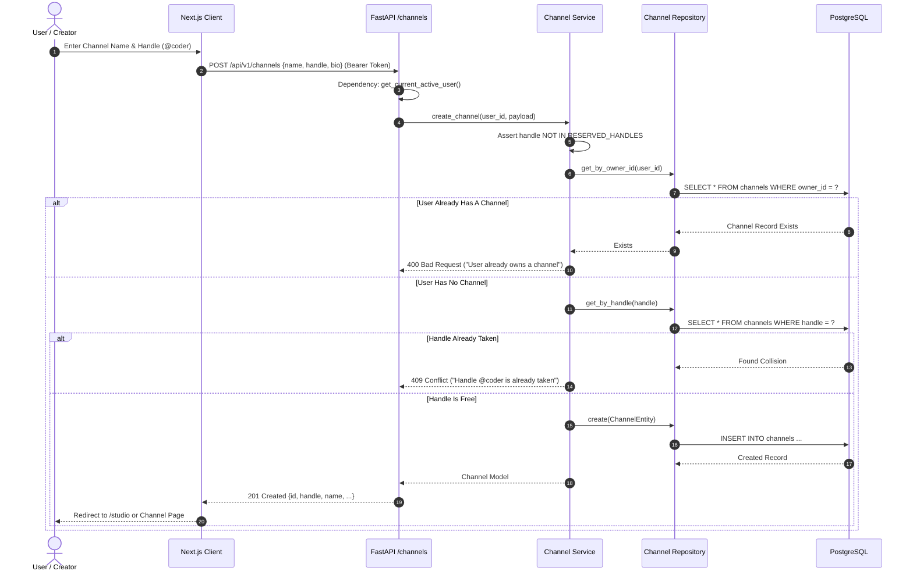
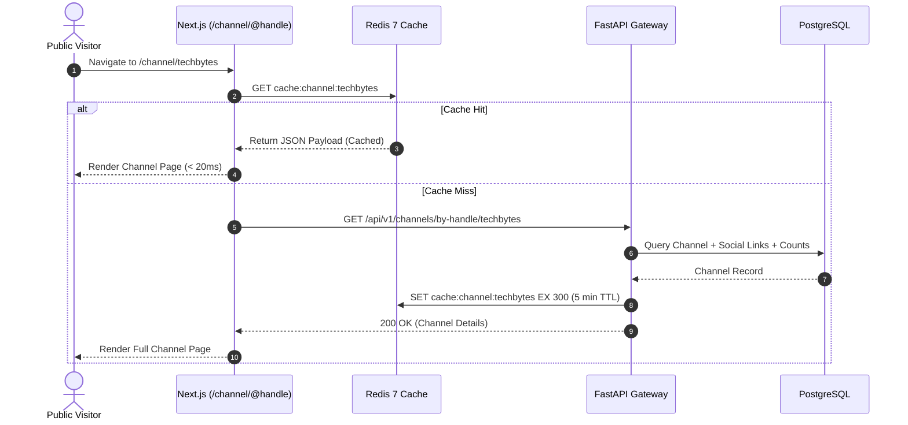
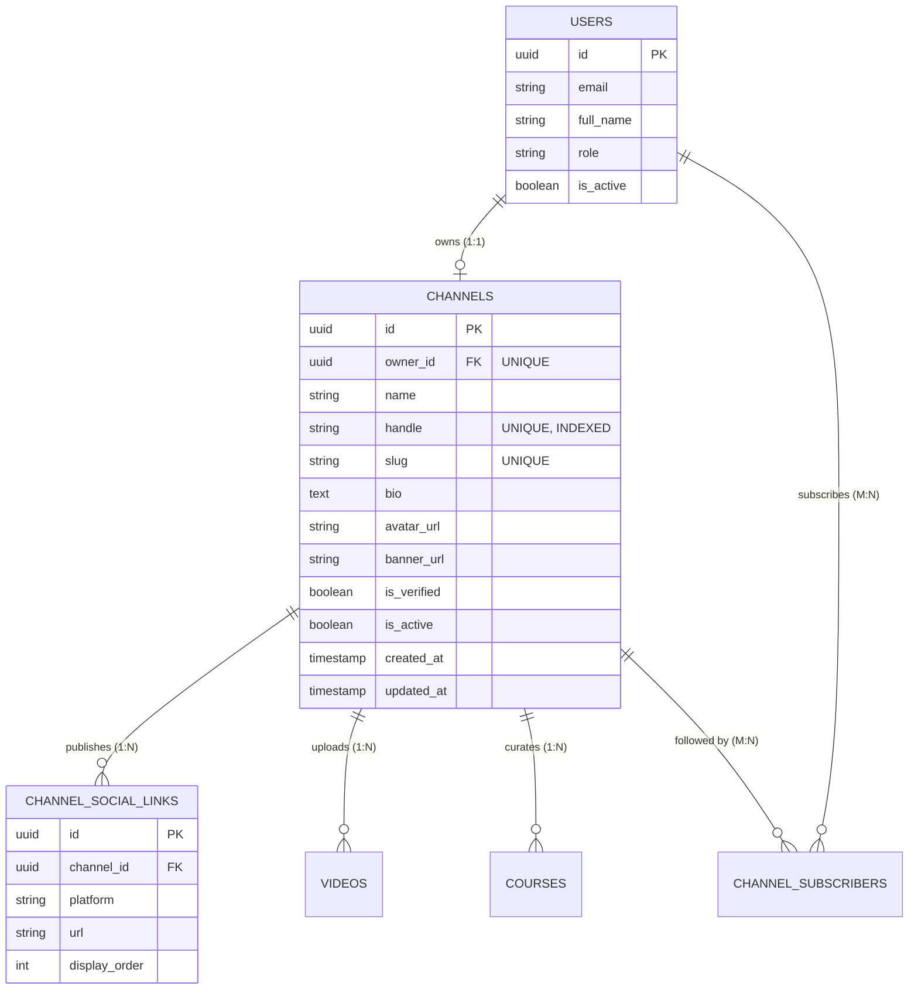
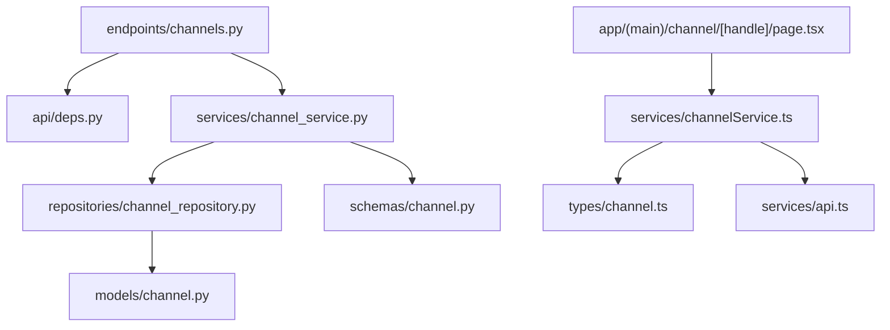

# Feature: Free Channel Management (Base Channel System)

> **Document Type:** System Architecture & Open-Source Implementation Blueprint  
> **Feature Identifier:** Tier 1 — Foundational (Feature 02)  
> **Bounded Context:** Creator Identity, Channel Profiles, Unique Handles, Social Links & Public Showcase  
> **Primary Target:** Open-Source Contributors, System Architects, Full-Stack Engineers  
> **Status:** Architecture Design & Implementation Guidance (Read-Only Blueprint)  

---

## 1. Feature Overview

In **RKSkillTube**, content is not published directly under raw user profiles; instead, it is organized under dedicated **Channels**. The **Free Channel Management (Base Channel System)** is the foundational creator vehicle that bridges general registered learners (`USER`) with content publishing capabilities (`CREATOR`).

A Channel serves as a creator's public homepage and digital brand on the platform, encompassing:
1. **Public Identity & Metadata:** Channel name, global handle (`@handle`), customized slug, avatar, high-resolution banner image, and descriptive bio.
2. **Handle Allocation & URL Structure:** Collision-resistant handle uniqueness (`rkskilltube.com/@handle`) with support for automated fallback slugs.
3. **External Social Showcase:** Verified link showcase for external platforms (GitHub, LinkedIn, YouTube, Twitter/X, personal portfolios) stored with relational integrity.
4. **Creator Studio Entrypoint:** Owning a channel unlocks the creator studio workspace, allowing video uploads, playlist curation, and course curriculum building.

This feature establishes the 1-to-1 ownership bond between a platform user and their primary channel, enforcing role boundaries, unique namespace constraints, and clean presentation models.

---

## 2. Project Architecture Context

RKSkillTube is architected as a high-performance modern web application leveraging **FastAPI** on the backend and **Next.js (App Router)** on the frontend. The channel subsystem integrates into the global architecture as follows:

```
┌────────────────────────────────────────────────────────────────────────┐
│                      CLIENT TIER (Next.js 16+ / TS)                    │
│  • Public Route: frontend/src/app/(main)/channel/[handle]/page.tsx     │
│  • Studio Route: frontend/src/app/(creator)/studio/...                 │
│  • State & Services: channelService.ts, useAuthStore.ts                │
└───────────────────────────────────┬────────────────────────────────────┘
                                    │ HTTPS REST / JSON
                                    ▼
┌────────────────────────────────────────────────────────────────────────┐
│                   API GATEWAY / BACKEND TIER (FastAPI)                 │
│  • Presentation Layer: backend/app/api/v1/endpoints/channels.py        │
│  • Auth & RBAC Dependency: backend/app/api/deps.py                     │
│  • Service Layer: backend/app/services/channel_service.py              │
│  • Repository Layer: backend/app/repositories/channel_repository.py    │
│  • Models & Entities: backend/app/models/channel.py (SQLAlchemy 2.0)   │
└───────────────────┬───────────────────────────────┬────────────────────┘
                    │                               │
                    ▼                               ▼
       ┌─────────────────────────┐     ┌────────────────────────┐
       │   PostgreSQL 16 DB      │     │    Redis 7 Cache       │
       │   • channels            │     │   • Handle-to-ID lookup│
       │   • channel_social_links│     │   • Channel metadata   │
       │   • users               │     │   • View hit counters  │
       └─────────────────────────┘     └────────────────────────┘
```

### Architectural Principles Enforced:
- **Clean Architecture & Separation of Concerns:** Routers only handle HTTP deserialization and validation. Business invariants (handle reserved words, slug generation, 1-to-1 ownership limits) live strictly in the Service layer. Data queries live strictly in the Repository layer.
- **Fail-Safe Identity Federation:** Unauthenticated visitors can view public channel pages. Write operations (`POST /channels`, `PUT /channels/{id}`) strictly require authenticated identity validation and resource ownership checks.

---

## 3. Existing System Analysis

A comprehensive inspection of the repository reveals the following structural footprint:

### Backend Repository Status (`backend/`):
- **Models:** [backend/app/models/channel.py](file:///e:/Projects/Open%20Source%20Contributions/RKSkillTube/backend/app/models/channel.py) is scaffolded as an empty placeholder file.
- **Endpoints:** [backend/app/api/v1/endpoints/channels.py](file:///e:/Projects/Open%20Source%20Contributions/RKSkillTube/backend/app/api/v1/endpoints/channels.py) exists as an empty placeholder file.
- **Router Registry:** [backend/app/api/v1/router.py](file:///e:/Projects/Open%20Source%20Contributions/RKSkillTube/backend/app/api/v1/router.py) is ready to mount the channel router under `/api/v1/channels`.
- **Missing Supporting Components:**
  - `backend/app/schemas/channel.py` does **NOT** exist yet and must be proposed.
  - `backend/app/repositories/channel_repository.py` does **NOT** exist yet and must be proposed.
  - `backend/app/services/channel_service.py` does **NOT** exist yet and must be proposed.

### Frontend Repository Status (`frontend/`):
- **Dynamic Channel Page:** [frontend/src/app/(main)/channel/[handle]/page.tsx](file:///e:/Projects/Open%20Source%20Contributions/RKSkillTube/frontend/src/app/(main)/channel/%5Bhandle%5D/page.tsx) exists as an empty placeholder route.
- **Client Service:** [frontend/src/services/channelService.ts](file:///e:/Projects/Open%20Source%20Contributions/RKSkillTube/frontend/src/services/channelService.ts) exists as an empty placeholder file.
- **Types:** `frontend/src/types/channel.ts` does **NOT** exist yet and must be proposed.

---

## 4. Functional Requirements

### A. Channel Lifecycle & Creation
1. **One-to-One Channel Provisioning:** An authenticated user without an existing channel can create a free channel (`POST /api/v1/channels`).
2. **Handle Reservation & Validation:** Every channel must have a unique `@handle`. Handles must be alphanumeric with underscores/hyphens (regex: `^[a-zA-Z0-9_-]{3,30}$`) and cannot collide with reserved platform namespaces (`admin`, `api`, `settings`, `explore`, `support`, etc.).
3. **Automated Slug Fallback:** If a handle is generated automatically, the system creates a collision-free URL slug derived from the channel name appended with a random alphanumeric suffix.

### B. Channel Customization & Metadata
1. **Branding Assets:** Creators can update their channel name, bio/description, avatar URL, and banner image URL.
2. **Social Links Management:** Creators can configure external profiles (GitHub, LinkedIn, YouTube, X/Twitter, Personal Portfolio). The system validates URL protocols and sanitizes inputs.

### C. Public Consumption
1. **Public Showcase Page:** Anyone (authenticated or guest) can retrieve a channel's public profile by its unique handle (`GET /api/v1/channels/by-handle/{handle}`) or ID (`GET /api/v1/channels/{id}`).
2. **Aggregated Stats (Read-Only):** Returns total published video count, subscriber count, and verified creator status badge.

### D. Administrative & Governance Controls
1. **Channel Verification Badge:** Super-admins can toggle a channel's `is_verified` badge.
2. **Suspension & Takedown:** Super-admins can suspend or soft-delete abusive channels (`is_active = False`), immediately hiding them from public listings.

---

## 5. Non-Functional Requirements

- **Performance & Caching:** Channel public profiles are read-heavy. Cached responses in Redis (keyed by handle: `channel:handle:{handle}`) must yield sub-20ms response times.
- **Namespace Integrity & Race Prevention:** Concurrent requests attempting to claim the same `@handle` must be safely handled via database-level `UNIQUE` constraints and transaction isolation.
- **Security & Authorization:** Strict ownership verification (IDOR prevention) ensuring a user can never mutate or delete another creator's channel.
- **SEO & Server-Side Rendering (SSR):** Next.js App Router dynamic routes must generate dynamic metadata (`generateMetadata`) to optimize OpenGraph social cards and search engine indexability.

---

## 6. Assumptions and Open Questions

### Assumptions:
- In the initial free tier, each registered user is limited to exactly **one** channel (`user_id` has a unique constraint on the `channels` table).
- Image uploads (avatar and banner) are handled via presigned URLs or a dedicated storage service, storing only CDN URL strings in the database entity.

### Open Questions for Contributors & Maintainers:
1. *Handle Mutation Policy:* Can a creator change their `@handle` after creation? If yes, should old handles be redirected or placed on a 30-day quarantine before being released?
2. *Default Channel Creation:* Should a default channel be generated automatically upon user registration, or should channel creation be an explicit, conscious action taken when a user chooses to become a creator? *(Recommendation: Explicit creation upon visiting Studio/Create Channel to maintain clean role segregation).*

---

## 7. Low-Level Design (LLD)

### 7.1 Component Design

```
┌────────────────────────────────────────────────────────────────────────┐
│                        FastAPI PRESENTATION LAYER                      │
│   • endpoints/channels.py                                              │
│       - POST   /api/v1/channels             (Create Channel)           │
│       - GET    /api/v1/channels/by-handle/{h} (Public Profile)         │
│       - GET    /api/v1/channels/me          (Current User's Channel)   │
│       - PUT    /api/v1/channels/{id}        (Update Metadata)          │
│       - POST   /api/v1/channels/{id}/links  (Manage Social Links)      │
└───────────────────────────────────┬────────────────────────────────────┘
                                    │ Injects Dependencies
                                    ▼
┌────────────────────────────────────────────────────────────────────────┐
│                      DEPENDENCY INJECTION & GUARDS                     │
│   • api/deps.py                                                        │
│       - get_current_active_user(): Authenticates caller via JWT        │
│       - require_channel_owner(): Asserts user_id == channel.owner_id   │
└───────────────────────────────────┬────────────────────────────────────┘
                                    │ Invokes Business Logic
                                    ▼
┌────────────────────────────────────────────────────────────────────────┐
│                        SERVICES LAYER (Business Logic)                 │
│   • services/channel_service.py                                        │
│       - create_channel(user_id, channel_in)                            │
│       - validate_and_reserve_handle(handle)                            │
│       - get_channel_by_handle(handle)                                  │
│       - update_channel_profile(user_id, channel_id, update_in)         │
│       - sync_social_links(channel_id, links_in)                        │
└───────────────────────────────────┬────────────────────────────────────┘
                                    │ Executes Database Transactions
                                    ▼
┌────────────────────────────────────────────────────────────────────────┐
│                   REPOSITORIES LAYER (Data Access Abstraction)         │
│   • repositories/channel_repository.py                                 │
│       - get_by_id(channel_id), get_by_handle(handle)                   │
│       - get_by_owner_id(user_id)                                       │
│       - create(channel_entity), update(channel_entity)                 │
│       - upsert_social_links(channel_id, links_list)                    │
└───────────────────────────────────┬────────────────────────────────────┘
                                    │ SQLAlchemy 2.0 ORM
                                    ▼
┌────────────────────────────────────────────────────────────────────────┐
│                           MODELS (Entities)                            │
│   • models/channel.py: Channel, ChannelSocialLink entities             │
└────────────────────────────────────────────────────────────────────────┘
```

### 7.2 Design Patterns Applied
- **Repository Pattern:** Isolates database querying logic, allowing the channel service to be unit-tested without an active PostgreSQL instance.
- **Reserved Word Guard Specification:** A dedicated validator pattern preventing creators from claiming system paths (e.g., `admin`, `api`, `login`, `static`) as handles.
- **DTO / Schema Decoupling:** Pydantic models separate write payloads (`ChannelCreate`, `ChannelUpdate`) from public read representations (`ChannelPublicResponse`).

---

## 8. High-Level Design (HLD)

### Channel Creation & Handle Reservation Flow



### Public Channel Discovery & Caching Flow



---

## 9. Architecture Diagrams

### Entity Relationships & Bounded Contexts



---

## 10. Database Design

### 10.1 `channels` Table
| Column | Type | Constraints | Description |
| :--- | :--- | :--- | :--- |
| `id` | `UUID` | Primary Key, `default=gen_random_uuid()` | Immutable unique channel identifier. |
| `owner_id` | `UUID` | Foreign Key (`users.id` ON DELETE CASCADE), **UNIQUE** | 1-to-1 constraint binding owner to channel. |
| `name` | `VARCHAR(100)` | Not Null | Display name of the channel. |
| `handle` | `VARCHAR(30)` | **Unique, Indexed**, Not Null | Public unique handle (e.g., `code_with_rk`). Stored without `@`. |
| `slug` | `VARCHAR(120)` | **Unique, Indexed**, Not Null | URL-safe slug fallback. |
| `bio` | `TEXT` | Nullable | Markdown or plain text channel summary. |
| `avatar_url` | `VARCHAR(500)` | Nullable | CDN URL for channel profile photo. |
| `banner_url` | `VARCHAR(500)` | Nullable | CDN URL for wide channel header banner. |
| `is_verified` | `BOOLEAN` | Not Null, Default `FALSE` | Official creator verification badge. |
| `is_active` | `BOOLEAN` | Not Null, Default `TRUE` | Administrative status flag (false = suspended). |
| `created_at` | `TIMESTAMPTZ` | Not Null, Default `NOW()` | Timestamp of creation. |
| `updated_at` | `TIMESTAMPTZ` | Not Null, Auto-update `NOW()` | Timestamp of last modification. |

### 10.2 `channel_social_links` Table
| Column | Type | Constraints | Description |
| :--- | :--- | :--- | :--- |
| `id` | `UUID` | Primary Key, `default=gen_random_uuid()` | Unique record ID. |
| `channel_id` | `UUID` | Foreign Key (`channels.id` ON DELETE CASCADE), Indexed | Owning channel reference. |
| `platform` | `VARCHAR(30)` | Not Null | Name of service (`github`, `linkedin`, `youtube`, `x`, `website`). |
| `url` | `VARCHAR(500)` | Not Null | Fully qualified URL (`https://...`). |
| `display_order`| `INTEGER` | Not Null, Default `0` | Order of appearance on channel header. |

---

## 11. API Design

### Public Endpoints (No Auth Required)
- **`GET /api/v1/channels/by-handle/{handle}`**
  - *Purpose:* Fetch full channel public profile by its `@handle`.
  - *Path Param:* `handle` (string, e.g. `coder_pro`).
  - *Response (200 OK):*
    ```json
    {
      "id": "e4b5...",
      "name": "Coder Pro",
      "handle": "coder_pro",
      "bio": "High quality computer science lectures.",
      "avatar_url": "https://cdn.example.com/avatars/c1.jpg",
      "banner_url": "https://cdn.example.com/banners/b1.jpg",
      "is_verified": true,
      "social_links": [
        { "platform": "github", "url": "https://github.com/coderpro", "display_order": 1 }
      ],
      "stats": {
        "subscriber_count": 1420,
        "video_count": 38
      }
    }
    ```
  - *Error Scenarios:* `404 Not Found` if handle does not exist or channel is suspended.

- **`GET /api/v1/channels/{id}`**
  - *Purpose:* Retrieve channel profile by unique UUID.

### Protected Endpoints (Requires Bearer Token)
- **`POST /api/v1/channels`**
  - *Purpose:* Create the authenticated user's base channel.
  - *Request Body:*
    ```json
    {
      "name": "Dev Stream",
      "handle": "devstream",
      "bio": "Live system design coding."
    }
    ```
  - *Validation Rules:* `handle` must be 3–30 characters, alphanumeric with underscores/hyphens. Cannot match reserved words.
  - *Response (201 Created):* Returns newly created channel record.
  - *Errors:* `400 Bad Request` (user already owns a channel), `409 Conflict` (handle taken).

- **`GET /api/v1/channels/me`**
  - *Purpose:* Get the calling user's owned channel for Studio management.
  - *Errors:* `404 Not Found` if user has not yet created a channel.

- **`PUT /api/v1/channels/{id}`**
  - *Purpose:* Update channel display name, bio, avatar, or banner.
  - *Authorization:* Caller must be the channel `owner_id` or an `ADMIN`.

- **`PUT /api/v1/channels/{id}/social-links`**
  - *Purpose:* Atomically replace/synchronize the channel's social links array.
  - *Request Body:*
    ```json
    {
      "links": [
        { "platform": "github", "url": "https://github.com/...", "display_order": 1 },
        { "platform": "linkedin", "url": "https://linkedin.com/in/...", "display_order": 2 }
      ]
    }
    ```

---

## 12. Security Analysis

### 12.0 Cryptographic Hashing Standards & Security Warnings
> [!CAUTION]
> **Cryptographic Integrity & Legacy Hashing (MD5 Analysis):**
> - **MD5 is cryptographically obsolete.** MD5 is vulnerable to collision attacks and must **never** be used for password hashing, session tokens, or sensitive identification keys.
> - **Slug & Token Generation:** When generating unique channel random suffixes or fallback slugs, contributors must use cryptographically secure entropy sources such as Python's `secrets.token_urlsafe()` or standard UUIDv4, rather than hashing timestamps with MD5.
> - **URL Sanitization:** Social link URLs must be strictly checked to prevent JavaScript execution payloads (e.g., rejecting `javascript:` URIs).

### 12.1 Security Levels: Insecure to Production-Grade

| Level | Architecture Approach | Vulnerabilities & Pitfalls | Production Remediation |
| :--- | :--- | :--- | :--- |
| **Level 1 (Insecure)** | **Raw Client-Supplied IDs Without Verification** | • **IDOR Vulnerability:** Any user can send `PUT /channels/{any_id}` and edit any other creator's channel.<br>• **Handle Hijacking:** Malicious users claim system routes (e.g. `@admin`, `@login`, `@api`). | Never trust the client payload for identity. Always resolve owner context via server-verified JWT claims. |
| **Level 2 (Improved)** | **Basic Owner ID Comparison** | • Prevents IDOR by asserting `user.id == channel.owner_id`.<br>• Still vulnerable to XSS in channel bio and Stored XSS via malicious social link schemas. | Add HTML sanitization on bio text and schema-level regex validation for social links. |
| **Level 3 (Production Ready)** | **Owner Guards + Reserved Word Blacklist + ACID Transactions** | • Reserved word dictionary prevents route conflicts.<br>• Database-level unique constraints eliminate handle-claim race conditions.<br>• Social links validate strict `https://` schemas. | Standard for RKSkillTube production deployment. |
| **Level 4 (Advanced)** | **Rate-Limited Claims + Handle Quarantine + CDN Edge Cache Shield** | • Handle reservation requires rate limiting to stop handle squatting bots.<br>• Deleted/renamed handles enter a 30-day quarantine before being made available again. | Enterprise-grade creator namespace protection. |

### 12.2 Critical Attack Vectors & Mitigations
- **BOLA / IDOR (Broken Object Level Authorization):** Ensure every mutating route uses a FastAPI dependency (`require_channel_owner`) that checks the database record's `owner_id` against `current_user.id`.
- **Stored XSS:** The channel bio allows rich text/markdown. Content must be sanitized on the backend and rendered safely on the frontend (e.g., using `DOMPurify` or safe React markdown components without `dangerouslySetInnerHTML`).
- **Route Hijacking (Namespace Collision):** The frontend serves channels at `rkskilltube.com/@handle`. If a creator registers handle `@settings` or `@admin`, it would shadow core frontend routes. A comprehensive list of reserved keywords must be enforced.

---

## 13. Existing Files Analysis

### A. Directly Reusable Files
- [backend/app/api/deps.py](file:///e:/Projects/Open%20Source%20Contributions/RKSkillTube/backend/app/api/deps.py): Reuses `get_current_active_user` to authenticate creators.
- [backend/app/core/exceptions.py](file:///e:/Projects/Open%20Source%20Contributions/RKSkillTube/backend/app/core/exceptions.py): Reuses standard exceptions (`NotFoundException`, `ForbiddenException`).
- [frontend/src/store/useAuthStore.ts](file:///e:/Projects/Open%20Source%20Contributions/RKSkillTube/frontend/src/store/useAuthStore.ts): Injects current authenticated user into the UI header.
- [frontend/src/services/api.ts](file:///e:/Projects/Open%20Source%20Contributions/RKSkillTube/frontend/src/services/api.ts): Base Axios client with authorization headers.

### B. Files That Need Implementation / Modification
- [backend/app/models/channel.py](file:///e:/Projects/Open%20Source%20Contributions/RKSkillTube/backend/app/models/channel.py): Define SQLAlchemy models `Channel` and `ChannelSocialLink`.
- [backend/app/api/v1/endpoints/channels.py](file:///e:/Projects/Open%20Source%20Contributions/RKSkillTube/backend/app/api/v1/endpoints/channels.py): Implement router endpoints.
- [backend/app/api/v1/router.py](file:///e:/Projects/Open%20Source%20Contributions/RKSkillTube/backend/app/api/v1/router.py): Include `channels.router` into the v1 master router.
- [frontend/src/services/channelService.ts](file:///e:/Projects/Open%20Source%20Contributions/RKSkillTube/frontend/src/services/channelService.ts): Implement API communication methods.
- [frontend/src/app/(main)/channel/[handle]/page.tsx](file:///e:/Projects/Open%20Source%20Contributions/RKSkillTube/frontend/src/app/(main)/channel/%5Bhandle%5D/page.tsx): Implement the public channel view.

### C. Proposed New Files Required
- `backend/app/schemas/channel.py`: Pydantic request/response schemas (`ChannelCreate`, `ChannelUpdate`, `ChannelResponse`, `SocialLinkCreate`).
- `backend/app/repositories/channel_repository.py`: Repository handling channel queries and transactional upserts.
- `backend/app/services/channel_service.py`: Business logic (handle sanitization, reserved word check, 1-to-1 constraint).
- `frontend/src/types/channel.ts`: TypeScript interfaces mirroring backend DTOs.
- `frontend/src/components/channel/ChannelHeader.tsx`: Reusable banner, avatar, handle, and subscribe button component.
- `frontend/src/components/channel/SocialLinksList.tsx`: Social link badge icons component.

### D. Files That Should NOT Be Modified
- `backend/app/models/user.py`: User model defines users; foreign keys should link *to* users, not create circular dependencies.
- `backend/app/models/video.py`, `course.py`: Video and Course models reference `channel_id`, but their core entities should remain untouched during base channel implementation.

### E. Architectural Dependency Map



---

## 14. Implementation Roadmap (Milestones)

### Milestone 1: Data Modeling & Schema Definitions
- **Goal:** Establish database tables and validation schemas.
- **Inspect:** [backend/app/models/base.py](file:///e:/Projects/Open%20Source%20Contributions/RKSkillTube/backend/app/models/base.py), `backend/app/models/user.py`.
- **Implement In:** `backend/app/models/channel.py`, `backend/app/schemas/channel.py`.
- **Architectural Hint:** Add a `UniqueConstraint('handle', name='uq_channels_handle')` and `UniqueConstraint('owner_id', name='uq_channels_owner')`.
- **Testing:** Verify schema validation handles uppercase input normalization (e.g. `@CodeMaster` $\rightarrow$ `codemaster`).

### Milestone 2: Repository Data Access Layer
- **Goal:** Implement database queries with relationship loading.
- **Implement In:** `backend/app/repositories/channel_repository.py`.
- **Architectural Hint:** Use SQLAlchemy `selectinload(Channel.social_links)` to prevent N+1 query performance degradation when loading public profiles.

### Milestone 3: Business Logic & Handle Validation Service
- **Goal:** Implement channel creation rules and handle safety checks.
- **Implement In:** `backend/app/services/channel_service.py`.
- **Architectural Hint:** Define a static `RESERVED_HANDLES = {"admin", "api", "auth", "settings", "explore", "trending", "studio"}` and reject any matching handle during registration.

### Milestone 4: FastAPI Routers & Ownership Verification
- **Goal:** Expose public and authenticated endpoints.
- **Implement In:** `backend/app/api/v1/endpoints/channels.py`, `backend/app/api/deps.py`.
- **Architectural Hint:** Create a reusable FastAPI dependency `check_channel_ownership(channel_id, current_user)` that queries the channel and raises `HTTP_403_FORBIDDEN` if the caller is not the owner.

### Milestone 5: Frontend API Service & TypeScript Contracts
- **Goal:** Integrate frontend HTTP layer.
- **Implement In:** `frontend/src/types/channel.ts`, `frontend/src/services/channelService.ts`.
- **Architectural Hint:** Include a method `getChannelByHandle(handle: string)` and handle `404` errors by rendering the Next.js `notFound()` component.

### Milestone 6: Public Channel Presentation & Customization UI
- **Goal:** Render the responsive channel profile page.
- **Implement In:** `frontend/src/app/(main)/channel/[handle]/page.tsx`.
- **Architectural Hint:** Structure tabs for "Videos", "Playlists", "Courses", and "About".

---

## 15. Hints and Socratic Engineering Questions

1. *Why is it critical to enforce unique constraints on `handle` at the database level rather than solely relying on an `if exists` check in the service layer?*
2. *If a creator enters the handle `@john_doe` on the frontend, should the database store `@john_doe` or `john_doe`? How does this choice affect URL routing and search queries?*
3. *What happens to a channel's videos and social links if a user deletes their account? How should cascading deletes (`ON DELETE CASCADE`) be configured?*
4. *How does Next.js `generateMetadata` benefit SEO when fetching public channel data by handle on the server?*

---

## 16. Testing Strategy

### A. Unit Tests (`backend/tests/unit/test_channel_service.py`)
- Handle validation rejects handles containing spaces or special characters (`#`, `$`, `!`).
- Handle validation blocks reserved platform words.
- Unique slug generation handles collisions by appending random entropy.

### B. Integration Tests (`backend/tests/integration/test_channels_api.py`)
- `POST /channels`: Authenticated user successfully creates their channel.
- `POST /channels`: Second creation attempt by the same user returns `400 Bad Request`.
- `POST /channels`: Duplicate handle returns `409 Conflict`.
- `GET /channels/by-handle/{handle}`: Public caller retrieves full channel and social link profile.
- `GET /channels/by-handle/{non_existent}`: Returns `404 Not Found`.

### C. Security & Authorization Tests (`backend/tests/integration/test_channel_security.py`)
- User B attempting to `PUT /channels/{user_a_channel_id}` receives `403 Forbidden`.
- Super-admin calling `PUT /channels/{user_a_channel_id}` succeeds (admin privilege).
- Social links rejecting `javascript:` and non-HTTP protocols.

---

## 17. Engineering Trade-offs

| Architectural Decision | Option A | Option B | Selected Choice & Rationale |
| :--- | :--- | :--- | :--- |
| **Channel Ownership** | Multiple channels per user account | Exactly 1 channel per user account | **Option B (1-to-1):** Keeps data structures simple and predictable for Tier 1. Multi-channel support can be introduced later via a join table if enterprise needs arise. |
| **Social Links Storage** | Store as JSONB array inside `channels` table | Dedicated normalized table `channel_social_links` | **Option B (Normalized Table):** Allows relational integrity, strict column typing, and straightforward foreign key cascading. |
| **Handle Casing** | Case-sensitive (`@Alice` != `@alice`) | Case-insensitive normalized lowercase | **Option B (Lowercase):** Prevents user impersonation and duplicate confusion on web URLs. |

---

## 18. Learning Resources

1. **FastAPI & Clean Architecture:**
   - [FastAPI Dependency Injection Tutorial](https://fastapi.tiangolo.com/tutorial/dependencies/) — Declarative resource ownership and security checks.
   - [SQLAlchemy 2.0 Relationship Loading Techniques](https://docs.sqlalchemy.org/en/20/orm/loading_relationships.html) — Preventing N+1 queries using `selectinload`.
2. **Next.js & Frontend Architecture:**
   - [Next.js Dynamic Routes & Metadata](https://nextjs.org/docs/app/building-your-application/routing/dynamic-routes) — Handling `[handle]` parameters and dynamic OpenGraph tags.
   - [Lucide Icons React](https://lucide.dev/guide/packages/lucide-react) — Standard icons for social platform links.
3. **Security Standards:**
   - [OWASP Broken Object Level Authorization (BOLA)](https://owasp.org/API-Security/editions/2023/en/0xa1-broken-object-level-authorization/) — IDOR prevention guidelines.
   - [RFC 3986: Uniform Resource Identifier (URI) Generic Syntax](https://www.ietf.org/rfc/rfc3986.txt) — Handle and slug standard characters.

---

## 19. Acceptance Criteria (Definition of Done)

- [ ] Database migration successfully creates `channels` and `channel_social_links` tables with unique indexes.
- [ ] Authenticated users can create exactly one channel via `POST /api/v1/channels`.
- [ ] Duplicate handle registrations return `409 Conflict`.
- [ ] Reserved platform words (`admin`, `api`, etc.) cannot be claimed as handles.
- [ ] Public users can query channels by handle (`GET /api/v1/channels/by-handle/{handle}`).
- [ ] Channel owners can update metadata and manage external social links.
- [ ] Non-owners attempting to edit a channel receive `403 Forbidden`.
- [ ] Dynamic frontend route `/channel/[handle]` renders banner, avatar, metadata, and social links.
- [ ] Integration tests achieve $\ge 85\%$ test coverage across all channel operations.

---

## 20. Contributor Pull Request Checklist

Before submitting a PR for this feature:
- [ ] I have strictly followed the Layered Architecture (Router $\rightarrow$ Service $\rightarrow$ Repository $\rightarrow$ Model).
- [ ] I have written Pydantic validation schemas with regex handle validation.
- [ ] I have verified that handle uniqueness is enforced at both the database level and the application layer.
- [ ] I have included Alembic migrations under `backend/app/alembic/versions/`.
- [ ] I have covered edge cases (reserved words, handle collision, unauthorized edits) in test suites.
- [ ] I have not committed any hardcoded credentials or mock storage URLs.

---

## 21. Final Architecture Recommendations & Document Checksum

### Architectural Recommendations:
1. **Handle Normalization:** Always normalize handles to lowercase (`handle.lower().strip()`) before writing to the database or checking uniqueness.
2. **Handle-to-ID Redis Cache:** Implement a simple key-value cache `SET channel:handle:{handle} {channel_id}` with a 10-minute TTL to accelerate public lookups.
3. **Graceful Handle Renames:** If a handle rename feature is added in the future, reserve the old handle for 30 days to avoid broken links and impersonation attacks.

### Document Integrity Checksum:
- **Specification File:** `Feature Based Guide/02-Free-Channel-Management-(Base-Channel-System).md`
- **MD5 Checksum:** `8C10745EF9E15A5654DF6327775593FB`
- **SHA-256 Checksum:** `73986D6F6088ABF904ED7F0378825F8875881BE699514A49A72824897D613AE6`
- **Verification Command (PowerShell):**
  ```powershell
  Get-FileHash -Path "Feature Based Guide\02-Free-Channel-Management-(Base-Channel-System).md" -Algorithm MD5
  ```
