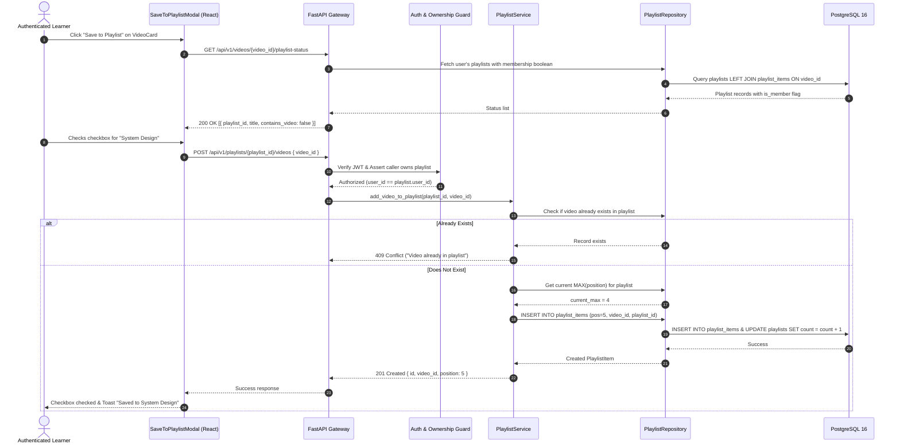
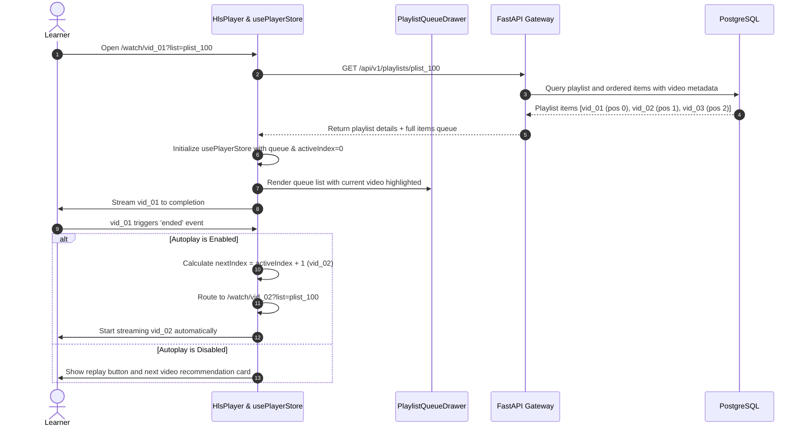
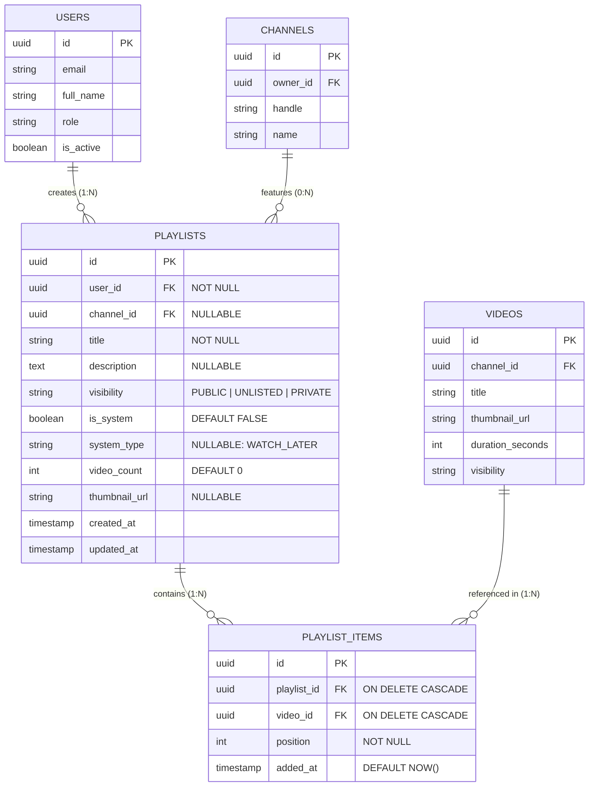
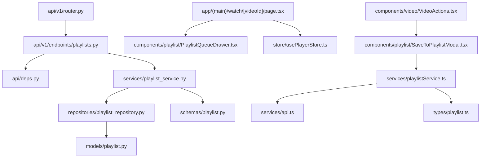

# Feature: Playlists & "Watch Later" Queue

> **Document Type:** System Architecture & Open-Source Implementation Blueprint  
> **Feature Identifier:** Tier 1 — Foundational (Feature 03)  
> **Bounded Context:** Content Organization, Personal Media Queues, Sequenced Playback & Library Management  
> **Primary Target:** Open-Source Contributors, System Architects, Full-Stack Engineers  
> **Status:** Architecture Design & Implementation Guidance (Read-Only Blueprint)  

---

## 1. Feature Overview

In **RKSkillTube**, content consumption is organized around personalized curation and sequential video playback. The **Playlists & "Watch Later" Queue** module provides learners and creators with the mechanisms to collect, categorize, sequence, and continuously stream video content across the platform.

This subsystem encompasses two distinct yet tightly integrated workflows:
1. **User-Created Custom Playlists:** Arbitrary collections of videos created by any authenticated user or creator (e.g., *"Full-Stack Python Roadmap"*, *"System Design Masterclass"*). Playlists support metadata customization (title, description), privacy visibility levels (`PUBLIC`, `UNLISTED`, `PRIVATE`), and dynamic drag-and-drop or index-based sequence reordering.
2. **Dedicated "Watch Later" System Queue:** A persistent, 1-click personal queue provisioned automatically for every registered user. It allows learners to bookmark videos from anywhere across the platform (feed, search results, channel pages, or the video player actions bar) and consume them sequentially in an uninterrupted playback session.

### Core Objectives for Contributors:
- Design a normalized relational data model for playlists and ordered playlist items.
- Ensure strict multi-tenant authorization so that users can only mutate their own playlists, while permitting public and unlisted sharing.
- Enable deterministic, low-overhead item reordering that avoids race conditions and index corruption.
- Provide high-performance query access for checking whether a specific video is already saved to a user's Watch Later queue or custom playlists.
- Integrate seamless continuous playback state on the frontend video player (queue tracking, next/previous navigation, and autoplay toggling).

---

## 2. Project Architecture Context

RKSkillTube follows a clean, decoupled client-server architecture built on **FastAPI** (Python 3.11+) and **Next.js 16+** (React 19 App Router with TypeScript):

```
┌────────────────────────────────────────────────────────────────────────┐
│                      CLIENT TIER (Next.js 16+ / TS)                    │
│  • Public Playlist View: app/(main)/playlist/[playlistId]/page.tsx     │
│  • Watch Later Queue:   app/(main)/feed/watch-later/page.tsx           │
│  • Player Queue Drawer: components/playlist/PlaylistQueueDrawer.tsx    │
│  • Save Modal:          components/playlist/SaveToPlaylistModal.tsx    │
│  • State Stores:        usePlaylistStore.ts, usePlayerStore.ts         │
└───────────────────────────────────┬────────────────────────────────────┘
                                    │ HTTPS REST JSON
                                    ▼
┌────────────────────────────────────────────────────────────────────────┐
│                   API GATEWAY / BACKEND TIER (FastAPI)                 │
│  • Presentation Layer: app/api/v1/endpoints/playlists.py               │
│  • Auth & Identity:    app/api/deps.py (get_current_active_user)       │
│  • Business Logic:     app/services/playlist_service.py                │
│  • Data Access Layer:  app/repositories/playlist_repository.py         │
│  • Persistence Models: app/models/playlist.py (SQLAlchemy 2.0 Async)   │
└───────────────────┬───────────────────────────────┬────────────────────┘
                    │                               │
                    ▼                               ▼
       ┌─────────────────────────┐     ┌────────────────────────┐
       │    PostgreSQL 16 DB     │     │     Redis 7 Cache      │
       │   • playlists           │     │   • User queue cache   │
       │   • playlist_items      │     │   • Playlist metadata  │
       │   • videos / users      │     │   • Fast membership set│
       └─────────────────────────┘     └────────────────────────┘
```

### Architectural Principles Enforced:
- **Clean Layered Architecture:** Routers accept Pydantic models, validate route permissions, and delegate directly to the `PlaylistService`. The service coordinates domain rules (ordering constraints, duplicate checks, privacy rules), while `PlaylistRepository` performs async SQLAlchemy queries.
- **Stateless Authorization with Granular Bounded Contexts:** Public playlists are cacheable and viewable by anonymous guests. Private playlists strictly verify ownership against the calling user's JWT claims. System playlists (`WATCH_LATER`) cannot be deleted or renamed.

---

## 3. Existing System Analysis

A physical inspection of the RKSkillTube repository shows the existing scaffolding relevant to playlists and media queues:

### Backend Codebase Reality (`backend/`):
- **Core Models:**
  - [backend/app/models/base.py](file:///e:/Projects/Open%20Source%20Contributions/RKSkillTube/backend/app/models/base.py): Base declarative SQLAlchemy model (empty placeholder).
  - [backend/app/models/user.py](file:///e:/Projects/Open%20Source%20Contributions/RKSkillTube/backend/app/models/user.py): User entity placeholder.
  - [backend/app/models/video.py](file:///e:/Projects/Open%20Source%20Contributions/RKSkillTube/backend/app/models/video.py): Video entity placeholder.
  - `backend/app/models/playlist.py`: **Does not exist yet.** Must be created to define `Playlist` and `PlaylistItem`.
- **API Endpoints:**
  - [backend/app/api/v1/endpoints/videos.py](file:///e:/Projects/Open%20Source%20Contributions/RKSkillTube/backend/app/api/v1/endpoints/videos.py): Video endpoint placeholder.
  - [backend/app/api/v1/endpoints/users.py](file:///e:/Projects/Open%20Source%20Contributions/RKSkillTube/backend/app/api/v1/endpoints/users.py): User endpoint placeholder.
  - [backend/app/api/v1/router.py](file:///e:/Projects/Open%20Source%20Contributions/RKSkillTube/backend/app/api/v1/router.py): Master router where `playlists.router` must be mounted.
  - `backend/app/api/v1/endpoints/playlists.py`: **Does not exist yet.** Must be created.
- **Repositories & Services:**
  - [backend/app/repositories/video_repository.py](file:///e:/Projects/Open%20Source%20Contributions/RKSkillTube/backend/app/repositories/video_repository.py): Video data access placeholder.
  - `backend/app/repositories/playlist_repository.py`: **Does not exist yet.** Must be created.
  - `backend/app/services/playlist_service.py`: **Does not exist yet.** Must be created.
  - `backend/app/schemas/playlist.py`: **Does not exist yet.** Must be created.

### Frontend Codebase Reality (`frontend/`):
- **Player & Actions Components:**
  - [frontend/src/components/video/VideoActions.tsx](file:///e:/Projects/Open%20Source%20Contributions/RKSkillTube/frontend/src/components/video/VideoActions.tsx): Placeholder for action triggers (Like, Dislike, Share, Save to Playlist / Watch Later).
  - [frontend/src/components/video/VideoCard.tsx](file:///e:/Projects/Open%20Source%20Contributions/RKSkillTube/frontend/src/components/video/VideoCard.tsx): Placeholder for video cards displaying thumbnail, title, and quick "Watch Later" hover icon.
  - [frontend/src/components/video/HlsPlayer.tsx](file:///e:/Projects/Open%20Source%20Contributions/RKSkillTube/frontend/src/components/video/HlsPlayer.tsx): HLS video playback component.
- **Store & Services:**
  - [frontend/src/store/usePlayerStore.ts](file:///e:/Projects/Open%20Source%20Contributions/RKSkillTube/frontend/src/store/usePlayerStore.ts): Player store placeholder; needs queue management extensions (current index, autoplay next, loop/shuffle).
  - [frontend/src/services/api.ts](file:///e:/Projects/Open%20Source%20Contributions/RKSkillTube/frontend/src/services/api.ts): Base Axios client with authorization interceptors.
  - `frontend/src/services/playlistService.ts`: **Does not exist yet.** Must be created.
  - `frontend/src/store/usePlaylistStore.ts`: **Does not exist yet.** Must be created.
  - `frontend/src/types/playlist.ts`: **Does not exist yet.** Must be created.

---

## 4. Functional Requirements

### A. Custom Playlists Management
1. **Creation:** Authenticated users can create playlists with a `title` (required), optional `description`, and a visibility setting (`PUBLIC`, `UNLISTED`, `PRIVATE`).
2. **Read & Discovery:**
   - Anyone can view `PUBLIC` playlists.
   - Anyone with the link or token can view `UNLISTED` playlists.
   - Only the owner (or super-admin) can view `PRIVATE` playlists.
3. **Updating Metadata:** Playlist owners can update title, description, visibility, and thumbnail overrides.
4. **Deletion:** Owners can delete custom playlists. Deleting a playlist must automatically clean up all associated items without deleting the actual videos.

### B. Playlist Items & Ordering
1. **Adding Videos:** Users can add any public video to their playlists. A video cannot be added twice to the same playlist (idempotent addition or explicit 409 conflict).
2. **Removing Videos:** Users can remove individual videos from their playlists.
3. **Sequence Reordering:** Playlist owners can reorder items. The reordering API must accept an updated ordered list of item IDs or explicit source-to-target repositioning commands.
4. **Dynamic Item Counts & Thumbnails:** The playlist entity reflects the total item count and dynamically displays the thumbnail of the first video in the sequence (or a custom selected cover).

### C. Dedicated "Watch Later" Queue
1. **Automatic Provisioning:** Every user gets a single, private "Watch Later" system playlist upon registration or on their first "Watch Later" interaction.
2. **One-Click Toggle:** Users can instantly add or remove a video from Watch Later using a quick toggle button on video cards or the player toolbar (`POST/DELETE /api/v1/users/me/watch-later/{video_id}`).
3. **Dedicated Queue View:** Users can access `/feed/watch-later` to view their queue, sort by added date, clear watched items, or start continuous playback.
4. **Immutability of System Attributes:** The Watch Later playlist cannot be deleted, renamed, or made public.

### D. Playback Integration & Continuous Streaming
1. **Playlist Player Mode:** Navigating to `/watch/[videoId]?list=[playlistId]` opens the video player with an active playlist sidebar/drawer.
2. **Next/Previous Navigation:** Seamlessly jump to the next or previous video in the playlist order.
3. **Continuous Autoplay:** When the current video ends, the player automatically transitions to the next video in sequence if autoplay is enabled.

---

## 5. Non-Functional Requirements

- **Sub-50ms Response Times:** Playlist read endpoints must respond under 50ms for normal page loads. Hot public playlists should be cached in Redis with cache invalidation on item addition/removal.
- **Relational Integrity & ACID Transactions:** Reordering playlist items or deleting playlists must occur within atomic database transactions to prevent orphaned items or gaps in position indexes.
- **Optimized Membership Lookups:** The "Save to Playlist" modal needs to know which of the user's playlists currently contain a given video. This must be resolved in a single efficient query using a `LEFT JOIN` or subquery rather than $N$ separate queries.
- **Scalability:** The data model must support playlists with hundreds of videos without degrading player loading performance (support cursor- or offset-based pagination).
- **Graceful Deletion Handling:** If a video is deleted from the platform, foreign key cascading (`ON DELETE CASCADE`) or soft-delete filtering must remove it from all playlists automatically.

---

## 6. Assumptions and Open Questions

### Assumptions:
- In Tier 1, each user can create up to 100 custom playlists, and each playlist can contain up to 500 videos.
- Video visibility overrides playlist visibility: if a video is `PRIVATE`, unauthorized users cannot stream it even if it is placed inside a `PUBLIC` playlist.
- Watch Later is implemented as a specialized system playlist (`is_system = True, system_type = 'WATCH_LATER'`) under the unified `playlists` schema, avoiding table fragmentation while reusing ordering and playback logic.

### Open Questions for Contributors & Maintainers:
1. *Position Indexing Strategy:* Should item positions use zero-indexed integers (`0, 1, 2, ...`) requiring transactional updates on shift, or fractional indexing (floating-point ranks / Lexorank) to allow insertions without updating subsequent items? *(Recommendation: Start with integer indexing inside a transaction for simplicity; migrate to Lexorank if high-frequency collaborative reordering is introduced in later phases).*
2. *Creator Channel Playlists:* Should a playlist belong directly to a `user_id`, or optionally to a `channel_id`? *(Recommendation: Include an optional `channel_id` foreign key. If set, the playlist can be showcased on the creator's public channel page under the "Playlists" tab).*

---

## 7. Low-Level Design (LLD)

### 7.1 Component Design

```
┌────────────────────────────────────────────────────────────────────────┐
│                        FastAPI PRESENTATION LAYER                      │
│   • endpoints/playlists.py                                             │
│       - POST   /api/v1/playlists                 (Create Playlist)     │
│       - GET    /api/v1/playlists/{id}            (Get Playlist Details)│
│       - PUT    /api/v1/playlists/{id}            (Update Metadata)     │
│       - DELETE /api/v1/playlists/{id}            (Delete Playlist)     │
│       - POST   /api/v1/playlists/{id}/videos     (Add Video)           │
│       - DELETE /api/v1/playlists/{id}/videos/{v} (Remove Video)        │
│       - PUT    /api/v1/playlists/{id}/reorder    (Reorder Items)       │
│       - GET    /api/v1/users/me/playlists        (User's Playlists)    │
│       - GET    /api/v1/users/me/watch-later      (Get Watch Later)     │
│       - POST   /api/v1/users/me/watch-later/{v}  (Add to Watch Later)  │
│       - DELETE /api/v1/users/me/watch-later/{v}  (Remove from WL)      │
│       - GET    /api/v1/videos/{v}/playlist-status (Membership Check)   │
└───────────────────────────────────┬────────────────────────────────────┘
                                    │ Injects Dependencies
                                    ▼
┌────────────────────────────────────────────────────────────────────────┐
│                      DEPENDENCY INJECTION & GUARDS                     │
│   • api/deps.py                                                        │
│       - get_current_active_user(): Authenticates caller via JWT        │
│       - get_optional_current_user(): Permissive auth for public views  │
└───────────────────────────────────┬────────────────────────────────────┘
                                    │ Invokes Business Logic
                                    ▼
┌────────────────────────────────────────────────────────────────────────┐
│                        SERVICES LAYER (Business Logic)                 │
│   • services/playlist_service.py                                       │
│       - create_playlist(user_id, data)                                 │
│       - get_playlist_with_items(playlist_id, viewer_id)                │
│       - add_video_to_playlist(playlist_id, video_id, user_id)          │
│       - remove_video_from_playlist(playlist_id, video_id, user_id)     │
│       - reorder_playlist_items(playlist_id, user_id, item_order)       │
│       - get_or_create_watch_later(user_id)                             │
│       - toggle_watch_later(user_id, video_id)                          │
└───────────────────────────────────┬────────────────────────────────────┘
                                    │ Database Interactions
                                    ▼
┌────────────────────────────────────────────────────────────────────────┐
│                     REPOSITORY LAYER (Data Access)                     │
│   • repositories/playlist_repository.py                                │
│       - CRUD operations on `playlists` and `playlist_items`            │
│       - Atomic position shifting and bulk reordering                   │
│       - Eager loading video relationships (`selectinload`)             │
└───────────────────────────────────┬────────────────────────────────────┘
                                    │ Executes SQL
                                    ▼
┌────────────────────────────────────────────────────────────────────────┐
│                     DATABASE PERSISTENCE (PostgreSQL)                  │
│   • models/playlist.py -> tables: playlists, playlist_items            │
└────────────────────────────────────────────────────────────────────────┘
```

### 7.2 Sequence Diagram: Adding a Video to a Playlist



### 7.3 Sequence Diagram: Continuous Playlist Playback



---

## 8. High-Level Design (HLD)

### 8.1 System Context

The playlist system connects the media catalog with personalized user engagement:

```
               ┌───────────────────────┐
               │    Guest / Learner    │
               └───────────┬───────────┘
                           │ Interacts with UI
                           ▼
               ┌───────────────────────┐
               │   Next.js Frontend    │
               │  • Library / Drawer   │
               │  • Save to Playlist   │
               │  • Watch Later Queue  │
               └───────────┬───────────┘
                           │ REST / JSON
                           ▼
               ┌───────────────────────┐
               │    FastAPI Backend    │
               │  • JWT Auth Filter    │
               │  • Visibility Check   │
               │  • Sequence Mutator   │
               └─────┬───────────┬─────┘
                     │           │
       Query / Cache │           │ ACID Persistence
                     ▼           ▼
        ┌──────────────────┐   ┌──────────────────┐
        │  Redis 7 Cache   │   │  PostgreSQL 16   │
        │ • Queue status   │   │ • playlists      │
        │ • Hot playlists  │   │ • playlist_items │
        └──────────────────┘   └──────────────────┘
```

### 8.2 Architectural Decisions

1. **Unified Schema for Custom and System Playlists:**
   Rather than maintaining a separate `watch_later` table and a `playlists` table with duplicate schemas and logic, both are modeled in `playlists`. A system flag (`is_system = TRUE`, `system_type = 'WATCH_LATER'`) identifies the queue. This unlocks:
   - Identical API interfaces for playback queueing.
   - Unified reordering logic and component reuse.
   - Zero duplication of database indexes, query models, and frontend UI drawer components.

2. **Sequential Ordering Mechanics:**
   - Every item has an integer `position` (0, 1, 2, ...).
   - When an item is added, it is assigned `position = COALESCE(MAX(position), -1) + 1`.
   - When an item is removed, positions of subsequent items are shifted down (`position = position - 1 WHERE position > deleted_position`) within an ACID transaction.
   - When reordering, a bulk reorder endpoint accepts an ordered array of IDs and updates positions in a single batch query using `CASE WHEN` or PostgreSQL `UPDATE ... FROM VALUES`.

3. **Denormalized Video Counts:**
   The `playlists` table includes an integer column `video_count`. It is atomically incremented on addition and decremented on removal. This prevents slow `COUNT(*)` aggregations when rendering a user's library of 50+ playlists.

---

## 9. Architecture Diagrams

### 9.1 Entity-Relationship Diagram (ERD)



---

## 10. Database Design

### 10.1 `playlists` Table

| Column | Type | Constraints | Description |
| :--- | :--- | :--- | :--- |
| `id` | `UUID` | Primary Key, `default=gen_random_uuid()` | Immutable unique playlist identifier. |
| `user_id` | `UUID` | Foreign Key (`users.id` ON DELETE CASCADE), **NOT NULL, Indexed** | Owning user ID. |
| `channel_id` | `UUID` | Foreign Key (`channels.id` ON DELETE SET NULL), **Nullable, Indexed** | Associated creator channel (if featured on channel page). |
| `title` | `VARCHAR(150)` | **NOT NULL** | Display title (e.g. "Python Fundamentals", "Watch Later"). |
| `description` | `TEXT` | Nullable | Optional detailed summary of the playlist. |
| `visibility` | `VARCHAR(20)` | **NOT NULL, Default 'PUBLIC'** | Access tier: `'PUBLIC'`, `'UNLISTED'`, `'PRIVATE'`. |
| `is_system` | `BOOLEAN` | **NOT NULL, Default FALSE** | System flag. If `TRUE`, protected from deletion/renaming. |
| `system_type` | `VARCHAR(30)` | Nullable | Subtype: `'WATCH_LATER'`, `'FAVORITES'`, etc. |
| `video_count` | `INTEGER` | **NOT NULL, Default 0** | Denormalized count of videos in the playlist. |
| `thumbnail_url`| `VARCHAR(500)`| Nullable | Custom cover or resolved from the first video. |
| `created_at` | `TIMESTAMPTZ` | **NOT NULL, Default NOW()** | Playlist creation timestamp. |
| `updated_at` | `TIMESTAMPTZ` | **NOT NULL, Auto-update NOW()** | Last metadata or sequence update timestamp. |

#### Database Constraints & Indexes:
- **Unique System Playlist Constraint:**  
  `CREATE UNIQUE INDEX uq_user_system_playlist ON playlists (user_id, system_type) WHERE is_system = TRUE;`  
  *(Guarantees that a user can never have more than one Watch Later playlist).*
- **Index for User Playlists Listing:**  
  `CREATE INDEX idx_playlists_user_updated ON playlists (user_id, updated_at DESC);`
- **Index for Channel Featured Playlists:**  
  `CREATE INDEX idx_playlists_channel ON playlists (channel_id) WHERE channel_id IS NOT NULL;`

---

### 10.2 `playlist_items` Table

| Column | Type | Constraints | Description |
| :--- | :--- | :--- | :--- |
| `id` | `UUID` | Primary Key, `default=gen_random_uuid()` | Unique record identifier. |
| `playlist_id`| `UUID` | Foreign Key (`playlists.id` ON DELETE CASCADE), **NOT NULL, Indexed** | Parent playlist reference. |
| `video_id` | `UUID` | Foreign Key (`videos.id` ON DELETE CASCADE), **NOT NULL, Indexed** | Target video reference. |
| `position` | `INTEGER` | **NOT NULL** | Zero-indexed playback order (`0, 1, 2, ...`). |
| `added_at` | `TIMESTAMPTZ` | **NOT NULL, Default NOW()** | Timestamp when video was added. |

#### Database Constraints & Indexes:
- **No Duplicate Videos in Same Playlist:**  
  `CREATE UNIQUE INDEX uq_playlist_video ON playlist_items (playlist_id, video_id);`  
  *(Prevents adding the same video multiple times to a playlist).*
- **Ordered Sequence Retrieval Index:**  
  `CREATE INDEX idx_playlist_items_order ON playlist_items (playlist_id, position ASC);`  
  *(Enables sub-millisecond retrieval of ordered playlist tracks).*

---

## 11. API Design

### 11.1 Playlist Management Endpoints

#### `POST /api/v1/playlists`
- **Purpose:** Create a new custom playlist.
- **Auth:** Bearer Token (`USER` or higher).
- **Request Body:**
  ```json
  {
    "title": "FastAPI & Microservices 2026",
    "description": "Curated lectures on backend architecture.",
    "visibility": "PUBLIC",
    "channel_id": null
  }
  ```
- **Response (201 Created):**
  ```json
  {
    "id": "7b3a9c1e-4567-4890-a123-abcdef123456",
    "title": "FastAPI & Microservices 2026",
    "description": "Curated lectures on backend architecture.",
    "visibility": "PUBLIC",
    "is_system": false,
    "system_type": null,
    "video_count": 0,
    "thumbnail_url": null,
    "created_at": "2026-11-03T17:00:00Z",
    "updated_at": "2026-11-03T17:00:00Z"
  }
  ```
- **Error Codes:** `400 Bad Request` (invalid title length), `401 Unauthorized`.

---

#### `GET /api/v1/playlists/{id}`
- **Purpose:** Retrieve playlist metadata and its ordered videos list.
- **Auth:** Optional Bearer Token.
- **Visibility Logic:**
  - If `PUBLIC` or `UNLISTED`: Open to all callers.
  - If `PRIVATE`: Caller must be authenticated and `caller.id == playlist.user_id` (or `ADMIN`).
- **Response (200 OK):**
  ```json
  {
    "id": "7b3a9c1e-4567-4890-a123-abcdef123456",
    "title": "FastAPI & Microservices 2026",
    "description": "Curated lectures on backend architecture.",
    "visibility": "PUBLIC",
    "is_system": false,
    "video_count": 2,
    "owner": {
      "id": "u123",
      "full_name": "Jane Developer"
    },
    "items": [
      {
        "item_id": "item-01",
        "position": 0,
        "added_at": "2026-11-03T17:05:00Z",
        "video": {
          "id": "vid-101",
          "title": "Introduction to ASGI & Uvicorn",
          "thumbnail_url": "https://cdn.example.com/thumb/vid101.jpg",
          "duration_seconds": 1240,
          "channel_name": "TechBytes"
        }
      },
      {
        "item_id": "item-02",
        "position": 1,
        "added_at": "2026-11-03T17:06:00Z",
        "video": {
          "id": "vid-102",
          "title": "SQLAlchemy 2.0 Async Session Management",
          "thumbnail_url": "https://cdn.example.com/thumb/vid102.jpg",
          "duration_seconds": 1820,
          "channel_name": "TechBytes"
        }
      }
    ]
  }
  ```
- **Error Codes:** `403 Forbidden` (private playlist accessed by non-owner), `404 Not Found`.

---

#### `PUT /api/v1/playlists/{id}`
- **Purpose:** Update playlist title, description, or visibility.
- **Auth:** Bearer Token (Owner only).
- **Request Body:**
  ```json
  {
    "title": "FastAPI & Distributed Systems 2026",
    "description": "Updated syllabus with Celery workflows.",
    "visibility": "UNLISTED"
  }
  ```
- **Rules:** Cannot rename or modify visibility of system playlists (`is_system == True`).
- **Response (200 OK):** Updated playlist object.
- **Error Codes:** `400 Bad Request` (attempting to alter system playlist), `403 Forbidden`, `404 Not Found`.

---

#### `DELETE /api/v1/playlists/{id}`
- **Purpose:** Permanently delete a custom playlist.
- **Auth:** Bearer Token (Owner only).
- **Rules:** System playlists (`WATCH_LATER`) **cannot** be deleted.
- **Response (204 No Content)**.
- **Error Codes:** `400 Bad Request` (cannot delete Watch Later), `403 Forbidden`, `404 Not Found`.

---

### 11.2 Playlist Items & Sequence Endpoints

#### `POST /api/v1/playlists/{id}/videos`
- **Purpose:** Append a video to the end of a playlist.
- **Auth:** Bearer Token (Owner only).
- **Request Body:**
  ```json
  {
    "video_id": "vid-103"
  }
  ```
- **Response (201 Created):** Created `PlaylistItem` record with assigned `position`.
- **Error Codes:** `400 Bad Request` (invalid video ID), `404 Not Found` (playlist or video not found), `409 Conflict` (video already exists in playlist).

---

#### `DELETE /api/v1/playlists/{id}/videos/{video_id}`
- **Purpose:** Remove a video from a playlist and re-sequence subsequent positions.
- **Auth:** Bearer Token (Owner only).
- **Response (200 OK):**
  ```json
  {
    "message": "Video successfully removed from playlist",
    "remaining_count": 1
  }
  ```
- **Error Codes:** `404 Not Found` (video is not in playlist), `403 Forbidden`.

---

#### `PUT /api/v1/playlists/{id}/reorder`
- **Purpose:** Reorder playlist videos in a single atomic transaction.
- **Auth:** Bearer Token (Owner only).
- **Request Body:**
  ```json
  {
    "ordered_video_ids": [
      "vid-102",
      "vid-101",
      "vid-103"
    ]
  }
  ```
- **Response (200 OK):** Confirms updated ordering array.
- **Validation Rules:** The `ordered_video_ids` list must contain the exact same set of video IDs currently present in the playlist (no missing or extraneous IDs).
- **Error Codes:** `400 Bad Request` (mismatched ID count or unfamiliar IDs), `403 Forbidden`.

---

### 11.3 Dedicated "Watch Later" & Status Endpoints

#### `GET /api/v1/users/me/watch-later`
- **Purpose:** Fast convenience endpoint returning the authenticated user's Watch Later queue.
- **Auth:** Bearer Token.
- **Behavior:** If the user has not interacted with Watch Later yet, lazily provisions the system playlist on the fly and returns an empty list.

#### `POST /api/v1/users/me/watch-later/{video_id}`
- **Purpose:** Quick 1-click addition of a video to Watch Later.
- **Auth:** Bearer Token.
- **Response (201 Created):** `{ "message": "Saved to Watch Later", "video_id": "..." }`.

#### `DELETE /api/v1/users/me/watch-later/{video_id}`
- **Purpose:** Quick 1-click removal of a video from Watch Later.
- **Auth:** Bearer Token.
- **Response (200 OK):** `{ "message": "Removed from Watch Later" }`.

#### `GET /api/v1/videos/{video_id}/playlist-status`
- **Purpose:** Returns all playlists owned by the authenticated caller, indicating for each whether this specific video is currently present.
- **Auth:** Bearer Token.
- **Response (200 OK):**
  ```json
  [
    {
      "playlist_id": "7b3a9c1e-...",
      "title": "FastAPI & Microservices 2026",
      "is_system": false,
      "contains_video": true
    },
    {
      "playlist_id": "9f11ab22-...",
      "title": "Watch Later",
      "is_system": true,
      "contains_video": false
    }
  ]
  ```

---

## 12. Security Analysis

### 12.0 Cryptographic Hashing Standards & Security Warnings
> [!CAUTION]
> **Cryptographic Reference & Share Token Integrity:**
> - **Obsolete Hashing Algorithms:** Never use MD5 or SHA-1 for generating playlist share tokens or obscure URLs. MD5 is vulnerable to collision and pre-image attacks.
> - **Unlisted Token Generation:** When creating shareable tokens for `UNLISTED` playlists, use cryptographically secure pseudo-random generators such as Python's `secrets.token_urlsafe(32)` or UUIDv4.
> - **Sequential ID Enumeration Prevention:** Primary keys must use UUIDv4 (`gen_random_uuid()`) instead of auto-incrementing integers (`1, 2, 3...`) to prevent attackers from scraping private playlists via ID enumeration.

### 12.1 Security Levels: Insecure to Production-Grade

| Level | Architecture Approach | Vulnerabilities & Pitfalls | Production Remediation |
| :--- | :--- | :--- | :--- |
| **Level 1 (Insecure)** | **Raw Client IDs with No Ownership Validation** | • **BOLA / IDOR:** Any user can invoke `DELETE /playlists/{id}` or `POST /playlists/{id}/videos` with any playlist ID and alter or destroy other users' playlists.<br>• **Private Leakage:** Anyone can query any playlist ID and inspect private saved videos. | Never trust user-supplied ownership; verify ownership via server-side JWT claims on every mutation. |
| **Level 2 (Improved)** | **Basic Owner Comparison** | • Prevents simple IDOR by checking `playlist.user_id == user.id`.<br>• Still vulnerable to Stored XSS in `title` and `description`.<br>• System playlist deletion vulnerability (user calls `DELETE` on their own Watch Later). | Sanitize text fields; add immutability constraints blocking deletion of system playlists. |
| **Level 3 (Production Ready)** | **Dependency Injection Guards + ACID Shift Transactions + Output Sanitization** | • FastAPI dependencies (`require_playlist_owner`) strictly enforce authorization.<br>• Database-level unique constraints eliminate item duplication.<br>• Reordering happens within explicit database transaction locks. | Standard baseline for RKSkillTube production release. |
| **Level 4 (Advanced)** | **Rate-Limited Mutation + Cache Invalidation Hooks + Query Cost Guard** | • Redis rate limiting on playlist creation (e.g. max 20 playlists/hour) prevents spam attacks.<br>• Query pagination prevents huge JSON payload memory exhaustion.<br>• Video privacy cascading (hiding deleted/private videos from public playlist views). | Enterprise-ready resilience against scraping and automated abuse. |

### 12.2 Critical Attack Vectors & Mitigations

1. **BOLA / IDOR (Broken Object Level Authorization):**
   - *Risk:* A malicious user discovers a playlist UUID and adds spam videos or deletes the playlist.
   - *Mitigation:* The `PlaylistService` must inspect `playlist.user_id` against `current_user.id`. If mismatched and caller is not a super-admin, immediately raise `HTTP 403 Forbidden`.

2. **Private Video Leaking via Public Playlist:**
   - *Risk:* User A uploads a `PRIVATE` or unlisted unreleased video. User B knows the video UUID, adds it to a `PUBLIC` playlist, and inadvertently exposes title, thumbnail, or stream metadata to the public.
   - *Mitigation:* When serializing playlist items for public visitors, the query must join with the `videos` table and filter out any videos with `visibility != 'PUBLIC'` unless the viewer is the video owner.

3. **Reordering Race Conditions (Lost Updates):**
   - *Risk:* Two concurrent reorder requests result in duplicate position numbers (e.g., two items having `position = 2`).
   - *Mitigation:* Execute reordering inside an atomic transaction using a `SELECT ... FOR UPDATE` lock on the parent `playlists` row, or update all positions in a single batch statement.

4. **Stored XSS in Playlist Metadata:**
   - *Risk:* An attacker names a playlist `<script>alert('XSS')</script>` or inserts malicious markdown in the description.
   - *Mitigation:* Sanitize inputs on the backend, strip HTML tags from titles, and ensure the Next.js frontend renders titles as pure text strings rather than using `dangerouslySetInnerHTML`.

---

## 13. Existing Files Analysis

### A. Directly Reusable Files
- [backend/app/api/deps.py](file:///e:/Projects/Open%20Source%20Contributions/RKSkillTube/backend/app/api/deps.py): Reusable dependency injection for `get_current_active_user` (enforcing JWT validation) and `get_optional_current_user` (permissive auth).
- [backend/app/models/base.py](file:///e:/Projects/Open%20Source%20Contributions/RKSkillTube/backend/app/models/base.py): Base SQLAlchemy class for model inheritance.
- [backend/app/repositories/base_repository.py](file:///e:/Projects/Open%20Source%20Contributions/RKSkillTube/backend/app/repositories/base_repository.py): Base CRUD repository pattern.
- [frontend/src/services/api.ts](file:///e:/Projects/Open%20Source%20Contributions/RKSkillTube/frontend/src/services/api.ts): Configured Axios instance with bearer token injection and interceptors.
- [frontend/src/store/useAuthStore.ts](file:///e:/Projects/Open%20Source%20Contributions/RKSkillTube/frontend/src/store/useAuthStore.ts): Authenticated user session state.
- [frontend/src/components/video/VideoCard.tsx](file:///e:/Projects/Open%20Source%20Contributions/RKSkillTube/frontend/src/components/video/VideoCard.tsx): Video card preview that will trigger the Watch Later toggle and Save modal.

### B. Files That Need Implementation / Modification
- [backend/app/api/v1/router.py](file:///e:/Projects/Open%20Source%20Contributions/RKSkillTube/backend/app/api/v1/router.py): Mount the new `playlists.router` under `/api/v1/playlists`.
- [frontend/src/components/video/VideoActions.tsx](file:///e:/Projects/Open%20Source%20Contributions/RKSkillTube/frontend/src/components/video/VideoActions.tsx): Connect "Save to Playlist" and "Watch Later" action buttons.
- [frontend/src/store/usePlayerStore.ts](file:///e:/Projects/Open%20Source%20Contributions/RKSkillTube/frontend/src/store/usePlayerStore.ts): Add playlist queue state (`playlistId`, `queueItems`, `currentIndex`, `isAutoplayEnabled`, `nextVideo()`, `prevVideo()`).
- [frontend/src/app/(main)/watch/[videoId]/page.tsx](file:///e:/Projects/Open%20Source%20Contributions/RKSkillTube/frontend/src/app/(main)/watch/%5BvideoId%5D/page.tsx): Read optional `?list=[playlistId]` search parameter and render the playlist drawer alongside the player.

### C. Proposed New Files Required
- `backend/app/models/playlist.py`: SQLAlchemy entities `Playlist` and `PlaylistItem`.
- `backend/app/schemas/playlist.py`: Pydantic schemas (`PlaylistCreate`, `PlaylistUpdate`, `PlaylistResponse`, `PlaylistItemResponse`, `ReorderRequest`).
- `backend/app/repositories/playlist_repository.py`: Async database query methods with eager loading.
- `backend/app/services/playlist_service.py`: Domain business rules (Watch Later lazy creation, ownership checks, reordering).
- `backend/app/api/v1/endpoints/playlists.py`: FastAPI endpoints for playlist and queue operations.
- `frontend/src/types/playlist.ts`: TypeScript interfaces for playlists and playlist items.
- `frontend/src/services/playlistService.ts`: Frontend HTTP client methods for playlist APIs.
- `frontend/src/store/usePlaylistStore.ts`: Zustand store managing user's playlist status and quick Watch Later cache.
- `frontend/src/app/(main)/playlist/[playlistId]/page.tsx`: Full public playlist view page with thumbnail banner and item list.
- `frontend/src/app/(main)/feed/watch-later/page.tsx`: Dedicated user Watch Later queue page.
- `frontend/src/components/playlist/SaveToPlaylistModal.tsx`: Checkbox modal allowing users to quickly toggle a video across all their playlists.
- `frontend/src/components/playlist/PlaylistQueueDrawer.tsx`: Collapsible sidebar/drawer rendered inside the video watch page when playing a playlist.
- `frontend/src/components/playlist/PlaylistCard.tsx`: Grid preview card for playlists (stacked thumbnail style).

### D. Files That Should NOT Be Modified
- `backend/app/models/video.py`: The `Video` model should not know about playlist specifics; association is managed cleanly via the `PlaylistItem` join model.
- `backend/app/models/user.py`: Keep core user authentication clean; playlists refer to `user_id` via foreign key without bloating the user table.
- `backend/app/core/security.py`: Token signing and password hashing are generic and should remain untouched.

### E. Architectural Dependency Map



---

## 14. Implementation Roadmap (Milestones)

### Milestone 1: Database Entities & Alembic Migration
- **Goal:** Create the relational persistence layer for playlists and playlist items.
- **Inspect:** [backend/app/models/base.py](file:///e:/Projects/Open%20Source%20Contributions/RKSkillTube/backend/app/models/base.py), [backend/app/models/user.py](file:///e:/Projects/Open%20Source%20Contributions/RKSkillTube/backend/app/models/user.py).
- **Implement In:** `backend/app/models/playlist.py`, `backend/app/alembic/versions/...`.
- **Architectural Hint:** Add unique indexes for `(playlist_id, video_id)` and a partial unique index for `(user_id, system_type)` where `is_system = TRUE`.
- **Testing:** Verify `alembic upgrade head` creates tables without errors and foreign keys cascade properly upon test deletions.

### Milestone 2: Pydantic Validation Schemas
- **Goal:** Define strict input and output DTO contracts.
- **Implement In:** `backend/app/schemas/playlist.py`.
- **Architectural Hint:** Ensure `title` has `min_length=1, max_length=150` and strip leading/trailing whitespace. Include an Enum for `Visibility` (`PUBLIC`, `UNLISTED`, `PRIVATE`).

### Milestone 3: Repository Layer & Atomic Transactions
- **Goal:** Encapsulate database queries and position calculation.
- **Implement In:** `backend/app/repositories/playlist_repository.py`.
- **Architectural Hint:** In `add_item()`, calculate next position using `COALESCE(MAX(position), -1) + 1`. Use `selectinload(Playlist.items).joinedload(PlaylistItem.video)` to avoid N+1 query overhead.

### Milestone 4: Business Logic & Watch Later Service
- **Goal:** Implement playlist business rules, lazy creation, and permission guards.
- **Implement In:** `backend/app/services/playlist_service.py`.
- **Architectural Hint:** In `get_or_create_watch_later(user_id)`, attempt to fetch the user's system playlist; if absent, catch the empty result and create it atomically with `is_system=True, system_type='WATCH_LATER'`.

### Milestone 5: FastAPI Presentation Endpoints
- **Goal:** Expose REST endpoints and wire into the master router.
- **Implement In:** `backend/app/api/v1/endpoints/playlists.py`, [backend/app/api/v1/router.py](file:///e:/Projects/Open%20Source%20Contributions/RKSkillTube/backend/app/api/v1/router.py).
- **Architectural Hint:** Mount router with `prefix="/playlists", tags=["Playlists"]`. Expose user convenience routes under `/users/me/watch-later`.

### Milestone 6: Frontend Types, API Client & State Store
- **Goal:** Establish typed contracts and state management in Next.js.
- **Implement In:** `frontend/src/types/playlist.ts`, `frontend/src/services/playlistService.ts`, `frontend/src/store/usePlaylistStore.ts`.
- **Architectural Hint:** Implement an optimistic update in Zustand when toggling Watch Later so the UI feels instant before the network request resolves.

### Milestone 7: UI Components & Video Player Integration
- **Goal:** Build the Save to Playlist modal, Watch Later page, and player queue drawer.
- **Implement In:** `frontend/src/components/playlist/SaveToPlaylistModal.tsx`, `frontend/src/components/playlist/PlaylistQueueDrawer.tsx`, `frontend/src/app/(main)/feed/watch-later/page.tsx`, `frontend/src/app/(main)/playlist/[playlistId]/page.tsx`.
- **Architectural Hint:** Connect the `onEnded` callback in `HlsPlayer.tsx` to automatically trigger `usePlayerStore.getState().playNext()` when a playlist is active.

---

## 15. Hints and Socratic Engineering Questions

1. *Why should the Watch Later queue be modeled as a system playlist in the `playlists` table instead of an isolated `watch_later` table? How does this choice simplify continuous playback logic in the video player?*
2. *If a user removes video at position 2 in a 5-item playlist (positions 0, 1, 2, 3, 4), what happens to items at positions 3 and 4? Why must this update be wrapped in an ACID transaction?*
3. *What happens if a creator deletes a video that is saved in 500 different user playlists? How does configuring `ON DELETE CASCADE` on `playlist_items.video_id` safeguard database integrity?*
4. *How does using `selectinload` differ from `joinedload` in SQLAlchemy 2.0 when querying a playlist with 100 items? Which prevents data multiplication when joining video metadata?*
5. *Why should the playlist reordering endpoint receive the entire ordered list of video IDs instead of a simple "move item X to index Y" command? How does this prevent race conditions if two browser tabs reorder items simultaneously?*

---

## 16. Testing Strategy

### A. Unit Tests (`backend/tests/unit/test_playlist_service.py`)
- **Schema Validation:** Ensure empty or whitespace-only playlist titles are rejected with a 422 error.
- **Position Allocation:** Adding three items sequentially assigns positions 0, 1, and 2.
- **System Immutability:** Attempting to update `is_system` or call `delete_playlist` on a Watch Later queue raises a `BadRequestException`.

### B. Integration Tests (`backend/tests/integration/test_playlists_api.py`)
- **`POST /api/v1/playlists`:** Authenticated user successfully creates a custom playlist.
- **`POST /api/v1/playlists/{id}/videos`:** Adding a video increments `video_count` to 1.
- **Duplicate Prevention:** Attempting to add the same video twice returns `409 Conflict`.
- **Reordering API:** Submitting `[vid_2, vid_1]` successfully swaps their position integers in the database.
- **`DELETE /api/v1/playlists/{id}/videos/{video_id}`:** Deleting an item decrements `video_count` and shifts subsequent positions down by 1.

### C. Security & Authorization Tests (`backend/tests/integration/test_playlist_security.py`)
- **BOLA Protection:** User B attempting to add or remove videos from User A's playlist receives `403 Forbidden`.
- **Privacy Enforcement:** Unauthenticated guest querying a `PRIVATE` playlist receives `403 Forbidden` or `404 Not Found`.
- **Unlisted Access:** Any visitor with the correct UUID can retrieve an `UNLISTED` playlist without authentication.

### D. Concurrency & Edge Case Tests
- **Concurrent Additions:** Two simultaneous requests adding different videos to the same playlist must not result in identical `position` values.
- **Deleted Video Cleanup:** Deleting a `Video` record from the database triggers automatic cascading deletion of related `playlist_items` rows.

---

## 17. Engineering Trade-offs

| Decision | Option A | Option B | Selected Choice & Rationale |
| :--- | :--- | :--- | :--- |
| **Watch Later Storage** | Separate `watch_later` table | Unified `playlists` table with `is_system = True` | **Option B (Unified Model):** Eliminates duplicate data structures, reuses queue playback logic, and allows the player component to treat Watch Later like any other playlist. |
| **Item Sequence Indexing** | Integer indexing (`0, 1, 2, ...`) | Fractional indexing / Lexorank strings | **Option A (Integer Indexing):** Simpler to implement and query in Tier 1. Position shifting inside an ACID transaction is reliable for playlists of typical size ($\le 500$ items). |
| **Video Count Tracking** | Dynamic `COUNT(*)` subquery on read | Denormalized `video_count` column on `playlists` | **Option B (Denormalized Counter):** Avoids expensive aggregate scans when loading a user's library containing dozens of playlists. Counter is maintained atomically via transactions. |
| **Playlist Thumbnail** | Dedicated uploaded image file | Derived dynamically from the first video's thumbnail | **Option B (First Video Derivation):** Reduces storage complexity and CDN costs. Users can optionally override it later in Phase 2. |

---

## 18. Learning Resources

1. **FastAPI & Clean Architecture:**
   - [FastAPI Dependency Injection Tutorial](https://fastapi.tiangolo.com/tutorial/dependencies/) — Structuring authentication and resource ownership checks.
   - [SQLAlchemy 2.0 Async Relationship Loading](https://docs.sqlalchemy.org/en/20/orm/loading_relationships.html) — Preventing N+1 queries using `selectinload` and `joinedload`.
2. **Database Ordering & Data Integrity:**
   - [PostgreSQL Indexing: A Deep Dive](https://www.postgresql.org/docs/current/indexes.html) — Understanding composite and partial indexes.
   - [Figma Engineering: Real-Time Ordering with Fractional Indexing](https://www.figma.com/blog/how-figmas-multiplayer-technology-works/) — Deep dive into order ranking trade-offs.
3. **Frontend & Next.js Architecture:**
   - [Next.js App Router Dynamic Routes](https://nextjs.org/docs/app/building-your-application/routing/dynamic-routes) — Constructing `/playlist/[playlistId]` route hierarchies.
   - [Zustand State Management Guide](https://docs.pmnd.rs/zustand/getting-started/introduction) — Structuring optimistic queue updates in React 19.
4. **Security Standards:**
   - [OWASP Broken Object Level Authorization (BOLA)](https://owasp.org/API-Security/editions/2023/en/0xa1-broken-object-level-authorization/) — Preventing IDOR vulnerabilities on playlist mutations.

---

## 19. Acceptance Criteria (Definition of Done)

- [ ] Database migration successfully creates `playlists` and `playlist_items` tables with unique indexes and foreign key cascades.
- [ ] Authenticated users can create custom playlists with title, description, and visibility flags (`PUBLIC`, `UNLISTED`, `PRIVATE`).
- [ ] Users can add and remove videos from their playlists with automated sequence position adjustment.
- [ ] Duplicate video additions to the same playlist are rejected with `409 Conflict`.
- [ ] Reordering endpoint updates video sequence atomically without gaps or position collisions.
- [ ] Dedicated "Watch Later" system playlist is lazily provisioned and cannot be deleted or renamed.
- [ ] One-click toggle adds/removes videos from Watch Later across the UI.
- [ ] Non-owners attempting to mutate a playlist receive `403 Forbidden`.
- [ ] Video player on `/watch/[videoId]?list=[playlistId]` displays the playlist queue drawer and supports continuous autoplay.
- [ ] Test suite achieves $\ge 85\%$ coverage across all playlist and queue operations.

---

## 20. Contributor Pull Request Checklist

Before submitting a PR for this feature:
- [ ] I have strictly adhered to Clean Architecture (Router $\rightarrow$ Service $\rightarrow$ Repository $\rightarrow$ Model).
- [ ] I have defined Pydantic request and response schemas with title length validation.
- [ ] I have ensured system playlists (`WATCH_LATER`) cannot be deleted or made public.
- [ ] I have enclosed playlist item deletion and reordering within an atomic database transaction.
- [ ] I have created an Alembic migration under `backend/app/alembic/versions/`.
- [ ] I have written unit and integration tests covering positive, negative, and authorization edge cases.
- [ ] I have verified that all TypeScript interfaces in `frontend/src/types/playlist.ts` align with backend Pydantic schemas.

---

## 21. Final Architecture Recommendations & Document Checksum

### Architectural Recommendations:
1. **Lazy Provisioning of System Playlists:** Do not create a Watch Later record during user registration. Instead, lazily create it on the user's first "Watch Later" click (`get_or_create_watch_later`). This saves millions of empty rows for inactive accounts.
2. **Fast Membership Cache:** Use a Redis Set `user:{id}:watch_later` containing video IDs to enable $O(1)$ lookups for rendering the "Saved to Watch Later" bookmark icon across video feeds.
3. **Queue Player Hydration:** Keep the playlist queue state in `usePlayerStore` lightweight (store only video IDs, titles, durations, and thumbnail URLs) to ensure fast route transitions when jumping between playlist tracks.

### Document Integrity Checksum:
- **Specification File:** `Feature Based Guide/03-Playlists-&-Watch Later-Queue.md`
- **MD5 Checksum:** `578468FAD9A791D9E7FDFB5771DCC14D`
- **SHA-256 Checksum:** `E5A404C8B93437122A82073E4CA9E41F034FEC22240169075EF44A6B3D365EEA`
- **Verification Command (PowerShell):**
  ```powershell
  Get-FileHash -Path "Feature Based Guide\03-Playlists-&-Watch Later-Queue.md" -Algorithm MD5
  ```
