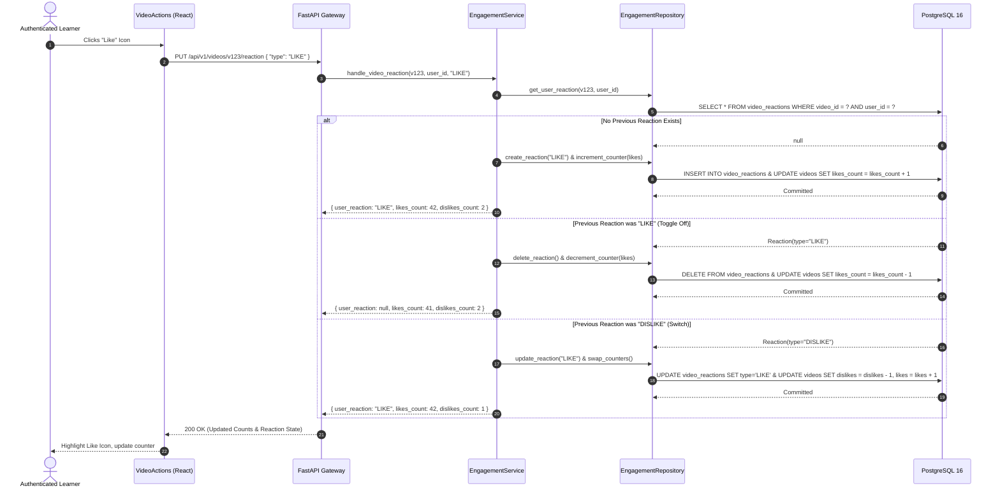
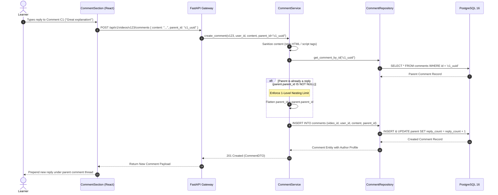
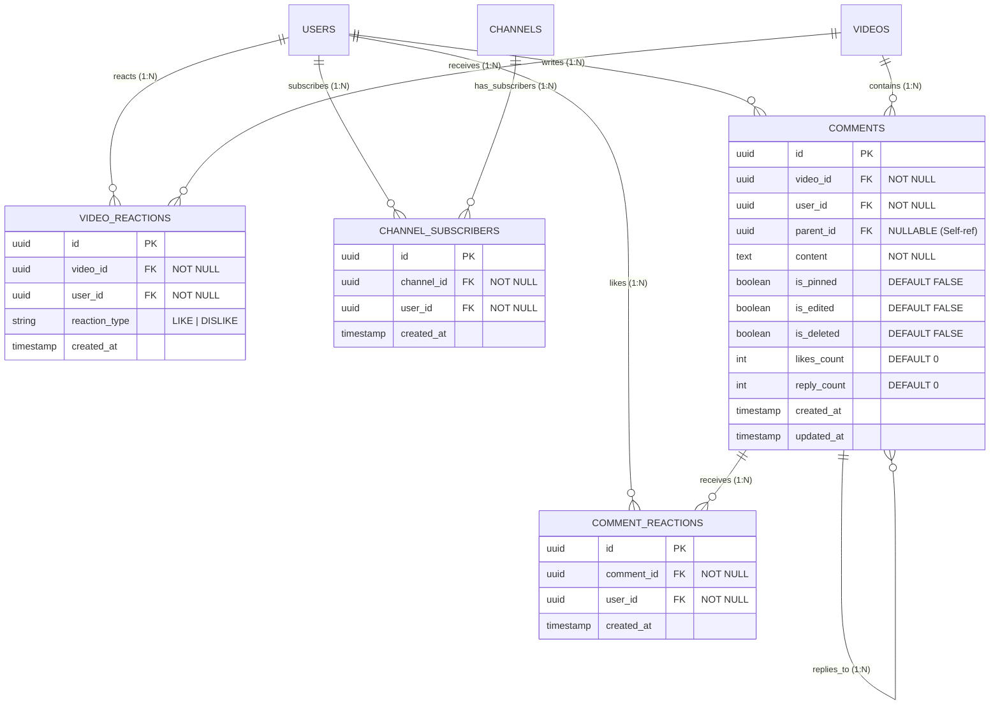
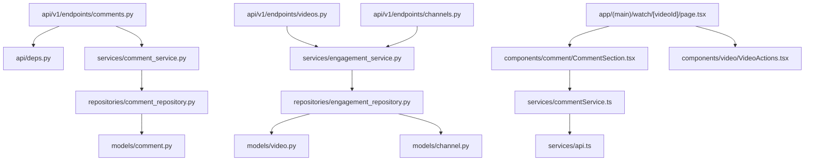

# Feature: Social Interactions & Engagement (Reactions, Subscriptions & 1-Level Threaded Comments)

> **Document Type:** System Architecture & Open-Source Implementation Blueprint  
> **Feature Identifier:** Tier 1 — Foundational (Feature 04)  
> **Bounded Context:** Social Graph, Community Engagement, Asynchronous Discussions & Real-Time Feedback  
> **Primary Target:** Open-Source Contributors, System Architects, Full-Stack Engineers  
> **Status:** Architecture Design & Implementation Guidance (Read-Only Blueprint)  

---

## 1. Feature Overview

In **RKSkillTube**, community interactions and feedback loops drive student engagement, content discoverability, and creator retention. The **Social Interactions & Engagement** subsystem empowers users to actively interact with video lectures and creators across three essential capabilities:

1. **Video Reactions (Like & Dislike):**
   - Enables users to express binary sentiment on videos.
   - Enforces idempotent toggle and state transitions (e.g., switching directly from *Like* to *Dislike*, or clearing an existing reaction).
   - Aggregates atomic counters (`likes_count`, `dislikes_count`) without race conditions or expensive table-wide `COUNT(*)` table scans.

2. **Channel Subscriptions:**
   - Establishes a many-to-many relationship between learners (`users`) and creator channels (`channels`).
   - Supports 1-click subscription toggle (`Subscribe` / `Subscribed`) with subscriber count caching.
   - Powers the dedicated personalized subscriptions feed (`/feed/subscriptions`) and unlocks notification routing for newly uploaded courses and videos.

3. **Threaded Commenting System (1-Level Nesting):**
   - Allows learners to ask technical questions, post timestamps, and share feedback directly below videos.
   - Implements **1-level deep replies** using a self-referential foreign key (`parent_comment_id`). This delivers the familiar YouTube-style discussion hierarchy (Top-Level Comment $\rightarrow$ Direct Replies) while avoiding recursive query complexity and performance degradation.
   - Supports comment editing, soft-deletion / tombstones (*"This comment was deleted by user"*), pin-to-top privileges for channel creators, and comment-level like reactions.

---

## 2. Project Architecture Context

RKSkillTube uses **FastAPI** for high-concurrency async REST services and **Next.js 16+** (React 19 App Router) on the client tier. The social engagement subsystem is architected across clean layers:

```
┌────────────────────────────────────────────────────────────────────────┐
│                      CLIENT TIER (Next.js 16+ / TS)                    │
│  • Watch Page:         app/(main)/watch/[videoId]/page.tsx             │
│  • Subscriptions Feed: app/(main)/feed/subscriptions/page.tsx          │
│  • Engagement UI:      LikeDislikeButtons.tsx, SubscribeButton.tsx     │
│  • Comment Subsystem:  CommentSection.tsx, CommentItem.tsx             │
│  • State & Services:   commentService.ts, channelService.ts            │
└───────────────────────────────────┬────────────────────────────────────┘
                                    │ HTTPS REST JSON
                                    ▼
┌────────────────────────────────────────────────────────────────────────┐
│                   API GATEWAY / BACKEND TIER (FastAPI)                 │
│  • Presentation Layer: endpoints/comments.py, channels.py, videos.py   │
│  • Auth & Identity:    api/deps.py (get_current_active_user)           │
│  • Business Logic:     services/comment_service.py, engagement_service │
│  • Data Access Layer:  repositories/comment_repo, engagement_repo      │
│  • Entities & Schemas: models/comment.py, video.py, channel.py         │
└───────────────────┬───────────────────────────────┬────────────────────┘
                    │                               │
                    ▼                               ▼
       ┌─────────────────────────┐     ┌────────────────────────┐
       │    PostgreSQL 16 DB     │     │     Redis 7 Cluster    │
       │   • video_reactions     │     │   • Counter buffering  │
       │   • channel_subscribers │     │   • Active user states │
       │   • comments            │     │   • Rate limit windows │
       │   • comment_reactions   │     │   • Subscriptions set  │
       └─────────────────────────┘     └────────────────────────┘
```

### Architectural Principles Enforced:
- **Clean Layered Architecture:** Routers validate incoming payloads and route permissions. Domain services encapsulate business rules (self-subscription rejection, reaction transitions, nesting limits). Repositories handle database transactions and efficient SQL joins.
- **Fail-Safe Idempotency:** Rapid double-clicking on a Like button or Subscribe toggle must never produce duplicate records or desynchronize counters.
- **Controlled Nesting Depth:** Recursive tree traversal is deliberately bounded to 1 level (`parent_comment_id` points only to root comments), keeping database indexing simple and rendering predictable.

---

## 3. Existing System Analysis

An inspection of the workspace reveals the physical foundation ready for this feature:

### Backend Codebase Reality (`backend/`):
- **Models:**
  - [backend/app/models/base.py](file:///e:/Projects/Open%20Source%20Contributions/RKSkillTube/backend/app/models/base.py): Declarative base class placeholder.
  - [backend/app/models/user.py](file:///e:/Projects/Open%20Source%20Contributions/RKSkillTube/backend/app/models/user.py): User entity placeholder.
  - [backend/app/models/channel.py](file:///e:/Projects/Open%20Source%20Contributions/RKSkillTube/backend/app/models/channel.py): Channel entity placeholder; needs `ChannelSubscriber` table relationship.
  - [backend/app/models/video.py](file:///e:/Projects/Open%20Source%20Contributions/RKSkillTube/backend/app/models/video.py): Video entity placeholder; needs `VideoReaction` table relationship.
  - [backend/app/models/comment.py](file:///e:/Projects/Open%20Source%20Contributions/RKSkillTube/backend/app/models/comment.py): Scaffolded empty model file. Needs `Comment` and `CommentReaction` models.
- **Endpoints:**
  - [backend/app/api/v1/endpoints/comments.py](file:///e:/Projects/Open%20Source%20Contributions/RKSkillTube/backend/app/api/v1/endpoints/comments.py): Scaffolded empty router placeholder.
  - [backend/app/api/v1/endpoints/videos.py](file:///e:/Projects/Open%20Source%20Contributions/RKSkillTube/backend/app/api/v1/endpoints/videos.py): Placeholder for video reactions (`PUT/DELETE /videos/{id}/reaction`).
  - [backend/app/api/v1/endpoints/channels.py](file:///e:/Projects/Open%20Source%20Contributions/RKSkillTube/backend/app/api/v1/endpoints/channels.py): Placeholder for channel subscriptions (`POST/DELETE /channels/{id}/subscribe`).
  - [backend/app/api/v1/router.py](file:///e:/Projects/Open%20Source%20Contributions/RKSkillTube/backend/app/api/v1/router.py): Master router where `comments.router` is registered.
- **Dependencies & Repositories:**
  - [backend/app/api/deps.py](file:///e:/Projects/Open%20Source%20Contributions/RKSkillTube/backend/app/api/deps.py): Injects current authenticated user or permissive anonymous user.
  - `backend/app/repositories/comment_repository.py`: **Does not exist yet.** Must be created.
  - `backend/app/repositories/engagement_repository.py`: **Does not exist yet.** Must be created.
  - `backend/app/services/comment_service.py`: **Does not exist yet.** Must be created.
  - `backend/app/services/engagement_service.py`: **Does not exist yet.** Must be created.
  - `backend/app/schemas/comment.py`: **Does not exist yet.** Must be created.

### Frontend Codebase Reality (`frontend/`):
- **Pages:**
  - [frontend/src/app/(main)/watch/[videoId]/page.tsx](file:///e:/Projects/Open%20Source%20Contributions/RKSkillTube/frontend/src/app/(main)/watch/%5BvideoId%5D/page.tsx): Watch page placeholder; hosts video player, action buttons, and comment section.
  - [frontend/src/app/(main)/feed/subscriptions/page.tsx](file:///e:/Projects/Open%20Source%20Contributions/RKSkillTube/frontend/src/app/(main)/feed/subscriptions/page.tsx): Subscriptions feed page placeholder.
- **Components:**
  - [frontend/src/components/video/VideoActions.tsx](file:///e:/Projects/Open%20Source%20Contributions/RKSkillTube/frontend/src/components/video/VideoActions.tsx): Placeholder for Like/Dislike, Share, Save.
  - `frontend/src/components/comment/`: Folder exists; components (`CommentSection.tsx`, `CommentItem.tsx`, `CommentInput.tsx`) must be created.
- **Services & Types:**
  - [frontend/src/services/api.ts](file:///e:/Projects/Open%20Source%20Contributions/RKSkillTube/frontend/src/services/api.ts): Base Axios client.
  - [frontend/src/services/channelService.ts](file:///e:/Projects/Open%20Source%20Contributions/RKSkillTube/frontend/src/services/channelService.ts): Channel service placeholder.
  - `frontend/src/services/commentService.ts`: **Does not exist yet.** Must be created.
  - `frontend/src/types/comment.ts`: **Does not exist yet.** Must be created.

---

## 4. Functional Requirements

### A. Video Reactions (Like & Dislike)
1. **Binary Reactions:** Authenticated users can react to any public or unlisted video with either `LIKE` or `DISLIKE`.
2. **Idempotent State Transitions:**
   - Clicking `LIKE` when unreacted $\rightarrow$ creates a `LIKE` reaction (+1 likes).
   - Clicking `LIKE` when already liked $\rightarrow$ removes the reaction (-1 likes).
   - Clicking `DISLIKE` when already liked $\rightarrow$ atomically shifts reaction from `LIKE` to `DISLIKE` (-1 likes, +1 dislikes).
   - Explicit `DELETE` request clears any existing reaction.
3. **Public Totals & Personal State:** The API returns total `likes_count` and `dislikes_count` for the video, along with the calling user's current reaction (`"LIKE"`, `"DISLIKE"`, or `null`).

### B. Channel Subscriptions
1. **Subscription Toggle:** Authenticated users can subscribe or unsubscribe from any creator channel (`POST/DELETE /api/v1/channels/{id}/subscribe`).
2. **Self-Subscription Prevention:** A creator cannot subscribe to their own channel.
3. **Subscriber Counter:** Channel profile reflects total `subscriber_count`.
4. **Subscribed Status Check:** Fast endpoint returning whether the calling user is subscribed to a channel.
5. **Subscriptions Feed:** Enumerate all recent videos published by channels the user is subscribed to (`GET /api/v1/users/me/subscriptions/videos`).

### C. Commenting System (1-Level Nesting)
1. **Top-Level Comments:** Authenticated users can post comments on videos (`POST /api/v1/videos/{id}/comments`).
2. **1-Level Nested Replies:** Users can post replies directly beneath an existing top-level comment by specifying `parent_id`. Replying to an existing reply is flattened under the same root comment (no deep arbitrary tree nesting).
3. **Comment Listing & Pagination:**
   - Top-level comments are returned in paginated chunks (offset or cursor-based), sorted by `newest` or `top` (most liked).
   - Each top-level comment includes a `reply_count` and an optional preview of the first 2 replies.
   - Separate endpoint (`GET /api/v1/comments/{id}/replies`) fetches additional replies on demand.
4. **Editing & Moderation:**
   - Authors can edit their comment text (`is_edited` flag becomes `TRUE`).
   - Authors and channel owners can delete comments.
   - If a top-level comment has existing replies, deleting it transforms it into a tombstone (`is_deleted = TRUE`, text displayed as *"This comment was deleted by user"*), preserving reply context. If it has no replies, it is permanently removed.
5. **Creator Pinning:** Channel owners can pin exactly one comment to the top of the video comment thread.
6. **Comment Likes:** Users can like/unlike individual comments.

---

## 5. Non-Functional Requirements

- **High-Throughput Write Handling:** Video likes and comments experience massive traffic spikes during live streams or viral uploads. Counter updates must be atomic (`UPDATE ... SET likes_count = likes_count + 1`) or buffered via Redis to prevent database lock contention.
- **Sub-30ms Read Latency:** Comment sections must paginate efficiently. Avoid Cartesian products or recursive CTE queries by keeping nesting strictly capped at 1 level.
- **Data Consistency:** Database foreign keys (`ON DELETE CASCADE`) guarantee that deleting a video or channel cleans up all associated reactions, subscriptions, and comments without orphaned records.
- **XSS & Content Sanitization:** User comments must be thoroughly sanitized to eliminate malicious HTML, script tags, and prompt injection attacks before persistence.

---

## 6. Assumptions and Open Questions

### Assumptions:
- Free channel subscriptions do not require billing or payment verification (handled as an instant database record).
- Anonymous visitors can view public comments and like counts, but cannot post comments, react, or subscribe.
- Dislike counts are visible on RKSkillTube (unlike YouTube's hidden dislikes), but maintainers can configure visibility via platform settings.

### Open Questions for Contributors & Maintainers:
1. *Tombstone Deletion Policy:* If a user deletes their account, should their comments be hard-deleted or scrubbed into anonymous tombstones? *(Recommendation: Scrub author metadata to "Deleted User" to maintain course discussions).*
2. *Profanity & Spam Filtering:* Should basic keyword filtering happen synchronously in the service layer or asynchronously via a moderation queue? *(Recommendation: Basic regex word filtering synchronously; automated AI moderation via Celery task in Tier 2).*

---

## 7. Low-Level Design (LLD)

### 7.1 Component Design

```
┌────────────────────────────────────────────────────────────────────────┐
│                        FastAPI PRESENTATION LAYER                      │
│   • endpoints/videos.py                                                │
│       - PUT    /api/v1/videos/{id}/reaction    (Toggle Like/Dislike)   │
│       - DELETE /api/v1/videos/{id}/reaction    (Clear Reaction)        │
│   • endpoints/channels.py                                              │
│       - POST   /api/v1/channels/{id}/subscribe (Subscribe)             │
│       - DELETE /api/v1/channels/{id}/subscribe (Unsubscribe)           │
│       - GET    /api/v1/channels/{id}/subscription-status               │
│   • endpoints/comments.py                                              │
│       - GET    /api/v1/videos/{id}/comments    (List Top-Level)        │
│       - POST   /api/v1/videos/{id}/comments    (Post Comment / Reply)  │
│       - GET    /api/v1/comments/{id}/replies   (List Nested Replies)   │
│       - PUT    /api/v1/comments/{id}           (Edit Comment)          │
│       - DELETE /api/v1/comments/{id}           (Soft/Hard Delete)      │
│       - PUT    /api/v1/comments/{id}/pin       (Creator Pin)           │
│       - PUT    /api/v1/comments/{id}/reaction  (Like Comment)          │
└───────────────────────────────────┬────────────────────────────────────┘
                                    │ Injects Dependencies
                                    ▼
┌────────────────────────────────────────────────────────────────────────┐
│                      DEPENDENCY INJECTION & GUARDS                     │
│   • api/deps.py                                                        │
│       - get_current_active_user(): Authenticates caller via JWT        │
│       - get_optional_current_user(): Returns user if logged in         │
└───────────────────────────────────┬────────────────────────────────────┘
                                    │ Invokes Business Logic
                                    ▼
┌────────────────────────────────────────────────────────────────────────┐
│                        SERVICES LAYER (Business Logic)                 │
│   • services/engagement_service.py                                     │
│       - handle_video_reaction(video_id, user_id, reaction_type)        │
│       - toggle_channel_subscription(channel_id, user_id)               │
│   • services/comment_service.py                                        │
│       - create_comment(video_id, user_id, content, parent_id)          │
│       - get_video_comments(video_id, viewer_id, sort_by, page)         │
│       - delete_comment(comment_id, user_id)                            │
│       - pin_comment(comment_id, user_id)                               │
└───────────────────────────────────┬────────────────────────────────────┘
                                    │ Database Queries
                                    ▼
┌────────────────────────────────────────────────────────────────────────┐
│                     REPOSITORY LAYER (Data Access)                     │
│   • repositories/engagement_repository.py                              │
│   • repositories/comment_repository.py                                 │
└───────────────────────────────────┬────────────────────────────────────┘
                                    │ Executes SQL
                                    ▼
┌────────────────────────────────────────────────────────────────────────┐
│                     DATABASE PERSISTENCE (PostgreSQL)                  │
│   • Tables: video_reactions, channel_subscribers, comments,            │
│             comment_reactions                                          │
└────────────────────────────────────────────────────────────────────────┘
```

### 7.2 Sequence Diagram: Idempotent Video Reaction



### 7.3 Sequence Diagram: 1-Level Threaded Commenting



---

## 8. High-Level Design (HLD)

### 8.1 System Context

The social engagement subsystem handles high read-to-write ratios for counters and nested discussion threads:

```
               ┌───────────────────────┐
               │    Guest / Learner    │
               └───────────┬───────────┘
                           │ Interacts with UI
                           ▼
               ┌───────────────────────┐
               │   Next.js Frontend    │
               │ • VideoActions.tsx    │
               │ • CommentSection.tsx  │
               │ • SubscribeButton.tsx │
               └───────────┬───────────┘
                           │ REST / JSON
                           ▼
               ┌───────────────────────┐
               │    FastAPI Backend    │
               │ • Idempotent Handlers │
               │ • Sanitize Input      │
               │ • Ownership Guard     │
               └─────┬───────────┬─────┘
                     │           │
       Buffer Writes │           │ ACID Persistence
                     ▼           ▼
        ┌──────────────────┐   ┌──────────────────┐
        │  Redis 7 Cluster │   │  PostgreSQL 16   │
        │ • Like buffering │   │ • video_reactions│
        │ • Sub status set │   │ • subscriptions  │
        │ • Rate limiting  │   │ • comments       │
        └──────────────────┘   └──────────────────┘
```

### 8.2 Architectural Decisions

1. **Dedicated Join Tables vs. Polymorphic Tables:**
   - Instead of a single messy `reactions` table with nullable foreign keys (`video_id`, `comment_id`, `course_id`), we maintain dedicated tables: `video_reactions` and `comment_reactions`.
   - *Rationale:* Strong foreign key integrity (`ON DELETE CASCADE`), zero NULL columns, and specialized database indexes yielding predictable execution plans.

2. **Self-Referential 1-Level Nesting (Adjacency List):**
   - The `comments` table contains an optional self-referencing foreign key: `parent_id UUID REFERENCES comments(id) ON DELETE CASCADE`.
   - If `parent_id IS NULL`, the comment is top-level.
   - If `parent_id IS NOT NULL`, it is a reply.
   - *Depth Enforcement:* The service layer enforces that `parent_id` can only point to a root comment (`parent.parent_id IS NULL`). If a user replies to an existing reply, the system automatically assigns the root's ID. This eliminates complex tree-walking algorithms like MPTT (Modified Preorder Tree Traversal) while giving users a clean two-tier discussion hierarchy.

3. **Atomic Counters vs. Dynamic Aggregation:**
   - Video records maintain `likes_count` and `dislikes_count`.
   - Channels maintain `subscriber_count`.
   - Top-level comments maintain `reply_count` and `likes_count`.
   - *Rationale:* Computing `SELECT COUNT(*) FROM video_reactions WHERE video_id = ? AND type = 'LIKE'` on every video page load causes table locking and severe query degradation when videos receive hundreds of thousands of views. Counters are updated atomically inside the same transaction as the reaction record.

---

## 9. Architecture Diagrams

### 9.1 Entity-Relationship Diagram (ERD)



---

## 10. Database Design

### 10.1 `video_reactions` Table

| Column | Type | Constraints | Description |
| :--- | :--- | :--- | :--- |
| `id` | `UUID` | Primary Key, `default=gen_random_uuid()` | Immutable unique identifier. |
| `video_id` | `UUID` | Foreign Key (`videos.id` ON DELETE CASCADE), **NOT NULL, Indexed** | Target video. |
| `user_id` | `UUID` | Foreign Key (`users.id` ON DELETE CASCADE), **NOT NULL, Indexed** | Reacting user. |
| `reaction_type`| `VARCHAR(10)` | **NOT NULL** (`CHECK (reaction_type IN ('LIKE', 'DISLIKE'))`) | Sentiment enum. |
| `created_at` | `TIMESTAMPTZ` | **NOT NULL, Default NOW()** | Timestamp of reaction. |

#### Constraints & Indexes:
- **Composite Unique Index:**  
  `CREATE UNIQUE INDEX uq_video_user_reaction ON video_reactions (video_id, user_id);`  
  *(Ensures a user can only have at most one reaction record per video).*

---

### 10.2 `channel_subscribers` Table

| Column | Type | Constraints | Description |
| :--- | :--- | :--- | :--- |
| `id` | `UUID` | Primary Key, `default=gen_random_uuid()` | Unique record identifier. |
| `channel_id` | `UUID` | Foreign Key (`channels.id` ON DELETE CASCADE), **NOT NULL, Indexed** | Channel being subscribed to. |
| `user_id` | `UUID` | Foreign Key (`users.id` ON DELETE CASCADE), **NOT NULL, Indexed** | Subscribing user. |
| `created_at` | `TIMESTAMPTZ` | **NOT NULL, Default NOW()** | Timestamp of subscription. |

#### Constraints & Indexes:
- **Composite Unique Index:**  
  `CREATE UNIQUE INDEX uq_channel_user_subscription ON channel_subscribers (channel_id, user_id);`  
  *(Prevents duplicate subscription records).*
- **Index for User Subscriptions Listing:**  
  `CREATE INDEX idx_subscribers_user ON channel_subscribers (user_id, created_at DESC);`

---

### 10.3 `comments` Table

| Column | Type | Constraints | Description |
| :--- | :--- | :--- | :--- |
| `id` | `UUID` | Primary Key, `default=gen_random_uuid()` | Unique comment identifier. |
| `video_id` | `UUID` | Foreign Key (`videos.id` ON DELETE CASCADE), **NOT NULL, Indexed** | Associated video. |
| `user_id` | `UUID` | Foreign Key (`users.id` ON DELETE CASCADE), **NOT NULL, Indexed** | Author of the comment. |
| `parent_id`| `UUID` | Foreign Key (`comments.id` ON DELETE CASCADE), **Nullable, Indexed** | Root comment ID for replies. |
| `content` | `TEXT` | **NOT NULL** (`LENGTH(content) BETWEEN 1 AND 3000`) | Comment text body. |
| `is_pinned`| `BOOLEAN` | **NOT NULL, Default FALSE** | Pinned status by channel creator. |
| `is_edited`| `BOOLEAN` | **NOT NULL, Default FALSE** | True if comment has been updated. |
| `is_deleted`| `BOOLEAN` | **NOT NULL, Default FALSE** | Tombstone flag for soft deletion. |
| `likes_count`| `INTEGER`| **NOT NULL, Default 0** | Denormalized count of comment likes. |
| `reply_count`| `INTEGER`| **NOT NULL, Default 0** | Denormalized count of direct replies. |
| `created_at` | `TIMESTAMPTZ` | **NOT NULL, Default NOW()** | Comment publication timestamp. |
| `updated_at` | `TIMESTAMPTZ` | **NOT NULL, Auto-update NOW()** | Last modification timestamp. |

#### Constraints & Indexes:
- **Index for Video Top-Level Comments (Sorted by Pinned & Date):**  
  `CREATE INDEX idx_comments_video_root ON comments (video_id, is_pinned DESC, created_at DESC) WHERE parent_id IS NULL;`
- **Index for Replies by Parent:**  
  `CREATE INDEX idx_comments_parent ON comments (parent_id, created_at ASC) WHERE parent_id IS NOT NULL;`

---

### 10.4 `comment_reactions` Table

| Column | Type | Constraints | Description |
| :--- | :--- | :--- | :--- |
| `id` | `UUID` | Primary Key, `default=gen_random_uuid()` | Unique record identifier. |
| `comment_id` | `UUID` | Foreign Key (`comments.id` ON DELETE CASCADE), **NOT NULL, Indexed** | Liked comment. |
| `user_id` | `UUID` | Foreign Key (`users.id` ON DELETE CASCADE), **NOT NULL, Indexed** | Reacting user. |
| `created_at` | `TIMESTAMPTZ` | **NOT NULL, Default NOW()** | Reaction timestamp. |

#### Constraints:
- `CREATE UNIQUE INDEX uq_comment_user_reaction ON comment_reactions (comment_id, user_id);`

---

## 11. API Design

### 11.1 Video Reactions API

#### `PUT /api/v1/videos/{id}/reaction`
- **Purpose:** Idempotently apply or toggle a `LIKE` or `DISLIKE` on a video.
- **Auth:** Bearer Token.
- **Request Body:**
  ```json
  {
    "reaction_type": "LIKE"
  }
  ```
- **Response (200 OK):**
  ```json
  {
    "user_reaction": "LIKE",
    "likes_count": 1284,
    "dislikes_count": 12
  }
  ```

#### `DELETE /api/v1/videos/{id}/reaction`
- **Purpose:** Clear user's active reaction on a video.
- **Auth:** Bearer Token.
- **Response (200 OK):** Returns updated counts with `"user_reaction": null`.

---

### 11.2 Channel Subscriptions API

#### `POST /api/v1/channels/{id}/subscribe`
- **Purpose:** Subscribe the authenticated user to a channel.
- **Auth:** Bearer Token.
- **Validation:** Raises `400 Bad Request` if user owns the channel (`user.id == channel.owner_id`).
- **Response (201 Created):**
  ```json
  {
    "is_subscribed": true,
    "subscriber_count": 45200
  }
  ```

#### `DELETE /api/v1/channels/{id}/subscribe`
- **Purpose:** Unsubscribe from a channel.
- **Auth:** Bearer Token.
- **Response (200 OK):** Returns `"is_subscribed": false` with decremented count.

#### `GET /api/v1/channels/{id}/subscription-status`
- **Purpose:** Check whether the current user is subscribed to a channel.
- **Auth:** Optional Bearer Token.
- **Response (200 OK):** `{ "is_subscribed": true }` (or `false` if guest).

---

### 11.3 Comments API

#### `GET /api/v1/videos/{id}/comments`
- **Purpose:** Fetch paginated top-level comments for a video.
- **Query Params:** `page` (default 1), `limit` (default 20), `sort` (`newest` | `top`).
- **Auth:** Optional Bearer Token (if provided, includes caller's liked status per comment).
- **Response (200 OK):**
  ```json
  {
    "total_count": 142,
    "page": 1,
    "limit": 20,
    "items": [
      {
        "id": "c-101",
        "content": "The section at 04:30 on ACID isolation was brilliant!",
        "is_pinned": true,
        "is_edited": false,
        "is_deleted": false,
        "likes_count": 89,
        "reply_count": 3,
        "is_liked_by_me": true,
        "created_at": "2026-11-03T14:00:00Z",
        "author": {
          "id": "u-55",
          "full_name": "Sarah Connor",
          "avatar_url": "https://cdn.example.com/avatars/s55.jpg"
        }
      }
    ]
  }
  ```

#### `POST /api/v1/videos/{id}/comments`
- **Purpose:** Post a top-level comment or a 1-level reply.
- **Auth:** Bearer Token.
- **Request Body:**
  ```json
  {
    "content": "Does this work with PostgreSQL 16 read replicas?",
    "parent_id": null
  }
  ```
- **Response (201 Created):** Full created comment object.

#### `GET /api/v1/comments/{id}/replies`
- **Purpose:** Retrieve paginated replies for a specific top-level comment.
- **Response (200 OK):** Array of reply items sorted chronologically (`created_at ASC`).

#### `PUT /api/v1/comments/{id}`
- **Purpose:** Update comment text.
- **Auth:** Bearer Token (Author only).
- **Request Body:** `{ "content": "Updated content..." }`.
- **Response (200 OK):** Updated comment with `"is_edited": true`.

#### `DELETE /api/v1/comments/{id}`
- **Purpose:** Delete a comment.
- **Auth:** Bearer Token (Author or Channel Owner).
- **Behavior:**
  - If `reply_count > 0`: Soft deletes comment (`is_deleted = true`, content becomes `"[This comment was deleted by user]"`).
  - If `reply_count == 0`: Hard deletes row from database.
- **Response (200 OK):** `{ "message": "Comment deleted successfully" }`.

#### `PUT /api/v1/comments/{id}/pin`
- **Purpose:** Pin a comment to the top of the video comment thread.
- **Auth:** Bearer Token (Channel Owner of the video only).
- **Behavior:** Unpins any previously pinned comment on the video and pins the target comment.

#### `PUT /api/v1/comments/{id}/reaction`
- **Purpose:** Like/unlike a comment.
- **Auth:** Bearer Token.
- **Response (200 OK):** `{ "is_liked": true, "likes_count": 90 }`.

---

## 12. Security Analysis

### 12.0 Cryptographic Reference & Security Warnings
> [!CAUTION]
> **Input Sanitization & Injection Defense:**
> - **Stored XSS Attack Vector:** Comments allow raw user text. Attackers frequently submit `<script>alert('cookie')</script>` or SVG image payloads (``). All comment inputs must be sanitized on the backend, and rendered strictly as plaintext strings on React/Next.js without utilizing `dangerouslySetInnerHTML`.
> - **Self-Referential Deadlock / Infinite Loop Prevention:** Do not accept arbitrary `parent_id` hierarchies from clients. Always assert that `parent.parent_id IS NULL` to prevent circular comment graph traversal.

### 12.1 Security Levels: Insecure to Production-Grade

| Level | Architecture Approach | Vulnerabilities & Pitfalls | Production Remediation |
| :--- | :--- | :--- | :--- |
| **Level 1 (Insecure)** | **Unauthenticated Client-Supplied User IDs** | • **Vote Fraud & BOLA:** Attackers submit reactions or delete comments using arbitrary `user_id` payloads.<br>• **Self-Subscription Inflation:** Creators write scripts to subscribe to themselves millions of times. | Resolve caller identity exclusively from verified JWT server claims; reject self-subscription. |
| **Level 2 (Improved)** | **JWT Auth + Basic Owner Check** | • Prevents IDOR by verifying `comment.user_id == caller.id`.<br>• Still vulnerable to Stored XSS and automated comment spam bots. | Introduce HTML sanitization, character limits (1-3000 chars), and input schema validation. |
| **Level 3 (Production Ready)** | **Owner Guards + Tombstone Preservation + Atomic Counter Shifting** | • Channel owner moderation permissions enforced via dependency injection.<br>• Tombstone deletion preserves reply context without breaking discussion trees.<br>• Unique composite database indexes prevent race condition duplicates. | Standard baseline for RKSkillTube production deployment. |
| **Level 4 (Advanced)** | **Redis Sliding-Window Rate Limiting + Automated Toxicity Moderation** | • Rate-limits comments (e.g., max 1 comment every 10 seconds per IP/user) to mitigate spam floods.<br>• Asynchronous Celery task evaluates comment embeddings for abusive language. | Enterprise-grade social platform security. |

### 12.2 Critical Attack Vectors & Mitigations

1. **BOLA / IDOR on Comment Mutations:**
   - *Risk:* User A tries to edit or delete User B's comment by passing User B's comment UUID.
   - *Mitigation:* The `CommentService` checks `comment.user_id == current_user.id`. Exception: Channel owners who own the video are granted moderation deletion rights over any comment on their videos.

2. **Race Condition Counter Corruption:**
   - *Risk:* Two concurrent requests hit `PUT /videos/{id}/reaction` at the exact same millisecond. If counters are calculated in memory (`video.likes = video.likes + 1`), one increment is lost.
   - *Mitigation:* Use atomic SQL expressions: `UPDATE videos SET likes_count = likes_count + 1 WHERE id = :video_id` inside the same database transaction.

3. **Self-Subscription Abuse:**
   - *Risk:* Creator attempts to inflate their subscriber count by calling `POST /channels/{my_channel_id}/subscribe`.
   - *Mitigation:* The service layer queries the channel's `owner_id` and rejects the action with `400 Bad Request` if `channel.owner_id == caller.id`.

---

## 13. Existing Files Analysis

### A. Directly Reusable Files
- [backend/app/api/deps.py](file:///e:/Projects/Open%20Source%20Contributions/RKSkillTube/backend/app/api/deps.py): Reusable dependency injection for `get_current_active_user` and `get_optional_current_user`.
- [backend/app/models/base.py](file:///e:/Projects/Open%20Source%20Contributions/RKSkillTube/backend/app/models/base.py): Base SQLAlchemy class for model inheritance.
- [backend/app/repositories/base_repository.py](file:///e:/Projects/Open%20Source%20Contributions/RKSkillTube/backend/app/repositories/base_repository.py): Generic CRUD query abstraction.
- [frontend/src/services/api.ts](file:///e:/Projects/Open%20Source%20Contributions/RKSkillTube/frontend/src/services/api.ts): Configured Axios instance with bearer token headers.
- [frontend/src/store/useAuthStore.ts](file:///e:/Projects/Open%20Source%20Contributions/RKSkillTube/frontend/src/store/useAuthStore.ts): Authenticated user session state.

### B. Files That Need Implementation / Modification
- [backend/app/models/comment.py](file:///e:/Projects/Open%20Source%20Contributions/RKSkillTube/backend/app/models/comment.py): Implement SQLAlchemy entities `Comment` and `CommentReaction`.
- [backend/app/models/video.py](file:///e:/Projects/Open%20Source%20Contributions/RKSkillTube/backend/app/models/video.py): Add `VideoReaction` entity and relationships (`reactions`, `comments`).
- [backend/app/models/channel.py](file:///e:/Projects/Open%20Source%20Contributions/RKSkillTube/backend/app/models/channel.py): Add `ChannelSubscriber` entity and relationship (`subscribers`).
- [backend/app/api/v1/endpoints/comments.py](file:///e:/Projects/Open%20Source%20Contributions/RKSkillTube/backend/app/api/v1/endpoints/comments.py): Implement comment endpoints.
- [backend/app/api/v1/endpoints/videos.py](file:///e:/Projects/Open%20Source%20Contributions/RKSkillTube/backend/app/api/v1/endpoints/videos.py): Implement reaction endpoints (`PUT/DELETE /videos/{id}/reaction`).
- [backend/app/api/v1/endpoints/channels.py](file:///e:/Projects/Open%20Source%20Contributions/RKSkillTube/backend/app/api/v1/endpoints/channels.py): Implement subscription endpoints (`POST/DELETE /channels/{id}/subscribe`).
- [backend/app/api/v1/router.py](file:///e:/Projects/Open%20Source%20Contributions/RKSkillTube/backend/app/api/v1/router.py): Mount `comments.router` into the v1 master router.
- [frontend/src/components/video/VideoActions.tsx](file:///e:/Projects/Open%20Source%20Contributions/RKSkillTube/frontend/src/components/video/VideoActions.tsx): Implement Like/Dislike button and count display.
- [frontend/src/app/(main)/watch/[videoId]/page.tsx](file:///e:/Projects/Open%20Source%20Contributions/RKSkillTube/frontend/src/app/(main)/watch/%5BvideoId%5D/page.tsx): Mount `CommentSection` below video player.

### C. Proposed New Files Required
- `backend/app/schemas/comment.py`: Pydantic schemas (`CommentCreate`, `CommentUpdate`, `CommentResponse`, `CommentListResponse`).
- `backend/app/schemas/reaction.py`: Pydantic schemas (`ReactionToggleRequest`, `ReactionStatusResponse`).
- `backend/app/schemas/subscription.py`: Pydantic schemas (`SubscriptionStatusResponse`).
- `backend/app/repositories/comment_repository.py`: Database query methods for comments and replies with author loading.
- `backend/app/repositories/engagement_repository.py`: Reaction and subscription queries and atomic counter methods.
- `backend/app/services/comment_service.py`: Domain rules for 1-level replies, sanitization, and tombstones.
- `backend/app/services/engagement_service.py`: Business logic for idempotent reaction transitions and subscriptions.
- `frontend/src/types/comment.ts`: TypeScript contracts for comments, replies, and reactions.
- `frontend/src/services/commentService.ts`: Client API methods for comment endpoints.
- `frontend/src/components/comment/CommentSection.tsx`: Container component with comment count, sort dropdown, and input box.
- `frontend/src/components/comment/CommentItem.tsx`: Individual comment card with author avatar, timestamp, like button, and reply toggle.
- `frontend/src/components/comment/CommentInput.tsx`: Textarea input with character counter and submit buttons.
- `frontend/src/components/comment/CommentReplyList.tsx`: Collapsible reply container.
- `frontend/src/components/video/SubscribeButton.tsx`: Reactive subscribe/unsubscribe button with optimistic state.

### D. Files That Should NOT Be Modified
- `backend/app/models/user.py`: Keep core user authentication clean; social interactions reference `user_id` as foreign keys without adding unnecessary columns to `users`.
- `backend/app/core/security.py`: Token signing and password hashing are generic and should remain untouched.

### E. Architectural Dependency Map



---

## 14. Implementation Roadmap (Milestones)

### Milestone 1: Database Entities & Schema Migrations
- **Goal:** Model reactions, subscriptions, comments, and comment reactions.
- **Inspect:** [backend/app/models/base.py](file:///e:/Projects/Open%20Source%20Contributions/RKSkillTube/backend/app/models/base.py), [backend/app/models/video.py](file:///e:/Projects/Open%20Source%20Contributions/RKSkillTube/backend/app/models/video.py), [backend/app/models/channel.py](file:///e:/Projects/Open%20Source%20Contributions/RKSkillTube/backend/app/models/channel.py).
- **Implement In:** `backend/app/models/comment.py`, `backend/app/models/video.py`, `backend/app/models/channel.py`.
- **Architectural Hint:** Create unique constraints on `(video_id, user_id)` in `video_reactions` and `(channel_id, user_id)` in `channel_subscribers`. Add foreign key `parent_id` referencing `comments.id`.
- **Testing:** Run Alembic migration and verify table generation with proper cascading rules.

### Milestone 2: Pydantic Validation & DTO Contracts
- **Goal:** Establish strict request/response validation schemas.
- **Implement In:** `backend/app/schemas/comment.py`, `backend/app/schemas/reaction.py`, `backend/app/schemas/subscription.py`.
- **Architectural Hint:** Enforce `min_length=1, max_length=3000` on comment content. Ensure `reaction_type` accepts only `"LIKE"` or `"DISLIKE"`.

### Milestone 3: Engagement Service & Idempotent Reaction Logic
- **Goal:** Implement Like/Dislike state machine and channel subscriptions.
- **Implement In:** `backend/app/repositories/engagement_repository.py`, `backend/app/services/engagement_service.py`.
- **Architectural Hint:** When toggling reactions, execute the reaction upsert and counter adjustment in the same database transaction to prevent desynchronization.

### Milestone 4: Comment Service & 1-Level Nesting Hierarchy
- **Goal:** Implement comment posting, nesting flattening, and tombstone soft-deletion.
- **Implement In:** `backend/app/repositories/comment_repository.py`, `backend/app/services/comment_service.py`.
- **Architectural Hint:** In `create_comment`, check if `parent.parent_id` is not null; if so, assign `new_comment.parent_id = parent.parent_id` to strictly preserve 1-level depth.

### Milestone 5: FastAPI Presentation Endpoints
- **Goal:** Expose all engagement endpoints and wire into the master router.
- **Implement In:** `backend/app/api/v1/endpoints/comments.py`, `backend/app/api/v1/endpoints/videos.py`, `backend/app/api/v1/endpoints/channels.py`, [backend/app/api/v1/router.py](file:///e:/Projects/Open%20Source%20Contributions/RKSkillTube/backend/app/api/v1/router.py).
- **Architectural Hint:** Use `get_optional_current_user` on comment listing so logged-in users receive `is_liked_by_me = true` while guests still receive public comments.

### Milestone 6: Frontend API Services & Reactive Action Buttons
- **Goal:** Connect client API and build Like/Dislike and Subscribe controls.
- **Implement In:** `frontend/src/services/commentService.ts`, `frontend/src/components/video/VideoActions.tsx`, `frontend/src/components/video/SubscribeButton.tsx`.
- **Architectural Hint:** Apply optimistic UI updates for Like and Subscribe buttons so the counter updates immediately on click before the server responds.

### Milestone 7: Nested Comment UI & Discussion Tree
- **Goal:** Build the complete responsive comment section on the video watch page.
- **Implement In:** `frontend/src/components/comment/CommentSection.tsx`, `frontend/src/components/comment/CommentItem.tsx`, `frontend/src/components/comment/CommentInput.tsx`.
- **Architectural Hint:** Conditionally show the reply input only when the user clicks "Reply", and display a "View X replies" collapsible accordion for child comments.

---

## 15. Hints and Socratic Engineering Questions

1. *Why should Like and Dislike actions be handled as a single idempotent `PUT` endpoint rather than separate `/like` and `/dislike` endpoints? How does this simplify switching sentiment?*
2. *If user A replies to a reply by user B, why should `parent_id` be flattened to point to the root comment instead of creating an arbitrary deep tree? How does this decision impact database indexing and mobile rendering?*
3. *What happens to child replies if a top-level comment is hard-deleted from the database? Why is a tombstone (`is_deleted = TRUE, content = '[deleted]'`) superior to `ON DELETE CASCADE` in active discussion threads?*
4. *Why is executing `UPDATE videos SET likes_count = likes_count + 1 WHERE id = :id` immune to concurrency race conditions, whereas `video.likes_count += 1` in Python is vulnerable?*
5. *How does using `get_optional_current_user` allow unauthenticated visitors to read comments while still letting logged-in users see which comments they personally liked?*

---

## 16. Testing Strategy

### A. Unit Tests (`backend/tests/unit/test_engagement_service.py`)
- **Reaction Transitions:** Verify all state machine transitions (None $\rightarrow$ Like $\rightarrow$ None, None $\rightarrow$ Like $\rightarrow$ Dislike $\rightarrow$ None).
- **Self-Subscription Prevention:** Creator attempting to subscribe to their own channel raises `BadRequestException`.
- **Nesting Flattening:** Replying to an existing reply sets `parent_id` to the root comment ID.
- **Input Sanitization:** Submitting `<script>` tags strips or encodes unsafe HTML tags.

### B. Integration Tests (`backend/tests/integration/test_social_api.py`)
- **`PUT /videos/{id}/reaction`:** Correctly increments `likes_count` on first call, decrements on second call.
- **`POST /channels/{id}/subscribe`:** Correctly increments `subscriber_count` and returns `is_subscribed: true`.
- **`POST /videos/{id}/comments`:** Successfully creates top-level comment and increments video comment count.
- **`GET /comments/{id}/replies`:** Returns only child comments belonging to the requested parent.
- **Tombstone Verification:** Calling `DELETE` on a comment with replies sets `is_deleted = true` without deleting replies.

### C. Security & Authorization Tests (`backend/tests/integration/test_social_security.py`)
- **BOLA Protection:** User B attempting to `PUT /comments/{user_a_comment_id}` receives `403 Forbidden`.
- **Channel Owner Privileges:** Channel owner calling `DELETE` on a student's abusive comment succeeds (moderation right).
- **Pinning Authorization:** Non-owner attempting to pin a comment receives `403 Forbidden`.

### D. Concurrency Tests
- **Concurrent Likes:** 50 simultaneous requests liking the same video must increment `likes_count` by exactly 50 without lost updates.

---

## 17. Engineering Trade-offs

| Decision | Option A | Option B | Selected Choice & Rationale |
| :--- | :--- | :--- | :--- |
| **Reaction Tables** | Single polymorphic `reactions` table (`entity_type`, `entity_id`) | Dedicated tables (`video_reactions`, `comment_reactions`) | **Option B (Dedicated Tables):** Guarantees relational foreign key integrity, avoids NULL columns, and provides cleaner database execution plans. |
| **Comment Nesting Depth** | Arbitrary recursive nesting (MPTT / Closure Table) | Strictly bounded 1-level nesting (Adjacency List) | **Option B (1-Level Nesting):** Matches YouTube's UX, prevents UI indentation breakdown on mobile devices, and avoids expensive recursive SQL queries. |
| **Deleted Comments** | Immediate hard deletion (`DELETE FROM comments`) | Tombstone soft-deletion (`is_deleted = true`) | **Option B (Tombstones):** Preserves discussion continuity when top-level comments with valuable replies are deleted by their authors. |
| **Counter Calculation** | Real-time `SELECT COUNT(*)` on every request | Denormalized atomic counters on parent tables | **Option B (Atomic Counters):** Reduces database query time from $O(N)$ table scans to $O(1)$ single-row lookups on read-heavy video pages. |

---

## 18. Learning Resources

1. **FastAPI & Async Database Systems:**
   - [FastAPI Dependency Injection](https://fastapi.tiangolo.com/tutorial/dependencies/) — Handling optional vs. required authentication.
   - [SQLAlchemy 2.0 Async Session Management](https://docs.sqlalchemy.org/en/20/orm/extensions/asyncio.html) — Coordinating atomic transactions and counter updates.
2. **Database Modeling & Tree Hierarchies:**
   - [Models for Hierarchical Data in SQL](https://www.slideshare.net/billkarwin/models-for-hierarchical-data) — Deep architectural comparison between Adjacency Lists, Nested Sets, and Closure Tables.
   - [PostgreSQL Partial Indexes Documentation](https://www.postgresql.org/docs/current/indexes-partial.html) — Indexing root comments separately from replies.
3. **Frontend & React 19 State:**
   - [React Optimistic UI Updates](https://react.dev/reference/react/useOptimistic) — Providing instant visual feedback for Like and Subscribe buttons.
   - [DOMPurify XSS Sanitization](https://github.com/cure53/DOMPurify) — Client-side HTML sanitization best practices.
4. **Security Standards:**
   - [OWASP Top 10 API Security Risks (BOLA / IDOR)](https://owasp.org/API-Security/editions/2023/en/0xa1-broken-object-level-authorization/) — Enforcing resource ownership in comment moderation.

---

## 19. Acceptance Criteria (Definition of Done)

- [ ] Database migration successfully creates `video_reactions`, `channel_subscribers`, `comments`, and `comment_reactions` tables with unique indexes.
- [ ] Authenticated users can like and dislike videos idempotently, with accurate atomic counter updates.
- [ ] Users can subscribe and unsubscribe from channels, with self-subscription blocked by validation.
- [ ] Top-level comments can be posted, edited by authors, and listed with pagination.
- [ ] 1-level replies can be posted to top-level comments; attempting to reply to a reply flattens under the root comment.
- [ ] Deleting a comment with replies creates a tombstone without breaking existing reply threads.
- [ ] Channel owners can pin a comment to the top of their video's comment section.
- [ ] Non-owners attempting to edit another user's comment receive `403 Forbidden`.
- [ ] Automated integration tests achieve $\ge 85\%$ test coverage across all reaction, subscription, and comment workflows.

---

## 20. Contributor Pull Request Checklist

Before submitting a PR for this feature:
- [ ] I have strictly followed Clean Layered Architecture (Router $\rightarrow$ Service $\rightarrow$ Repository $\rightarrow$ Model).
- [ ] I have enclosed reaction toggles and counter updates within atomic database transactions.
- [ ] I have validated that comment content is sanitized and bounded (1–3000 characters).
- [ ] I have verified that self-subscription is rejected with a `400 Bad Request`.
- [ ] I have included Alembic migrations under `backend/app/alembic/versions/`.
- [ ] I have implemented comprehensive unit and integration tests covering positive, negative, and concurrency cases.
- [ ] I have verified that all TypeScript interfaces in `frontend/src/types/comment.ts` align with backend Pydantic schemas.

---

## 21. Final Architecture Recommendations & Document Checksum

### Architectural Recommendations:
1. **Atomic SQL Counter Updates:** Always use `UPDATE videos SET likes_count = likes_count + 1` directly in SQL rather than reading the model into Python, incrementing in memory, and committing back.
2. **Optimistic Frontend Updates:** Implement optimistic UI updates on the frontend for Like and Subscribe buttons to give users instantaneous feedback while network requests resolve.
3. **Lazy Reply Loading:** When listing top-level comments, do not eagerly load all nested replies. Return `reply_count` and let the client fetch replies on-demand when the user clicks "View replies".

### Document Integrity Checksum:
- **Specification File:** `Feature Based Guide/04-Social-Interactions-&-Engagement.md`
- **MD5 Checksum:** `E8F05DA47563FB9A24EE200B5895B0E8`
- **SHA-256 Checksum:** `2F092FCF852B370493D0CD53D703C9C0E970A7A7E16464247BA7D9DEC4021657`
- **Verification Command (PowerShell):**
  ```powershell
  Get-FileHash -Path "Feature Based Guide\04-Social-Interactions-&-Engagement.md" -Algorithm MD5
  ```
