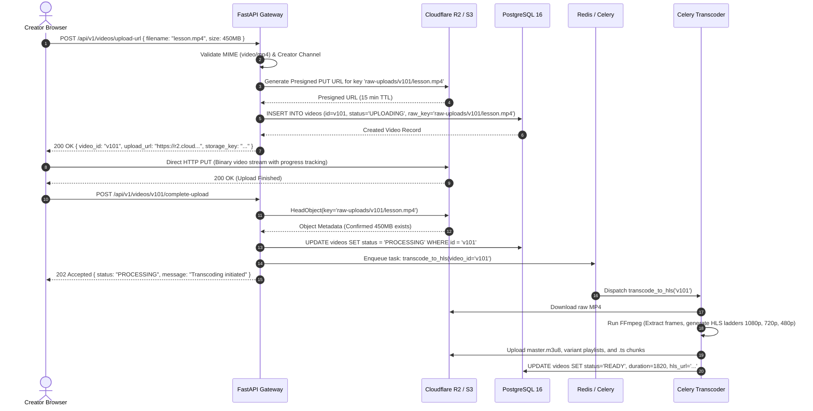
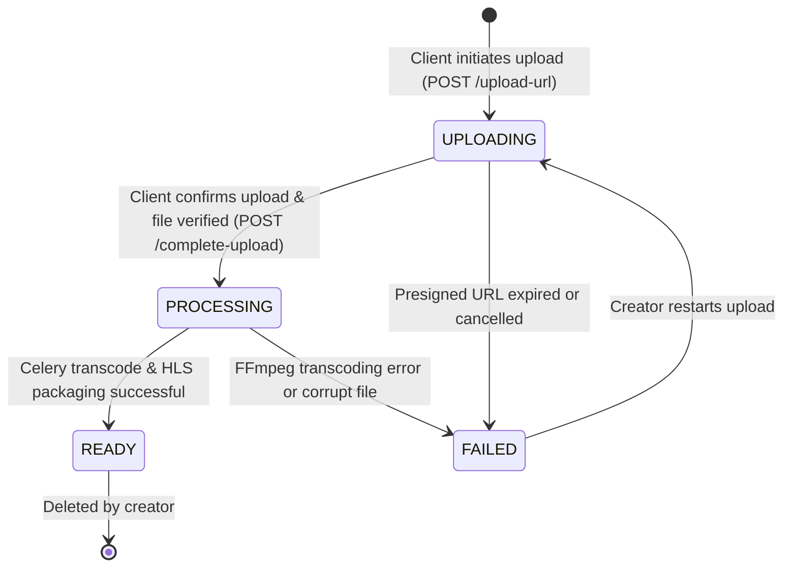
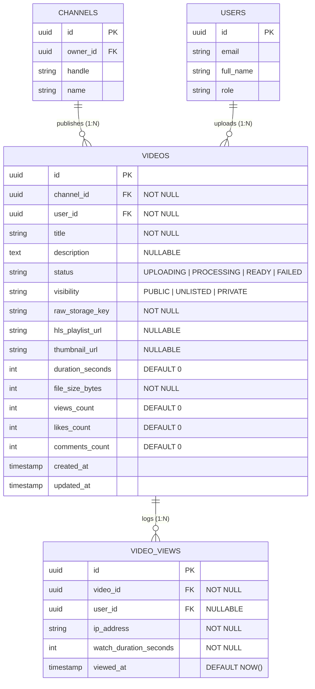
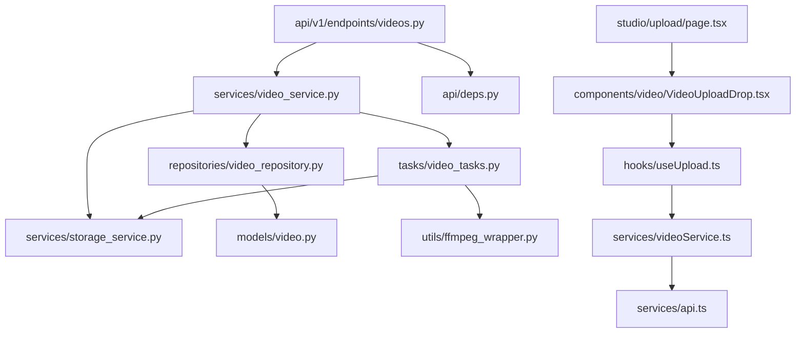

# Feature: Video Management & Cloud Ingestion Handshake

> **Document Type:** System Architecture & Open-Source Implementation Blueprint  
> **Feature Identifier:** Tier 2 — Lifecycle Workflows & Media Ingestion (Feature 05)  
> **Bounded Context:** Media Ingestion, Cloud Storage Handshake, Video Metadata Lifecycle & Playback Manifest Resolution  
> **Primary Target:** Open-Source Contributors, System Architects, Backend & Media Engineers  
> **Status:** Architecture Design & Implementation Guidance (Read-Only Blueprint)  

---

## 1. Feature Overview

In **RKSkillTube**, video is the primary educational currency. Video ingestion cannot be treated as a standard file upload; handling raw multi-gigabyte video files directly through a web application server causes thread starvation, high memory overhead, and severe bandwidth bottlenecks.

The **Video Management & Cloud Ingestion Handshake** establishes an enterprise-grade media pipeline that decouples file ingestion from the core application servers:

1. **Direct-to-Cloud Upload Handshake (Presigned URLs):**
   - The client application negotiates with the backend for a secure, short-lived presigned upload URL (pointing to Cloudflare R2 or AWS S3/Google Cloud Storage).
   - The browser streams the video binary directly to cloud object storage using chunked HTTP PUT requests with client-side progress tracking.
   - Upon upload completion, the client triggers an ingestion handshake callback (`complete-upload`) that verifies the raw object in storage and kicks off background processing.

2. **Video Metadata & Lifecycle State Machine:**
   - Tracks videos across explicit lifecycle states: `UPLOADING` $\rightarrow$ `PROCESSING` $\rightarrow$ `READY` (or `FAILED`).
   - Manages comprehensive metadata: title, description, tags, duration, thumbnail URLs, category, and access visibility (`PUBLIC`, `UNLISTED`, `PRIVATE`).
   - Provides creator studio management capabilities to search, update, and moderate uploaded video assets.

3. **Playback Manifest Resolution & Rate-Limited View Tracking:**
   - Exposes playback endpoints (`GET /videos/{id}/playback`) that enforce access control (public vs. private vs. enrolled students) before resolving the HLS stream manifest (`.m3u8`).
   - Records verified video views with anti-abuse rate limiting (preventing automated view inflation).

---

## 2. Project Architecture Context

RKSkillTube employs a hybrid cloud architecture combining **FastAPI** (Python 3.11+ ASGI), **Celery + Redis** for asynchronous task execution, and **Next.js 16+** for the creator and learner interfaces:

```
┌────────────────────────────────────────────────────────────────────────┐
│                      CLIENT TIER (Next.js 16+ / TS)                    │
│  • Creator Studio:    app/(creator)/studio/upload/page.tsx             │
│  • Video Manager:     app/(creator)/studio/videos/page.tsx             │
│  • Upload Component:  components/video/VideoUploadDrop.tsx             │
│  • Upload Hook:       hooks/useUpload.ts (Direct PUT with Progress)    │
│  • Video Player:      components/video/HlsPlayer.tsx                   │
└───────────────────┬────────────────────────────────┬───────────────────┘
                    │ 1. Request Presigned URL       │ 2. Direct Binary PUT
                    ▼                                ▼
┌──────────────────────────────────────┐  ┌──────────────────────────────┐
│  API GATEWAY / BACKEND (FastAPI)     │  │  OBJECT STORAGE (R2 / S3)    │
│  • endpoints/videos.py               │  │  • raw-uploads/ (Incoming)   │
│  • services/storage_service.py       │  │  • hls-streams/ (Transcoded) │
│  • services/video_service.py         │  │  • thumbnails/  (Images)     │
└───────────────────┬──────────────────┘  └──────────────┬───────────────┘
                    │ 3. Enqueue Ingestion Task          │
                    ▼                                    │ Transcode Pipeline
┌──────────────────────────────────────┐                 │
│  DISTRIBUTED WORKERS (Celery)        │                 ▼
│  • tasks/video_tasks.py              │◄────────────────┘
│  • utils/ffmpeg_wrapper.py           │
│  • tasks/thumbnail_tasks.py          │
└───────────────────┬──────────────────┘
                    │
                    ▼
       ┌─────────────────────────┐
       │    PostgreSQL 16 DB     │
       │   • videos (State/Meta) │
       │   • video_views (Stats) │
       └─────────────────────────┘
```

### Architectural Principles Enforced:
- **Zero-Proxy Cloud Ingestion:** Raw media binaries NEVER traverse the FastAPI application servers. Application servers handle only lightweight JSON negotiation; heavy file bytes flow directly from browser to object storage.
- **Strict State Machine Integrity:** A video cannot transition to `READY` until storage verification, duration extraction, and HLS packaging succeed.
- **Fail-Safe Asynchronous Offloading:** CPU-intensive FFmpeg transcoding runs on dedicated Celery worker nodes, ensuring zero degradation of web API responsiveness.

---

## 3. Existing System Analysis

An audit of the RKSkillTube codebase reveals existing scaffolding prepared for video ingestion:

### Backend Scaffolding (`backend/`):
- **Endpoints & Routing:**
  - [backend/app/api/v1/endpoints/videos.py](file:///e:/Projects/Open%20Source%20Contributions/RKSkillTube/backend/app/api/v1/endpoints/videos.py): Empty endpoint placeholder. Ready for upload handshake, metadata CRUD, playback, and view counting.
  - [backend/app/api/v1/router.py](file:///e:/Projects/Open%20Source%20Contributions/RKSkillTube/backend/app/api/v1/router.py): Master router ready to register `videos.router`.
- **Services & Storage Abstractions:**
  - [backend/app/services/storage_service.py](file:///e:/Projects/Open%20Source%20Contributions/RKSkillTube/backend/app/services/storage_service.py): Empty placeholder. Intended for AWS S3 / Cloudflare R2 / GCS presigned URL generation and bucket existence checks.
  - [backend/app/services/video_service.py](file:///e:/Projects/Open%20Source%20Contributions/RKSkillTube/backend/app/services/video_service.py): Empty placeholder. Intended to coordinate video lifecycle transitions, metadata validation, and Celery task dispatching.
- **Worker & Transcoding Pipeline:**
  - [backend/app/celery_worker.py](file:///e:/Projects/Open%20Source%20Contributions/RKSkillTube/backend/app/celery_worker.py): Celery instance setup placeholder.
  - [backend/app/tasks/video_tasks.py](file:///e:/Projects/Open%20Source%20Contributions/RKSkillTube/backend/app/tasks/video_tasks.py): Task placeholder for `transcode_to_hls`.
  - [backend/app/utils/ffmpeg_wrapper.py](file:///e:/Projects/Open%20Source%20Contributions/RKSkillTube/backend/app/utils/ffmpeg_wrapper.py): Utility placeholder for invoking FFmpeg subprocess commands.
  - [backend/app/tasks/thumbnail_tasks.py](file:///e:/Projects/Open%20Source%20Contributions/RKSkillTube/backend/app/tasks/thumbnail_tasks.py): Task placeholder for poster and storyboard tile extraction.
- **Models & Repositories:**
  - [backend/app/models/video.py](file:///e:/Projects/Open%20Source%20Contributions/RKSkillTube/backend/app/models/video.py): Empty placeholder for `Video` and `VideoView` entities.
  - [backend/app/repositories/video_repository.py](file:///e:/Projects/Open%20Source%20Contributions/RKSkillTube/backend/app/repositories/video_repository.py): Empty placeholder for video data access.
  - [backend/app/schemas/video.py](file:///e:/Projects/Open%20Source%20Contributions/RKSkillTube/backend/app/schemas/video.py): Empty placeholder for Pydantic request/response models.

### Frontend Scaffolding (`frontend/`):
- **Upload & Studio Pages:**
  - [frontend/src/app/(creator)/studio/upload/page.tsx](file:///e:/Projects/Open%20Source%20Contributions/RKSkillTube/frontend/src/app/(creator)/studio/upload/page.tsx): Studio upload wizard placeholder.
  - [frontend/src/app/(creator)/studio/videos/page.tsx](file:///e:/Projects/Open%20Source%20Contributions/RKSkillTube/frontend/src/app/(creator)/studio/videos/page.tsx): Creator video listing and status manager placeholder.
- **Components & Hooks:**
  - [frontend/src/components/video/VideoUploadDrop.tsx](file:///e:/Projects/Open%20Source%20Contributions/RKSkillTube/frontend/src/components/video/VideoUploadDrop.tsx): Drag-and-drop file upload component placeholder.
  - [frontend/src/hooks/useUpload.ts](file:///e:/Projects/Open%20Source%20Contributions/RKSkillTube/frontend/src/hooks/useUpload.ts): Upload hook placeholder for presigned URL PUT requests with progress events.
  - [frontend/src/services/videoService.ts](file:///e:/Projects/Open%20Source%20Contributions/RKSkillTube/frontend/src/services/videoService.ts): Video API client methods placeholder.
  - [frontend/src/types/video.ts](file:///e:/Projects/Open%20Source%20Contributions/RKSkillTube/frontend/src/types/video.ts): TypeScript interfaces placeholder.

---

## 4. Functional Requirements

### A. Presigned Ingestion Handshake
1. **Presigned URL Request (`POST /api/v1/videos/upload-url`):**
   - Authenticated creator submits file metadata: `filename`, `content_type`, `file_size_bytes`, and optional initial `title`.
   - Backend validates allowed MIME types (`video/mp4`, `video/webm`, `video/quicktime`), maximum file size (e.g. 5 GB), and creator authorization.
   - Backend provisions a new `Video` record with `status = 'UPLOADING'`, generates a unique storage key (`raw-uploads/{video_id}/{uuid}.mp4`), and signs a temporary presigned PUT URL (15-minute TTL).
2. **Direct Binary Upload:**
   - The browser streams the raw binary directly to the object storage bucket via HTTP PUT.
   - Frontend displays real-time progress percentage ($0\% \rightarrow 100\%$) and upload speed.
3. **Ingestion Confirmation Handshake (`POST /api/v1/videos/{id}/complete-upload`):**
   - Client notifies backend that the direct upload completed.
   - Backend performs an atomic `HeadObject` check against cloud storage to confirm the file exists and matches the registered size.
   - Backend transitions video status to `PROCESSING` and immediately enqueues a Celery task (`transcode_to_hls`).

### B. Video Metadata & Studio Management
1. **Metadata Customization:** Creators can update title, description, category, tags, and visibility (`PUBLIC`, `UNLISTED`, `PRIVATE`).
2. **Custom Poster Upload:** Creators can upload a custom thumbnail image via a separate presigned image upload flow or choose an auto-generated frame.
3. **Creator Studio Library:** Creators can view a paginated list of their uploaded videos with filtering by status (`UPLOADING`, `PROCESSING`, `READY`, `FAILED`) and visibility.
4. **Video Deletion:** Owners can soft-delete or permanently remove a video. Deleting a video triggers cleanup of raw files and transcoded chunks from object storage.

### C. Playback Manifest Resolution
1. **Stream Resolution (`GET /api/v1/videos/{id}/playback`):**
   - Resolves the master HLS stream URL (`https://cdn.example.com/hls/{video_id}/master.m3u8`).
   - Validates access rules:
     - `PUBLIC` or `UNLISTED`: Available to all visitors.
     - `PRIVATE`: Restricted strictly to the video owner or platform administrators.
     - Course lessons: Verifies enrollment entitlement.
   - Returns playback parameters: stream URL, duration, available resolutions (`1080p`, `720p`, `480p`, `360p`), and storyboard VTT sprite URL.

### D. View Count Recording & Rate Limiting
1. **View Pulse (`POST /api/v1/videos/{id}/view`):**
   - Client heartbeat sends a view confirmation after the student watches at least 30 seconds of content.
   - Backend checks a sliding-window rate limit in Redis (`view:{video_id}:{ip_or_user_id}`) to ensure the same viewer cannot artificially inflate views within a 30-minute window.
   - Increments the `views_count` counter atomically.

---

## 5. Non-Functional Requirements

- **Zero API Server Memory Bloat:** Application servers must never buffer video chunks in memory or on local disk. Memory footprint per upload request on the API layer must remain under 10 KB (handling only JSON payloads).
- **Scalable Media Storage (Cloudflare R2 / AWS S3):** Object storage buckets must be configured with CORS rules permitting HTTP PUT from platform domains, with strict lifecycle rules deleting stale unconfirmed uploads after 24 hours.
- **Asynchronous Fault Tolerance:** The transcoding Celery worker must handle failures gracefully. If FFmpeg transcoding fails (e.g. corrupt codec), the video record is marked `FAILED` with an error message stored in the database, allowing creator retry.
- **Global Low-Latency Streaming:** Transcoded HLS chunks (`.ts`) and master playlists (`.m3u8`) must be served through an edge CDN (Cloudflare CDN / CloudFront) with immutable caching headers (`Cache-Control: public, max-age=31536000, immutable`).

---

## 6. Assumptions and Open Questions

### Assumptions:
- Cloudflare R2 or AWS S3 is configured with valid credentials in `backend/app/config.py` (`S3_BUCKET_NAME`, `S3_ENDPOINT_URL`, `AWS_ACCESS_KEY_ID`, `AWS_SECRET_ACCESS_KEY`).
- Creators must own a channel before they are allowed to upload videos (`channel_id` is required).
- Transcoding generates standard HLS adaptive bitrate streams with resolutions: `1080p` (if source $\ge 1080p$), `720p`, `480p`, and `360p`.

### Open Questions for Contributors & Maintainers:
1. *Multipart vs. Single-PUT Presigned Upload:* Should uploads over 100 MB use S3 Multipart Presigned Uploads or single PUT? *(Recommendation: Start with single PUT for files up to 1 GB in Tier 2; introduce S3 Multipart with chunk resumes in Phase 3 for 5 GB+ files).*
2. *Webhook vs. Polling for Transcoding Status:* How does the creator studio know when processing completes? *(Recommendation: Client polls `GET /api/v1/videos/{id}` every 5 seconds while status is `PROCESSING`, with WebSocket / SSE push notifications planned for Phase 3).*

---

## 7. Low-Level Design (LLD)

### 7.1 Component Design

```
┌────────────────────────────────────────────────────────────────────────┐
│                        FastAPI PRESENTATION LAYER                      │
│   • endpoints/videos.py                                                │
│       - POST   /api/v1/videos/upload-url     (Generate Presigned PUT)  │
│       - POST   /api/v1/videos/{id}/complete  (Confirm Upload & Enqueue)│
│       - GET    /api/v1/videos/{id}           (Public Details)          │
│       - PUT    /api/v1/videos/{id}           (Update Metadata)         │
│       - DELETE /api/v1/videos/{id}           (Delete Video)            │
│       - GET    /api/v1/videos/{id}/playback  (Resolve Stream URL)      │
│       - POST   /api/v1/videos/{id}/view      (Record Verified View)    │
│       - GET    /api/v1/creator/videos        (Creator Studio List)     │
└───────────────────────────────────┬────────────────────────────────────┘
                                    │ Injects Dependencies
                                    ▼
┌────────────────────────────────────────────────────────────────────────┐
│                      DEPENDENCY INJECTION & GUARDS                     │
│   • api/deps.py                                                        │
│       - get_current_active_user(): Authenticates caller                │
│       - require_creator_channel(): Asserts caller owns a channel       │
│       - require_video_owner(): Asserts caller owns video or is admin   │
└───────────────────────────────────┬────────────────────────────────────┘
                                    │ Invokes Services
                                    ▼
┌────────────────────────────────────────────────────────────────────────┐
│                        SERVICES LAYER (Business Logic)                 │
│   • services/video_service.py                                          │
│       - initiate_upload(channel_id, user_id, data)                     │
│       - confirm_upload(video_id, user_id)                              │
│       - get_playback_manifest(video_id, viewer_id)                     │
│       - record_video_view(video_id, client_ip, user_id)                │
│   • services/storage_service.py                                        │
│       - generate_presigned_put_url(key, content_type, ttl)             │
│       - verify_file_exists(key) -> bool                                │
│       - delete_file(key)                                               │
└───────────────────┬───────────────────────────────┬────────────────────┘
                    │ DB Operations                 │ Task Enqueuing
                    ▼                               ▼
┌──────────────────────────────────────┐  ┌──────────────────────────────┐
│  REPOSITORIES (Data Access)          │  │  CELERY BACKGROUND WORKERS   │
│  • repositories/video_repository.py  │  │  • tasks/video_tasks.py      │
│      - CRUD, state updates, counters │  │      - transcode_to_hls()    │
└───────────────────┬──────────────────┘  │  • utils/ffmpeg_wrapper.py   │
                    │                     │  • tasks/thumbnail_tasks.py  │
                    ▼                     └──────────────────────────────┘
┌──────────────────────────────────────┐
│  PERSISTENCE LAYER (PostgreSQL 16)   │
│  • models/video.py                   │
│      - tables: videos, video_views   │
└──────────────────────────────────────┘
```

### 7.2 Ingestion Handshake Sequence Diagram



### 7.3 Video State Machine



---

## 8. High-Level Design (HLD)

### 8.1 System Context & Media Flow

```
                     ┌────────────────────────┐
                     │    Creator / Learner   │
                     └───────────┬────────────┘
                                 │
         ┌───────────────────────┼───────────────────────┐
         │ 1. Metadata / URL     │ 2. Direct PUT Binary  │ 4. Playback Manifest
         ▼                       ▼                       ▼
┌─────────────────┐     ┌─────────────────┐     ┌─────────────────┐
│ FastAPI Gateway │     │ Cloudflare R2   │     │ Cloudflare CDN  │
│ (Metadata/Auth) │     │ (Object Storage)│     │ (Edge Caching)  │
└────────┬────────┘     └────────┬────────┘     └────────▲────────┘
         │                       │                       │
         │ Enqueue Task          │ Read Raw / Save HLS   │ Pulls HLS
         ▼                       ▼                       │
┌─────────────────┐     ┌─────────────────┐              │
│ Redis Queue     │────►│ Celery Workers  │──────────────┘
│ (Job Broker)    │     │ (FFmpeg Engine) │
└─────────────────┘     └─────────────────┘
```

### 8.2 Architectural Decisions

1. **Direct-to-Cloud Upload vs. Backend Proxying:**
   - *Chosen Approach:* Direct-to-Cloud using Presigned PUT URLs.
   - *Rationale:* Streaming 1 GB+ video files through FastAPI would exhaust worker threads, create disk I/O bottlenecks, and multiply network egress costs. Direct uploads leverage the global edge network of Cloudflare R2 / S3 without touching API memory.

2. **Asynchronous Transcoding with Celery + FFmpeg:**
   - Transcoding is an asynchronous, multi-minute, CPU-intensive process.
   - Celery workers process jobs outside the web request cycle, downloading the raw MP4 from R2, generating HLS chunks, and uploading transcoded assets back to CDN-backed storage.

3. **Rate-Limited View Deduplication via Redis:**
   - Video view count is a high-frequency metric targeted by bots.
   - Instead of immediately incrementing the database on every HTTP call, the view endpoint checks Redis key `view:{video_id}:{ip_or_user}` with a 30-minute expiration TTL. Only verified unique views trigger an atomic database increment.

---

## 9. Architecture Diagrams

### 9.1 Entity-Relationship Diagram (ERD)



---

## 10. Database Design

### 10.1 `videos` Table

| Column | Type | Constraints | Description |
| :--- | :--- | :--- | :--- |
| `id` | `UUID` | Primary Key, `default=gen_random_uuid()` | Unique video identifier. |
| `channel_id` | `UUID` | Foreign Key (`channels.id` ON DELETE CASCADE), **NOT NULL, Indexed** | Publishing creator channel. |
| `user_id` | `UUID` | Foreign Key (`users.id` ON DELETE CASCADE), **NOT NULL, Indexed** | Uploader user account. |
| `title` | `VARCHAR(150)` | **NOT NULL** | Video title. |
| `description` | `TEXT` | Nullable | Detailed video description / markdown notes. |
| `status` | `VARCHAR(20)` | **NOT NULL, Default 'UPLOADING'** | Lifecycle state: `'UPLOADING'`, `'PROCESSING'`, `'READY'`, `'FAILED'`. |
| `visibility` | `VARCHAR(20)` | **NOT NULL, Default 'PUBLIC'** | Access tier: `'PUBLIC'`, `'UNLISTED'`, `'PRIVATE'`. |
| `raw_storage_key`| `VARCHAR(500)`| **NOT NULL** | Cloud storage path to uploaded source MP4. |
| `hls_playlist_url`| `VARCHAR(500)`| Nullable | CDN URL to master `.m3u8` playlist. |
| `thumbnail_url`| `VARCHAR(500)`| Nullable | CDN URL to video poster preview. |
| `duration_seconds`| `INTEGER`| **NOT NULL, Default 0** | Total video run time in seconds. |
| `file_size_bytes`| `BIGINT` | **NOT NULL** | Raw file size in bytes. |
| `views_count` | `INTEGER` | **NOT NULL, Default 0** | Denormalized count of verified views. |
| `likes_count` | `INTEGER` | **NOT NULL, Default 0** | Denormalized count of likes. |
| `comments_count`| `INTEGER` | **NOT NULL, Default 0** | Denormalized count of comments. |
| `created_at` | `TIMESTAMPTZ` | **NOT NULL, Default NOW()** | Initial record creation timestamp. |
| `updated_at` | `TIMESTAMPTZ` | **NOT NULL, Auto-update NOW()** | Last metadata update timestamp. |

#### Database Constraints & Indexes:
- **Index for Public Feed & Search:**  
  `CREATE INDEX idx_videos_public ON videos (created_at DESC) WHERE status = 'READY' AND visibility = 'PUBLIC';`
- **Index for Channel Video Listing:**  
  `CREATE INDEX idx_videos_channel_status ON videos (channel_id, status, created_at DESC);`

---

### 10.2 `video_views` Table (Audit Log & Analytics)

| Column | Type | Constraints | Description |
| :--- | :--- | :--- | :--- |
| `id` | `UUID` | Primary Key, `default=gen_random_uuid()` | Unique log identifier. |
| `video_id` | `UUID` | Foreign Key (`videos.id` ON DELETE CASCADE), **NOT NULL, Indexed** | Target video. |
| `user_id` | `UUID` | Foreign Key (`users.id` ON DELETE SET NULL), **Nullable, Indexed** | Logged-in viewer (null if guest). |
| `ip_address` | `VARCHAR(45)` | **NOT NULL** | IPv4 or IPv6 of the client. |
| `watch_duration_seconds`| `INTEGER` | **NOT NULL** | Seconds watched before heartbeat fired. |
| `viewed_at` | `TIMESTAMPTZ` | **NOT NULL, Default NOW(), Indexed** | Timestamp of view. |

#### Database Index:
- `CREATE INDEX idx_video_views_dedup ON video_views (video_id, ip_address, viewed_at DESC);`

---

## 11. API Design

### 11.1 Ingestion & Upload Endpoints

#### `POST /api/v1/videos/upload-url`
- **Purpose:** Request a presigned cloud storage URL for direct upload.
- **Auth:** Bearer Token (`CREATOR` role required, must own a channel).
- **Request Body:**
  ```json
  {
    "filename": "fastapi_concurrency.mp4",
    "content_type": "video/mp4",
    "file_size_bytes": 450000000,
    "title": "FastAPI Concurrency Deep Dive",
    "channel_id": "c-101"
  }
  ```
- **Validation Rules:**
  - `content_type` must be in `['video/mp4', 'video/webm', 'video/quicktime']`.
  - `file_size_bytes` must be $\le 5,368,709,120$ (5 GB).
  - Caller must be the owner of `channel_id`.
- **Response (200 OK):**
  ```json
  {
    "video_id": "8a31e84a-3211-4b10-8201-9a72b8109312",
    "upload_url": "https://<bucket>.r2.cloudflarestorage.com/raw-uploads/8a31e84a/fastapi_concurrency.mp4?X-Amz-Signature=...",
    "storage_key": "raw-uploads/8a31e84a/fastapi_concurrency.mp4",
    "expires_in_seconds": 900
  }
  ```

---

#### `POST /api/v1/videos/{id}/complete-upload`
- **Purpose:** Complete upload handshake, verify file in cloud storage, and trigger transcoding.
- **Auth:** Bearer Token (Video owner only).
- **Behavior:**
  - Performs an S3 `HeadObject` check on `raw_storage_key`.
  - Verifies file exists and size matches within $5\%$ tolerance.
  - Updates status to `PROCESSING`.
  - Enqueues Celery task `transcode_to_hls.delay(video_id)`.
- **Response (202 Accepted):**
  ```json
  {
    "video_id": "8a31e84a-3211-4b10-8201-9a72b8109312",
    "status": "PROCESSING",
    "message": "Upload confirmed. Video queued for HLS transcoding."
  }
  ```

---

### 11.2 Video Metadata & Management Endpoints

#### `GET /api/v1/videos/{id}`
- **Purpose:** Fetch public video metadata for watch page hydration.
- **Auth:** Optional.
- **Response (200 OK):**
  ```json
  {
    "id": "8a31e84a-3211-4b10-8201-9a72b8109312",
    "title": "FastAPI Concurrency Deep Dive",
    "description": "Comprehensive guide on async event loops.",
    "status": "READY",
    "visibility": "PUBLIC",
    "thumbnail_url": "https://cdn.example.com/thumbnails/8a31e84a.jpg",
    "duration_seconds": 1820,
    "views_count": 14200,
    "likes_count": 850,
    "created_at": "2026-11-03T12:00:00Z",
    "channel": {
      "id": "c-101",
      "name": "Backend Mastery",
      "handle": "backendmastery",
      "avatar_url": "https://cdn.example.com/avatars/c101.jpg"
    }
  }
  ```

#### `PUT /api/v1/videos/{id}`
- **Purpose:** Update video metadata (title, description, visibility, custom thumbnail).
- **Auth:** Bearer Token (Owner or Admin).
- **Request Body:**
  ```json
  {
    "title": "FastAPI Concurrency Deep Dive (Updated 2026)",
    "description": "Updated syllabus with Python 3.12 syntax.",
    "visibility": "PUBLIC"
  }
  ```

#### `DELETE /api/v1/videos/{id}`
- **Purpose:** Delete video and dispatch background file cleanup.
- **Auth:** Bearer Token (Owner or Admin).
- **Response (204 No Content)**.

---

### 11.3 Playback & View Tracking Endpoints

#### `GET /api/v1/videos/{id}/playback`
- **Purpose:** Resolve streaming manifest URL and playback parameters.
- **Auth:** Optional (required if video is `PRIVATE`).
- **Authorization Logic:**
  - If `status != 'READY'`, returns `422 Unprocessable Entity` ("Video is still processing").
  - If `visibility == 'PRIVATE'`, requires `current_user.id == video.user_id` or `ADMIN`.
- **Response (200 OK):**
  ```json
  {
    "video_id": "8a31e84a-3211-4b10-8201-9a72b8109312",
    "stream_url": "https://cdn.example.com/hls/8a31e84a/master.m3u8",
    "format": "HLS",
    "duration_seconds": 1820,
    "thumbnail_url": "https://cdn.example.com/thumbnails/8a31e84a.jpg",
    "storyboard_vtt_url": "https://cdn.example.com/hls/8a31e84a/storyboard.vtt"
  }
  ```

#### `POST /api/v1/videos/{id}/view`
- **Purpose:** Record verified playback progress and increment view count.
- **Auth:** Optional.
- **Request Body:**
  ```json
  {
    "watch_duration_seconds": 45
  }
  ```
- **Rate-Limiting Rule:**
  - Validates `watch_duration_seconds >= 30`.
  - Checks Redis key `view:{video_id}:{ip_address}`. If present, returns `200 OK` without incrementing counter.
  - If absent, sets key with TTL 1800 (30 mins) and executes `UPDATE videos SET views_count = views_count + 1`.

---

## 12. Security Analysis

### 12.0 Cryptographic Reference & Security Warnings
> [!CAUTION]
> **Presigned URL & Secret Key Management:**
> - **HMAC-SHA256 Signature Generation:** Presigned upload URLs are generated using the AWS S3 Signature Version 4 (SigV4) standard with HMAC-SHA256. Never use MD5 or legacy SigV2 signatures.
> - **Short Time-To-Live (TTL):** Presigned PUT URLs must have a maximum TTL of 15 minutes (900 seconds) to prevent stolen URLs from being reused.
> - **MIME Type Enforcement:** Presigned URLs must include the `Content-Type` header in the signed signature headers, preventing an attacker from uploading an `.exe` or `.html` file under a video URL.

### 12.1 Security Levels: Insecure to Production-Grade

| Level | Architecture Approach | Vulnerabilities & Pitfalls | Production Remediation |
| :--- | :--- | :--- | :--- |
| **Level 1 (Insecure)** | **Proxying Binary Files Through API Server** | • **Denial of Service (DoS):** Uploading large files exhausts API memory and connections.<br>• **Zip Bomb / Malicious Code:** Executable scripts uploaded directly to web server storage. | Shift entirely to Direct-to-Cloud Presigned PUT URLs; enforce strict cloud storage CORS. |
| **Level 2 (Improved)** | **Presigned URLs with No Size Validation** | • **Storage Exhaustion:** Attackers request a URL for a 50MB file and upload a 500GB file.<br>• **BOLA / IDOR:** Attackers trigger completion callbacks for videos they do not own. | Add `content-length-range` constraints to storage policies; verify ownership on callback. |
| **Level 3 (Production Ready)** | **Signed SigV4 Headers + HeadObject Size Check + MIME Whitelist** | • Exact size verification via cloud `HeadObject` before enqueuing transcoding.<br>• Strict MIME whitelist (`video/mp4`, `video/webm`, `video/quicktime`). | Standard baseline for RKSkillTube production release. |
| **Level 4 (Advanced)** | **Redis View Deduplication + Signed CloudFront Cookies for Paid Videos** | • Eliminates bot view-farming via Redis sliding windows.<br>• Protects course video streams using signed HLS manifest cookies. | Enterprise-grade streaming security. |

### 12.2 Critical Attack Vectors & Mitigations

1. **BOLA / IDOR on Video Metadata & Handshake:**
   - *Risk:* Malicious creator calls `POST /api/v1/videos/{target_id}/complete-upload` or `PUT /api/v1/videos/{target_id}` to take over another creator's video.
   - *Mitigation:* The `require_video_owner` dependency inspects `video.user_id == current_user.id` and raises `HTTP 403 Forbidden` if mismatched.

2. **MIME-Type Spoofing:**
   - *Risk:* Attacker uploads an HTML file with embedded JavaScript named `exploit.mp4` to perform Cross-Site Scripting (XSS) via the CDN domain.
   - *Mitigation:* The presigned URL signs the exact `Content-Type: video/mp4`. During transcoding, FFmpeg probes the file (`ffprobe`); if the codec stream is not a valid video format, the worker rejects the file and marks it `FAILED`.

3. **View Count Botting / Fraud:**
   - *Risk:* Automated scripts invoke `POST /videos/{id}/view` thousands of times per minute to artificially inflate trending statistics.
   - *Mitigation:* Require a minimum watch duration threshold ($\ge 30$ seconds) and enforce a 30-minute Redis cooldown keyed by hashed IP and video ID.

---

## 13. Existing Files Analysis

### A. Directly Reusable Files
- [backend/app/api/deps.py](file:///e:/Projects/Open%20Source%20Contributions/RKSkillTube/backend/app/api/deps.py): Reuses `get_current_active_user` and `get_optional_current_user`.
- [backend/app/config.py](file:///e:/Projects/Open%20Source%20Contributions/RKSkillTube/backend/app/config.py): Holds S3 credentials, bucket name, and CDN base URL.
- [backend/app/models/base.py](file:///e:/Projects/Open%20Source%20Contributions/RKSkillTube/backend/app/models/base.py): Base declarative SQLAlchemy model.
- [frontend/src/services/api.ts](file:///e:/Projects/Open%20Source%20Contributions/RKSkillTube/frontend/src/services/api.ts): Base Axios client with authentication headers.
- [frontend/src/components/video/HlsPlayer.tsx](file:///e:/Projects/Open%20Source%20Contributions/RKSkillTube/frontend/src/components/video/HlsPlayer.tsx): HLS video player component.

### B. Files That Need Implementation / Modification
- [backend/app/models/video.py](file:///e:/Projects/Open%20Source%20Contributions/RKSkillTube/backend/app/models/video.py): Implement `Video` and `VideoView` SQLAlchemy entities.
- [backend/app/api/v1/endpoints/videos.py](file:///e:/Projects/Open%20Source%20Contributions/RKSkillTube/backend/app/api/v1/endpoints/videos.py): Implement presigned upload, completion callback, playback resolution, and view pulse endpoints.
- [backend/app/api/v1/router.py](file:///e:/Projects/Open%20Source%20Contributions/RKSkillTube/backend/app/api/v1/router.py): Mount `videos.router` under `/api/v1/videos`.
- [backend/app/services/storage_service.py](file:///e:/Projects/Open%20Source%20Contributions/RKSkillTube/backend/app/services/storage_service.py): Implement boto3 / Cloudflare R2 presigned URL generator and `head_object` check.
- [backend/app/services/video_service.py](file:///e:/Projects/Open%20Source%20Contributions/RKSkillTube/backend/app/services/video_service.py): Implement video business logic and Celery dispatch.
- [backend/app/repositories/video_repository.py](file:///e:/Projects/Open%20Source%20Contributions/RKSkillTube/backend/app/repositories/video_repository.py): Implement video persistence operations.
- [backend/app/schemas/video.py](file:///e:/Projects/Open%20Source%20Contributions/RKSkillTube/backend/app/schemas/video.py): Implement Pydantic validation models.
- [backend/app/tasks/video_tasks.py](file:///e:/Projects/Open%20Source%20Contributions/RKSkillTube/backend/app/tasks/video_tasks.py): Implement `transcode_to_hls` Celery background task.
- [frontend/src/hooks/useUpload.ts](file:///e:/Projects/Open%20Source%20Contributions/RKSkillTube/frontend/src/hooks/useUpload.ts): Implement presigned PUT request with Axios `onUploadProgress`.
- [frontend/src/components/video/VideoUploadDrop.tsx](file:///e:/Projects/Open%20Source%20Contributions/RKSkillTube/frontend/src/components/video/VideoUploadDrop.tsx): Build drop zone with progress indicator.
- [frontend/src/app/(creator)/studio/upload/page.tsx](file:///e:/Projects/Open%20Source%20Contributions/RKSkillTube/frontend/src/app/(creator)/studio/upload/page.tsx): Build creator upload wizard.
- [frontend/src/services/videoService.ts](file:///e:/Projects/Open%20Source%20Contributions/RKSkillTube/frontend/src/services/videoService.ts): Implement video API client methods.
- [frontend/src/types/video.ts](file:///e:/Projects/Open%20Source%20Contributions/RKSkillTube/frontend/src/types/video.ts): Define TypeScript contracts.

### C. Proposed New Files Required
- `backend/app/utils/ffmpeg_wrapper.py`: Python wrapper around FFmpeg CLI subprocess for HLS chunking and frame extraction.
- `frontend/src/components/video/VideoStatusBadge.tsx`: Visual badge for video status (`UPLOADING`, `PROCESSING`, `READY`, `FAILED`).

### D. Files That Should NOT Be Modified
- `backend/app/models/user.py`: User model should not contain video-specific columns.
- `backend/app/core/security.py`: JWT token validation is decoupled from media handling.

### E. Architectural Dependency Map



---

## 14. Implementation Roadmap (Milestones)

### Milestone 1: Database Models & State Schema
- **Goal:** Create `videos` and `video_views` tables with status enums and foreign key cascades.
- **Inspect:** [backend/app/models/base.py](file:///e:/Projects/Open%20Source%20Contributions/RKSkillTube/backend/app/models/base.py), [backend/app/models/channel.py](file:///e:/Projects/Open%20Source%20Contributions/RKSkillTube/backend/app/models/channel.py).
- **Implement In:** [backend/app/models/video.py](file:///e:/Projects/Open%20Source%20Contributions/RKSkillTube/backend/app/models/video.py), `backend/app/alembic/versions/...`.
- **Architectural Hint:** Use an explicit status enum (`UPLOADING`, `PROCESSING`, `READY`, `FAILED`) and index `(channel_id, status)`.

### Milestone 2: Cloud Storage Service & Presigned URL Generation
- **Goal:** Implement S3/R2 client using `boto3` to sign temporary PUT URLs.
- **Implement In:** [backend/app/services/storage_service.py](file:///e:/Projects/Open%20Source%20Contributions/RKSkillTube/backend/app/services/storage_service.py).
- **Architectural Hint:** Use `boto3.client('s3')` with `generate_presigned_url('put_object', Params={'Bucket': ..., 'Key': ..., 'ContentType': ...}, ExpiresIn=900)`.

### Milestone 3: Handshake Endpoints & Video Repository
- **Goal:** Build the presigned URL request and completion confirmation endpoints.
- **Implement In:** [backend/app/repositories/video_repository.py](file:///e:/Projects/Open%20Source%20Contributions/RKSkillTube/backend/app/repositories/video_repository.py), [backend/app/services/video_service.py](file:///e:/Projects/Open%20Source%20Contributions/RKSkillTube/backend/app/services/video_service.py), [backend/app/api/v1/endpoints/videos.py](file:///e:/Projects/Open%20Source%20Contributions/RKSkillTube/backend/app/api/v1/endpoints/videos.py).
- **Architectural Hint:** In `complete_upload`, call `storage_service.verify_file_exists(raw_key)` before transitioning status to `PROCESSING`.

### Milestone 4: FFmpeg Transcoding Celery Task
- **Goal:** Process raw video into multi-bitrate HLS adaptive streams.
- **Implement In:** [backend/app/utils/ffmpeg_wrapper.py](file:///e:/Projects/Open%20Source%20Contributions/RKSkillTube/backend/app/utils/ffmpeg_wrapper.py), [backend/app/tasks/video_tasks.py](file:///e:/Projects/Open%20Source%20Contributions/RKSkillTube/backend/app/tasks/video_tasks.py).
- **Architectural Hint:** Use `ffprobe` to inspect source video resolution; generate 4-second `.ts` chunks with a master `.m3u8` playlist. Mark video `READY` on completion.

### Milestone 5: Playback Resolution & Rate-Limited View Tracking
- **Goal:** Expose playback stream manifest and record unique views.
- **Implement In:** [backend/app/api/v1/endpoints/videos.py](file:///e:/Projects/Open%20Source%20Contributions/RKSkillTube/backend/app/api/v1/endpoints/videos.py).
- **Architectural Hint:** Use Redis `SET view:{video_id}:{ip} 1 EX 1800 NX` to ensure a viewer cannot count more than 1 view every 30 minutes.

### Milestone 6: Frontend Direct-to-Cloud Upload Hook
- **Goal:** Build direct upload engine with progress tracking in React/Next.js.
- **Implement In:** [frontend/src/hooks/useUpload.ts](file:///e:/Projects/Open%20Source%20Contributions/RKSkillTube/frontend/src/hooks/useUpload.ts), [frontend/src/services/videoService.ts](file:///e:/Projects/Open%20Source%20Contributions/RKSkillTube/frontend/src/services/videoService.ts).
- **Architectural Hint:** Use standard `axios.put(uploadUrl, file, { headers: { 'Content-Type': file.type }, onUploadProgress: ... })`.

### Milestone 7: Creator Studio Upload Wizard & Video Manager
- **Goal:** Deliver the creator upload UI and video management table.
- **Implement In:** [frontend/src/components/video/VideoUploadDrop.tsx](file:///e:/Projects/Open%20Source%20Contributions/RKSkillTube/frontend/src/components/video/VideoUploadDrop.tsx), [frontend/src/app/(creator)/studio/upload/page.tsx](file:///e:/Projects/Open%20Source%20Contributions/RKSkillTube/frontend/src/app/(creator)/studio/upload/page.tsx), [frontend/src/app/(creator)/studio/videos/page.tsx](file:///e:/Projects/Open%20Source%20Contributions/RKSkillTube/frontend/src/app/(creator)/studio/videos/page.tsx).
- **Architectural Hint:** Show polling progress badge while status is `PROCESSING`.

---

## 15. Hints and Socratic Engineering Questions

1. *Why is streaming raw video files through FastAPI to local disk a severe architectural anti-pattern for a production video platform? How does direct-to-cloud presigned URL uploading resolve this?*
2. *What happens if a creator starts an upload, receives a presigned URL, but closes their browser at 50%? How do S3 bucket lifecycle rules prevent orphan data accumulation in the `raw-uploads/` bucket?*
3. *Why must the `complete-upload` callback verify the file via `HeadObject` on cloud storage rather than trusting the frontend's claim that the upload finished?*
4. *How does generating an adaptive bitrate HLS ladder (1080p, 720p, 480p, 360p) improve user experience for students on slow mobile networks compared to serving a single static 1080p MP4?*
5. *Why should video view increments be gated behind a watch duration threshold ($\ge 30$ seconds) and a Redis deduplication key rather than firing immediately when the watch page mounts?*

---

## 16. Testing Strategy

### A. Unit Tests (`backend/tests/unit/test_video_service.py`)
- **Presigned URL Validation:** Reject unapproved MIME types (`application/pdf`, `image/png`) and files exceeding 5 GB.
- **Mismatched Channel Ownership:** User attempting to upload to another creator's channel receives `403 Forbidden`.
- **State Machine Guard:** Calling `complete_upload` on a video already marked `READY` raises `BadRequestException`.

### B. Integration Tests (`backend/tests/integration/test_video_api.py`)
- **Upload Handshake Flow:**
  1. `POST /api/v1/videos/upload-url` returns valid presigned URL and creates `UPLOADING` record.
  2. Mock S3 `HeadObject` returning success.
  3. `POST /api/v1/videos/{id}/complete-upload` sets status to `PROCESSING` and dispatches Celery task.
- **Playback Resolution:**
  - `GET /api/v1/videos/{id}/playback` on a `PROCESSING` video returns `422 Unprocessable Entity`.
  - On a `READY` video, returns full HLS master stream URL.
- **View Pulse Deduplication:**
  - Calling `POST /videos/{id}/view` with duration 10 seconds does not increment view count.
  - Calling with duration 35 seconds increments count from 0 to 1. Immediate second call returns 200 but keeps count at 1 (deduplicated).

### C. Security & Authorization Tests (`backend/tests/integration/test_video_security.py`)
- **BOLA Protection:** User B calling `PUT /api/v1/videos/{user_a_video_id}` receives `403 Forbidden`.
- **Private Stream Shield:** Unauthenticated guest requesting playback for a `PRIVATE` video receives `403 Forbidden`.

---

## 17. Engineering Trade-offs

| Decision | Option A | Option B | Selected Choice & Rationale |
| :--- | :--- | :--- | :--- |
| **Upload Pathway** | Proxy binary upload through FastAPI server | Direct-to-Cloud Presigned PUT URL | **Option B (Direct-to-Cloud):** Keeps API servers stateless and lightweight, eliminating memory exhaustion and double-bandwidth egress costs. |
| **Stream Delivery** | Progressive single-file MP4 download | Adaptive Bitrate HLS (`.m3u8` + `.ts` chunks) | **Option B (HLS):** Automatically switches video quality to match the learner's network conditions, preventing playback buffering. |
| **Transcoding Engine** | Synchronous background thread on API node | Distributed asynchronous Celery workers | **Option B (Celery Workers):** Prevents CPU-intensive FFmpeg encoding from freezing API request handlers. Workers can scale horizontally on GPU/high-CPU instances. |
| **View Counter Storage** | Synchronous DB write on page load | Redis sliding-window deduplication with async flush | **Option B (Redis Buffer):** Protects the primary PostgreSQL database from lock contention and write storms during viral video surges. |

---

## 18. Learning Resources

1. **Cloud Ingestion & Presigned URLs:**
   - [AWS Boto3 S3 Presigned URLs Guide](https://boto3.amazonaws.com/v1/documentation/api/latest/guide/s3-presigned-urls.html) — Generating secure temporary PUT signatures.
   - [Cloudflare R2 Direct Uploads](https://developers.cloudflare.com/r2/api/s3/presigned-urls/) — S3-compatible zero-egress object storage.
2. **Video Transcoding & HLS Packaging:**
   - [FFmpeg Documentation on HLS Multiplexer](https://ffmpeg.org/ffmpeg-formats.html#hls-2) — Generating multi-bitrate HLS playlists and video chunks.
   - [Apple HTTP Live Streaming (HLS) Authoring Guidelines](https://developer.apple.com/documentation/http-live-streaming/hls-authoring-specification-for-apple-devices) — Industry-standard segment durations and ladder bitrates.
3. **Distributed Tasks & Concurrency:**
   - [Celery Task Queues with Redis](https://docs.celeryq.dev/en/stable/getting-started/first-steps-with-celery.html) — Offloading asynchronous video encoding tasks.
   - [FastAPI Streaming & Background Workflows](https://fastapi.tiangolo.com/tutorial/background-tasks/) — Managing async API responses.
4. **Security & Anti-Abuse:**
   - [OWASP File Upload Security Cheat Sheet](https://cheatsheetseries.owasp.org/cheatsheets/File_Upload_Cheat_Sheet.html) — Safe file handling, MIME validation, and cloud storage bucket isolation.

---

## 19. Acceptance Criteria (Definition of Done)

- [ ] Database migration successfully creates `videos` and `video_views` tables with indexes and status constraints.
- [ ] Authenticated creators can request a presigned upload URL via `POST /api/v1/videos/upload-url`.
- [ ] Direct HTTP PUT from client to object storage completes with progress reporting in `useUpload.ts`.
- [ ] `POST /api/v1/videos/{id}/complete-upload` verifies file existence via `HeadObject` and enqueues Celery task.
- [ ] Celery worker runs FFmpeg transcoding, generating HLS multi-bitrate chunks and master playlist.
- [ ] `GET /api/v1/videos/{id}/playback` resolves the HLS manifest URL for ready videos with access control enforcement.
- [ ] `POST /api/v1/videos/{id}/view` increments views with rate-limiting and 30-second duration validation.
- [ ] Non-owners attempting to edit or delete videos receive `403 Forbidden`.
- [ ] Test suite achieves $\ge 85\%$ coverage across upload handshake, playback, and view tracking.

---

## 20. Contributor Pull Request Checklist

Before submitting a PR for this feature:
- [ ] I have strictly followed Clean Layered Architecture (Router $\rightarrow$ Service $\rightarrow$ Repository $\rightarrow$ Model).
- [ ] I have verified that raw media binaries are uploaded directly to cloud storage and never buffered on the API server.
- [ ] I have enclosed video status transitions within atomic transactions.
- [ ] I have verified that presigned URLs have a TTL not exceeding 15 minutes.
- [ ] I have included Alembic migrations under `backend/app/alembic/versions/`.
- [ ] I have written comprehensive unit and integration tests with mocked S3 storage responses.
- [ ] I have verified that all TypeScript interfaces in `frontend/src/types/video.ts` match backend Pydantic schemas.

---

## 21. Final Architecture Recommendations & Document Checksum

### Architectural Recommendations:
1. **Cloud Storage CORS Configuration:** Ensure the object storage bucket has CORS configured to permit `PUT` and `HEAD` requests from your frontend domains, with `ETag` and `Content-Type` exposed in headers.
2. **CDN Path Invalidation:** If a creator re-transcodes a video or replaces a thumbnail, configure a CDN cache invalidation hook to prevent stale edge cache delivery.
3. **Chunked Polling Backoff:** In the creator studio, implement exponential backoff when polling video processing status (e.g., 3s, 5s, 10s, 15s) to minimize API query load during long transcoding tasks.

### Document Integrity Checksum:
- **Specification File:** `Feature Based Guide/05-Video-Management-&-Cloud-Ingestion-Handshake.md`
- **MD5 Checksum:** `291AA41E616990BEA65565A77ACD285E`
- **SHA-256 Checksum:** `C20907BE48F6A9C9F9EFDD10CF9B37398FB103ACB55F0B729307ADA2FFC46F38`
- **Verification Command (PowerShell):**
  ```powershell
  Get-FileHash -Path "Feature Based Guide\05-Video-Management-&-Cloud-Ingestion-Handshake.md" -Algorithm MD5
  ```
