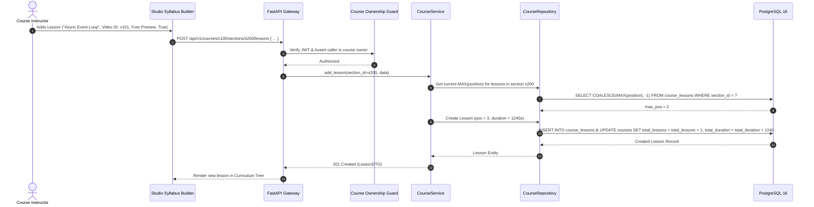
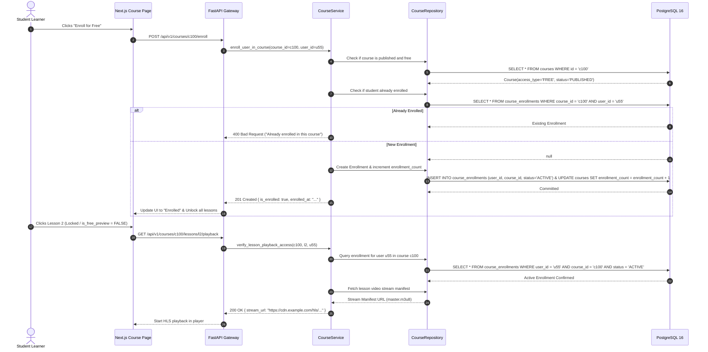
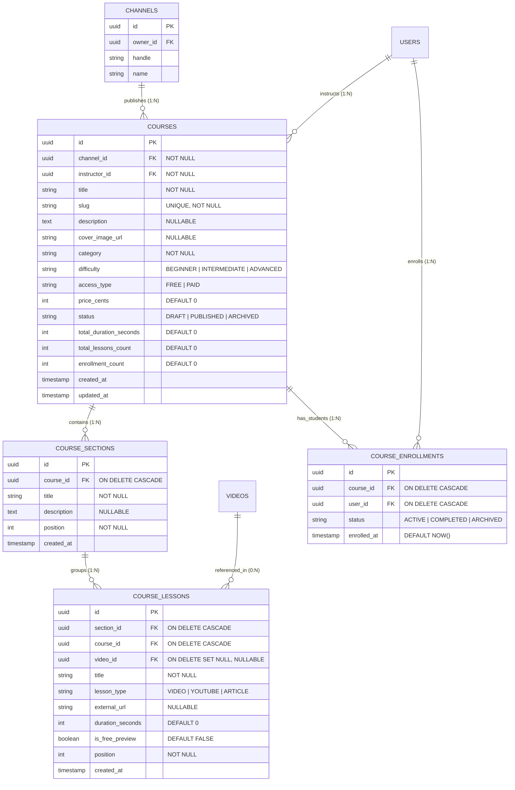
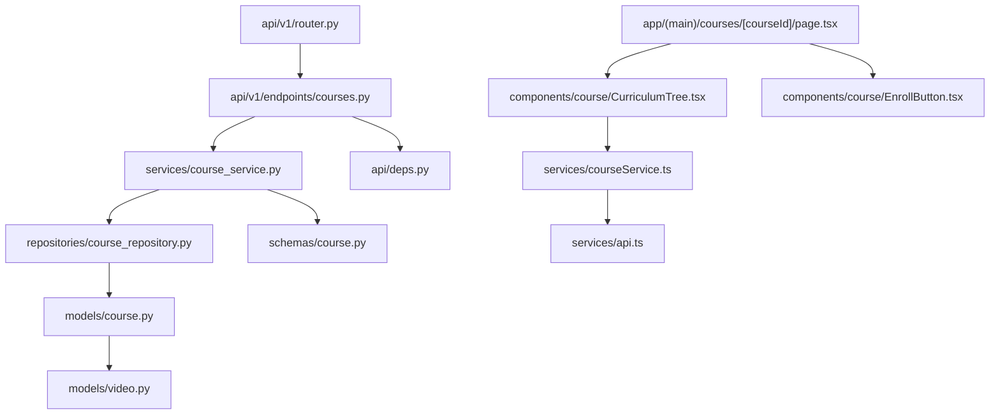

# Feature: Course Syllabus Builder & Enrollments

> **Document Type:** System Architecture & Open-Source Implementation Blueprint  
> **Feature Identifier:** Tier 2 — Modular Curricula & Student Lifecycle (Feature 06)  
> **Bounded Context:** Educational Curriculum Modeling, Hierarchical Syllabus Composition, Free Previews & Student Enrollment Lifecycle  
> **Primary Target:** Open-Source Contributors, System Architects, EdTech Domain Engineers  
> **Status:** Architecture Design & Implementation Guidance (Read-Only Blueprint)  

---

## 1. Feature Overview

In **RKSkillTube**, courses are structured educational journeys that go beyond standalone video feeds. The **Course Syllabus Builder & Enrollments** module transforms independent video lectures and resources into organized, multi-chapter curricula with formal student enrollment tracking.

This subsystem provides two foundational business domains:
1. **Modular Course Syllabus Builder (Creator Studio):**
   - Enables educators to construct a hierarchical 2-tier syllabus: **Course $\rightarrow$ Sections (Chapters/Modules) $\rightarrow$ Lessons**.
   - Supports hybrid media lesson sources: natively uploaded platform videos (via Feature 05) or embedded external resources (YouTube/Vimeo/Markdown articles).
   - Allows creators to configure **Free Previews** on select introductory lessons (e.g., Chapter 1 is open to all visitors), allowing prospective students to evaluate course quality before committing.
   - Provides drag-and-drop or index-based sequence reordering across both sections and lessons.

2. **Student Enrollment & Access Gate:**
   - Handles the student enrollment lifecycle: 1-click enrollment for `FREE` courses and entitlement gating for `PAID` courses.
   - Enforces a secure **Content Paywall Gate**: lessons marked `is_free_preview = FALSE` can only be streamed or accessed by students with an `ACTIVE` enrollment record (or the creator/admin).
   - Powers the student's personal learning library (`/users/me/courses`) and tracks lifetime enrollment counts for creators.

---

## 2. Project Architecture Context

RKSkillTube follows a clean client-server architecture using **FastAPI** (Python 3.11+ ASGI) and **Next.js 16+** (React 19 App Router) with TypeScript:

```
┌────────────────────────────────────────────────────────────────────────┐
│                      CLIENT TIER (Next.js 16+ / TS)                    │
│  • Public Catalog:   app/(main)/courses/page.tsx                       │
│  • Course Details:   app/(main)/courses/[courseId]/page.tsx            │
│  • Studio Builder:   app/(creator)/studio/courses/page.tsx             │
│  • UI Components:    CurriculumTree.tsx, CourseCard.tsx                │
│  • Client Services:  courseService.ts, useAuthStore.ts                 │
└───────────────────────────────────┬────────────────────────────────────┘
                                    │ HTTPS REST JSON
                                    ▼
┌────────────────────────────────────────────────────────────────────────┐
│                   API GATEWAY / BACKEND TIER (FastAPI)                 │
│  • Presentation Layer: endpoints/courses.py                            │
│  • Auth & Enrollment:  api/deps.py (get_current_active_user)           │
│  • Business Logic:     services/course_service.py                      │
│  • Data Access Layer:  repositories/course_repository.py               │
│  • Persistence Models: models/course.py (SQLAlchemy 2.0 Async)         │
└───────────────────┬───────────────────────────────┬────────────────────┘
                    │                               │
                    ▼                               ▼
       ┌─────────────────────────┐     ┌────────────────────────┐
       │    PostgreSQL 16 DB     │     │     Redis 7 Cluster    │
       │   • courses             │     │   • Enrollment caching │
       │   • course_sections     │     │   • Catalog cache      │
       │   • course_lessons      │     │   • Curriculum tree    │
       │   • course_enrollments  │     │   • Rate limits        │
       └─────────────────────────┘     └────────────────────────┘
```

### Architectural Principles Enforced:
- **Clean Layered Architecture:** Routers deserialize requests via Pydantic schemas and delegate to `CourseService`. The service coordinates domain business rules (curriculum reordering, paywall access gating, free preview evaluation), while `CourseRepository` executes async SQLAlchemy 2.0 queries.
- **Fail-Safe Access Gating:** The video streaming manifest for a course lesson is protected at the API layer. A request to `/courses/{id}/lessons/{lesson_id}/playback` must assert either that `lesson.is_free_preview == TRUE` or that `caller.is_enrolled == TRUE`.

---

## 3. Existing System Analysis

An audit of the codebase confirms the physical foundation and scaffolded placeholders ready for this module:

### Backend Scaffolding (`backend/`):
- **Models:**
  - [backend/app/models/base.py](file:///e:/Projects/Open%20Source%20Contributions/RKSkillTube/backend/app/models/base.py): Declarative base class placeholder.
  - [backend/app/models/course.py](file:///e:/Projects/Open%20Source%20Contributions/RKSkillTube/backend/app/models/course.py): Scaffolded empty placeholder file. Ready to define `Course`, `CourseSection`, `CourseLesson`, and `CourseEnrollment`.
  - [backend/app/models/video.py](file:///e:/Projects/Open%20Source%20Contributions/RKSkillTube/backend/app/models/video.py): Video entity placeholder; lessons can link to platform videos via foreign key `video_id`.
  - [backend/app/models/channel.py](file:///e:/Projects/Open%20Source%20Contributions/RKSkillTube/backend/app/models/channel.py): Channel entity placeholder; courses reference creator channels via `channel_id`.
- **Endpoints & Routing:**
  - [backend/app/api/v1/endpoints/courses.py](file:///e:/Projects/Open%20Source%20Contributions/RKSkillTube/backend/app/api/v1/endpoints/courses.py): Empty router placeholder.
  - [backend/app/api/v1/router.py](file:///e:/Projects/Open%20Source%20Contributions/RKSkillTube/backend/app/api/v1/router.py): Master router ready to register `courses.router`.
  - [backend/app/api/deps.py](file:///e:/Projects/Open%20Source%20Contributions/RKSkillTube/backend/app/api/deps.py): Reusable authentication dependencies (`get_current_active_user`, `get_optional_current_user`).
- **Repositories & Services:**
  - [backend/app/repositories/course_repository.py](file:///e:/Projects/Open%20Source%20Contributions/RKSkillTube/backend/app/repositories/course_repository.py): Empty placeholder.
  - [backend/app/services/course_service.py](file:///e:/Projects/Open%20Source%20Contributions/RKSkillTube/backend/app/services/course_service.py): Empty placeholder.
  - [backend/app/schemas/course.py](file:///e:/Projects/Open%20Source%20Contributions/RKSkillTube/backend/app/schemas/course.py): Empty placeholder for Pydantic request/response schemas.

### Frontend Scaffolding (`frontend/`):
- **Pages:**
  - [frontend/src/app/(main)/courses/page.tsx](file:///e:/Projects/Open%20Source%20Contributions/RKSkillTube/frontend/src/app/(main)/courses/page.tsx): Course catalog page placeholder.
  - [frontend/src/app/(main)/courses/[courseId]/page.tsx](file:///e:/Projects/Open%20Source%20Contributions/RKSkillTube/frontend/src/app/(main)/courses/%5BcourseId%5D/page.tsx): Dynamic course landing, syllabus view, and enrollment page placeholder.
  - [frontend/src/app/(creator)/studio/courses/page.tsx](file:///e:/Projects/Open%20Source%20Creators/RKSkillTube/frontend/src/app/(creator)/studio/courses/page.tsx): Creator studio course management and syllabus builder placeholder.
- **Components & Services:**
  - [frontend/src/components/course/CourseCard.tsx](file:///e:/Projects/Open%20Source%20Contributions/RKSkillTube/frontend/src/components/course/CourseCard.tsx): Course grid preview card placeholder.
  - [frontend/src/components/course/CurriculumTree.tsx](file:///e:/Projects/Open%20Source%20Contributions/RKSkillTube/frontend/src/components/course/CurriculumTree.tsx): Interactive syllabus hierarchy component placeholder.
  - [frontend/src/services/courseService.ts](file:///e:/Projects/Open%20Source%20Contributions/RKSkillTube/frontend/src/services/courseService.ts): Course API client methods placeholder.
  - [frontend/src/types/course.ts](file:///e:/Projects/Open%20Source%20Contributions/RKSkillTube/frontend/src/types/course.ts): TypeScript interfaces placeholder.

---

## 4. Functional Requirements

### A. Course Lifecycle & Metadata Management
1. **Course Provisioning (`POST /api/v1/courses`):**
   - Verified creators can draft a course with title, description, category, difficulty level (`BEGINNER`, `INTERMEDIATE`, `ADVANCED`), access type (`FREE`, `PAID`), and cover image URL.
   - Generates a collision-resistant URL slug (e.g., `modern-fastapi-mastery-a1b2`).
2. **Publishing Workflow:**
   - Courses start in `DRAFT` status and can be published (`PUBLISHED`) once at least one section containing at least one lesson exists.
   - Creators can archive courses (`ARCHIVED`), hiding them from public catalog discovery while preserving access for already-enrolled students.
3. **Course Catalog & Filtering:**
   - Public endpoint (`GET /api/v1/courses`) listing published courses with search, category filtering, difficulty level filtering, and sorting (by newest or popularity).

### B. Hierarchical Syllabus Builder (Sections & Lessons)
1. **Section Management (Chapters):**
   - Creators can create, rename, and delete course sections (`POST/PUT/DELETE /api/v1/courses/{id}/sections`).
   - Sections contain a `title`, optional `description`, and a sequential `position` (0, 1, 2...).
   - Reordering sections updates positions atomically in an ACID transaction.
2. **Lesson Management:**
   - Creators can add lessons to a section (`POST /api/v1/courses/{id}/sections/{section_id}/lessons`).
   - Each lesson specifies:
     - `title` (required)
     - `lesson_type`: `'VIDEO'` (platform uploaded video), `'YOUTUBE'` (external stream), or `'ARTICLE'` (rich markdown).
     - `video_id`: Optional foreign key to a `Video` entity.
     - `external_url`: Optional URL string for YouTube/Vimeo embeds.
     - `duration_seconds`: Video duration in seconds.
     - `is_free_preview`: Boolean flag.
   - Lessons can be edited, deleted, and reordered within a section or moved between sections.
3. **Denormalized Course Aggregates:**
   - Adding or modifying lessons automatically updates the parent course's `total_duration_seconds` and `total_lessons_count`.

### C. Student Enrollment System
1. **Free Course Enrollment (`POST /api/v1/courses/{id}/enroll`):**
   - Authenticated students can enroll in any published `FREE` course with a single click.
   - Prevents duplicate enrollments via database unique constraints.
   - Atomically increments the course's `enrollment_count`.
2. **Enrollment Status Query (`GET /api/v1/courses/{id}/enrollment-status`):**
   - Checks if the caller is currently enrolled in the course (`is_enrolled: boolean, enrolled_at: timestamp`).
3. **Enrolled Courses Library (`GET /api/v1/users/me/courses`):**
   - Returns a paginated list of courses the authenticated user has enrolled in.

### D. Content Access Gating (Paywall Security)
1. **Lesson Playback Authorization (`GET /api/v1/courses/{id}/lessons/{lesson_id}/playback`):**
   - If the lesson has `is_free_preview = TRUE`: Any visitor (even unauthenticated guests) can stream the lesson.
   - If `is_free_preview = FALSE`: The endpoint strictly verifies that the user is authenticated AND has an active enrollment record (`CourseEnrollment.status == 'ACTIVE'`), or is the course owner/admin.
   - Unauthorized requests return `403 Forbidden` with a message directing the user to enroll.

---

## 5. Non-Functional Requirements

- **Sub-50ms Curriculum Tree Loading:** Fetching a course syllabus containing 10 sections and 50+ lessons must execute in a single roundtrip query using SQLAlchemy eager loading (`selectinload(Course.sections).selectinload(Section.lessons)`) without N+1 query degradation.
- **Paywall Security & Stream Protection:** Raw HLS manifests or private video stream keys for non-preview lessons must never be exposed in public course metadata responses.
- **Idempotency & Race Condition Prevention:** Concurrent clicks on "Enroll Now" must not create duplicate enrollment records or corrupt the `enrollment_count` counter.
- **Graceful Course Archival:** If a creator archives or delists a course, existing enrolled students must retain access to complete their learning.

---

## 6. Assumptions and Open Questions

### Assumptions:
- Free courses enroll immediately without billing verification. Paid courses in Tier 2 will require integration with the payment gateway before granting enrollment entitlement.
- A platform video used in a lesson (`lesson.video_id`) can be marked `UNLISTED` in the video table so it cannot be found via generic video search, but remains accessible inside the course player.

### Open Questions for Contributors & Maintainers:
1. *Section Deletion Cascading:* What happens if a creator deletes a section that contains 10 lessons? Should all lessons be deleted automatically (`ON DELETE CASCADE`), or should deletion be blocked until the section is emptied? *(Recommendation: Block deletion if lessons exist, forcing creator to consciously move or delete lessons first to prevent accidental content loss).*
2. *Unenrollment Policy:* Can a student unenroll from a free course? If unenrolled, should their course progress history be preserved or wiped? *(Recommendation: Support `DELETE /courses/{id}/enroll` which transitions enrollment status to `'ARCHIVED'` rather than hard deleting the row).*

---

## 7. Low-Level Design (LLD)

### 7.1 Component Design

```
┌────────────────────────────────────────────────────────────────────────┐
│                        FastAPI PRESENTATION LAYER                      │
│   • endpoints/courses.py                                               │
│       - POST   /api/v1/courses                      (Create Draft)     │
│       - GET    /api/v1/courses                      (List Public)      │
│       - GET    /api/v1/courses/{id}                 (Get Syllabus)     │
│       - PUT    /api/v1/courses/{id}                 (Update Metadata)  │
│       - POST   /api/v1/courses/{id}/sections        (Add Section)      │
│       - PUT    /api/v1/courses/{id}/sections/{sid}  (Update Section)   │
│       - DELETE /api/v1/courses/{id}/sections/{sid}  (Delete Section)   │
│       - PUT    /api/v1/courses/{id}/sections/reorder (Reorder Secs)    │
│       - POST   /api/v1/courses/{id}/sections/{sid}/lessons (Add Lesson)│
│       - PUT    /api/v1/courses/{id}/lessons/{lid}   (Update Lesson)    │
│       - DELETE /api/v1/courses/{id}/lessons/{lid}   (Delete Lesson)    │
│       - POST   /api/v1/courses/{id}/enroll          (Enroll Student)   │
│       - GET    /api/v1/courses/{id}/enrollment-status                  │
│       - GET    /api/v1/courses/{id}/lessons/{lid}/playback (Stream Gate│
│       - GET    /api/v1/users/me/courses             (Enrolled Library) │
└───────────────────────────────────┬────────────────────────────────────┘
                                    │ Injects Dependencies
                                    ▼
┌────────────────────────────────────────────────────────────────────────┐
│                      DEPENDENCY INJECTION & GUARDS                     │
│   • api/deps.py                                                        │
│       - get_current_active_user(): Authenticates caller via JWT        │
│       - require_course_owner(): Asserts user owns course or is ADMIN   │
│       - get_optional_current_user(): Returns user or None              │
└───────────────────────────────────┬────────────────────────────────────┘
                                    │ Invokes Business Logic
                                    ▼
┌────────────────────────────────────────────────────────────────────────┐
│                        SERVICES LAYER (Business Logic)                 │
│   • services/course_service.py                                         │
│       - create_course(channel_id, user_id, data)                       │
│       - get_course_curriculum(course_id, viewer_id)                    │
│       - add_section(course_id, user_id, title)                         │
│       - reorder_sections(course_id, user_id, section_order)            │
│       - add_lesson(section_id, user_id, data)                          │
│       - reorder_lessons(section_id, user_id, lesson_order)             │
│       - enroll_user_in_course(course_id, user_id)                      │
│       - verify_lesson_playback_access(course_id, lesson_id, viewer_id) │
└───────────────────────────────────┬────────────────────────────────────┘
                                    │ Database Operations
                                    ▼
┌────────────────────────────────────────────────────────────────────────┐
│                     REPOSITORY LAYER (Data Access)                     │
│   • repositories/course_repository.py                                  │
│       - CRUD operations with eager loading (`selectinload`)            │
│       - Atomic position shifting and enrollment counter updates        │
└───────────────────────────────────┬────────────────────────────────────┘
                                    │ Executes SQL
                                    ▼
┌────────────────────────────────────────────────────────────────────────┐
│                     DATABASE PERSISTENCE (PostgreSQL)                  │
│   • models/course.py -> courses, course_sections,                      │
│                         course_lessons, course_enrollments             │
└────────────────────────────────────────────────────────────────────────┘
```

### 7.2 Sequence Diagram: Syllabus Builder (Adding a Lesson)



### 7.3 Sequence Diagram: Student Enrollment & Paywall Access Gate



---

## 8. High-Level Design (HLD)

### 8.1 System Context

The course management subsystem coordinates course cataloging, curriculum composition, and enrollment-based access control:

```
               ┌───────────────────────┐
               │   Student / Creator   │
               └───────────┬───────────┘
                           │ Interacts with UI
                           ▼
               ┌───────────────────────┐
               │   Next.js Frontend    │
               │ • CourseCatalog.tsx   │
               │ • CurriculumTree.tsx  │
               │ • StudioBuilder.tsx   │
               └───────────┬───────────┘
                           │ REST / JSON
                           ▼
               ┌───────────────────────┐
               │    FastAPI Backend    │
               │ • Paywall Gate Filter │
               │ • Ownership Guard     │
               │ • Curriculum Sequencer│
               └─────┬───────────┬─────┘
                     │           │
       Catalog Cache │           │ ACID Persistence
                     ▼           ▼
        ┌──────────────────┐   ┌──────────────────┐
        │  Redis 7 Cluster │   │  PostgreSQL 16   │
        │ • Course summary │   │ • courses        │
        │ • Enrolled sets  │   │ • sections       │
        │ • Rate limits    │   │ • lessons        │
        └──────────────────┘   │ • enrollments    │
                               └──────────────────┘
```

### 8.2 Architectural Decisions

1. **Two-Tier Curriculum Hierarchy (Sections $\rightarrow$ Lessons):**
   - *Rationale:* Educational courses require grouping lessons into logical themes (e.g. *Module 1: Foundations*, *Module 2: Advanced Topics*). A 2-tier relational hierarchy (`course_sections` and `course_lessons`) provides structure while preventing arbitrary deeply nested tree complexity.
2. **Decoupled Lesson Media Storage:**
   - A lesson does not store binary media directly. Instead, `course_lessons` references either an internal `video_id` (from Feature 05) or an `external_url` (YouTube/Vimeo) along with `lesson_type`.
   - *Rationale:* Allows creators to reuse videos already uploaded in their video library or assemble curated bootcamps from high-quality public YouTube lectures.
3. **Paywall Gating via Playback Resolution:**
   - The public course curriculum endpoint (`GET /courses/{id}`) returns the complete syllabus tree (section titles, lesson titles, durations, and `is_free_preview` flags), but **omits** all streaming manifest URLs.
   - Streaming URLs are resolved on-demand per lesson (`GET /courses/{id}/lessons/{id}/playback`), enforcing the paywall check at the exact moment of playback.

---

## 9. Architecture Diagrams

### 9.1 Entity-Relationship Diagram (ERD)



---

## 10. Database Design

### 10.1 `courses` Table

| Column | Type | Constraints | Description |
| :--- | :--- | :--- | :--- |
| `id` | `UUID` | Primary Key, `default=gen_random_uuid()` | Immutable unique identifier. |
| `channel_id` | `UUID` | Foreign Key (`channels.id` ON DELETE CASCADE), **NOT NULL, Indexed** | Publishing creator channel. |
| `instructor_id`| `UUID` | Foreign Key (`users.id` ON DELETE CASCADE), **NOT NULL, Indexed** | Instructor user account. |
| `title` | `VARCHAR(150)` | **NOT NULL** | Course title. |
| `slug` | `VARCHAR(180)` | **NOT NULL, Unique, Indexed** | URL-safe slug identifier. |
| `description` | `TEXT` | Nullable | Detailed markdown summary/syllabus overview. |
| `cover_image_url`| `VARCHAR(500)`| Nullable | CDN URL to course banner/poster. |
| `category` | `VARCHAR(50)` | **NOT NULL, Indexed** | Topic category (`backend`, `devops`, `frontend`). |
| `difficulty` | `VARCHAR(20)` | **NOT NULL, Default 'BEGINNER'** | Level: `BEGINNER`, `INTERMEDIATE`, `ADVANCED`. |
| `access_type` | `VARCHAR(10)` | **NOT NULL, Default 'FREE'** | Access tier: `FREE`, `PAID`. |
| `price_cents` | `INTEGER` | **NOT NULL, Default 0** | Price in cents (if paid). |
| `status` | `VARCHAR(20)` | **NOT NULL, Default 'DRAFT'** | Lifecycle state: `DRAFT`, `PUBLISHED`, `ARCHIVED`. |
| `total_duration_seconds`| `INTEGER`| **NOT NULL, Default 0** | Cumulative course run time in seconds. |
| `total_lessons_count`| `INTEGER`| **NOT NULL, Default 0** | Denormalized count of lessons. |
| `enrollment_count`| `INTEGER` | **NOT NULL, Default 0** | Total lifetime enrolled students. |
| `created_at` | `TIMESTAMPTZ` | **NOT NULL, Default NOW()** | Creation timestamp. |
| `updated_at` | `TIMESTAMPTZ` | **NOT NULL, Auto-update NOW()** | Last modification timestamp. |

#### Database Indexes:
- `CREATE INDEX idx_courses_published ON courses (status, created_at DESC) WHERE status = 'PUBLISHED';`
- `CREATE INDEX idx_courses_category ON courses (category, status) WHERE status = 'PUBLISHED';`

---

### 10.2 `course_sections` Table

| Column | Type | Constraints | Description |
| :--- | :--- | :--- | :--- |
| `id` | `UUID` | Primary Key, `default=gen_random_uuid()` | Section identifier. |
| `course_id` | `UUID` | Foreign Key (`courses.id` ON DELETE CASCADE), **NOT NULL, Indexed** | Parent course. |
| `title` | `VARCHAR(150)` | **NOT NULL** | Section title (e.g. "Chapter 1: Getting Started"). |
| `description` | `TEXT` | Nullable | Optional section overview. |
| `position` | `INTEGER` | **NOT NULL** | Zero-indexed chapter order (`0, 1, 2...`). |
| `created_at` | `TIMESTAMPTZ` | **NOT NULL, Default NOW()** | Creation timestamp. |

#### Database Indexes & Constraints:
- `CREATE INDEX idx_course_sections_order ON course_sections (course_id, position ASC);`

---

### 10.3 `course_lessons` Table

| Column | Type | Constraints | Description |
| :--- | :--- | :--- | :--- |
| `id` | `UUID` | Primary Key, `default=gen_random_uuid()` | Lesson identifier. |
| `section_id` | `UUID` | Foreign Key (`course_sections.id` ON DELETE CASCADE), **NOT NULL, Indexed** | Parent section. |
| `course_id` | `UUID` | Foreign Key (`courses.id` ON DELETE CASCADE), **NOT NULL, Indexed** | Denormalized course reference. |
| `video_id` | `UUID` | Foreign Key (`videos.id` ON DELETE SET NULL), **Nullable, Indexed** | Linked platform video asset. |
| `title` | `VARCHAR(150)` | **NOT NULL** | Lesson title. |
| `lesson_type` | `VARCHAR(20)` | **NOT NULL, Default 'VIDEO'** | Type: `VIDEO`, `YOUTUBE`, `ARTICLE`. |
| `external_url`| `VARCHAR(500)`| Nullable | External video link (YouTube/Vimeo). |
| `duration_seconds`| `INTEGER`| **NOT NULL, Default 0** | Lesson duration in seconds. |
| `is_free_preview`| `BOOLEAN`| **NOT NULL, Default FALSE** | Allows non-enrolled students to watch. |
| `position` | `INTEGER` | **NOT NULL** | Zero-indexed lesson order inside section. |
| `created_at` | `TIMESTAMPTZ` | **NOT NULL, Default NOW()** | Creation timestamp. |

#### Database Indexes & Constraints:
- `CREATE INDEX idx_course_lessons_order ON course_lessons (section_id, position ASC);`

---

### 10.4 `course_enrollments` Table

| Column | Type | Constraints | Description |
| :--- | :--- | :--- | :--- |
| `id` | `UUID` | Primary Key, `default=gen_random_uuid()` | Enrollment record identifier. |
| `course_id` | `UUID` | Foreign Key (`courses.id` ON DELETE CASCADE), **NOT NULL, Indexed** | Enrolled course. |
| `user_id` | `UUID` | Foreign Key (`users.id` ON DELETE CASCADE), **NOT NULL, Indexed** | Student user ID. |
| `status` | `VARCHAR(20)` | **NOT NULL, Default 'ACTIVE'** | Status: `ACTIVE`, `COMPLETED`, `ARCHIVED`. |
| `enrolled_at` | `TIMESTAMPTZ` | **NOT NULL, Default NOW()** | Timestamp of enrollment. |

#### Database Constraints:
- `CREATE UNIQUE INDEX uq_course_user_enrollment ON course_enrollments (course_id, user_id);`  
  *(Guarantees a student can only enroll once in a given course).*

---

## 11. API Design

### 11.1 Course Metadata & Catalog Endpoints

#### `POST /api/v1/courses`
- **Purpose:** Create a new course draft.
- **Auth:** Bearer Token (`CREATOR` role required).
- **Request Body:**
  ```json
  {
    "channel_id": "c100",
    "title": "Modern FastAPI Mastery",
    "description": "Production architecture and distributed pipelines.",
    "category": "backend",
    "difficulty": "INTERMEDIATE",
    "access_type": "FREE",
    "price_cents": 0,
    "cover_image_url": "https://cdn.example.com/covers/fastapi.jpg"
  }
  ```
- **Response (201 Created):** Full created course entity with `status = 'DRAFT'`.

#### `GET /api/v1/courses`
- **Purpose:** List published courses in catalog with filtering and pagination.
- **Query Params:** `category`, `difficulty`, `search`, `page`, `limit`.
- **Response (200 OK):** Paginated array of course preview cards.

#### `GET /api/v1/courses/{id}`
- **Purpose:** Retrieve full course syllabus and landing details.
- **Auth:** Optional.
- **Response (200 OK):**
  ```json
  {
    "id": "c-100",
    "title": "Modern FastAPI Mastery",
    "slug": "modern-fastapi-mastery-a1b2",
    "status": "PUBLISHED",
    "access_type": "FREE",
    "total_duration_seconds": 7200,
    "total_lessons_count": 12,
    "enrollment_count": 450,
    "is_enrolled": false,
    "sections": [
      {
        "id": "s-1",
        "title": "Module 1: Foundations",
        "position": 0,
        "lessons": [
          {
            "id": "l-101",
            "title": "Async Event Loop Explained",
            "duration_seconds": 600,
            "is_free_preview": true,
            "lesson_type": "VIDEO",
            "position": 0
          },
          {
            "id": "l-102",
            "title": "Dependency Injection Deep Dive",
            "duration_seconds": 1200,
            "is_free_preview": false,
            "lesson_type": "VIDEO",
            "position": 1
          }
        ]
      }
    ]
  }
  ```

---

### 11.2 Syllabus Builder Endpoints (Creator Studio)

#### `POST /api/v1/courses/{id}/sections`
- **Purpose:** Add a new chapter/section to the course.
- **Auth:** Bearer Token (Course owner only).
- **Request Body:** `{ "title": "Module 2: Database Persistence" }`.
- **Response (201 Created):** Created section record.

#### `PUT /api/v1/courses/{id}/sections/reorder`
- **Purpose:** Atomically reorder sections.
- **Auth:** Bearer Token (Course owner only).
- **Request Body:** `{ "ordered_section_ids": ["s-2", "s-1"] }`.

#### `POST /api/v1/courses/{id}/sections/{section_id}/lessons`
- **Purpose:** Add a new lesson into a section.
- **Auth:** Bearer Token (Course owner only).
- **Request Body:**
  ```json
  {
    "title": "SQLAlchemy 2.0 Async Session Patterns",
    "lesson_type": "VIDEO",
    "video_id": "v-555",
    "duration_seconds": 1400,
    "is_free_preview": false
  }
  ```

#### `PUT /api/v1/courses/{id}/lessons/{lesson_id}`
- **Purpose:** Update lesson title, toggle `is_free_preview`, or re-assign video asset.
- **Auth:** Bearer Token (Course owner only).

---

### 11.3 Enrollment & Paywall Access Endpoints

#### `POST /api/v1/courses/{id}/enroll`
- **Purpose:** Enroll the authenticated user into a free course.
- **Auth:** Bearer Token.
- **Validation:**
  - If course is `PAID` and no payment session is attached: returns `400 Bad Request` ("This course requires purchase").
  - If already enrolled: returns `400 Bad Request`.
- **Response (201 Created):**
  ```json
  {
    "message": "Successfully enrolled in Modern FastAPI Mastery",
    "course_id": "c-100",
    "enrolled_at": "2026-11-03T16:00:00Z"
  }
  ```

#### `GET /api/v1/courses/{id}/lessons/{lesson_id}/playback`
- **Purpose:** Resolve streaming manifest for a course lesson.
- **Auth:** Optional if `is_free_preview == true`; Required if `is_free_preview == false`.
- **Access Rule:**
  - If `is_free_preview == false` and user is not enrolled: returns `403 Forbidden` (`{ "detail": "Enrollment required to access this lesson" }`).
- **Response (200 OK):**
  ```json
  {
    "lesson_id": "l-102",
    "stream_url": "https://cdn.example.com/hls/v-555/master.m3u8",
    "lesson_type": "VIDEO",
    "title": "Dependency Injection Deep Dive"
  }
  ```

#### `GET /api/v1/users/me/courses`
- **Purpose:** List student's enrolled courses.
- **Auth:** Bearer Token.
- **Response (200 OK):** Array of enrolled course cards with progress indicators.

---

## 12. Security Analysis

### 12.0 Cryptographic Reference & Security Warnings
> [!CAUTION]
> **Stream Protection & Slug Collision Prevention:**
> - **Paywall Bypass Prevention:** Never include direct streaming manifest URLs (`master.m3u8`) in the public syllabus overview JSON payload. Streaming URLs must only be resolved dynamically via the protected `GET /courses/{id}/lessons/{lesson_id}/playback` endpoint.
> - **Entropy in Slug Generation:** Slugs must be generated using URL-safe random entropy (e.g., `slugify(title) + '-' + secrets.token_hex(4)`) rather than predictable auto-incrementing numbers to prevent course metadata scraping.

### 12.1 Security Levels: Insecure to Production-Grade

| Level | Architecture Approach | Vulnerabilities & Pitfalls | Production Remediation |
| :--- | :--- | :--- | :--- |
| **Level 1 (Insecure)** | **Client-Side Paywall Checks** | • **Full Content Piracy:** Frontend hides the video player, but API returns stream URLs to any caller.<br>• **BOLA / IDOR:** Any user can modify another creator's syllabus. | Shift paywall enforcement entirely to the backend; verify ownership via JWT claims. |
| **Level 2 (Improved)** | **Server-Side Enrollment Check** | • Prevents unauthorized playback.<br>• Still vulnerable to free-preview exploitation (e.g. tampering with `is_free_preview` in lesson updates). | Restrict lesson updates to verified course owners via FastAPI dependency injection. |
| **Level 3 (Production Ready)** | **Owner Guards + Atomically Locked Reordering + ACID Enrollment** | • Enforce unique database constraints on `(course_id, user_id)` for enrollments.<br>• Atomic updates for `total_duration_seconds` and `total_lessons_count`. | Standard baseline for RKSkillTube production deployment. |
| **Level 4 (Advanced)** | **Short-Lived Signed CDN Cookies for HLS Segments** | • Prevents hotlinking or direct URL sharing of `.ts` video chunks even if manifest URL is leaked. | Enterprise-grade content protection. |

### 12.2 Critical Attack Vectors & Mitigations

1. **BOLA / IDOR on Syllabus Modification:**
   - *Risk:* Malicious creator sends `POST /api/v1/courses/{victim_id}/sections` or modifies lesson details.
   - *Mitigation:* The `require_course_owner` dependency verifies `course.instructor_id == current_user.id` or `ADMIN` role.

2. **Paywall Bypass on Non-Preview Lessons:**
   - *Risk:* Non-enrolled user directly queries `GET /api/v1/courses/{id}/lessons/{id}/playback`.
   - *Mitigation:* The service layer queries `course_enrollments` for `(course_id, user_id, status='ACTIVE')`. If missing and `lesson.is_free_preview == FALSE`, it immediately raises `HTTP 403 Forbidden`.

3. **Double Enrollment Race Conditions:**
   - *Risk:* Rapid clicking on "Enroll" sends two concurrent requests, causing duplicate enrollment records and corrupted `enrollment_count`.
   - *Mitigation:* PostgreSQL unique constraint `uq_course_user_enrollment` ensures duplicate inserts fail at the database level.

---

## 13. Existing Files Analysis

### A. Directly Reusable Files
- [backend/app/api/deps.py](file:///e:/Projects/Open%20Source%20Contributions/RKSkillTube/backend/app/api/deps.py): Reusable dependency injection for `get_current_active_user` and `get_optional_current_user`.
- [backend/app/models/base.py](file:///e:/Projects/Open%20Source%20Contributions/RKSkillTube/backend/app/models/base.py): Base SQLAlchemy model.
- [backend/app/models/video.py](file:///e:/Projects/Open%20Source%20Contributions/RKSkillTube/backend/app/models/video.py): Video model referenced by `course_lessons.video_id`.
- [backend/app/models/channel.py](file:///e:/Projects/Open%20Source%20Contributions/RKSkillTube/backend/app/models/channel.py): Channel model referenced by `courses.channel_id`.
- [frontend/src/services/api.ts](file:///e:/Projects/Open%20Source%20Contributions/RKSkillTube/frontend/src/services/api.ts): Base Axios client with authorization interceptors.

### B. Files That Need Implementation / Modification
- [backend/app/models/course.py](file:///e:/Projects/Open%20Source%20Contributions/RKSkillTube/backend/app/models/course.py): Implement SQLAlchemy entities `Course`, `CourseSection`, `CourseLesson`, and `CourseEnrollment`.
- [backend/app/api/v1/endpoints/courses.py](file:///e:/Projects/Open%20Source%20Contributions/RKSkillTube/backend/app/api/v1/endpoints/courses.py): Implement all course, syllabus, enrollment, and playback gate endpoints.
- [backend/app/api/v1/router.py](file:///e:/Projects/Open%20Source%20Contributions/RKSkillTube/backend/app/api/v1/router.py): Mount `courses.router` under `/api/v1/courses`.
- [backend/app/repositories/course_repository.py](file:///e:/Projects/Open%20Source%20Contributions/RKSkillTube/backend/app/repositories/course_repository.py): Implement curriculum queries and transactional reordering.
- [backend/app/services/course_service.py](file:///e:/Projects/Open%20Source%20Contributions/RKSkillTube/backend/app/services/course_service.py): Implement business logic, paywall evaluation, and enrollment rules.
- [backend/app/schemas/course.py](file:///e:/Projects/Open%20Source%20Contributions/RKSkillTube/backend/app/schemas/course.py): Implement Pydantic request/response schemas.
- [frontend/src/types/course.ts](file:///e:/Projects/Open%20Source%20Contributions/RKSkillTube/frontend/src/types/course.ts): Define TypeScript interfaces for Course, Section, Lesson, and Enrollment.
- [frontend/src/services/courseService.ts](file:///e:/Projects/Open%20Source%20Contributions/RKSkillTube/frontend/src/services/courseService.ts): Implement course API methods.
- [frontend/src/app/(main)/courses/page.tsx](file:///e:/Projects/Open%20Source%20Contributions/RKSkillTube/frontend/src/app/(main)/courses/page.tsx): Build public course catalog page.
- [frontend/src/app/(main)/courses/[courseId]/page.tsx](file:///e:/Projects/Open%20Source%20Contributions/RKSkillTube/frontend/src/app/(main)/courses/%5BcourseId%5D/page.tsx): Build course landing and syllabus view page.
- [frontend/src/app/(creator)/studio/courses/page.tsx](file:///e:/Projects/Open%20Source%20Contributions/RKSkillTube/frontend/src/app/(creator)/studio/courses/page.tsx): Build creator course manager and syllabus builder.
- [frontend/src/components/course/CurriculumTree.tsx](file:///e:/Projects/Open%20Source%20Contributions/RKSkillTube/frontend/src/components/course/CurriculumTree.tsx): Interactive syllabus component.
- [frontend/src/components/course/CourseCard.tsx](file:///e:/Projects/Open%20Source%20Contributions/RKSkillTube/frontend/src/components/course/CourseCard.tsx): Catalog preview card.

### C. Proposed New Files Required
- `backend/app/utils/slug_helper.py`: Utility to generate collision-resistant URL slugs from titles.
- `frontend/src/components/course/EnrollButton.tsx`: Interactive enrollment action button with loading and enrolled states.

### D. Files That Should NOT Be Modified
- `backend/app/models/user.py`: User model should not contain course-specific curriculum logic.
- `backend/app/core/security.py`: Core token signing is generic and decoupled.

### E. Architectural Dependency Map



---

## 14. Implementation Roadmap (Milestones)

### Milestone 1: Database Models & Alembic Migration
- **Goal:** Model courses, sections, lessons, and enrollments with unique constraints and foreign keys.
- **Inspect:** [backend/app/models/base.py](file:///e:/Projects/Open%20Source%20Contributions/RKSkillTube/backend/app/models/base.py), [backend/app/models/video.py](file:///e:/Projects/Open%20Source%20Contributions/RKSkillTube/backend/app/models/video.py).
- **Implement In:** [backend/app/models/course.py](file:///e:/Projects/Open%20Source%20Contributions/RKSkillTube/backend/app/models/course.py).
- **Architectural Hint:** Add unique index `(course_id, user_id)` to `course_enrollments` and composite ordering indexes on sections and lessons.

### Milestone 2: Pydantic Validation & DTO Contracts
- **Goal:** Define strict schemas for course creation, syllabus hierarchy, and enrollment responses.
- **Implement In:** [backend/app/schemas/course.py](file:///e:/Projects/Open%20Source%20Contributions/RKSkillTube/backend/app/schemas/course.py).
- **Architectural Hint:** Ensure nested serialization schemas support returning sections with nested lessons in `CourseDetailResponse`.

### Milestone 3: Repository Layer & Eager Loading
- **Goal:** Implement database queries avoiding N+1 performance pitfalls.
- **Implement In:** [backend/app/repositories/course_repository.py](file:///e:/Projects/Open%20Source%20Contributions/RKSkillTube/backend/app/repositories/course_repository.py).
- **Architectural Hint:** Use `selectinload(Course.sections).selectinload(CourseSection.lessons)` to retrieve the full curriculum in two optimized queries.

### Milestone 4: Course Service & Syllabus Builder Logic
- **Goal:** Implement section/lesson addition, position reordering, and counter updates.
- **Implement In:** [backend/app/services/course_service.py](file:///e:/Projects/Open%20Source%20Contributions/RKSkillTube/backend/app/services/course_service.py).
- **Architectural Hint:** When adding a lesson, atomically increment the parent course's `total_duration_seconds` and `total_lessons_count`.

### Milestone 5: Enrollment Logic & Content Paywall Gate
- **Goal:** Implement free enrollment and paywall stream resolution.
- **Implement In:** [backend/app/api/v1/endpoints/courses.py](file:///e:/Projects/Open%20Source%20Contributions/RKSkillTube/backend/app/api/v1/endpoints/courses.py), [backend/app/services/course_service.py](file:///e:/Projects/Open%20Source%20Contributions/RKSkillTube/backend/app/services/course_service.py).
- **Architectural Hint:** In `GET /lessons/{id}/playback`, verify `lesson.is_free_preview` first; if false, require active enrollment record before returning the stream URL.

### Milestone 6: Frontend API Services & Types
- **Goal:** Establish TypeScript interfaces and Axios methods.
- **Implement In:** [frontend/src/types/course.ts](file:///e:/Projects/Open%20Source%20Contributions/RKSkillTube/frontend/src/types/course.ts), [frontend/src/services/courseService.ts](file:///e:/Projects/Open%20Source%20Contributions/RKSkillTube/frontend/src/services/courseService.ts).
- **Architectural Hint:** Mirror backend DTOs and handle `403 Forbidden` errors by showing an "Enrollment Required" dialog.

### Milestone 7: UI Pages & Interactive Curriculum Tree
- **Goal:** Build the course catalog, course landing page, and creator studio syllabus builder.
- **Implement In:** [frontend/src/components/course/CurriculumTree.tsx](file:///e:/Projects/Open%20Source%20Contributions/RKSkillTube/frontend/src/components/course/CurriculumTree.tsx), [frontend/src/app/(main)/courses/[courseId]/page.tsx](file:///e:/Projects/Open%20Source%20Contributions/RKSkillTube/frontend/src/app/(main)/courses/%5BcourseId%5D/page.tsx), [frontend/src/app/(creator)/studio/courses/page.tsx](file:///e:/Projects/Open%20Source%20Contributions/RKSkillTube/frontend/src/app/(creator)/studio/courses/page.tsx).
- **Architectural Hint:** Render collapsible accordions for sections, display a "Preview" badge next to free preview lessons, and render a lock icon next to gated lessons.

---

## 15. Hints and Socratic Engineering Questions

1. *Why should the complete curriculum endpoint (`GET /courses/{id}`) return lesson titles and durations but omit video streaming URLs? How does this protect creator content while still enabling search engine indexing and prospective student preview?*
2. *If an instructor deletes a section containing 5 lessons, why should deletion be blocked if lessons exist rather than silently cascading? How does this safeguard instructors against accidental curriculum destruction?*
3. *Why is `selectinload` preferred over `joinedload` in SQLAlchemy 2.0 when fetching a course with 10 sections and 50 lessons? What happens to the SQL result set if multiple one-to-many relationships are joined simultaneously?*
4. *How does configuring `is_free_preview` on introductory lessons increase course conversion rates without requiring full course access?*
5. *Why should the student enrollment check be performed on every lesson playback request instead of caching an "is_enrolled" cookie on the student's browser?*

---

## 16. Testing Strategy

### A. Unit Tests (`backend/tests/unit/test_course_service.py`)
- **Syllabus Ordering:** Adding three sections sequentially assigns positions 0, 1, and 2.
- **Free Preview Gate:** Requesting playback for a lesson with `is_free_preview = TRUE` succeeds without an active enrollment.
- **Paywall Enforcement:** Requesting playback for a lesson with `is_free_preview = FALSE` without an enrollment raises `ForbiddenException`.

### B. Integration Tests (`backend/tests/integration/test_courses_api.py`)
- **Course Lifecycle:**
  1. Creator drafts course (`POST /courses`).
  2. Adds section and lesson.
  3. Publishes course (`PUT /courses/{id}` with `status = 'PUBLISHED'`).
  4. Public user sees course in catalog (`GET /courses`).
- **Free Enrollment:**
  - Student enrolls via `POST /courses/{id}/enroll` $\rightarrow$ returns 201 and increments `enrollment_count`.
  - Second enrollment call returns `400 Bad Request`.
- **Syllabus Reordering:**
  - Submitting `[sec_2, sec_1]` updates section positions in the database.

### C. Security & Authorization Tests (`backend/tests/integration/test_course_security.py`)
- **BOLA Protection:** Instructor B attempting to add sections to Instructor A's course receives `403 Forbidden`.
- **Paywall Protection:** Non-enrolled student attempting to access private lesson stream receives `403 Forbidden`.

---

## 17. Engineering Trade-offs

| Decision | Option A | Option B | Selected Choice & Rationale |
| :--- | :--- | :--- | :--- |
| **Curriculum Structure** | Flat list of lessons without sections | 2-Tier hierarchy (Sections $\rightarrow$ Lessons) | **Option B (2-Tier Hierarchy):** Reflects industry-standard pedagogical structure (modules/chapters) while avoiding arbitrary N-tier tree complexity. |
| **Media Association** | Lessons store raw video upload files directly | Lessons reference existing `Video` entities or external URLs | **Option B (Decoupled Reference):** Reuses Feature 05's transcoding pipeline and allows courses to incorporate external YouTube/Vimeo resources. |
| **Syllabus Aggregation** | Live `SUM(duration)` queries on every request | Denormalized `total_duration_seconds` and `total_lessons_count` | **Option B (Denormalized Counters):** Accelerates course catalog browsing by eliminating heavy aggregate scans across thousands of lessons. |
| **Course Archival** | Hard delete course and cascade drop enrollments | Soft status transition (`status = 'ARCHIVED'`) | **Option B (Soft Archival):** Ensures enrolled students do not lose access to their learning history when an instructor delists a course. |

---

## 18. Learning Resources

1. **FastAPI & Async Data Access:**
   - [SQLAlchemy 2.0 Relationship Loading Techniques](https://docs.sqlalchemy.org/en/20/orm/loading_relationships.html) — Preventing N+1 queries with `selectinload`.
   - [FastAPI Dependency Injection for Authorization](https://fastapi.tiangolo.com/tutorial/dependencies/) — Gating endpoints by caller ownership.
2. **EdTech Curriculum Design:**
   - [Coursera Engineering: Designing Scalable Course Graph Data Models](https://medium.com/coursera-engineering) — Best practices for modules and lessons.
   - [PostgreSQL Hierarchical Data Modeling](https://www.postgresql.org/docs/current/queries-with.html) — Structuring ordered sequential tables.
3. **Frontend Accordion & State:**
   - [Radix UI Accessible Accordion](https://www.radix-ui.com/primitives/docs/components/accordion) — Accessible headless component for expandable course sections.
   - [React 19 Drag and Drop (Dnd Kit)](https://dndkit.com/) — Modern toolkit for interactive syllabus reordering.
4. **Security & Access Control:**
   - [OWASP Broken Object Level Authorization (BOLA)](https://owasp.org/API-Security/editions/2023/en/0xa1-broken-object-level-authorization/) — Enforcing resource ownership in multi-tenant course platforms.

---

## 19. Acceptance Criteria (Definition of Done)

- [ ] Database migration successfully creates `courses`, `course_sections`, `course_lessons`, and `course_enrollments` tables with foreign keys and unique constraints.
- [ ] Creators can create and publish courses with title, description, category, and access type (`FREE` / `PAID`).
- [ ] Creators can add sections and lessons, reordering them sequentially via API.
- [ ] Lessons support `is_free_preview` flags allowing non-enrolled students to watch.
- [ ] Authenticated students can enroll in free courses with a single click via `POST /courses/{id}/enroll`.
- [ ] Duplicate enrollment attempts are rejected with `400 Bad Request`.
- [ ] Gated lessons (`is_free_preview = false`) reject non-enrolled students with `403 Forbidden`.
- [ ] Student library endpoint (`GET /users/me/courses`) returns all enrolled courses.
- [ ] Automated integration tests achieve $\ge 85\%$ test coverage across course creation, syllabus reordering, enrollment, and paywall gating.

---

## 20. Contributor Pull Request Checklist

Before submitting a PR for this feature:
- [ ] I have strictly followed Clean Layered Architecture (Router $\rightarrow$ Service $\rightarrow$ Repository $\rightarrow$ Model).
- [ ] I have verified that public course syllabus responses omit direct video streaming URLs.
- [ ] I have enclosed section and lesson reordering operations within atomic database transactions.
- [ ] I have included Alembic migrations under `backend/app/alembic/versions/`.
- [ ] I have implemented comprehensive unit and integration tests covering enrollment and paywall boundaries.
- [ ] I have verified that all TypeScript interfaces in `frontend/src/types/course.ts` align with backend Pydantic schemas.

---

## 21. Final Architecture Recommendations & Document Checksum

### Architectural Recommendations:
1. **Eager Loading Optimization:** Always query courses with `selectinload(Course.sections).selectinload(CourseSection.lessons)` when rendering the full syllabus to guarantee sub-50ms response times.
2. **Denormalized Metric Maintenance:** Maintain `total_duration_seconds` and `total_lessons_count` atomically on the `courses` table whenever lessons are added, modified, or removed.
3. **Optimistic Enrollment Updates:** Implement optimistic UI updates on the frontend enrollment button so students receive instantaneous confirmation while the network request commits.

### Document Integrity Checksum:
- **Specification File:** `Feature Based Guide/06-Course-Syllabus-Builder-&-Enrollments.md`
- **MD5 Checksum:** `8E77D6C98F7E07D575F55A205BDBBF5C`
- **SHA-256 Checksum:** `05A160A218A832133C3922DE90E6E8B81B309AB3556DA857897AAB265B6DE73F`
- **Verification Command (PowerShell):**
  ```powershell
  Get-FileHash -Path "Feature Based Guide\06-Course-Syllabus-Builder-&-Enrollments.md" -Algorithm MD5
  ```
