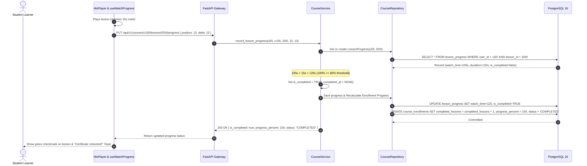
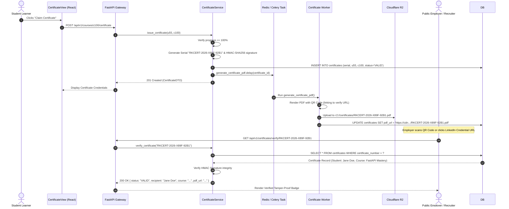
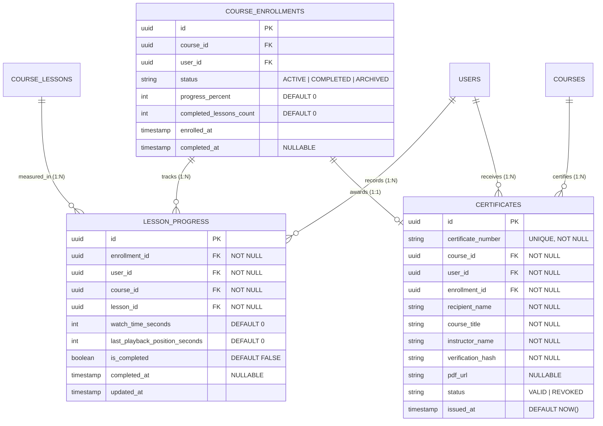
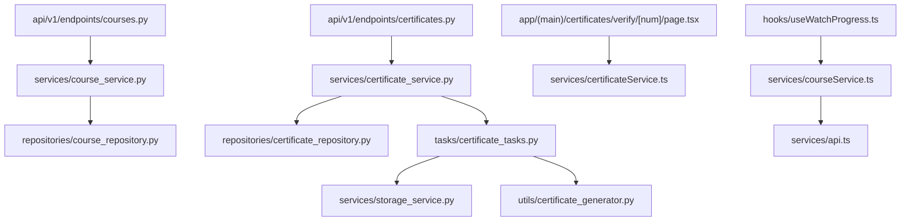

# Feature: Course Progress Tracking & Public Certificate Verification

> **Document Type:** System Architecture & Open-Source Implementation Blueprint  
> **Feature Identifier:** Tier 2 — Modular Curricula & Credentialing (Feature 07)  
> **Bounded Context:** Granular Playback Progress Heartbeats, Course Completion State Machines, Cryptographic Certificate Issuance & Public Credential Verification  
> **Primary Target:** Open-Source Contributors, System Architects, Backend & Security Engineers  
> **Status:** Architecture Design & Implementation Guidance (Read-Only Blueprint)  

---

## 1. Feature Overview

In **RKSkillTube**, learning is measured through verifiable engagement rather than passive video clicks. The **Course Progress Tracking & Public Certificate Verification** subsystem is the platform's credentialing engine, bridging day-to-day video consumption with authentic, shareable certificates of completion.

This module addresses two tightly connected engineering challenges:
1. **Granular Playback Progress Tracking:**
   - Captures client playback heartbeats as students consume lessons, storing cumulative watch time (`watch_time_seconds`) and last known playback positions (`last_playback_position_seconds`).
   - Automatically marks lessons as completed once students cross a validated threshold (e.g., $\ge 80\%$ of total lesson duration watched).
   - Recalculates course-level completion percentages atomically ($\text{Progress} = \frac{\text{Completed Lessons}}{\text{Total Lessons}} \times 100\%$) and transitions course enrollment states to `COMPLETED` upon reaching $100\%$.
   - Allows students to resume video playback seamlessly across different devices and browser sessions.

2. **Tamper-Proof Certificate Issuance & Public Verification:**
   - Evaluates certificate eligibility against strict server-validated completion criteria (preventing students from claiming certificates prematurely).
   - Dynamically issues immutable certificates assigned a collision-resistant serial number (e.g., `RKCERT-2026-X89F-92B1`) and an HMAC-SHA256 cryptographic verification signature.
   - Offloads high-resolution PDF generation with dynamic QR codes to Celery background workers (`backend/app/tasks/certificate_tasks.py`), persisting artifacts to Cloudflare R2 / AWS S3.
   - Exposes a completely public, unauthenticated verification route (`GET /api/v1/certificates/verify/{certificate_number}`) and Next.js verification page (`/certificates/verify/[certificateNumber]`), allowing employers, recruiters, and LinkedIn connections to verify credential authenticity with zero friction.

---

## 2. Project Architecture Context

RKSkillTube uses **FastAPI** for high-throughput async REST endpoints, **Celery + Redis** for asynchronous PDF certificate rendering, and **Next.js 16+** (React 19) for the client presentation tier:

```
┌────────────────────────────────────────────────────────────────────────┐
│                      CLIENT TIER (Next.js 16+ / TS)                    │
│  • Watch Player:      hooks/useWatchProgress.ts (Periodic Heartbeat)   │
│  • Course Curriculum: components/course/CurriculumTree.tsx             │
│  • Credential View:   components/course/CertificateView.tsx            │
│  • Public Verification: app/(main)/certificates/verify/[num]/page.tsx  │
└───────────────────┬────────────────────────────────┬───────────────────┘
                    │ Heartbeat / Claim              │ Public Verification
                    ▼                                ▼
┌────────────────────────────────────────────────────────────────────────┐
│                   API GATEWAY / BACKEND TIER (FastAPI)                 │
│  • Presentation Layer: endpoints/courses.py, certificates.py           │
│  • Auth & Enrollment:  api/deps.py (get_current_active_user)           │
│  • Business Logic:     services/course_service.py, certificate_service │
│  • Data Access Layer:  repositories/course_repo, certificate_repo      │
│  • Persistence Models: models/course.py, certificate.py                │
└───────────────────┬───────────────────────────────┬────────────────────┘
                    │                               │ Enqueue Task
                    ▼                               ▼
       ┌─────────────────────────┐     ┌────────────────────────┐
       │    PostgreSQL 16 DB     │     │     Celery Workers     │
       │   • lesson_progress     │     │  • certificate_tasks.py│
       │   • certificates        │     │  • ReportLab / Weasy   │
       │   • course_enrollments  │     │  • Uploads to R2 / S3  │
       └─────────────────────────┘     └────────────────────────┘
```

### Architectural Principles Enforced:
- **Server-Side Progress Validation:** Progress and completion are calculated server-side; client claims of "100% completed" are never trusted without matching cumulative watch heartbeat verification.
- **Asynchronous Heavy I/O Offloading:** Generating high-resolution vector PDF certificates with embedded QR codes and instructor signatures is offloaded to Celery workers, preventing API thread blocking.
- **Cryptographic Tamper-Proofing:** Every certificate stores an HMAC-SHA256 signature generated from immutable properties (serial number, user ID, course ID, issue timestamp) to guarantee credential authenticity even if database rows are audited or inspected externally.

---

## 3. Existing System Analysis

An inspection of the workspace reveals the following scaffolding ready for this module:

### Backend Scaffolding (`backend/`):
- **Worker Tasks:**
  - [backend/app/tasks/certificate_tasks.py](file:///e:/Projects/Open%20Source%20Contributions/RKSkillTube/backend/app/tasks/certificate_tasks.py): Scaffolded empty task file. Intended for asynchronous PDF certificate rendering and cloud storage upload.
- **Models & Repositories:**
  - [backend/app/models/course.py](file:///e:/Projects/Open%20Source%20Contributions/RKSkillTube/backend/app/models/course.py): Scaffolded course model file; needs `LessonProgress` and `Certificate` models (or `models/certificate.py`).
  - [backend/app/models/user.py](file:///e:/Projects/Open%20Source%20Contributions/RKSkillTube/backend/app/models/user.py): User model; certificates snapshot student name.
  - [backend/app/repositories/course_repository.py](file:///e:/Projects/Open%20Source%20Contributions/RKSkillTube/backend/app/repositories/course_repository.py): Empty placeholder.
  - `backend/app/repositories/certificate_repository.py`: **Does not exist yet.** Must be created.
- **Services & Schemas:**
  - [backend/app/services/course_service.py](file:///e:/Projects/Open%20Source%20Contributions/RKSkillTube/backend/app/services/course_service.py): Empty placeholder.
  - `backend/app/services/certificate_service.py`: **Does not exist yet.** Must be created.
  - [backend/app/schemas/course.py](file:///e:/Projects/Open%20Source%20Contributions/RKSkillTube/backend/app/schemas/course.py): Empty placeholder for DTOs.
  - `backend/app/schemas/certificate.py`: **Does not exist yet.** Must be created.
- **Endpoints:**
  - [backend/app/api/v1/endpoints/courses.py](file:///e:/Projects/Open%20Source%20Contributions/RKSkillTube/backend/app/api/v1/endpoints/courses.py): Empty placeholder for progress heartbeat endpoint.
  - `backend/app/api/v1/endpoints/certificates.py`: **Does not exist yet.** Must be created for public verification and certificate retrieval.

### Frontend Scaffolding (`frontend/`):
- **Components & Hooks:**
  - [frontend/src/hooks/useWatchProgress.ts](file:///e:/Projects/Open%20Source%20Contributions/RKSkillTube/frontend/src/hooks/useWatchProgress.ts): Scaffolded hook placeholder. Intended for throttling playback heartbeats and sending progress updates to the API.
  - [frontend/src/components/course/CertificateView.tsx](file:///e:/Projects/Open%20Source%20Contributions/RKSkillTube/frontend/src/components/course/CertificateView.tsx): Scaffolded component placeholder for rendering certificate preview, download buttons, and LinkedIn sharing cards.
  - [frontend/src/components/course/CurriculumTree.tsx](file:///e:/Projects/Open%20Source%20Contributions/RKSkillTube/frontend/src/components/course/CurriculumTree.tsx): Scaffolded component; needs checkmark completion badges per lesson.
- **Pages:**
  - [frontend/src/app/(main)/courses/[courseId]/page.tsx](file:///e:/Projects/Open%20Source%20Contributions/RKSkillTube/frontend/src/app/(main)/courses/%5BcourseId%5D/page.tsx): Course view page where certificate eligibility banner is displayed.
  - `frontend/src/app/(main)/certificates/verify/[certificateNumber]/page.tsx`: **Does not exist yet.** Must be created for public verification.

---

## 4. Functional Requirements

### A. Granular Lesson Progress Heartbeats
1. **Heartbeat Recording (`PUT /api/v1/courses/{id}/lessons/{lesson_id}/progress`):**
   - The video player pulses periodic heartbeats (every 10–15 seconds of active playback).
   - Payload includes: `playback_position_seconds` (current timestamp) and `delta_seconds` (active seconds watched since last heartbeat).
   - Server updates `last_playback_position_seconds` and increments `watch_time_seconds` atomically.
2. **Completion Threshold Evaluation:**
   - A lesson is marked `is_completed = TRUE` when `watch_time_seconds >= 0.8 * lesson.duration_seconds` (80% threshold).
   - Once completed, the completion timestamp (`completed_at`) is set and cannot be un-set.
3. **Playback Resume Position:**
   - When a student returns to a lesson, the API returns `last_playback_position_seconds`, allowing the player to automatically seek to where the student paused.

### B. Course Completion Calculation
1. **Automated Aggregation:**
   - Each completed lesson recalculates the student's progress:
     $$\text{Progress \%} = \min\left(100, \left\lfloor \frac{\text{Completed Lessons}}{\text{Total Course Lessons}} \times 100 \right\rfloor\right)$$
   - Updates `course_enrollments.progress_percent` and `completed_lessons_count`.
2. **State Transition:**
   - When `progress_percent == 100`, the enrollment status transitions from `ACTIVE` to `COMPLETED`.

### C. Certificate Eligibility & Issuance
1. **Eligibility Evaluation (`GET /api/v1/courses/{id}/certificate/eligibility`):**
   - Checks whether `progress_percent == 100` and all mandatory lessons have `is_completed = TRUE`.
   - Returns `{ is_eligible: boolean, completed_lessons: X, total_lessons: Y }`.
2. **Certificate Generation Request (`POST /api/v1/courses/{id}/certificate`):**
   - If eligible and no certificate exists yet:
     - Generates a unique, collision-free serial number: `RKCERT-YYYY-XXXX-XXXX`.
     - Computes an HMAC-SHA256 signature using the system platform key.
     - Snapshots current student full name, course title, and instructor name into the certificate row.
     - Enqueues a Celery task (`generate_certificate_pdf`) to render a vector PDF with QR code and upload it to Cloudflare R2 / S3.
   - If certificate already exists: Returns the existing certificate record (idempotent).

### D. Public Certificate Verification
1. **Public Verification API (`GET /api/v1/certificates/verify/{certificate_number}`):**
   - Completely public, unauthenticated endpoint.
   - Queries certificate by its unique serial number.
   - Validates HMAC signature against stored metadata.
   - Returns credential payload: `recipient_name`, `course_title`, `instructor_name`, `issued_at`, `status` (`VALID` / `REVOKED`), `pdf_url`, and verified badge.
2. **Public Verification Page:**
   - Accessible at `/certificates/verify/[certificateNumber]`.
   - Renders a credential showcase card suitable for sharing on LinkedIn, X/Twitter, or resumes.
   - Contains a direct download link for the official vector PDF.

---

## 5. Non-Functional Requirements

- **Heartbeat Concurrency & Rate Limiting:** In a platform with thousands of concurrent learners, progress heartbeats generate high write loads. Heartbeat endpoints must be rate-limited (e.g., maximum 1 request per 10 seconds per lesson per user) to prevent DDoS on the database.
- **Idempotent Completion & PDF Rendering:** Rapid double-clicks on "Claim Certificate" must never generate duplicate certificates or dispatch duplicate PDF rendering tasks.
- **Tamper Resistance:** Certificate serial numbers must be unpredictable and cryptographically verifiable to prevent users from forging certificates for courses they never finished.
- **Fast Public Verification (< 30ms):** Public verification lookups must execute instantly via a unique index on `certificate_number` and optional Redis caching.
- **Permanent Cloud Storage Persistence:** PDF certificates stored in R2 / S3 must have immutable storage keys (`certificates/{certificate_number}.pdf`) and public CDN URLs.

---

## 6. Assumptions and Open Questions

### Assumptions:
- Lessons of type `ARTICLE` are marked completed when the student scrolls to the bottom or spends at least 60 seconds on the page.
- Video duration is known from Feature 05 metadata. If duration is 0 (e.g. broken external video), the threshold defaults to requiring 60 seconds of watch time.
- Certificate generation uses a headless rendering engine (ReportLab, WeasyPrint, or CairoSVG) running inside the Celery worker container.

### Open Questions for Contributors & Maintainers:
1. *Instructor Revocation Rights:* Should instructors or super-admins have the ability to revoke a certificate (`status = 'REVOKED'`) if academic dishonesty or plagiarism is discovered? *(Recommendation: Yes, include `status` enum `VALID | REVOKED` and expose an administrative revocation endpoint).*
2. *Name Changes on Certificates:* What happens if a user updates their profile name after earning a certificate? Should the certificate reflect the old name or update dynamically? *(Recommendation: Certificates should freeze the recipient's name as an immutable legal snapshot at issue time, with a dedicated "Reissue Certificate" action available if requested).*

---

## 7. Low-Level Design (LLD)

### 7.1 Component Design

```
┌────────────────────────────────────────────────────────────────────────┐
│                        FastAPI PRESENTATION LAYER                      │
│   • endpoints/courses.py                                               │
│       - PUT    /api/v1/courses/{id}/lessons/{lid}/progress (Heartbeat) │
│       - GET    /api/v1/courses/{id}/progress               (Summary)   │
│       - GET    /api/v1/courses/{id}/certificate/eligibility            │
│       - POST   /api/v1/courses/{id}/certificate            (Claim)     │
│   • endpoints/certificates.py                                          │
│       - GET    /api/v1/certificates/verify/{num}           (Public)    │
│       - GET    /api/v1/users/me/certificates               (My List)   │
└───────────────────────────────────┬────────────────────────────────────┘
                                    │ Injects Dependencies
                                    ▼
┌────────────────────────────────────────────────────────────────────────┐
│                      DEPENDENCY INJECTION & GUARDS                     │
│   • api/deps.py                                                        │
│       - get_current_active_user(): Authenticates student               │
│       - require_enrollment(): Asserts user is enrolled in course       │
└───────────────────────────────────┬────────────────────────────────────┘
                                    │ Invokes Services
                                    ▼
┌────────────────────────────────────────────────────────────────────────┐
│                        SERVICES LAYER (Business Logic)                 │
│   • services/course_service.py                                         │
│       - record_lesson_progress(user_id, course_id, lesson_id, data)    │
│       - evaluate_course_progress(enrollment_id)                        │
│   • services/certificate_service.py                                    │
│       - check_eligibility(user_id, course_id)                          │
│       - issue_certificate(user_id, course_id)                          │
│       - verify_certificate(certificate_number)                         │
└───────────────────┬───────────────────────────────┬────────────────────┘
                    │ DB Access                     │ Celery Dispatch
                    ▼                               ▼
┌──────────────────────────────────────┐  ┌──────────────────────────────┐
│  REPOSITORIES (Data Access)          │  │  DISTRIBUTED WORKERS (Celery)│
│  • repositories/course_repository.py │  │  • tasks/certificate_tasks.py│
│  • repositories/certificate_repo.py  │  │      - generate_pdf()        │
└───────────────────┬──────────────────┘  │      - upload_to_r2()        │
                    │                     └──────────────────────────────┘
                    ▼
┌──────────────────────────────────────┐
│  PERSISTENCE LAYER (PostgreSQL 16)   │
│  • tables: lesson_progress,          │
│            certificates,             │
│            course_enrollments        │
└──────────────────────────────────────┘
```

### 7.2 Sequence Diagram: Playback Progress Heartbeat & Threshold Completion



### 7.3 Sequence Diagram: Certificate Issuance & Public Verification



---

## 8. High-Level Design (HLD)

### 8.1 System Context

```
                     ┌────────────────────────┐
                     │    Student Learner     │
                     └───────────┬────────────┘
                                 │ 1. Watch Heartbeats & Claim
                                 ▼
                     ┌────────────────────────┐
                     │    Next.js Frontend    │
                     │  • useWatchProgress    │
                     │  • CertificateView     │
                     └───────────┬────────────┘
                                 │ REST JSON
                                 ▼
┌──────────────────┐ 3. Verify  ┌────────────────────────┐
│  Public Visitor  │───────────►│    FastAPI Backend     │
│   / Recruiter    │            │ • Heartbeat Throttle   │
└──────────────────┘            │ • Eligibility Guard    │
                                │ • Signature Generator  │
                                └─────┬────────────┬─────┘
                                      │            │
                        ACID Progress │            │ 2. Enqueue PDF Job
                                      ▼            ▼
                         ┌──────────────────┐   ┌──────────────────┐
                         │  PostgreSQL 16   │   │  Celery Workers  │
                         │ • lesson_progress│   │ • Render PDF/QR  │
                         │ • certificates   │   │ • Push to R2/S3  │
                         └──────────────────┘   └──────────────────┘
```

### 8.2 Architectural Decisions

1. **Heartbeat Delta Aggregation vs. Single Timestamp Overwrite:**
   - Instead of merely storing `position_seconds`, the client sends `delta_seconds` (time elapsed since last beat).
   - *Rationale:* Students could skip directly to the 99% mark of a 1-hour video. Overwriting position would treat the video as watched in 2 seconds. Aggregating `watch_time_seconds += delta` guarantees the student actually spent the required time consuming the content.

2. **Asynchronous PDF Generation:**
   - Rendering vector PDFs with high-dpi logos, custom typography, instructor signatures, and embedded dynamic QR codes takes between 800ms and 2.5 seconds.
   - Performing this synchronously inside an HTTP request would degrade API throughput. The API immediately returns the certificate serial number and metadata, while a Celery worker generates and attaches the `pdf_url` asynchronously.

3. **HMAC-SHA256 Tamper-Proof Signatures:**
   - Every certificate record stores `verification_hash = HMAC_SHA256(secret_key, f"{serial}:{user_id}:{course_id}:{issued_at}")`.
   - The public verification route recomputes and validates this signature, ensuring that even direct database tampering or manual serial guessing will fail verification.

---

## 9. Architecture Diagrams

### 9.1 Entity-Relationship Diagram (ERD)



---

## 10. Database Design

### 10.1 `lesson_progress` Table

| Column | Type | Constraints | Description |
| :--- | :--- | :--- | :--- |
| `id` | `UUID` | Primary Key, `default=gen_random_uuid()` | Immutable unique identifier. |
| `enrollment_id`| `UUID` | Foreign Key (`course_enrollments.id` ON DELETE CASCADE), **NOT NULL, Indexed** | Parent enrollment reference. |
| `user_id` | `UUID` | Foreign Key (`users.id` ON DELETE CASCADE), **NOT NULL, Indexed** | Student user ID. |
| `course_id` | `UUID` | Foreign Key (`courses.id` ON DELETE CASCADE), **NOT NULL, Indexed** | Parent course ID. |
| `lesson_id` | `UUID` | Foreign Key (`course_lessons.id` ON DELETE CASCADE), **NOT NULL, Indexed** | Target lesson. |
| `watch_time_seconds`| `INTEGER`| **NOT NULL, Default 0** | Cumulative validated seconds watched. |
| `last_playback_position_seconds`| `INTEGER`| **NOT NULL, Default 0** | Resume point in seconds. |
| `is_completed` | `BOOLEAN` | **NOT NULL, Default FALSE, Indexed** | Completion flag ($\ge 80\%$ duration). |
| `completed_at` | `TIMESTAMPTZ` | Nullable | Exact timestamp of threshold completion. |
| `created_at` | `TIMESTAMPTZ` | **NOT NULL, Default NOW()** | Initial record timestamp. |
| `updated_at` | `TIMESTAMPTZ` | **NOT NULL, Auto-update NOW()** | Last heartbeat timestamp. |

#### Constraints & Indexes:
- `CREATE UNIQUE INDEX uq_user_lesson_progress ON lesson_progress (user_id, lesson_id);`  
  *(Ensures exactly one progress record per user per lesson).*
- `CREATE INDEX idx_progress_course_user ON lesson_progress (course_id, user_id, is_completed);`

---

### 10.2 `certificates` Table

| Column | Type | Constraints | Description |
| :--- | :--- | :--- | :--- |
| `id` | `UUID` | Primary Key, `default=gen_random_uuid()` | Immutable certificate UUID. |
| `certificate_number`| `VARCHAR(50)`| **NOT NULL, UNIQUE, Indexed** | Formatted serial (e.g. `RKCERT-2026-X89F-92B1`). |
| `course_id` | `UUID` | Foreign Key (`courses.id` ON DELETE CASCADE), **NOT NULL, Indexed** | Completed course. |
| `user_id` | `UUID` | Foreign Key (`users.id` ON DELETE CASCADE), **NOT NULL, Indexed** | Credential recipient. |
| `enrollment_id`| `UUID` | Foreign Key (`course_enrollments.id` ON DELETE CASCADE), **NOT NULL, Indexed** | Associated enrollment. |
| `recipient_name`| `VARCHAR(150)`| **NOT NULL** | Immutable snapshot of student's name. |
| `course_title` | `VARCHAR(200)`| **NOT NULL** | Immutable snapshot of course title. |
| `instructor_name`| `VARCHAR(150)`| **NOT NULL** | Immutable snapshot of instructor's name. |
| `verification_hash`| `VARCHAR(128)`| **NOT NULL** | HMAC-SHA256 cryptographic signature. |
| `pdf_url` | `VARCHAR(500)`| Nullable | CDN URL to generated vector PDF file. |
| `status` | `VARCHAR(20)` | **NOT NULL, Default 'VALID'** | Status: `'VALID'`, `'REVOKED'`. |
| `issued_at` | `TIMESTAMPTZ` | **NOT NULL, Default NOW(), Indexed** | Timestamp of issuance. |

#### Constraints:
- `CREATE UNIQUE INDEX uq_user_course_certificate ON certificates (user_id, course_id);`  
  *(Prevents issuing duplicate certificates for the same course).*

---

## 11. API Design

### 11.1 Progress Heartbeat & Course Progress APIs

#### `PUT /api/v1/courses/{id}/lessons/{lesson_id}/progress`
- **Purpose:** Submit playback heartbeat, update resume point, and evaluate lesson completion.
- **Auth:** Bearer Token (`USER` enrolled in course).
- **Request Body:**
  ```json
  {
    "playback_position_seconds": 320,
    "delta_seconds": 15
  }
  ```
- **Validation Rules:**
  - `delta_seconds` must be between $1$ and $30$ (rejects artificially massive jumps).
- **Response (200 OK):**
  ```json
  {
    "lesson_id": "l-200",
    "watch_time_seconds": 480,
    "last_playback_position_seconds": 320,
    "is_completed": true,
    "course_progress_percent": 85,
    "completed_lessons_count": 11,
    "total_lessons_count": 13
  }
  ```

---

#### `GET /api/v1/courses/{id}/progress`
- **Purpose:** Retrieve student's comprehensive progress tree across all sections and lessons.
- **Auth:** Bearer Token.
- **Response (200 OK):**
  ```json
  {
    "course_id": "c-100",
    "progress_percent": 100,
    "status": "COMPLETED",
    "completed_lessons_count": 12,
    "total_lessons_count": 12,
    "completed_lesson_ids": ["l-1", "l-2", "l-3", "l-4", "l-5"]
  }
  ```

---

### 11.2 Certificate Issuance & Verification APIs

#### `GET /api/v1/courses/{id}/certificate/eligibility`
- **Purpose:** Evaluate whether current user is eligible to claim a certificate.
- **Auth:** Bearer Token.
- **Response (200 OK):**
  ```json
  {
    "is_eligible": true,
    "progress_percent": 100,
    "completed_lessons": 12,
    "total_lessons": 12,
    "already_claimed": false
  }
  ```

---

#### `POST /api/v1/courses/{id}/certificate`
- **Purpose:** Claim certificate upon 100% course completion.
- **Auth:** Bearer Token.
- **Behavior:**
  - Asserts `progress_percent == 100`.
  - Creates `certificates` row and enqueues Celery PDF task.
- **Response (201 Created):**
  ```json
  {
    "certificate_number": "RKCERT-2026-X89F-92B1",
    "recipient_name": "Jane Developer",
    "course_title": "Modern FastAPI Mastery",
    "instructor_name": "Alex TechBytes",
    "issued_at": "2026-11-03T17:30:00Z",
    "status": "VALID",
    "pdf_url": null,
    "verification_url": "https://rkskilltube.com/certificates/verify/RKCERT-2026-X89F-92B1"
  }
  ```

---

#### `GET /api/v1/certificates/verify/{certificate_number}`
- **Purpose:** Public tamper-proof verification endpoint (No Auth Required).
- **Path Param:** `certificate_number` (e.g., `RKCERT-2026-X89F-92B1`).
- **Response (200 OK):**
  ```json
  {
    "certificate_number": "RKCERT-2026-X89F-92B1",
    "is_valid": true,
    "status": "VALID",
    "recipient_name": "Jane Developer",
    "course_title": "Modern FastAPI Mastery",
    "instructor_name": "Alex TechBytes",
    "issued_at": "2026-11-03T17:30:00Z",
    "pdf_url": "https://cdn.example.com/certificates/RKCERT-2026-X89F-92B1.pdf"
  }
  ```
- **Error (404 Not Found):** `{ "is_valid": false, "detail": "Certificate number not found or invalid" }`.

---

## 12. Security Analysis

### 12.0 Cryptographic Reference & Security Warnings
> [!CAUTION]
> **Cryptographic Verification Standards & Signature Generation:**
> - **HMAC-SHA256 Signature:** The `verification_hash` must be calculated using `hmac.new(SECRET_KEY, msg, hashlib.sha256).hexdigest()`. Never use legacy MD5 or unkeyed SHA-1 hashes.
> - **Certificate Number Entropy:** Serial numbers must combine a timestamp component and cryptographically secure random entropy (e.g. `secrets.token_hex(4).upper()`) to prevent enumeration attacks.
> - **Public Verification Data Minimization:** The public verification route must NEVER expose sensitive user information (email, phone, user ID, IP address, payment details). Only the public recipient name and course credentials are safe to display.

### 12.1 Security Levels: Insecure to Production-Grade

| Level | Architecture Approach | Vulnerabilities & Pitfalls | Production Remediation |
| :--- | :--- | :--- | :--- |
| **Level 1 (Insecure)** | **Client-Claimed Completion** | • **Instant Scripting:** User sends `{ "is_completed": true }` for all lessons in 1 second and gets a certificate.<br>• **IDOR:** User B claims certificate for User A. | Server calculates completion exclusively from aggregated watch heartbeat deltas. |
| **Level 2 (Improved)** | **Watch Delta Accumulation** | • Prevents instant skip attacks.<br>• Still vulnerable to heartbeat spamming (sending 1,000 heartbeats in parallel). | Enforce rate limiting and clamp `delta_seconds` to max 30 seconds per request. |
| **Level 3 (Production Ready)** | **Server-Side Thresholds + HMAC Signatures + Celery Async PDF** | • Cryptographic HMAC-SHA256 signature guarantees tamper resistance.<br>• Unique database constraints prevent duplicate certificate generation. | Standard baseline for RKSkillTube production release. |
| **Level 4 (Advanced)** | **Blockchain Hash Anchor / OpenBadges 3.0 W3C Verifiable Credentials** | • Cryptographic proof anchored to external decentralized registries or W3C JSON-LD signatures. | Enterprise-grade verifiable digital credentialing. |

### 12.2 Critical Attack Vectors & Mitigations

1. **Heartbeat Scrubbing / Instant Completion Exploit:**
   - *Risk:* A malicious user scripts a loop sending `position: 3600` on a 1-hour video to trigger instant completion.
   - *Mitigation:* The backend ignores `position` for completion calculations, using only `watch_time_seconds += delta_seconds`. Furthermore, `delta_seconds` is clamped to the actual wall-clock elapsed time since the previous heartbeat.

2. **Certificate Serial Guessing / Spoofing:**
   - *Risk:* Attacker attempts to forge a certificate URL by guessing serial numbers.
   - *Mitigation:* Serial numbers utilize high-entropy random hex tokens, and public verification computes the HMAC-SHA256 signature against system secrets.

3. **BOLA / IDOR on Certificate Claiming:**
   - *Risk:* User attempts to claim a certificate for an enrollment owned by another student.
   - *Mitigation:* The API resolves caller identity strictly from verified JWT claims and queries `course_enrollments` where `user_id == current_user.id`.

---

## 13. Existing Files Analysis

### A. Directly Reusable Files
- [backend/app/api/deps.py](file:///e:/Projects/Open%20Source%20Contributions/RKSkillTube/backend/app/api/deps.py): Reuses `get_current_active_user` and `get_optional_current_user`.
- [backend/app/models/base.py](file:///e:/Projects/Open%20Source%20Contributions/RKSkillTube/backend/app/models/base.py): Base SQLAlchemy model.
- [backend/app/models/course.py](file:///e:/Projects/Open%20Source%20Contributions/RKSkillTube/backend/app/models/course.py): Referenced by `lesson_progress` and `certificates`.
- [backend/app/services/storage_service.py](file:///e:/Projects/Open%20Source%20Contributions/RKSkillTube/backend/app/services/storage_service.py): Reuses cloud storage methods to upload generated PDF certificates.
- [frontend/src/services/api.ts](file:///e:/Projects/Open%20Source%20Contributions/RKSkillTube/frontend/src/services/api.ts): Base Axios client.

### B. Files That Need Implementation / Modification
- [backend/app/tasks/certificate_tasks.py](file:///e:/Projects/Open%20Source%20Contributions/RKSkillTube/backend/app/tasks/certificate_tasks.py): Implement Celery task `generate_certificate_pdf` using ReportLab / WeasyPrint.
- [backend/app/models/course.py](file:///e:/Projects/Open%20Source%20Contributions/RKSkillTube/backend/app/models/course.py): Implement `LessonProgress` and `Certificate` SQLAlchemy entities.
- [backend/app/api/v1/endpoints/courses.py](file:///e:/Projects/Open%20Source%20Contributions/RKSkillTube/backend/app/api/v1/endpoints/courses.py): Implement progress heartbeat, summary, and eligibility endpoints.
- [backend/app/api/v1/router.py](file:///e:/Projects/Open%20Source%20Contributions/RKSkillTube/backend/app/api/v1/router.py): Mount `certificates.router` under `/api/v1/certificates`.
- [frontend/src/hooks/useWatchProgress.ts](file:///e:/Projects/Open%20Source%20Contributions/RKSkillTube/frontend/src/hooks/useWatchProgress.ts): Implement throttled heartbeat pulse in React.
- [frontend/src/components/course/CertificateView.tsx](file:///e:/Projects/Open%20Source%20Contributions/RKSkillTube/frontend/src/components/course/CertificateView.tsx): Implement certificate preview modal and PDF download button.
- [frontend/src/components/course/CurriculumTree.tsx](file:///e:/Projects/Open%20Source%20Contributions/RKSkillTube/frontend/src/components/course/CurriculumTree.tsx): Render completion checkmarks per lesson.

### C. Proposed New Files Required
- `backend/app/api/v1/endpoints/certificates.py`: Public verification and user certificate listing endpoints.
- `backend/app/schemas/certificate.py`: Pydantic validation schemas (`CertificateResponse`, `PublicVerificationResponse`).
- `backend/app/schemas/progress.py`: Pydantic schemas (`ProgressHeartbeatRequest`, `ProgressResponse`).
- `backend/app/repositories/certificate_repository.py`: Database operations for certificate creation and serial lookup.
- `backend/app/services/certificate_service.py`: Domain rules for eligibility verification and serial/HMAC generation.
- `backend/app/utils/certificate_generator.py`: PDF rendering helper script with QR code generation.
- `frontend/src/types/certificate.ts`: TypeScript interfaces for certificates and verification responses.
- `frontend/src/services/certificateService.ts`: Frontend HTTP client for certificate APIs.
- `frontend/src/app/(main)/certificates/verify/[certificateNumber]/page.tsx`: Public certificate verification showcase page.

### D. Files That Should NOT Be Modified
- `backend/app/models/video.py`: Keep core video entity isolated; progress references lessons, not raw video records.
- `backend/app/core/security.py`: Core token authentication is generic and decoupled.

### E. Architectural Dependency Map



---

## 14. Implementation Roadmap (Milestones)

### Milestone 1: Database Entities & Schema Migrations
- **Goal:** Model `lesson_progress` and `certificates` with unique constraints and foreign keys.
- **Inspect:** [backend/app/models/course.py](file:///e:/Projects/Open%20Source%20Contributions/RKSkillTube/backend/app/models/course.py), [backend/app/models/user.py](file:///e:/Projects/Open%20Source%20Contributions/RKSkillTube/backend/app/models/user.py).
- **Implement In:** [backend/app/models/course.py](file:///e:/Projects/Open%20Source%20Contributions/RKSkillTube/backend/app/models/course.py).
- **Architectural Hint:** Add `UniqueConstraint('user_id', 'lesson_id', name='uq_user_lesson_progress')` and `UniqueConstraint('certificate_number', name='uq_cert_number')`.

### Milestone 2: Pydantic Validation & DTO Contracts
- **Goal:** Define strict request/response validation schemas.
- **Implement In:** `backend/app/schemas/progress.py`, `backend/app/schemas/certificate.py`.
- **Architectural Hint:** Enforce `gt=0, le=30` on `delta_seconds` in `ProgressHeartbeatRequest`.

### Milestone 3: Progress Tracking Service & Threshold Calculation
- **Goal:** Implement heartbeat aggregation, 80% completion evaluation, and course progress recalculation.
- **Implement In:** [backend/app/services/course_service.py](file:///e:/Projects/Open%20Source%20Contributions/RKSkillTube/backend/app/services/course_service.py), [backend/app/repositories/course_repository.py](file:///e:/Projects/Open%20Source%20Contributions/RKSkillTube/backend/app/repositories/course_repository.py).
- **Architectural Hint:** Wrap lesson completion and enrollment progress recalculation within an atomic database transaction.

### Milestone 4: Certificate Generation Logic & Serial HMAC Signatures
- **Goal:** Implement certificate claiming and eligibility verification.
- **Implement In:** `backend/app/services/certificate_service.py`, `backend/app/repositories/certificate_repository.py`.
- **Architectural Hint:** Use `secrets.token_hex(4).upper()` to create serial numbers like `RKCERT-2026-A1B2-C3D4` and compute HMAC-SHA256 signature.

### Milestone 5: Celery Background PDF & QR Code Rendering
- **Goal:** Render vector PDF certificates with dynamic verification QR codes.
- **Implement In:** [backend/app/tasks/certificate_tasks.py](file:///e:/Projects/Open%20Source%20Contributions/RKSkillTube/backend/app/tasks/certificate_tasks.py), `backend/app/utils/certificate_generator.py`.
- **Architectural Hint:** Use `qrcode` library to generate a QR code pointing to `https://rkskilltube.com/certificates/verify/{certificate_number}`, embed it in a ReportLab canvas, and upload to S3/R2.

### Milestone 6: Public Verification Endpoints & Frontend Hook
- **Goal:** Expose public verification and build the watch progress hook.
- **Implement In:** `backend/app/api/v1/endpoints/certificates.py`, [frontend/src/hooks/useWatchProgress.ts](file:///e:/Projects/Open%20Source%20Contributions/RKSkillTube/frontend/src/hooks/useWatchProgress.ts).
- **Architectural Hint:** In `useWatchProgress.ts`, use `useRef` to throttle heartbeats to fire only every 15 seconds of active HTML5 video playback.

### Milestone 7: Verification Showcase Page & Certificate View UI
- **Goal:** Build the public credential verification view and learner certificate modal.
- **Implement In:** `frontend/src/app/(main)/certificates/verify/[certificateNumber]/page.tsx`, [frontend/src/components/course/CertificateView.tsx](file:///e:/Projects/Open%20Source%20Contributions/RKSkillTube/frontend/src/components/course/CertificateView.tsx).
- **Architectural Hint:** Include a "Share to LinkedIn" button pre-filling the credential ID, issue date, and verification URL.

---

## 15. Hints and Socratic Engineering Questions

1. *Why should the server calculate lesson completion using cumulative watch delta seconds rather than accepting the video player's current playback position? How does this stop users from fast-forwarding to the end in 2 seconds?*
2. *What happens if a student watches the same 30-second clip on loop 10 times? Why must the heartbeat service ensure `watch_time_seconds` cannot increment faster than elapsed wall-clock time?*
3. *Why is certificate generation offloaded to a Celery background worker instead of being generated synchronously inside the `POST /courses/{id}/certificate` HTTP handler?*
4. *How does generating an HMAC-SHA256 signature prevent attackers from forging certificate numbers or claiming certifications for courses they never enrolled in?*
5. *Why should the public certificate verification endpoint (`GET /certificates/verify/{num}`) be accessible to unauthenticated guests, and what specific student data must be withheld for privacy?*

---

## 16. Testing Strategy

### A. Unit Tests (`backend/tests/unit/test_certificate_service.py`)
- **Completion Threshold:** A 100-second lesson requires 80 seconds of cumulative watch time to transition `is_completed` to `TRUE`.
- **Delta Clamping:** A heartbeat with `delta_seconds: 500` is rejected or clamped by schema validation.
- **Eligibility Guard:** Course with 9 out of 10 lessons completed returns `is_eligible: false`.

### B. Integration Tests (`backend/tests/integration/test_progress_api.py`)
- **Progress Lifecycle:**
  1. Student sends heartbeat $\rightarrow$ `watch_time_seconds` increments.
  2. Crossing threshold sets `is_completed = true` and updates `course_enrollments.progress_percent`.
  3. Reaching 100% transitions enrollment status to `COMPLETED`.
- **Certificate Issuance:**
  - `POST /courses/{id}/certificate` returns 201 with serial number and enqueues Celery task.
  - Second claim call returns existing certificate (idempotent).
- **Public Verification:**
  - `GET /certificates/verify/{valid_serial}` returns 200 with `is_valid: true` and student name snapshot.
  - `GET /certificates/verify/INVALID-SERIAL` returns 404 with `is_valid: false`.

### C. Security & Authorization Tests (`backend/tests/integration/test_certificate_security.py`)
- **BOLA Protection:** Student B attempting to submit heartbeats for Student A's enrollment receives `403 Forbidden`.
- **Premature Claim Prevention:** Student with 50% course progress calling `POST /courses/{id}/certificate` receives `400 Bad Request`.

---

## 17. Engineering Trade-offs

| Decision | Option A | Option B | Selected Choice & Rationale |
| :--- | :--- | :--- | :--- |
| **Progress Tracking** | Client sends raw current position | Server aggregates throttled watch time deltas | **Option B (Delta Aggregation):** Prevents instant completion exploits by verifying that the learner actively spent the required duration in playback. |
| **PDF Generation** | Synchronous PDF compilation in web thread | Asynchronous background worker via Celery | **Option B (Celery Worker):** Eliminates 2-second HTTP request blocking, preventing API thread exhaustion during peak graduation surges. |
| **Certificate Verification** | Query database directly without crypto checks | Database lookup validated by HMAC-SHA256 signature | **Option B (Cryptographic Signature):** Guarantees tamper-proofing and integrity verification across all issued credentials. |
| **PDF Storage** | Regenerate PDF on-the-fly on every download | Generate once, upload immutable artifact to R2/S3 | **Option B (Persistent Cloud Artifact):** Eliminates CPU re-rendering costs and guarantees that downloaded PDFs remain bit-for-bit identical forever. |

---

## 18. Learning Resources

1. **FastAPI & Async Workflows:**
   - [FastAPI Dependency Injection](https://fastapi.tiangolo.com/tutorial/dependencies/) — Scoping enrollment authorization.
   - [Celery Task Scheduling with Redis](https://docs.celeryq.dev/en/stable/getting-started/first-steps-with-celery.html) — Offloading PDF compilation.
2. **PDF Generation & QR Codes:**
   - [ReportLab PDF Generation Documentation](https://www.reportlab.com/docs/reportlab-userguide.pdf) — High-performance vector PDF rendering in Python.
   - [Python qrcode Documentation](https://github.com/lincolnloop/python-qrcode) — Generating vector QR codes for verification URLs.
3. **Cryptographic Signatures & Credentialing:**
   - [Python HMAC Standard Library Reference](https://docs.python.org/3/library/hmac.html) — Computing keyed SHA-256 signatures.
   - [W3C Verifiable Credentials Standard](https://www.w3.org/TR/vc-data-model/) — Architectural principles of digital educational credentials.
4. **Security Standards:**
   - [OWASP Anti-Automation / Rate Limiting Cheat Sheet](https://cheatsheetseries.owasp.org/cheatsheets/Anti_Automation_Cheat_Sheet.html) — Throttling high-frequency heartbeat writes.

---

## 19. Acceptance Criteria (Definition of Done)

- [ ] Database migration successfully creates `lesson_progress` and `certificates` tables with indexes and unique constraints.
- [ ] Video player emits periodic playback heartbeats via `useWatchProgress.ts`.
- [ ] Lessons are marked completed automatically upon reaching the 80% watch time threshold.
- [ ] Course enrollment progress percentage updates atomically, transitioning status to `COMPLETED` at 100%.
- [ ] Certificate claiming endpoint generates unique serial numbers and HMAC signatures for eligible students.
- [ ] Celery worker renders vector PDF with QR code and stores artifact in Cloudflare R2 / S3.
- [ ] Public verification route (`/certificates/verify/{certificate_number}`) verifies credentials without requiring login.
- [ ] Premature certificate claims are rejected with `400 Bad Request`.
- [ ] Automated integration tests achieve $\ge 85\%$ test coverage across progress heartbeats, completion evaluation, and certificate verification.

---

## 20. Contributor Pull Request Checklist

Before submitting a PR for this feature:
- [ ] I have strictly followed Clean Layered Architecture (Router $\rightarrow$ Service $\rightarrow$ Repository $\rightarrow$ Model).
- [ ] I have validated that lesson completion is calculated server-side and cannot be spoofed by client timestamps.
- [ ] I have clamped `delta_seconds` to a maximum of 30 seconds per heartbeat request.
- [ ] I have verified that public verification responses withhold all sensitive personal information.
- [ ] I have included Alembic migrations under `backend/app/alembic/versions/`.
- [ ] I have written comprehensive unit and integration tests covering threshold boundaries and HMAC verification.
- [ ] I have verified that all TypeScript interfaces in `frontend/src/types/certificate.ts` match backend Pydantic schemas.

---

## 21. Final Architecture Recommendations & Document Checksum

### Architectural Recommendations:
1. **Heartbeat Throttling in Client Hook:** Implement a 15-second debounce/throttle in `useWatchProgress.ts` and only emit heartbeats while the video is actively playing (paused or buffering states must not emit deltas).
2. **Public Verification CDN Caching:** Cache public verification responses (`/api/v1/certificates/verify/{num}`) on Cloudflare CDN for 1 hour (`Cache-Control: public, max-age=3600`) to protect the database against viral LinkedIn credential post traffic.
3. **Immutable PDF Keying:** Name certificate PDF artifacts using their serial number (`certificates/{certificate_number}.pdf`) and set immutable caching headers on object storage.

### Document Integrity Checksum:
- **Specification File:** `Feature Based Guide/07-Course-Progress-Tracking-&-Public-Certificate-Verification.md`
- **MD5 Checksum:** `AA8789CE5DF4B25F295741335C19D148`
- **SHA-256 Checksum:** `638F5C8E65B57BB5ABBAB24E713945EB2671B0609745F03930D03F68812D28A0`
- **Verification Command (PowerShell):**
  ```powershell
  Get-FileHash -Path "Feature Based Guide\07-Course-Progress-Tracking-&-Public-Certificate-Verification.md" -Algorithm MD5
  ```
