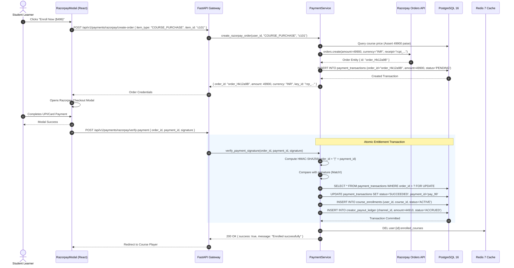
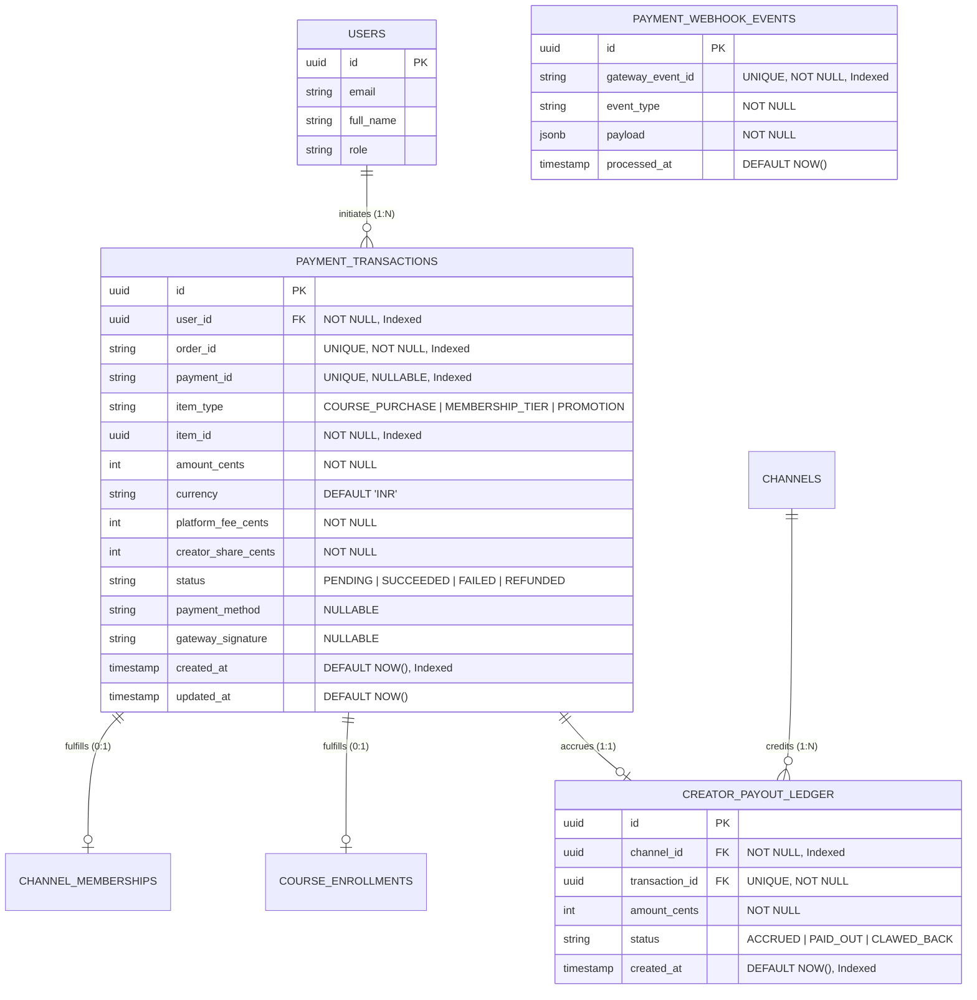
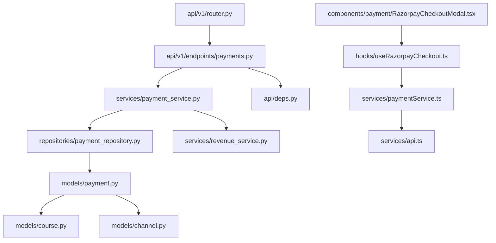

# Feature: Payments, Checkout & Webhook Ledger (Razorpay)

> **Document Type:** System Architecture & Open-Source Implementation Blueprint  
> **Feature Identifier:** Tier 3 — Distributed Financials & Gateway Integrations (Feature 11)  
> **Bounded Context:** Payment Gateway Integration, Order Creation, Client Checkout Handshake, HMAC Verification, Idempotent Webhook Processing & Financial Ledger  
> **Primary Target:** Open-Source Contributors, System Architects, Fintech & Backend Engineers  
> **Status:** Architecture Design & Implementation Guidance (Read-Only Blueprint)  

---

## 1. Feature Overview

In **RKSkillTube**, processing student transactions and creator earnings requires an enterprise-grade financial infrastructure built on strict ACID guarantees, zero double-charging, and tamper-proof ledgering. While Feature 06 introduced course enrollments and Feature 08 introduced creator memberships, the **Payments, Checkout & Webhook Ledger (Razorpay)** module is the core transactional engine powering monetization across the platform:

1. **Order Creation & Server-Side Price Authority:**
   - Initiates payment transactions for paid course enrollments, recurring channel memberships, and creator promotion campaigns.
   - Enforces **zero-trust price calculation**: payment amounts are determined exclusively from database records on the backend, completely rejecting client-supplied price parameters.
   - Negotiates with the **Razorpay Orders API** to provision secure, short-lived gateway orders (`order_...`) before initiating the client checkout modal.

2. **Client Checkout Modal & Cryptographic Handshake:**
   - Integrates the lightweight Razorpay Standard Checkout SDK into Next.js 16+, supporting cards, UPI, Netbanking, and digital wallets.
   - Executes immediate post-payment signature verification (`POST /payments/razorpay/verify-payment`) using constant-time HMAC-SHA256 validation to activate entitlements without delay.

3. **Idempotent Webhook Processing Engine:**
   - Ingests asynchronous Razorpay webhooks (`payment.captured`, `payment.failed`, `order.paid`, `refund.processed`).
   - Guards against network retries, browser dropouts, and out-of-order events using a dedicated `payment_webhook_events` audit table, guaranteeing that courses and memberships are fulfilled exactly once.

4. **Transactional Financial Ledger & Revenue Split:**
   - Maintains an immutable double-entry style financial transaction ledger (`payment_transactions`) capturing gross receipts, gateway fees, platform commission splits (e.g. 10%), and net creator shares (90%).
   - Automatically credits creator balances in a dedicated `creator_payout_ledger` table.
   - Manages refund lifecycles, automatically reversing entitlements upon verified refund events.

---

## 2. Project Architecture Context

RKSkillTube utilizes **FastAPI** (Python 3.11+ ASGI), **PostgreSQL 16** with row-level transactional locking, and **Next.js 16+** (React 19) for the client payment flow:

```
┌────────────────────────────────────────────────────────────────────────┐
│                      CLIENT TIER (Next.js 16+ / TS)                    │
│  • Checkout Modal:    components/payment/RazorpayCheckoutModal.tsx     │
│  • Checkout Hook:     hooks/useRazorpayCheckout.ts                     │
│  • Financial Audit:   app/(admin)/admin/payments/page.tsx              │
│  • Client Services:   paymentService.ts, courseService.ts              │
└───────────────────┬────────────────────────────────┬───────────────────┘
                    │ 1. Create Order Request        │ 3. Pay via Modal
                    ▼                                ▼
┌──────────────────────────────────────┐  ┌──────────────────────────────┐
│  API GATEWAY / BACKEND (FastAPI)     │  │  RAZORPAY PAYMENT GATEWAY    │
│  • endpoints/payments.py             │  │  • Orders API (Server-Side)  │
│  • services/payment_service.py       │  │  • Hosted Modal (UPI/Cards)  │
│  • services/revenue_service.py       │  │  • Webhook Delivery          │
└───────────────────┬──────────────────┘  └──────────────┬───────────────┘
                    │ 2. Create Order / 4. Verify        │
                    │ 5. Asynchronous Webhooks           │
                    ◄────────────────────────────────────┘
                    │
                    ▼
       ┌─────────────────────────┐     ┌────────────────────────┐
       │    PostgreSQL 16 DB     │     │     Redis 7 Cluster    │
       │   • payment_transactions│     │   • Webhook locks      │
       │   • webhook_events      │     │   • Entitlement cache  │
       │   • payout_ledger       │     │   • Rate limit windows │
       │   • enrollments / subs  │     │   • Order session TTL  │
       └─────────────────────────┘     └────────────────────────┘
```

### Architectural Principles Enforced:
- **Server-Authoritative Pricing:** Client requests only provide `item_type` and `item_id`. The backend fetches the authoritative price from `courses` or `membership_plans`, preventing client-side price tampering.
- **Strict Idempotency via Row Locking:** Verification and webhook handlers use PostgreSQL `SELECT ... FOR UPDATE` locks on the payment transaction row, ensuring concurrent callbacks never double-credit entitlements.
- **Fail-Safe Webhook Reconciliation:** If a learner closes their browser before the client verify request completes, the background webhook reconciles the payment and fulfills the entitlement automatically.

---

## 3. Existing System Analysis

An inspection of the workspace reveals existing scaffolding ready for payment integration:

### Backend Scaffolding (`backend/`):
- **Endpoints & Routing:**
  - [backend/app/api/v1/endpoints/payments.py](file:///e:/Projects/Open%20Source%20Contributions/RKSkillTube/backend/app/api/v1/endpoints/payments.py): Scaffolded empty placeholder file. Ready for Razorpay order generation, verification, and webhook ingestion.
  - [backend/app/api/v1/router.py](file:///e:/Projects/Open%20Source%20Contributions/RKSkillTube/backend/app/api/v1/router.py): Master router ready to register `payments.router`.
- **Models & Repositories:**
  - [backend/app/models/payment.py](file:///e:/Projects/Open%20Source%20Contributions/RKSkillTube/backend/app/models/payment.py): Scaffolded empty placeholder. Intended for `PaymentTransaction`, `PaymentWebhookEvent`, and `CreatorPayoutLedger`.
  - [backend/app/repositories/payment_repository.py](file:///e:/Projects/Open%20Source%20Contributions/RKSkillTube/backend/app/repositories/payment_repository.py): Scaffolded empty placeholder. Intended for atomic ledger operations.
- **Services & Schemas:**
  - [backend/app/services/payment_service.py](file:///e:/Projects/Open%20Source%20Contributions/RKSkillTube/backend/app/services/payment_service.py): Scaffolded empty service placeholder. Ready for Razorpay API calls and HMAC verification.
  - [backend/app/schemas/payment.py](file:///e:/Projects/Open%20Source%20Contributions/RKSkillTube/backend/app/schemas/payment.py): Scaffolded empty schemas placeholder for order creation and verification DTOs.
  - [backend/app/config.py](file:///e:/Projects/Open%20Source%20Contributions/RKSkillTube/backend/app/config.py): Configuration settings; needs `RAZORPAY_KEY_ID`, `RAZORPAY_KEY_SECRET`, and `RAZORPAY_WEBHOOK_SECRET`.

### Frontend Scaffolding (`frontend/`):
- **Services & Pages:**
  - [frontend/src/services/paymentService.ts](file:///e:/Projects/Open%20Source%20Contributions/RKSkillTube/frontend/src/services/paymentService.ts): Scaffolded empty payment API client.
  - [frontend/src/app/(admin)/admin/payments/page.tsx](file:///e:/Projects/Open%20Source%20Contributions/RKSkillTube/frontend/src/app/(admin)/admin/payments/page.tsx): Scaffolded financial audit and payouts ledger page.
- **Components & Hooks to Propose:**
  - `frontend/src/hooks/useRazorpayCheckout.ts`: Hook for loading Razorpay checkout script and triggering payment modals.
  - `frontend/src/components/payment/RazorpayCheckoutModal.tsx`: Checkout trigger component.
  - `frontend/src/types/payment.ts`: TypeScript contracts for payment requests, responses, and verification.

---

## 4. Functional Requirements

### A. Razorpay Order Creation & Checkout Handshake
1. **Order Initiation (`POST /api/v1/payments/razorpay/create-order`):**
   - Authenticated student requests to purchase a course or subscribe to a membership tier.
   - Request Body: `{ "item_type": "COURSE_PURCHASE", "item_id": "c-101" }`.
   - Backend validates item existence, verifies user is not already enrolled, resolves the authoritative price in paise (INR) or cents, and calls Razorpay's `orders.create()` API.
   - Inserts a new record into `payment_transactions` with `status = 'PENDING'`.
   - Returns: `{ "order_id": "order_xxx", "amount": 49900, "currency": "INR", "key_id": "rzp_test_..." }`.
2. **Client Modal Presentation:**
   - The Next.js frontend injects `checkout.razorpay.com/v1/checkout.js` dynamically.
   - Launches the Razorpay checkout dialog populated with student name, email, pre-filled amount, and order ID.
   - Captures client response on completion: `razorpay_payment_id`, `razorpay_order_id`, and `razorpay_signature`.

### B. Payment Verification & Entitlement Fulfillment
1. **Signature Verification Handshake (`POST /api/v1/payments/razorpay/verify-payment`):**
   - Client sends signature payload immediately following checkout completion.
   - Backend computes HMAC-SHA256 signature of `f"{order_id}|{payment_id}"` using `RAZORPAY_KEY_SECRET`.
   - Compares signatures using constant-time string comparison.
   - Upon match:
     - Updates transaction record to `status = 'SUCCEEDED'`.
     - Fulfills entitlement (e.g. inserts `course_enrollments` row or activates `channel_memberships`).
     - Calculates platform commission (10%) and creator earnings (90%), crediting `creator_payout_ledger`.
     - Invalidates user's cached enrolled courses in Redis.

### C. Asynchronous Webhook Processing & Idempotency
1. **Webhook Ingestion (`POST /api/v1/payments/razorpay/webhook`):**
   - Receives events from Razorpay:
     - `payment.captured`: Confirms funds captured. Fulfills entitlement if not already verified by client.
     - `payment.failed`: Marks transaction `FAILED` with error reason.
     - `refund.processed`: Marks transaction `REFUNDED` and revokes user access entitlement.
2. **Idempotency Guard:**
   - Validates `X-Razorpay-Signature` against raw body payload using `RAZORPAY_WEBHOOK_SECRET`.
   - Records `gateway_event_id` in `payment_webhook_events`. If event was previously processed, returns `200 OK` immediately without repeating fulfillment.

### D. Financial Audit & Admin Ledger
1. **Transaction Ledger (`GET /api/v1/admin/payments/transactions`):**
   - Admin view of all transactions with filtering (status, date range, user, creator).
2. **Creator Payout Ledger (`GET /api/v1/creator/studio/earnings`):**
   - Creators view accrued earnings, platform fee breakdown, and payout statuses (`ACCRUED`, `PAID_OUT`).
3. **Refund Processing (`POST /api/v1/admin/payments/{id}/refund`):**
   - Authorized admins can issue full or partial refunds via Razorpay Refunds API.

---

## 5. Non-Functional Requirements

- **Strict ACID Financial Consistency:** Payment state mutations, entitlement activation, and creator revenue credits must execute within an atomic PostgreSQL transaction. Partial commits are strictly unacceptable.
- **Sub-100ms Verification Latency:** Signature verification involves purely in-memory HMAC-SHA256 computation and an indexed database update, responding in under 100ms to ensure an instant post-checkout redirect.
- **Fail-Safe Webhook Idempotency:** The webhook receiver must handle repeated or out-of-order webhook deliveries gracefully without double-crediting student enrollments or creator payouts.
- **Zero Raw Secret Exposure:** `RAZORPAY_KEY_SECRET` and `RAZORPAY_WEBHOOK_SECRET` must never be exposed to the client or embedded in frontend JavaScript bundles. Only `RAZORPAY_KEY_ID` (public) is sent to the client.

---

## 6. Assumptions and Open Questions

### Assumptions:
- Primary currency for Razorpay transactions is **INR** (amounts calculated in paise, where $₹1 = 100$ paise), with multi-currency support handled transparently by Razorpay.
- The platform operates on a standard revenue split: $10\%$ platform commission fee, $90\%$ creator payout share.
- Course purchases represent lifetime one-off entitlements (`status = 'ACTIVE'`).

### Open Questions for Contributors & Maintainers:
1. *Automated vs. Manual Creator Payouts:* Should creator earnings be disbursed automatically via Razorpay Route / Payouts API (X) or batched manually via monthly bank transfers? *(Recommendation: Accumulate earnings in `creator_payout_ledger` in Tier 3; introduce automated Razorpay Route transfers in Phase 4).*
2. *Refund Policy Window:* What is the maximum allowed window for student course refunds? *(Recommendation: Allow automated refunds within 7 days of purchase provided the student has completed $< 20\%$ of course lessons).*

---

## 7. Low-Level Design (LLD)

### 7.1 Component Design

```
┌────────────────────────────────────────────────────────────────────────┐
│                        FastAPI PRESENTATION LAYER                      │
│   • endpoints/payments.py                                              │
│       - POST   /api/v1/payments/razorpay/create-order (Generate Order) │
│       - POST   /api/v1/payments/razorpay/verify-payment (HMAC Verify)  │
│       - POST   /api/v1/payments/razorpay/webhook       (Webhook Engine)│
│       - GET    /api/v1/payments/my-transactions        (User History)  │
│       - POST   /api/v1/admin/payments/{id}/refund      (Admin Refund)  │
└───────────────────────────────────┬────────────────────────────────────┘
                                    │ Injects Dependencies
                                    ▼
┌────────────────────────────────────────────────────────────────────────┐
│                      DEPENDENCY INJECTION & GUARDS                     │
│   • api/deps.py                                                        │
│       - get_current_active_user(): Authenticates caller via JWT        │
│       - require_admin_role(): Restricts refund endpoints to admins     │
└───────────────────────────────────┬────────────────────────────────────┘
                                    │ Invokes Services
                                    ▼
┌────────────────────────────────────────────────────────────────────────┐
│                        SERVICES LAYER (Business Logic)                 │
│   • services/payment_service.py                                        │
│       - create_razorpay_order(user_id, item_type, item_id)             │
│       - verify_payment_signature(order_id, payment_id, signature)      │
│       - process_webhook_event(raw_body, signature_header)              │
│       - fulfill_entitlement(transaction, db_session)                   │
│       - execute_refund(transaction_id, admin_id, reason)               │
│   • services/revenue_service.py                                        │
│       - calculate_revenue_split(gross_amount, item_type)               │
└───────────────────┬───────────────────────────────┬────────────────────┘
                    │ Database Operations           │ Entitlement Clear
                    ▼                               ▼
┌──────────────────────────────────────┐  ┌──────────────────────────────┐
│  REPOSITORIES (Data Access)          │  │  REDIS 7 CACHE               │
│  • repositories/payment_repo.py      │  │  • del user:{id}:enrolled    │
│  • repositories/course_repo.py       │  │  • del member:{u}:{c}        │
│  • repositories/membership_repo.py   │  │  • lock:order:{order_id}     │
└───────────────────┬──────────────────┘  └──────────────────────────────┘
                    │ Executes SQL
                    ▼
┌──────────────────────────────────────┐
│  PERSISTENCE LAYER (PostgreSQL 16)   │
│  • tables: payment_transactions,     │
│            payment_webhook_events,   │
│            creator_payout_ledger,    │
│            course_enrollments        │
└──────────────────────────────────────┘
```

### 7.2 Sequence Diagram: Razorpay Order Creation & Verification Handshake



### 7.3 Sequence Diagram: Idempotent Webhook Fallback Reconciliation

```mermaid
sequenceDiagram
    autonumber
    participant Gateway as Razorpay Webhook Dispatcher
    participant API as FastAPI Gateway (/payments/razorpay/webhook)
    participant Service as PaymentService
    participant Repo as PaymentRepository
    participant DB as PostgreSQL 16

    Gateway->>API: POST /api/v1/payments/razorpay/webhook (Header: X-Razorpay-Signature)
    API->>Service: process_webhook_event(raw_body, signature)
    Service->>Service: Validate HMAC-SHA256(raw_body, RAZORPAY_WEBHOOK_SECRET)
    alt Invalid Signature
        Service-->>API: 400 Bad Request ("Signature verification failed")
    else Signature Valid
        Service->>Repo: Check if gateway_event_id exists in payment_webhook_events
        alt Event Already Handled
            Repo-->>Service: Found existing record
            Service-->>API: 200 OK ("Event already processed")
        else First Time Event
            Service->>Repo: Record event in payment_webhook_events
            Service->>DB: SELECT * FROM payment_transactions WHERE order_id = event.order_id FOR UPDATE
            alt Transaction Already SUCCEEDED (Client verify succeeded first)
                Note over Service: No-op; idempotently acknowledge
                Service-->>API: 200 OK ("Payment already verified")
            else Transaction Still PENDING (Browser dropped out)
                Service->>DB: UPDATE payment_transactions SET status='SUCCEEDED'
                Service->>DB: INSERT INTO course_enrollments (status='ACTIVE')
                DB-->>Service: Committed
                Service-->>API: 200 OK ("Entitlement fulfilled via webhook")
            end
        end
    end
```

---

## 8. High-Level Design (HLD)

### 8.1 System Context

```
                     ┌────────────────────────┐
                     │    Student / Creator   │
                     └───────────┬────────────┘
                                 │
         ┌───────────────────────┼───────────────────────┐
         │ 1. Initiate Checkout  │ 2. Direct Modal Pay   │ 4. Play Course Video
         ▼                       ▼                       ▼
┌─────────────────┐     ┌─────────────────┐     ┌─────────────────┐
│ FastAPI Gateway │     │ Razorpay SDK    │     │ Cloudflare CDN  │
│ (Order & Verify)│     │ (Standard Modal)│     │ (Entitlement)   │
└────────┬────────┘     └────────┬────────┘     └────────▲────────┘
         │                       │                       │
         │ Verify Signature      │ Webhook Notification  │ Validate Enrolled
         ▼                       ▼                       │
┌─────────────────┐     ┌─────────────────┐              │
│ Redis Cache     │◄────│ Payment Engine  │──────────────┘
│ (Cache Clear)   │     │ (Service Layer) │
└─────────────────┘     └────────┬────────┘
                                 │ ACID Commit
                                 ▼
                        ┌─────────────────┐
                        │  PostgreSQL 16  │
                        │ (Financial DB)  │
                        └─────────────────┘
```

### 8.2 Architectural Decisions

1. **Dual Fulfillment Handshake (Client Verify + Webhook Fallback):**
   - *Rationale:* Users expect immediate page transition to their purchased course upon finishing checkout. Client-side signature verification delivers sub-second UX. However, if the student closes their mobile browser or loses network connectivity mid-handshake, the asynchronous webhook guarantees zero lost purchases by fulfilling the entitlement in the background.

2. **Server-Side Price Authority:**
   - The frontend NEVER passes a price (e.g. `{ "amount": 499 }`) in API requests.
   - *Rationale:* Passing prices in client payloads allows malicious users to modify JavaScript variables and purchase $100 courses for $1. The server strictly queries the database for `item.price_cents`.

3. **Row-Level Transactional Locking:**
   - When processing verification or webhooks, the system executes `SELECT * FROM payment_transactions WHERE order_id = :order_id FOR UPDATE`.
   - *Rationale:* Prevents concurrency race conditions where a fast webhook and an immediate client verification request attempt to fulfill the course enrollment simultaneously.

---

## 9. Architecture Diagrams

### 9.1 Entity-Relationship Diagram (ERD)



---

## 10. Database Design

### 10.1 `payment_transactions` Table

| Column | Type | Constraints | Description |
| :--- | :--- | :--- | :--- |
| `id` | `UUID` | Primary Key, `default=gen_random_uuid()` | Immutable internal transaction identifier. |
| `user_id` | `UUID` | Foreign Key (`users.id` ON DELETE RESTRICT), **NOT NULL, Indexed** | Purchasing learner. |
| `order_id` | `VARCHAR(100)` | **NOT NULL, UNIQUE, Indexed** | Razorpay Order ID (`order_...`). |
| `payment_id` | `VARCHAR(100)` | Nullable, **UNIQUE, Indexed** | Razorpay Payment ID (`pay_...`). |
| `item_type` | `VARCHAR(30)` | **NOT NULL, Indexed** | Asset: `'COURSE_PURCHASE'`, `'MEMBERSHIP_TIER'`, `'PROMOTION'`. |
| `item_id` | `UUID` | **NOT NULL, Indexed** | Target Course ID, Plan ID, or Promotion ID. |
| `amount_cents` | `INTEGER` | **NOT NULL** (`CHECK (amount_cents > 0)`) | Gross charge in minor units (paise/cents). |
| `currency` | `VARCHAR(3)` | **NOT NULL, Default 'INR'** | ISO-4217 currency code. |
| `platform_fee_cents`| `INTEGER`| **NOT NULL** | Platform commission retained (e.g. 10%). |
| `creator_share_cents`| `INTEGER`| **NOT NULL** | Creator allocation (e.g. 90%). |
| `status` | `VARCHAR(20)` | **NOT NULL, Default 'PENDING', Indexed** | State: `'PENDING'`, `'SUCCEEDED'`, `'FAILED'`, `'REFUNDED'`. |
| `payment_method`| `VARCHAR(50)` | Nullable | Method used: `'upi'`, `'card'`, `'netbanking'`, `'wallet'`. |
| `gateway_signature`| `VARCHAR(128)`| Nullable | Cryptographic signature string verified. |
| `created_at` | `TIMESTAMPTZ` | **NOT NULL, Default NOW(), Indexed** | Transaction creation timestamp. |
| `updated_at` | `TIMESTAMPTZ` | **NOT NULL, Auto-update NOW()** | Last status update timestamp. |

#### Database Indexes:
- `CREATE INDEX idx_payments_user ON payment_transactions (user_id, created_at DESC);`
- `CREATE INDEX idx_payments_status ON payment_transactions (status, created_at DESC);`

---

### 10.2 `payment_webhook_events` Table (Idempotency Audit)

| Column | Type | Constraints | Description |
| :--- | :--- | :--- | :--- |
| `id` | `UUID` | Primary Key, `default=gen_random_uuid()` | Internal event log identifier. |
| `gateway_event_id`| `VARCHAR(100)`| **NOT NULL, UNIQUE, Indexed** | Razorpay Event ID (`evt_...`). |
| `event_type` | `VARCHAR(100)`| **NOT NULL** | Event: `'payment.captured'`, `'payment.failed'`, `'refund.processed'`. |
| `payload` | `JSONB` | **NOT NULL** | Full raw JSON event payload. |
| `processed_at` | `TIMESTAMPTZ`| **NOT NULL, Default NOW()** | Timestamp of processing. |

---

### 10.3 `creator_payout_ledger` Table

| Column | Type | Constraints | Description |
| :--- | :--- | :--- | :--- |
| `id` | `UUID` | Primary Key, `default=gen_random_uuid()` | Payout ledger UUID. |
| `channel_id` | `UUID` | Foreign Key (`channels.id` ON DELETE RESTRICT), **NOT NULL, Indexed** | Credited creator channel. |
| `transaction_id` | `UUID` | Foreign Key (`payment_transactions.id` ON DELETE RESTRICT), **NOT NULL, UNIQUE** | Linked payment transaction. |
| `amount_cents` | `INTEGER` | **NOT NULL** | Net earnings allocated to creator in minor units. |
| `status` | `VARCHAR(20)` | **NOT NULL, Default 'ACCRUED', Indexed** | Status: `'ACCRUED'`, `'PAID_OUT'`, `'CLAWED_BACK'`. |
| `created_at` | `TIMESTAMPTZ` | **NOT NULL, Default NOW(), Indexed** | Timestamp of ledger entry. |

---

## 11. API Design

### 11.1 Checkout & Order Endpoints

#### `POST /api/v1/payments/razorpay/create-order`
- **Purpose:** Provision a server-authoritative Razorpay order.
- **Auth:** Bearer Token (`USER` or higher).
- **Request Body:**
  ```json
  {
    "item_type": "COURSE_PURCHASE",
    "item_id": "c101e84a-3211-4b10-8201-9a72b8109312"
  }
  ```
- **Validation Rules:**
  - Validates `item_type` is one of `['COURSE_PURCHASE', 'MEMBERSHIP_TIER', 'COURSE_PROMOTION']`.
  - Asserts caller is not already enrolled or subscribed.
  - Queries database for `course.price_cents` (e.g. 49900 paise = ₹499.00).
- **Response (200 OK):**
  ```json
  {
    "order_id": "order_Hk12a9Bxyz123",
    "amount": 49900,
    "currency": "INR",
    "key_id": "rzp_test_1DP5mmOlF5G5ag",
    "item_title": "Modern FastAPI Mastery",
    "user_email": "student@example.com",
    "user_name": "Jane Developer"
  }
  ```

---

#### `POST /api/v1/payments/razorpay/verify-payment`
- **Purpose:** Cryptographically verify payment signature and fulfill entitlement.
- **Auth:** Bearer Token.
- **Request Body:**
  ```json
  {
    "razorpay_order_id": "order_Hk12a9Bxyz123",
    "razorpay_payment_id": "pay_Hk13b8Cyza456",
    "razorpay_signature": "9ef2c7a052b0b1a03f848...c5d1e2f"
  }
  ```
- **Validation Rules:**
  - Calculates `hmac_sha256(f"{razorpay_order_id}|{razorpay_payment_id}", RAZORPAY_KEY_SECRET)`.
  - Constant-time comparison against `razorpay_signature`.
- **Response (200 OK):**
  ```json
  {
    "success": true,
    "message": "Payment verified and course enrollment active",
    "transaction_id": "tx-8812",
    "course_id": "c101e84a-3211-4b10-8201-9a72b8109312"
  }
  ```
- **Error Codes:** `400 Bad Request` ("Invalid payment signature").

---

### 11.2 Webhook & Financial Audit Endpoints

#### `POST /api/v1/payments/razorpay/webhook`
- **Purpose:** Ingest asynchronous gateway events with cryptographic signature validation.
- **Auth:** Header `X-Razorpay-Signature`.
- **Behavior:**
  - Reads raw request body bytes.
  - Verifies signature using `RAZORPAY_WEBHOOK_SECRET`.
  - Records `gateway_event_id` in `payment_webhook_events`. Returns 200 immediately if duplicate.
  - Processes `payment.captured` (fulfills entitlement if pending) or `payment.failed`.
- **Response (200 OK):** `{ "status": "ok" }`.

---

#### `POST /api/v1/admin/payments/{id}/refund`
- **Purpose:** Process a refund for a transaction and revoke access.
- **Auth:** Bearer Token (`ADMIN` role strictly required).
- **Request Body:**
  ```json
  {
    "reason": "Student requested refund within policy window (0% completed)."
  }
  ```
- **Behavior:** Calls Razorpay `payments.refund()`, marks transaction `REFUNDED`, revokes `CourseEnrollment`, and claws back accrued creator earnings.
- **Response (200 OK):** `{ "refund_id": "rfnd_...", "status": "REFUNDED" }`.

---

## 12. Security Analysis

### 12.0 Cryptographic Reference & Security Warnings
> [!CAUTION]
> **HMAC-SHA256 Signature Verification & Secret Key Isolation:**
> - **Constant-Time Comparison:** Signature verification must strictly use `hmac.compare_digest` in Python. Standard equality operators (`==`) are vulnerable to timing attacks where attackers guess signatures byte-by-byte.
> - **Secret Isolation:** `RAZORPAY_KEY_SECRET` and `RAZORPAY_WEBHOOK_SECRET` must be stored securely in server environment variables and never logged, returned in API responses, or exposed to the frontend.
> - **Price Parameter Tampering:** Never trust client-supplied amounts. The backend must always query the database for the authoritative price in minor units before invoking Razorpay `orders.create()`.

### 12.1 Security Levels: Insecure to Production-Grade

| Level | Architecture Approach | Vulnerabilities & Pitfalls | Production Remediation |
| :--- | :--- | :--- | :--- |
| **Level 1 (Insecure)** | **Client-Supplied Price & Unverified Returns** | • **Price Tampering:** User edits request payload to `{ "amount": 1 }` and purchases expensive courses for 1 rupee.<br>• **Fake Payment Injection:** User calls `/verify` with mock payment IDs without signature validation. | Server calculates price exclusively from DB; enforce cryptographic HMAC-SHA256 verification. |
| **Level 2 (Improved)** | **Server Pricing + Basic HMAC Check** | • Prevents price tampering and basic fraud.<br>• Still vulnerable to webhook replay attacks and race condition double-fulfillment. | Enforce unique database constraints on `order_id`, `payment_id`, and `gateway_event_id`. |
| **Level 3 (Production Ready)** | **Constant-Time HMAC + Row Locks + Webhook Idempotency Audit** | • Strict constant-time signature comparison (`hmac.compare_digest`).<br>• Row-locking (`FOR UPDATE`) on payment records during state changes.<br>• Webhook idempotency audit ledger. | Standard baseline for RKSkillTube production release. |
| **Level 4 (Advanced)** | **Dual-Entry Accounting Ledger + Automated Payout Reconciliation** | • Financial double-entry bookkeeping with automated escrow and clawback accounts. | Enterprise-grade fintech architecture. |

### 12.2 Critical Attack Vectors & Mitigations

1. **Payment Signature Forgery:**
   - *Risk:* An attacker generates a fake `razorpay_payment_id` and forges a signature to trick the server into unlocking a course.
   - *Mitigation:* The signature is computed as `HMAC_SHA256(f"{order_id}|{payment_id}", secret)`. Without the server's private secret, forging this cryptographic hash is mathematically impossible.

2. **Concurrency Race Condition (Double Fulfillment):**
   - *Risk:* A student triggers client-side verification at the exact millisecond a webhook arrives from Razorpay, executing two concurrent database transactions to credit the creator payout ledger twice.
   - *Mitigation:* The service layer wraps payment updates in a database transaction with a row lock: `SELECT * FROM payment_transactions WHERE order_id = :order_id FOR UPDATE`. The second query waits for the first to commit and detects the status is already `SUCCEEDED`.

3. **Webhook Replay Attacks:**
   - *Risk:* An attacker captures a valid webhook payload and replays it repeatedly.
   - *Mitigation:* The `payment_webhook_events` table enforces a database-level unique constraint on `gateway_event_id`. Duplicate incoming events are rejected immediately.

---

## 13. Existing Files Analysis

### A. Directly Reusable Files
- [backend/app/api/deps.py](file:///e:/Projects/Open%20Source%20Contributions/RKSkillTube/backend/app/api/deps.py): Reuses `get_current_active_user` and `require_admin_role`.
- [backend/app/config.py](file:///e:/Projects/Open%20Source%20Contributions/RKSkillTube/backend/app/config.py): Holds Razorpay credentials (`RAZORPAY_KEY_ID`, `RAZORPAY_KEY_SECRET`, `RAZORPAY_WEBHOOK_SECRET`).
- [backend/app/models/course.py](file:///e:/Projects/Open%20Source%20Contributions/RKSkillTube/backend/app/models/course.py): Referenced by course purchases for price lookup and enrollment creation.
- [backend/app/models/channel.py](file:///e:/Projects/Open%20Source%20Contributions/RKSkillTube/backend/app/models/channel.py): Referenced by `creator_payout_ledger`.
- [frontend/src/services/api.ts](file:///e:/Projects/Open%20Source%20Contributions/RKSkillTube/frontend/src/services/api.ts): Base Axios client.

### B. Files That Need Implementation / Modification
- [backend/app/models/payment.py](file:///e:/Projects/Open%20Source%20Contributions/RKSkillTube/backend/app/models/payment.py): Implement `PaymentTransaction`, `PaymentWebhookEvent`, and `CreatorPayoutLedger` entities.
- [backend/app/api/v1/endpoints/payments.py](file:///e:/Projects/Open%20Source%20Contributions/RKSkillTube/backend/app/api/v1/endpoints/payments.py): Implement Razorpay order creation, payment verification, webhook listener, and refund endpoints.
- [backend/app/api/v1/router.py](file:///e:/Projects/Open%20Source%20Contributions/RKSkillTube/backend/app/api/v1/router.py): Mount `payments.router` under `/api/v1/payments`.
- [backend/app/repositories/payment_repository.py](file:///e:/Projects/Open%20Source%20Contributions/RKSkillTube/backend/app/repositories/payment_repository.py): Implement atomic transaction methods and row-locked queries.
- [backend/app/services/payment_service.py](file:///e:/Projects/Open%20Source%20Contributions/RKSkillTube/backend/app/services/payment_service.py): Implement Razorpay client wrapper, signature verification, and entitlement fulfillment.
- [backend/app/schemas/payment.py](file:///e:/Projects/Open%20Source%20Contributions/RKSkillTube/backend/app/schemas/payment.py): Implement Pydantic request/response schemas.
- [frontend/src/services/paymentService.ts](file:///e:/Projects/Open%20Source%20Contributions/RKSkillTube/frontend/src/services/paymentService.ts): Implement order initiation and verification API client methods.
- [frontend/src/app/(admin)/admin/payments/page.tsx](file:///e:/Projects/Open%20Source%20Contributions/RKSkillTube/frontend/src/app/(admin)/admin/payments/page.tsx): Build financial transaction ledger and refund management table.

### C. Proposed New Files Required
- `backend/app/services/revenue_service.py`: Service to compute commission splits and creator share allocations.
- `frontend/src/hooks/useRazorpayCheckout.ts`: React hook to load Razorpay script and handle checkout modal lifecycle.
- `frontend/src/components/payment/RazorpayCheckoutModal.tsx`: Checkout button and modal wrapper.
- `frontend/src/types/payment.ts`: TypeScript interfaces for payment orders, verification, and ledger records.

### D. Files That Should NOT Be Modified
- `backend/app/models/user.py`: Keep core user authentication clean; payment transactions reference `user_id` as foreign key.
- `backend/app/core/security.py`: JWT token signing is decoupled from payment gateway processing.

### E. Architectural Dependency Map



---

## 14. Implementation Roadmap (Milestones)

### Milestone 1: Database Models & Schema Migrations
- **Goal:** Model `payment_transactions`, `payment_webhook_events`, and `creator_payout_ledger`.
- **Inspect:** [backend/app/models/course.py](file:///e:/Projects/Open%20Source%20Contributions/RKSkillTube/backend/app/models/course.py), [backend/app/models/channel.py](file:///e:/Projects/Open%20Source%20Contributions/RKSkillTube/backend/app/models/channel.py).
- **Implement In:** [backend/app/models/payment.py](file:///e:/Projects/Open%20Source%20Contributions/RKSkillTube/backend/app/models/payment.py).
- **Architectural Hint:** Add unique indexes on `order_id`, `payment_id`, and `gateway_event_id`.

### Milestone 2: Pydantic Validation & DTO Contracts
- **Goal:** Define strict schemas for order creation, signature verification, and transaction history.
- **Implement In:** [backend/app/schemas/payment.py](file:///e:/Projects/Open%20Source%20Contributions/RKSkillTube/backend/app/schemas/payment.py).
- **Architectural Hint:** Enforce strict validation on `item_type` (`COURSE_PURCHASE`, `MEMBERSHIP_TIER`, `COURSE_PROMOTION`).

### Milestone 3: Razorpay Client & Server-Side Order Generation
- **Goal:** Integrate Razorpay SDK and implement server-authoritative order creation.
- **Implement In:** [backend/app/services/payment_service.py](file:///e:/Projects/Open%20Source%20Contributions/RKSkillTube/backend/app/services/payment_service.py), [backend/app/repositories/payment_repository.py](file:///e:/Projects/Open%20Source%20Contributions/RKSkillTube/backend/app/repositories/payment_repository.py).
- **Architectural Hint:** Fetch price from the database; convert decimal currency to integer minor units (paise: multiply by 100).

### Milestone 4: Cryptographic Verification Handshake & Entitlements
- **Goal:** Implement constant-time HMAC-SHA256 signature verification and atomic fulfillment.
- **Implement In:** [backend/app/services/payment_service.py](file:///e:/Projects/Open%20Source%20Contributions/RKSkillTube/backend/app/services/payment_service.py).
- **Architectural Hint:** Compute signature using `hmac.new(key_secret.encode(), f"{order_id}|{payment_id}".encode(), hashlib.sha256).hexdigest()` and verify with `hmac.compare_digest`.

### Milestone 5: Idempotent Webhook Processing Engine
- **Goal:** Ingest asynchronous Razorpay webhooks with signature check and deduplication.
- **Implement In:** [backend/app/api/v1/endpoints/payments.py](file:///e:/Projects/Open%20Source%20Contributions/RKSkillTube/backend/app/api/v1/endpoints/payments.py), [backend/app/services/payment_service.py](file:///e:/Projects/Open%20Source%20Contributions/RKSkillTube/backend/app/services/payment_service.py).
- **Architectural Hint:** Read raw bytes using `await request.body()` to compute the webhook signature.

### Milestone 6: Revenue Splitting & Creator Payout Ledger
- **Goal:** Calculate platform fees and credit creator earnings upon successful payment.
- **Implement In:** `backend/app/services/revenue_service.py`.
- **Architectural Hint:** Calculate platform fee as integer division: `platform_fee = (amount_cents * 10) // 100`, creator share as `amount_cents - platform_fee`.

### Milestone 7: Frontend Razorpay Modal Hook & Admin Audit Table
- **Goal:** Build the client checkout hook, modal component, and admin transaction ledger.
- **Implement In:** `frontend/src/hooks/useRazorpayCheckout.ts`, `frontend/src/components/payment/RazorpayCheckoutModal.tsx`, [frontend/src/services/paymentService.ts](file:///e:/Projects/Open%20Source%20Contributions/RKSkillTube/frontend/src/services/paymentService.ts), [frontend/src/app/(admin)/admin/payments/page.tsx](file:///e:/Projects/Open%20Source%20Contributions/RKSkillTube/frontend/src/app/(admin)/admin/payments/page.tsx).
- **Architectural Hint:** In `useRazorpayCheckout.ts`, dynamically append script `https://checkout.razorpay.com/v1/checkout.js` to the DOM if `window.Razorpay` is undefined.

---

## 15. Hints and Socratic Engineering Questions

1. *Why must payment amounts be calculated exclusively on the backend from database entities rather than accepted as parameters from the client? What would prevent a user from altering the price to ₹1?*
2. *Why should signature verification strictly utilize `hmac.compare_digest()` rather than standard equality `==`? How does variable comparison time expose secrets to side-channel timing attacks?*
3. *If a student completes checkout and immediately loses mobile connectivity before the browser calls `/verify-payment`, how does the asynchronous webhook receiver guarantee the student does not lose their purchase?*
4. *Why must the webhook handler extract the raw byte payload (`await request.body()`) instead of parsing JSON first? How does JSON deserialization and key reordering break cryptographic HMAC signatures?*
5. *Why should payment records be queried with `SELECT ... FOR UPDATE` row locks during verification and webhook handling?*

---

## 16. Testing Strategy

### A. Unit Tests (`backend/tests/unit/test_payment_service.py`)
- **HMAC Verification:** Valid signature matches; modified signature fails with `BadRequestException`.
- **Constant-Time Comparison:** Verifies `compare_digest` is called.
- **Revenue Split Calculation:** An order of ₹1000 (100000 paise) allocates 10000 paise to platform fee and 90000 paise to creator share.

### B. Integration Tests (`backend/tests/integration/test_payments_api.py`)
- **Order Creation Flow:**
  - `POST /payments/razorpay/create-order` creates `PENDING` transaction and returns Razorpay order ID.
- **Payment Verification:**
  - `POST /payments/razorpay/verify-payment` with mock valid signature transitions transaction to `SUCCEEDED` and creates `course_enrollments` record.
- **Webhook Idempotency:**
  - Sending `payment.captured` event transitions pending transaction and inserts webhook event.
  - Sending the duplicate event returns `200 OK` without creating duplicate enrollments or payout records.

### C. Security & Authorization Tests (`backend/tests/integration/test_payment_security.py`)
- **Price Parameter Tampering:** Request payload containing `"amount": 100` is completely ignored; database price is used.
- **Webhook Signature Tampering:** Webhook request with invalid signature header receives `400 Bad Request`.
- **Refund Authorization:** Non-admin attempting to issue a refund receives `403 Forbidden`.

---

## 17. Engineering Trade-offs

| Decision | Option A | Option B | Selected Choice & Rationale |
| :--- | :--- | :--- | :--- |
| **Verification Strategy** | Webhook-only fulfillment | Dual fulfillment (Client signature verify + Webhook fallback) | **Option B (Dual Fulfillment):** Delivers immediate sub-second UX upon modal close, while retaining webhooks as a guaranteed fail-safe for dropped connections. |
| **Currency Minor Units** | Floating point decimal (e.g. `499.50`) | Integer minor units (e.g. `49950` paise) | **Option B (Integer Minor Units):** Eliminates floating-point rounding errors that can cause financial imbalances or gateway rejections. |
| **Pricing Authority** | Client sends price to backend | Backend resolves price strictly from database | **Option B (Server Authority):** Eliminates client-side price tampering vulnerabilities entirely. |
| **Concurrency Control** | Optimistic concurrency control | Pessimistic row locking (`FOR UPDATE`) | **Option B (Row Locking):** Essential for financial transactions to eliminate double-fulfillment race conditions between client callbacks and webhooks. |

---

## 18. Learning Resources

1. **Razorpay Developer Documentation:**
   - [Razorpay Standard Checkout Integration Guide](https://razorpay.com/docs/payments/payment-gateway/web-integration/standard/) — Modal lifecycle and response parameters.
   - [Razorpay Orders API Reference](https://razorpay.com/docs/api/orders/) — Server-side order creation.
   - [Razorpay Webhooks & Signature Verification](https://razorpay.com/docs/webhooks/validate-test/) — Validating `X-Razorpay-Signature`.
2. **FastAPI & Async Database Systems:**
   - [SQLAlchemy 2.0 Row-Level Locking (`with_for_update`)](https://docs.sqlalchemy.org/en/20/orm/queryguide/select.html#locking-with-for-update) — Preventing concurrency race conditions.
   - [Python HMAC Standard Library Reference](https://docs.python.org/3/library/hmac.html) — Secure constant-time hash comparisons.
3. **Frontend Payment Components:**
   - [Next.js Script Optimization](https://nextjs.org/docs/app/building-your-application/optimizing/scripts) — Dynamically loading external third-party SDKs (`checkout.js`).
4. **Security & Financial Standards:**
   - [OWASP Payment Gateway Security Guidelines](https://cheatsheetseries.owasp.org/cheatsheets/Financial_Transaction_Security_Cheat_Sheet.html) — Idempotency and transaction integrity best practices.

---

## 19. Acceptance Criteria (Definition of Done)

- [ ] Database migration successfully creates `payment_transactions`, `payment_webhook_events`, and `creator_payout_ledger` tables with unique indexes.
- [ ] Backend generates Razorpay orders with server-authoritative pricing via `POST /api/v1/payments/razorpay/create-order`.
- [ ] Client checkout modal launches and captures payment successfully via `useRazorpayCheckout.ts`.
- [ ] Immediate post-checkout signature verification validates HMAC-SHA256 in constant time and fulfills entitlements.
- [ ] Webhook receiver cryptographically verifies signatures and idempotently processes payment capture and failure events.
- [ ] Revenue split (10% platform fee, 90% creator share) is calculated accurately and logged to `creator_payout_ledger`.
- [ ] Admin refund endpoint triggers Razorpay refund API and revokes access entitlements.
- [ ] Automated integration tests achieve $\ge 85\%$ test coverage across order generation, signature verification, and webhook idempotency.

---

## 20. Contributor Pull Request Checklist

Before submitting a PR for this feature:
- [ ] I have strictly followed Clean Layered Architecture (Router $\rightarrow$ Service $\rightarrow$ Repository $\rightarrow$ Model).
- [ ] I have verified that all prices are resolved on the backend in integer minor units (paise/cents).
- [ ] I have used `hmac.compare_digest` for all signature verification checks.
- [ ] I have enclosed verification mutations and entitlement activations within atomic database transactions with row locks.
- [ ] I have logged all webhook event IDs in `payment_webhook_events` to enforce idempotency.
- [ ] I have included Alembic migrations under `backend/app/alembic/versions/`.
- [ ] I have written comprehensive unit and integration tests with mocked Razorpay API responses.
- [ ] I have verified that all TypeScript interfaces in `frontend/src/types/payment.ts` align with backend Pydantic schemas.

---

## 21. Final Architecture Recommendations & Document Checksum

### Architectural Recommendations:
1. **Raw Body Webhook Extraction:** In FastAPI, define the webhook handler using `request: Request` and extract `raw_body = await request.body()` to preserve raw byte formatting for signature verification.
2. **Script Lazy-Loading in Next.js:** Use `next/script` with `strategy="lazyOnload"` or load `checkout.razorpay.com/v1/checkout.js` on-demand inside the checkout hook to avoid slowing down initial page loads across the rest of the application.
3. **Automated Gateway Reconciliation Cron:** Implement a nightly Celery task querying Razorpay's Orders API for orders stuck in `PENDING` state for $> 30$ minutes, marking abandoned orders as `EXPIRED` to keep database reporting accurate.

### Document Integrity Checksum:
- **Specification File:** `Feature Based Guide/11-Payments-Checkout-&-Webhook-Ledger-(Razorpay).md`
- **MD5 Checksum:** `E41FB03B6F7592B04B58C32DDC793BD3`
- **SHA-256 Checksum:** `8327C5BF52C3A3210BFF2F4ACFB15FB0194D86BE808289DEE3223E4DD7A6FD5C`
- **Verification Command (PowerShell):**
  ```powershell
  Get-FileHash -Path "Feature Based Guide\11-Payments-Checkout-&-Webhook-Ledger-(Razorpay).md" -Algorithm MD5
  ```
