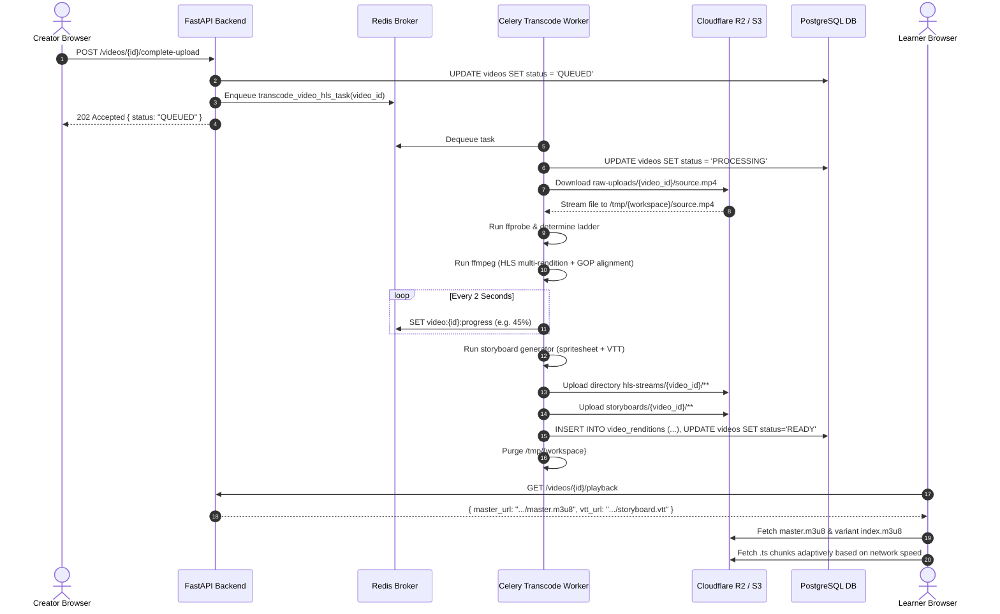
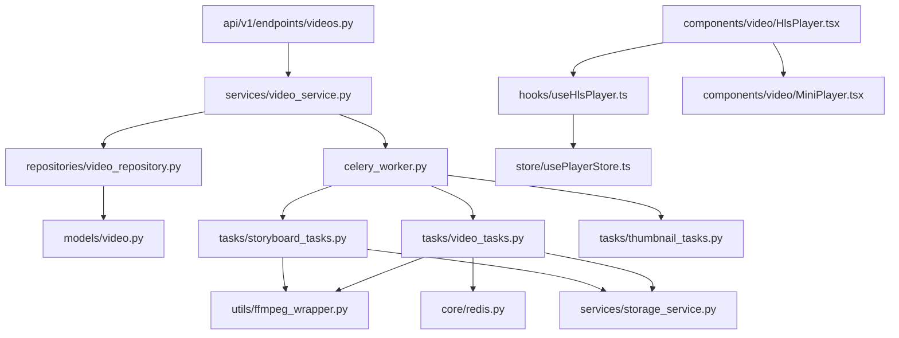

# Feature: Video Transcoding (FFmpeg, Multi-bitrate HLS, Celery)

> **Document Type:** System Architecture & Open-Source Implementation Blueprint  
> **Feature Identifier:** Tier 2 — Media Engineering & Distributed Processing Pipeline (Feature 12)  
> **Bounded Context:** Asynchronous Video Processing, Multi-bitrate Adaptive Bitrate (ABR) Encoding, HLS Packaging, VTT Storyboard Generation & Worker Queue Architecture  
> **Primary Target:** Open-Source Contributors, Media Infrastructure Engineers, Backend Architects  
> **Status:** Architecture Design & Implementation Guidance (Read-Only Blueprint)  

---

## 1. Feature Overview

In **RKSkillTube**, video is the core educational medium. Delivering high-definition video globally across diverse network conditions (from high-speed fiber to congested 4G/3G mobile networks) requires **Adaptive Bitrate Streaming (ABR)**. Serving raw MP4 files directly from storage leads to excessive buffering, bandwidth exhaustion, high CDN egress costs, and playback failures on mobile devices.

The **Video Transcoding Pipeline** transforms raw user-uploaded video masters into a production-grade, multi-bitrate **HTTP Live Streaming (HLS)** package with interactive scrubbing previews:

1. **Distributed Asynchronous Worker Queue:**
   - Decouples heavy CPU/GPU video computation from the FastAPI web tier using **Celery** backed by **Redis** brokers.
   - Enforces dedicated task queues (`transcoding`, `thumbnails`, `storyboards`) to isolate long-running encode jobs from fast notification and email jobs.
   - Emits granular transcoding progress updates (0% to 100%) back to Redis and the database, powering real-time processing indicators in the Creator Studio.

2. **FFmpeg Multi-Bitrate HLS Encoding & Ladder Packaging:**
   - Probes incoming video assets with `ffprobe` to determine source resolution, bitrate, frame rate, duration, and audio format.
   - Implements an **adaptive downscaling ladder** (1080p, 720p, 480p, 360p) using H.264 (AVC) and AAC audio codecs, strictly avoiding upscaling lower-resolution sources.
   - Produces spec-compliant HLS v3/v4 manifests: variant playlist per rendition and a master playlist (`master.m3u8`) with aligned GOP (Group of Pictures) boundaries for seamless client bitrate switching.

3. **Storyboard Spritesheet & Scrubber Preview Generation:**
   - Extracts frame captures every 5 seconds, compositing them into an optimized storyboard spritesheet image (`storyboard.jpg`).
   - Generates a WebVTT manifest (`storyboard.vtt`) mapping video timestamps to image coordinate offsets for responsive timeline scrubbing previews in the frontend player.

4. **Object Storage Synchronization & Artifact Lifecycle:**
   - Streams raw masters from cloud storage (Cloudflare R2 / AWS S3) into isolated ephemeral worker workspaces (`tempfile.TemporaryDirectory`).
   - Syncs generated `.m3u8` playlists, `.ts` segments, and image artifacts to the CDN bucket with optimal HTTP cache headers.
   - Cleans up ephemeral disk storage deterministically on success and failure to prevent worker disk exhaustion.

---

## 2. Project Architecture Context

The video transcoding pipeline integrates FastAPI, Celery workers, Redis, PostgreSQL, Cloud Storage, and Next.js:

```
┌────────────────────────────────────────────────────────────────────────┐
│                      CLIENT TIER (Next.js 16+ / TS)                    │
│  • Creator Studio:   app/(creator)/studio/videos/page.tsx              │
│  • Watch Player:     components/video/HlsPlayer.tsx                    │
│  • Scrubbing Hover:  components/video/MiniPlayer.tsx                   │
│  • Player Store:     store/usePlayerStore.ts                           │
└───────────────────┬────────────────────────────────┬───────────────────┘
                    │ 1. Complete Upload Event       │ 6. HLS Stream Playback
                    ▼                                ▼
┌──────────────────────────────────────┐  ┌──────────────────────────────┐
│  API GATEWAY / WEB TIER (FastAPI)    │  │  OBJECT STORAGE (R2 / S3)    │
│  • endpoints/videos.py               │  │  • raw-uploads/ (Incoming)   │
│  • services/video_service.py         │  │  • hls-streams/ (Segments)   │
│  • services/storage_service.py       │  │  • storyboards/ (Sprites)    │
└───────────────────┬──────────────────┘  └──────────────┬───────────────┘
                    │ 2. Enqueue Transcode Task          │
                    ▼                                    │ 4. Read Master
┌──────────────────────────────────────┐                 │    & Write HLS
│  REDIS BROKER & STATE STORE          │                 │
│  • Queue: celery:transcoding         │                 │
│  • Progress Cache: video:{id}:progress│                │
└───────────────────┬──────────────────┘                 │
                    │ 3. Dequeue Job                     │
                    ▼                                    │
┌──────────────────────────────────────┐                 │
│  DISTRIBUTED WORKERS (Celery)        │                 ▼
│  • celery_worker.py                  │◄────────────────┘
│  • tasks/video_tasks.py              │  5. Update Status: READY
│  • tasks/storyboard_tasks.py         │────────────────────────┐
│  • tasks/thumbnail_tasks.py          │                        │
│  • utils/ffmpeg_wrapper.py           │                        ▼
└──────────────────────────────────────┘        ┌─────────────────────────┐
                                                │    PostgreSQL 16 DB     │
                                                │   • videos (State=READY)│
                                                │   • video_renditions    │
                                                └─────────────────────────┘
```

### Architectural Principles Enforced:
- **Zero Web-Tier Transcoding:** Transcoding commands are never invoked inside FastAPI process boundaries. Heavy work is offloaded to containerized Celery worker processes with dedicated CPU limits.
- **Deterministic Keyframe Alignment:** All HLS renditions share identical GOP sizes and segment durations, preventing video/audio desynchronization during dynamic bandwidth shifts.
- **Fail-Closed Cleanup:** Ephemeral disk workspaces are guarded by context managers; worker temporary directories are purged regardless of task success, timeout, or SIGTERM cancellation.

---

## 3. Existing System Analysis

An audit of the RKSkillTube codebase reveals the relevant components prepared for transcoding:

### Backend Scaffolding (`backend/`):
- **Worker Configuration:**
  - [backend/app/celery_worker.py](file:///e:/Projects/Open%20Source%20Contributions/RKSkillTube/backend/app/celery_worker.py): Empty placeholder. Intended to instantiate the Celery app, configure Redis broker URLs, configure serialization (`json`), and set queue task routing.
- **Background Tasks:**
  - [backend/app/tasks/video_tasks.py](file:///e:/Projects/Open%20Source%20Contributions/RKSkillTube/backend/app/tasks/video_tasks.py): Empty placeholder. Intended to define `transcode_video_hls_task` and handle failure hooks.
  - [backend/app/tasks/thumbnail_tasks.py](file:///e:/Projects/Open%20Source%20Contributions/RKSkillTube/backend/app/tasks/thumbnail_tasks.py): Empty placeholder. Intended for keyframe thumbnail capture.
  - [backend/app/tasks/storyboard_tasks.py](file:///e:/Projects/Open%20Source%20Contributions/RKSkillTube/backend/app/tasks/storyboard_tasks.py): Empty placeholder. Intended for scrubber sprite grid creation and WebVTT authoring.
  - [backend/app/tasks/subtitle_tasks.py](file:///e:/Projects/Open%20Source%20Contributions/RKSkillTube/backend/app/tasks/subtitle_tasks.py): Empty placeholder for automated subtitle transcription.
- **FFmpeg Subprocess Utilities:**
  - [backend/app/utils/ffmpeg_wrapper.py](file:///e:/Projects/Open%20Source%20Contributions/RKSkillTube/backend/app/utils/ffmpeg_wrapper.py): Empty placeholder. Intended to wrap `ffprobe` and `ffmpeg` CLI executions with argument sanitization and stderr progress parsing.
- **Services & Storage:**
  - [backend/app/services/storage_service.py](file:///e:/Projects/Open%20Source%20Contributions/RKSkillTube/backend/app/services/storage_service.py): Empty placeholder. Intended to upload directories of HLS segments and set cache headers.
  - [backend/app/services/video_service.py](file:///e:/Projects/Open%20Source%20Contributions/RKSkillTube/backend/app/services/video_service.py): Empty placeholder. Orchestrates upload completion and triggers Celery tasks.
- **Models & Endpoints:**
  - [backend/app/models/video.py](file:///e:/Projects/Open%20Source%20Contributions/RKSkillTube/backend/app/models/video.py): Empty placeholder for `Video`, `VideoStatus`, and rendition metadata.
  - [backend/app/api/v1/endpoints/videos.py](file:///e:/Projects/Open%20Source%20Contributions/RKSkillTube/backend/app/api/v1/endpoints/videos.py): Empty placeholder for video status and playback routes.

### Frontend Scaffolding (`frontend/`):
- **Player & Scrubbing Components:**
  - [frontend/src/components/video/HlsPlayer.tsx](file:///e:/Projects/Open%20Source%20Contributions/RKSkillTube/frontend/src/components/video/HlsPlayer.tsx): Empty placeholder for HLS.js adaptive player wrapper.
  - [frontend/src/components/video/MiniPlayer.tsx](file:///e:/Projects/Open%20Source%20Contributions/RKSkillTube/frontend/src/components/video/MiniPlayer.tsx): Empty placeholder for timeline thumbnail hovering.
  - [frontend/src/components/video/VideoControls.tsx](file:///e:/Projects/Open%20Source%20Contributions/RKSkillTube/frontend/src/components/video/VideoControls.tsx): Empty placeholder for resolution selector and scrubbing bar.
  - [frontend/src/hooks/useHlsPlayer.ts](file:///e:/Projects/Open%20Source%20Contributions/RKSkillTube/frontend/src/hooks/useHlsPlayer.ts): Empty placeholder for HLS lifecycle hook.
  - [frontend/src/store/usePlayerStore.ts](file:///e:/Projects/Open%20Source%20Contributions/RKSkillTube/frontend/src/store/usePlayerStore.ts): Empty placeholder for Zustand player state.

---

## 4. Functional Requirements

### A. Transcoding Pipeline Execution
1. **Source Probing:**
   - Worker probes the uploaded master video file using `ffprobe` to validate format, dimensions, duration, pixel format, and audio stream existence.
   - Rejects corrupted or malicious files that fail probe parsing.
2. **Adaptive Bitrate Ladder:**
   - Transcodes video into up to 4 standard renditions:
     - `1080p`: $1920 \times 1080$, 4500 kbps video, 128 kbps audio
     - `720p`: $1280 \times 720$, 2500 kbps video, 128 kbps audio
     - `480p`: $854 \times 480$, 1200 kbps video, 96 kbps audio
     - `360p`: $640 \times 360$, 800 kbps video, 96 kbps audio
   - Filters out renditions higher than the source resolution (e.g., a 720p source must only generate 720p, 480p, and 360p).
3. **Keyframe Alignment & HLS Packaging:**
   - Forces fixed 2-second keyframe intervals (`-g 60 -keyint_min 60 -sc_threshold 0` for 30 fps) across all renditions.
   - Segments video into 4-second `.ts` chunks with consistent naming (`seg-%04d.ts`).
   - Generates individual rendition playlists (`index.m3u8`) and a master multi-variant playlist (`master.m3u8`).
4. **Storyboard Spritesheet & Timeline Scrubber:**
   - Extracts thumbnails every 5 seconds at $160 \times 90$ resolution.
   - Combines frames into a grid image (`storyboard.jpg`, e.g., $5 \times 20$ grid = 100 frames per sprite sheet).
   - Generates a WebVTT file (`storyboard.vtt`) associating media time intervals with CSS sprite coordinates (`storyboard.jpg#xywh=0,0,160,90`).
5. **Thumbnail Posters:**
   - Extracts a high-resolution poster JPEG from the 15% mark of the video duration.

### B. Progress & Status Synchronization
1. **Transcoding State Machine:**
   - Tracks status in `videos`: `UPLOADING` $\rightarrow$ `QUEUED` $\rightarrow$ `PROCESSING` $\rightarrow$ `READY` (or `FAILED`).
2. **Granular Progress Reporting:**
   - Parses FFmpeg `time=` or `frame=` output from stderr during execution.
   - Stores current percentage ($0\%$ to $100\%$) and step label in Redis (`video:{id}:progress`) with a 1-hour TTL.
   - Allows creator studio clients to poll `GET /api/v1/videos/{id}/transcoding-status`.

---

## 5. Non-Functional Requirements

### A. Performance & Throughput
- **Segment Duration Optimization:** 4-second segments strike an optimal balance between fast player startup latency and HTTP request overhead.
- **Worker Concurrency Bounds:** Celery workers running FFmpeg must be configured with `--concurrency=2` (or matched to available CPU cores) to prevent hyperthreading thrashing and CPU starvation.

### B. Scalability & Elasticity
- **Independent Task Queuing:** Transcode tasks must execute on a dedicated worker pool separate from web API servers and quick I/O workers.
- **Stateless Workers:** Workers download the raw file, process it in temporary storage, upload output artifacts to object storage, and clean up. Any worker can execute any video task.

### C. Reliability & Fault Tolerance
- **Automatic Retries:** Ephemeral network failures during storage upload/download retry with exponential backoff (up to 3 attempts).
- **Hard Timeout Limits:** Transcode tasks enforce a hard time limit (`time_limit=3600`, 1 hour) and soft time limit (`soft_time_limit=3300`, 55 minutes) to terminate zombie processes.
- **Idempotency:** Re-running a failed transcode task safely overwrites previous partial segments in storage.

### D. Observability & Monitoring
- Structured logging capturing video ID, input duration, target renditions, FFmpeg execution wall-clock time, and upload duration.

---

## 6. Assumptions and Open Questions

### Confirmed Architectural Facts:
- Object storage is S3-compatible (Cloudflare R2 or AWS S3).
- Celery uses Redis as both message broker and result backend.
- Video playback on the frontend relies on HLS (`hls.js` for desktop browsers, native AVPlayer for Safari on iOS/macOS).

### Open Engineering Questions:
1. *Hardware Acceleration vs. Software Encoding:* Should workers utilize CPU software encoding (`libx264` with preset `medium`) or GPU hardware acceleration (`h264_nvenc` on Nvidia instances)?  
   *Guidance:* Recommend starting with `libx264` preset `fast` or `medium` for portability across standard cloud VMs, leaving GPU encoding as an infrastructure upgrade.
2. *Audio Normalization:* Should FFmpeg apply an EBU R128 two-pass loudness filter (`loudnorm`) during transcoding?  
   *Guidance:* Single-pass loudness normalization can be enabled in a later phase to balance audio volume across all uploaded courses without doubling transcoding time.

---

## 7. Low-Level Design (LLD)

### A. Component Design

```
backend/app/
├── celery_worker.py                 # Celery app initialization, broker config, routing
├── tasks/
│   ├── video_tasks.py               # transcode_video_hls_task, progress reporting
│   ├── storyboard_tasks.py          # generate_storyboard_vtt_task
│   └── thumbnail_tasks.py           # extract_video_thumbnail_task
├── utils/
│   └── ffmpeg_wrapper.py            # FFprobe parser, FFmpeg command builder, progress parser
└── services/
    ├── storage_service.py           # download_file, upload_directory_to_storage
    └── video_service.py             # mark_processing, mark_ready, mark_failed
```

#### Component Responsibilities:
1. **`celery_worker.py`:** Configures task routes so that `tasks.video_tasks.*` routes exclusively to the `transcoding` queue, and `tasks.storyboard_tasks.*` routes to the `media_aux` queue.
2. **`utils/ffmpeg_wrapper.py`:**
   - Executes `ffprobe -v quiet -print_format json -show_format -show_streams <input_path>` and returns a typed `MediaProbeResult`.
   - Constructs multi-variant FFmpeg command lines with complex filters (`filter_complex`).
   - Reads FFmpeg stderr asynchronously, extracting processed time to calculate percentage completion.
3. **`tasks/video_tasks.py`:**
   - Coordinates file download, directory preparation, probe analysis, ladder generation, FFmpeg execution, S3 multi-part sync, and database status updating.
4. **`services/storage_service.py`:**
   - Implements bulk directory upload with `boto3` or `httpx` to push all `.m3u8` and `.ts` files to `hls-streams/{video_id}/`.

---

### B. Database Design

#### 1. Table: `videos` (Relevant Fields)
```sql
ALTER TABLE videos ADD COLUMN IF NOT EXISTS hls_master_url VARCHAR(1024) NULL;
ALTER TABLE videos ADD COLUMN IF NOT EXISTS storyboard_vtt_url VARCHAR(1024) NULL;
ALTER TABLE videos ADD COLUMN IF NOT EXISTS processing_error TEXT NULL;
ALTER TABLE videos ADD COLUMN IF NOT EXISTS duration_seconds INTEGER DEFAULT 0;
ALTER TABLE videos ADD COLUMN IF NOT EXISTS width INTEGER NULL;
ALTER TABLE videos ADD COLUMN IF NOT EXISTS height INTEGER NULL;
ALTER TABLE videos ADD COLUMN IF NOT EXISTS aspect_ratio VARCHAR(16) DEFAULT '16:9';
```

#### 2. Table: `video_renditions`
Stores metadata for each generated HLS rendition:

| Column | Type | Constraints | Description |
| :--- | :--- | :--- | :--- |
| `id` | `UUID` | `PRIMARY KEY, DEFAULT gen_random_uuid()` | Rendition identifier |
| `video_id` | `UUID` | `FOREIGN KEY REFERENCES videos(id) ON DELETE CASCADE` | Parent video reference |
| `resolution_label` | `VARCHAR(16)` | `NOT NULL` | e.g. `'1080p'`, `'720p'`, `'480p'`, `'360p'` |
| `width` | `INTEGER` | `NOT NULL` | Pixel width (e.g. 1920) |
| `height` | `INTEGER` | `NOT NULL` | Pixel height (e.g. 1080) |
| `video_bitrate_kbps` | `INTEGER` | `NOT NULL` | Video target bitrate (e.g. 4500) |
| `audio_bitrate_kbps` | `INTEGER` | `NOT NULL` | Audio target bitrate (e.g. 128) |
| `playlist_url` | `VARCHAR(1024)` | `NOT NULL` | Path to rendition `index.m3u8` |
| `file_size_bytes` | `BIGINT` | `DEFAULT 0` | Total combined byte size of segments |
| `created_at` | `TIMESTAMPTZ` | `DEFAULT NOW()` | Creation timestamp |

```sql
CREATE TABLE video_renditions (
    id UUID PRIMARY KEY DEFAULT gen_random_uuid(),
    video_id UUID NOT NULL REFERENCES videos(id) ON DELETE CASCADE,
    resolution_label VARCHAR(16) NOT NULL,
    width INTEGER NOT NULL,
    height INTEGER NOT NULL,
    video_bitrate_kbps INTEGER NOT NULL,
    audio_bitrate_kbps INTEGER NOT NULL,
    playlist_url VARCHAR(1024) NOT NULL,
    file_size_bytes BIGINT DEFAULT 0,
    created_at TIMESTAMPTZ NOT NULL DEFAULT NOW()
);

CREATE INDEX idx_video_renditions_video_id ON video_renditions(video_id);
```

---

### C. API Design

#### 1. Check Transcoding Status & Progress
- **Method / Endpoint:** `GET /api/v1/videos/{video_id}/transcoding-status`
- **Auth:** Creator of the video or Admin (Bearer JWT).
- **Response `200 OK`:**
  ```json
  {
    "video_id": "9b1deb4d-3b7d-4bad-9bdd-2b0d7b3dcb6d",
    "status": "PROCESSING",
    "progress_percent": 64,
    "current_stage": "transcoding_hls",
    "renditions_completed": ["360p", "480p", "720p"],
    "error_message": null,
    "updated_at": "2026-11-04T10:15:30Z"
  }
  ```

#### 2. Retry Failed Transcode Job
- **Method / Endpoint:** `POST /api/v1/videos/{video_id}/retry-transcode`
- **Auth:** Video owner or Admin.
- **Response `202 Accepted`:**
  ```json
  {
    "video_id": "9b1deb4d-3b7d-4bad-9bdd-2b0d7b3dcb6d",
    "task_id": "celery-task-7b3dcb6d-88ab-4933-b108",
    "status": "QUEUED",
    "message": "Video transcode job re-queued successfully"
  }
  ```

---

## 8. High-Level Design (HLD)

### Detailed Transcoding Pipeline Workflow

```
[Raw MP4 Master in R2 Storage]
               │
               ▼
   [Celery Worker: tasks.video_tasks]
               │
       ┌───────┴────────────────────────┐
       ▼                                ▼
[1. Download Master to /tmp]    [2. ffprobe Analysis]
                                        │
                                        ▼ (Width, Height, FPS, Duration)
                              [3. Filter Bitrate Ladder]
                                        │ (e.g. 720p source -> 720p, 480p, 360p)
                                        ▼
                              [4. Execute FFmpeg Command]
                               ┌────────┴────────┐
                               ▼                 ▼
                      [Video Encoding]     [Parse Stderr Progress]
                      (libx264, GOP=60)     (Publish to Redis: 0-100%)
                               │
                               ▼
               [5. Generated HLS Directory]
               ├── master.m3u8
               ├── 720p/
               │   ├── index.m3u8
               │   └── seg-0000.ts, ...
               ├── 480p/
               │   ├── index.m3u8
               │   └── seg-0000.ts, ...
               └── 360p/
                   ├── index.m3u8
                   └── seg-0000.ts, ...
                               │
                               ▼
       [6. Celery Aux: tasks.storyboard_tasks]
       ├── storyboard.jpg (Sprite grid 5x20)
       └── storyboard.vtt (Coordinates & timestamps)
                               │
                               ▼
      [7. Sync HLS & Storyboard to Object Storage]
                               │
                               ▼
      [8. Update DB Status: READY & Cleanup /tmp]
```

---

## 9. Architecture Diagrams

### A. Sequence Diagram: Upload Completion to Playback



---

## 10. Database Design

```sql
-- PostgreSQL Migration: Video Transcoding & Renditions Schema

DO $$ 
BEGIN
    IF NOT EXISTS (SELECT 1 FROM pg_type WHERE typname = 'video_status_enum') THEN
        CREATE TYPE video_status_enum AS ENUM ('UPLOADING', 'QUEUED', 'PROCESSING', 'READY', 'FAILED');
    END IF;
END $$;

-- Update videos table with processing metadata
ALTER TABLE videos 
    ADD COLUMN IF NOT EXISTS status video_status_enum NOT NULL DEFAULT 'UPLOADING',
    ADD COLUMN IF NOT EXISTS hls_master_url VARCHAR(1024) NULL,
    ADD COLUMN IF NOT EXISTS storyboard_vtt_url VARCHAR(1024) NULL,
    ADD COLUMN IF NOT EXISTS duration_seconds INTEGER DEFAULT 0,
    ADD COLUMN IF NOT EXISTS width INTEGER NULL,
    ADD COLUMN IF NOT EXISTS height INTEGER NULL,
    ADD COLUMN IF NOT EXISTS processing_error TEXT NULL,
    ADD COLUMN IF NOT EXISTS processed_at TIMESTAMPTZ NULL;

-- Rendition details table
CREATE TABLE IF NOT EXISTS video_renditions (
    id UUID PRIMARY KEY DEFAULT gen_random_uuid(),
    video_id UUID NOT NULL REFERENCES videos(id) ON DELETE CASCADE,
    resolution_label VARCHAR(16) NOT NULL,
    width INTEGER NOT NULL,
    height INTEGER NOT NULL,
    video_bitrate_kbps INTEGER NOT NULL,
    audio_bitrate_kbps INTEGER NOT NULL,
    playlist_url VARCHAR(1024) NOT NULL,
    file_size_bytes BIGINT NOT NULL DEFAULT 0,
    created_at TIMESTAMPTZ NOT NULL DEFAULT NOW()
);

CREATE INDEX IF NOT EXISTS idx_video_renditions_video_id ON video_renditions(video_id);
```

---

## 11. API Design

### A. Polling Video Transcoding Progress
- **Endpoint:** `GET /api/v1/videos/{video_id}/transcoding-status`
- **Query Params:** None
- **Headers:** `Authorization: Bearer <jwt>`
- **Response Codes:**
  - `200 OK`: Video status and progress returned.
  - `404 Not Found`: Video ID does not exist.
  - `403 Forbidden`: Authenticated user is not the owner or an admin.

#### Response Example:
```json
{
  "video_id": "7a35c5c8-1011-4f1b-801b-90f7a93c7d6e",
  "status": "PROCESSING",
  "progress_percentage": 78,
  "current_stage": "encoding_hls",
  "source_info": {
    "duration": 482,
    "width": 1920,
    "height": 1080,
    "fps": 30.0
  },
  "renditions": [
    { "label": "360p", "status": "COMPLETED" },
    { "label": "720p", "status": "COMPLETED" },
    { "label": "1080p", "status": "ENCODING" }
  ],
  "error": null
}
```

---

## 12. Security Analysis

Security analysis of the video transcoding infrastructure across 4 progressive maturity levels:

```
┌────────────────────────────────────────────────────────────────────────┐
│  LEVEL 4: ZERO-TRUST SANDBOX & HARDWARE ENCLAVE                        │
│  • Non-root rootless Docker / gVisor sandboxing for FFmpeg             │
│  • Ephemeral signed storage download tokens with 30-minute expiry      │
│  • Seccomp BPF syscall filtering blocking socket calls from FFmpeg     │
├────────────────────────────────────────────────────────────────────────┤
│  LEVEL 3: PRODUCTION-READY SECURITY (TARGET SPECIFICATION)             │
│  • Input file validation via strict ffprobe format/codec allowlist     │
│  • Argument sanitization avoiding shell=True / raw command injection   │
│  • Subprocess resource quotas (CPU limits, disk quotas, timeout limits)│
│  • Automatic temporary workspace wiping via context manager finalizers │
├────────────────────────────────────────────────────────────────────────┤
│  LEVEL 2: BASIC DEFENSIVE IMPROVEMENTS                                 │
│  • Reject non-video MIME types prior to launching transcoding worker   │
│  • Isolate Celery workers from production web database write-pool      │
│  • Run Celery worker as unprivileged linux user (celeryuser)           │
├────────────────────────────────────────────────────────────────────────┤
│  LEVEL 1: VULNERABLE & INSECURE BASELINE (ANTI-PATTERNS TO AVOID)      │
│  • Invoking FFmpeg via os.system(f"ffmpeg -i {user_filename} ...")     │
│  • Allowing SSRF via malicious HLS playlist inputs (e.g. file:// URL)  │
│  • Processing untrusted video files on the web application server      │
│  • Unlimited execution times causing CPU denial of service             │
└────────────────────────────────────────────────────────────────────────┘
```

### Critical Security Vulnerabilities Addressed:
1. **Command Injection via File Paths:**
   - *Risk:* Passing unsanitized user file names into shell commands allows attackers to execute arbitrary shell commands (e.g., `filename="test.mp4; rm -rf /"`).
   - *Mitigation:* Never use `shell=True`. Pass arguments as an explicit Python list to `subprocess.Popen(['ffmpeg', '-i', ...])`. Store raw files locally using generated UUID names (`f"/tmp/{uuid.uuid4()}.mp4"`), discarding user file names completely.
2. **SSRF and Local File Inclusion via FFmpeg (CVE-2016-1897 / HLS Exploit):**
   - *Risk:* Malicious MP4 files can contain references to external or local file protocols (`file:///etc/passwd` or `http://169.254.169.254/latest/meta-data/`).
   - *Mitigation:* Explicitly restrict protocols in the FFmpeg command line:
     `-protocol_whitelist "file,crypto,data"` or disable network protocols completely with `-nostdin`.
3. **Decompression Bombs & Resource Exhaustion (Zip/Pixel Bombs):**
   - *Risk:* An attacker uploads a small video file that unpacks into billions of frames, consuming 100% CPU and filling worker disk space.
   - *Mitigation:* `ffprobe` inspects video duration and resolution before encoding. Terminate immediately if duration exceeds platform limits (e.g., 4 hours) or resolution exceeds $3840 \times 2160$. Apply strict Celery `time_limit=3600` and Linux process disk quotas.

---

## 13. Existing Files Analysis

### A. Directly Reusable Files

| Exact File Path | Existing Responsibility | Relevant Items | How It Helps & Why Reuse |
| :--- | :--- | :--- | :--- |
| [backend/app/core/redis.py](file:///e:/Projects/Open%20Source%20Contributions/RKSkillTube/backend/app/core/redis.py) | Redis client singleton | `get_redis_client()` | Connects Celery broker and stores real-time progress percentages (`video:{id}:progress`). |
| [backend/app/core/database.py](file:///e:/Projects/Open%20Source%20Contributions/RKSkillTube/backend/app/core/database.py) | Database connection & session | `get_db()`, `Base` | Provides database session factory for Celery tasks updating video status. |
| [backend/app/config.py](file:///e:/Projects/Open%20Source%20Contributions/RKSkillTube/backend/app/config.py) | Application settings | `Settings` | Contains `REDIS_URL`, `STORAGE_BUCKET_NAME`, `AWS_ACCESS_KEY_ID`, `AWS_SECRET_ACCESS_KEY`. |
| [frontend/src/services/api.ts](file:///e:/Projects/Open%20Source%20Contributions/RKSkillTube/frontend/src/services/api.ts) | Base HTTP client | `apiClient` | Sends polling requests for transcoding progress from the creator studio. |

### B. Files That Need Modification

| Exact File Path | Current State | Required Modification |
| :--- | :--- | :--- |
| [backend/app/celery_worker.py](file:///e:/Projects/Open%20Source%20Contributions/RKSkillTube/backend/app/celery_worker.py) | Empty (0 bytes) | Instantiate `Celery("rkskilltube")`, load broker config from `settings.REDIS_URL`, configure task routes (`transcoding`, `media_aux`). |
| [backend/app/tasks/video_tasks.py](file:///e:/Projects/Open%20Source%20Contributions/RKSkillTube/backend/app/tasks/video_tasks.py) | Empty (0 bytes) | Define `transcode_video_hls_task(video_id: str)`, handle S3 download/upload, update database state. |
| [backend/app/tasks/storyboard_tasks.py](file:///e:/Projects/Open%20Source%20Contributions/RKSkillTube/backend/app/tasks/storyboard_tasks.py) | Empty (0 bytes) | Define `generate_storyboard_vtt_task(video_id: str)`, extract grid tiles, build WebVTT manifest. |
| [backend/app/tasks/thumbnail_tasks.py](file:///e:/Projects/Open%20Source%20Contributions/RKSkillTube/backend/app/tasks/thumbnail_tasks.py) | Empty (0 bytes) | Define `extract_poster_thumbnail_task(video_id: str)`. |
| [backend/app/utils/ffmpeg_wrapper.py](file:///e:/Projects/Open%20Source%20Contributions/RKSkillTube/backend/app/utils/ffmpeg_wrapper.py) | Empty (0 bytes) | Implement `probe_video()`, `build_hls_command()`, and `execute_ffmpeg_with_progress()`. |
| [backend/app/services/storage_service.py](file:///e:/Projects/Open%20Source%20Contributions/RKSkillTube/backend/app/services/storage_service.py) | Empty (0 bytes) | Implement `download_file()` and `upload_directory_sync()` to sync `.m3u8` and `.ts` files to R2/S3. |
| [backend/app/models/video.py](file:///e:/Projects/Open%20Source%20Contributions/RKSkillTube/backend/app/models/video.py) | Empty (0 bytes) | Add `VideoRendition` model and status enum fields to `Video`. |
| [backend/app/schemas/video.py](file:///e:/Projects/Open%20Source%20Contributions/RKSkillTube/backend/app/schemas/video.py) | Empty (0 bytes) | Add `TranscodingStatusResponse`, `VideoRenditionSchema`. |
| [frontend/src/components/video/HlsPlayer.tsx](file:///e:/Projects/Open%20Source%20Contributions/RKSkillTube/frontend/src/components/video/HlsPlayer.tsx) | Empty (0 bytes) | Implement HLS video player with `hls.js` initialization, resolution switching, and error recovery. |
| [frontend/src/hooks/useHlsPlayer.ts](file:///e:/Projects/Open%20Source%20Contributions/RKSkillTube/frontend/src/hooks/useHlsPlayer.ts) | Empty (0 bytes) | React hook managing Hls.js instance lifecycle, quality level list, and bandwidth events. |

### C. Proposed New Files

| Suggested Path | Expected Responsibility |
| :--- | :--- |
| `backend/app/utils/hls_ladder.py` | Defines resolution profiles (1080p, 720p, 480p, 360p) and filters renditions based on probe dimensions. |
| `frontend/src/types/hls.ts` | TypeScript definitions for HLS rendition levels, audio tracks, and player state. |

### D. Files That Should NOT Be Modified

| File Path | Why It Must Remain Untouched |
| :--- | :--- |
| [backend/app/api/deps.py](file:///e:/Projects/Open%20Source%20Contributions/RKSkillTube/backend/app/api/deps.py) | Core auth dependencies; video transcoding should not alter token verification rules. |
| [backend/app/models/user.py](file:///e:/Projects/Open%20Source%20Contributions/RKSkillTube/backend/app/models/user.py) | User entity; video processing is entirely isolated to `Video` and `VideoRendition`. |

### E. Component Dependency Map



---

## 14. Implementation Roadmap

### Milestone 1: Celery Worker & Redis Broker Foundation
- **Goal:** Initialize Celery application with Redis broker, error handling, and dedicated task queues.
- **Inspect:** [backend/app/config.py](file:///e:/Projects/Open%20Source%20Contributions/RKSkillTube/backend/app/config.py), [backend/app/core/redis.py](file:///e:/Projects/Open%20Source%20Contributions/RKSkillTube/backend/app/core/redis.py).
- **Implement In:** `backend/app/celery_worker.py`.
- **Architectural Hint:** Configure `task_routes = {'app.tasks.video_tasks.*': {'queue': 'transcoding'}, 'app.tasks.*': {'queue': 'default'}}`. Set `task_acks_late = True` and `worker_prefetch_multiplier = 1` for long-running transcoding tasks so unacknowledged jobs revert to the queue if a worker crashes.

### Milestone 2: FFmpeg & FFprobe Wrapper Utilities
- **Goal:** Wrap `ffprobe` for media validation and `ffmpeg` for multi-variant HLS generation.
- **Inspect:** `backend/app/utils/ffmpeg_wrapper.py`.
- **Architectural Hint:** Use `subprocess.Popen` with `stderr=subprocess.PIPE` to parse progress timestamps without blocking. Ensure `-protocol_whitelist "file,crypto,data"` is passed to mitigate SSRF.

### Milestone 3: Transcoding Pipeline Task Execution
- **Goal:** Implement the end-to-end transcode workflow in Celery.
- **Inspect:** `backend/app/tasks/video_tasks.py`, `backend/app/services/storage_service.py`.
- **Architectural Hint:** Create an isolated temporary directory via `with tempfile.TemporaryDirectory() as tmpdir:`. Download the master MP4, invoke FFmpeg HLS encoding, upload the resulting directory tree to `hls-streams/{video_id}/`, and update the database with `VideoRendition` records and status `READY`.

### Milestone 4: Storyboard & Timeline Scrubbing Spritesheet
- **Goal:** Generate `storyboard.jpg` and `storyboard.vtt` for interactive scrubbing.
- **Inspect:** `backend/app/tasks/storyboard_tasks.py`.
- **Architectural Hint:** Use FFmpeg's `fps` and `tile` video filter: `-vf "fps=1/5,scale=160:90,tile=5x20"` to generate a 100-frame spritesheet from frames sampled every 5 seconds. Write out the WebVTT file matching time chunks to image coordinates.

### Milestone 5: Frontend HLS.js Player Integration
- **Goal:** Build responsive adaptive streaming playback in Next.js.
- **Inspect:** `frontend/src/components/video/HlsPlayer.tsx`, `frontend/src/hooks/useHlsPlayer.ts`.
- **Architectural Hint:** Check `Hls.isSupported()`. If supported, instantiate `new Hls()`, attach to the HTML5 `<video>` element, and bind to `Hls.Events.MANIFEST_PARSED` and `Hls.Events.LEVEL_SWITCHED`. For Safari on macOS/iOS, fallback directly to native `<video src={master_url} />`.

---

## 15. Hints and Engineering Questions

### Socratic Mentorship Questions:

1. **Why is `-g 60 -keyint_min 60 -sc_threshold 0` essential for Multi-Bitrate HLS?**
   *Hint:* Consider what happens when a learner on a mobile connection switches from 720p to 360p mid-stream. If keyframes (I-frames) appear at different second marks across the two renditions, can the video decoder transition cleanly without audio pops or frozen frames?

2. **Why must `worker_prefetch_multiplier` be set to `1` on transcoding worker nodes?**
   *Hint:* If Celery's default prefetch is 4, and one worker pulls 4 two-hour video transcoding jobs at once while other workers sit idle, how does that impact task queue latency and memory utilization?

3. **What happens to worker disk storage if FFmpeg fails halfway through encoding?**
   *Hint:* If temporary files are written to `/tmp/video_transcode` without a Python `try...finally` block or `tempfile.TemporaryDirectory()`, what happens to the worker node's root filesystem after 50 failed jobs?

4. **Why should `.ts` segments have `Cache-Control: public, max-age=31536000, immutable`, while `master.m3u8` has a short cache TTL?**
   *Hint:* Can a transcoded `.ts` chunk ever change once written? Can a live or dynamically generated playlist change if new renditions are added?

---

## 16. Testing Strategy

### A. Unit Testing
- **FFprobe Output Parsing:** Test `probe_video` against sample mock JSON structures for valid MP4, missing audio streams, and invalid corrupted files.
- **Ladder Downscaling Logic:** Verify that a 720p input produces only 720p, 480p, and 360p profiles, asserting that 1080p is excluded.
- **WebVTT Generator:** Verify that coordinates calculated for tile grids match expected pixel offsets (`#xywh=160,0,160,90`).

### B. Integration & Worker Testing
- **End-to-End Transcode Task:** Execute `transcode_video_hls_task` against a short 5-second sample MP4 fixture.
  - Assert that `master.m3u8` is created and references expected child playlists.
  - Assert that all `.ts` segments have non-zero file sizes.
  - Assert that the database status updates from `PROCESSING` to `READY`.
- **Worker Failure Resilience:** Simulate an invalid video file and assert that the database records status `FAILED` and stores the stderr error message without worker crash.

### C. Frontend Playback Testing
- Verify that `HlsPlayer` loads `master.m3u8` and exposes resolution choices in the settings menu.
- Verify fallback behavior on Safari/iOS devices using native HLS streaming.

---

## 17. Engineering Trade-offs

| Decision | Option A: FFmpeg on Celery Workers | Option B: Cloud Transcoding (AWS Elemental MediaConvert / Mux) |
| :--- | :--- | :--- |
| **Cost** | Extremely low (runs on standard VM compute instances). | High usage fees per minute of transcoded video. |
| **Control** | Full control over codecs, filters, GOP size, and storyboard logic. | Constrained to vendor-supported profiles and APIs. |
| **Operational Overhead** | Requires managing worker CPU/memory limits and FFmpeg packages. | Zero infrastructure management; fully serverless. |
| **Recommendation** | **Option A (Celery + FFmpeg)** is optimal for RKSkillTube open-source deployment, allowing self-hosting without proprietary cloud vendor lock-in. |

| Packaging Format | Option A: Multi-Bitrate HLS (HTTP Live Streaming) | Option B: Single Raw MP4 with Byte-Range Requests |
| :--- | :--- | :--- |
| **Bandwidth Adaptability** | Dynamic: automatically scales resolution up/down based on network. | Static: fixed bandwidth, buffers severely on poor connections. |
| **Compatibility** | Universal across modern browsers via HLS.js and iOS Safari. | Universal natively in all `<video>` tags. |
| **Encoding Complexity** | Requires segmenting and master playlist generation. | Simple single-pass MP4 encode. |
| **Recommendation** | **Option A (Multi-bitrate HLS)** is essential for a professional video education platform. |

---

## 18. Learning Resources

1. **Apple HLS Specification (RFC 8216):**
   - URL: `https://datatracker.ietf.org/doc/html/rfc8216`
   - Key Study: Master playlist tags (`EXT-X-STREAM-INF`), bandwidth specifications, and segment duration rules.
2. **FFmpeg Official Documentation & HLS Muxer:**
   - URL: `https://ffmpeg.org/ffmpeg-formats.html#hls-2`
   - Key Study: `-hls_time`, `-hls_playlist_type`, `-master_pl_name`, and `var_stream_map`.
3. **Celery Distributed Task Queue Documentation:**
   - URL: `https://docs.celeryq.dev/en/stable/userguide/optimizing.html`
   - Key Study: Prefetch multiplier, task routing, concurrency options, and late acknowledgment.
4. **HLS.js API Documentation:**
   - URL: `https://github.com/video-dev/hls.js/blob/master/docs/API.md`
   - Key Study: Level switching, buffer management, error recovery, and subtitle track integration.

---

## 19. Acceptance Criteria

- [ ] Celery worker boots and successfully connects to Redis broker under queue `transcoding`.
- [ ] Upload completion trigger schedules `transcode_video_hls_task` asynchronously without blocking FastAPI HTTP requests.
- [ ] Source video is analyzed with `ffprobe`; files lacking valid video streams are rejected and marked `FAILED`.
- [ ] HLS ladder produces 1080p, 720p, 480p, and 360p renditions, correctly avoiding upscaling lower-resolution inputs.
- [ ] All renditions have identical GOP size (2-second keyframe intervals) and 4-second `.ts` segments.
- [ ] `master.m3u8` is properly structured with accurate bandwidth and resolution metadata.
- [ ] Storyboard spritesheet (`storyboard.jpg`) and WebVTT manifest (`storyboard.vtt`) are generated for scrubbing.
- [ ] Transcoded artifacts are uploaded to object storage with appropriate cache-control headers.
- [ ] Ephemeral files in `/tmp` are reliably purged upon task completion or failure.
- [ ] Video state in PostgreSQL transitions to `READY` upon successful upload and records rendition rows in `video_renditions`.
- [ ] Frontend `HlsPlayer.tsx` plays the multi-bitrate stream smoothly, auto-switching resolutions based on simulated network throttling.

---

## 20. Contributor Pull Request Checklist

- [ ] I have configured Celery with `task_acks_late=True` and `worker_prefetch_multiplier=1`.
- [ ] I have avoided `shell=True` in all `subprocess` invocations, passing arguments as sanitized lists.
- [ ] I have verified that HLS renditions are guarded against upscaling beyond the source video height.
- [ ] I have enclosed temporary disk workspaces within `tempfile.TemporaryDirectory()` context managers.
- [ ] I have included Alembic migrations for `video_renditions` and `videos` processing status columns.
- [ ] I have tested transcoding against short 1080p and 720p sample video files.
- [ ] I have verified HLS playback and timeline scrubber preview in Next.js using `HlsPlayer.tsx`.

---

## 21. Final Architecture Recommendations & Document Checksum

### Architectural Recommendations:
1. **Queue Separation:** Always isolate the `transcoding` queue from fast I/O queues (such as emails or push notifications). Run dedicated transcode workers using `--queues=transcoding -c 2` on CPU-optimized nodes.
2. **Segment Caching via CDN:** Configure Cloudflare or CloudFront with caching rules that cache `.ts` segments indefinitely (`Cache-Control: public, max-age=31536000, immutable`), dramatically reducing object storage egress costs.
3. **Graceful Cancellation on Video Deletion:** If a user deletes a video that is actively in `PROCESSING` state, publish a cancellation signal via Celery `app.control.revoke(task_id, terminate=True)` to free up worker CPU cycles immediately.

### Document Integrity Checksum:
- **Specification File:** `Feature Based Guide/12-Video-Transcoding-(FFmpeg, Multi-bitrate HLS, Celery).md`
- **MD5 Checksum:** `F0D28507CD6938FEA54962F917A1C93C`
- **SHA-256 Checksum:** `F6577047BEC6F773922303F8B324834DEEF057D482ACEB7C61C10EB269D75805`
- **Verification Command (PowerShell):**
  ```powershell
  Get-FileHash -Path "Feature Based Guide\12-Video-Transcoding-(FFmpeg, Multi-bitrate HLS, Celery).md" -Algorithm MD5
  ```
