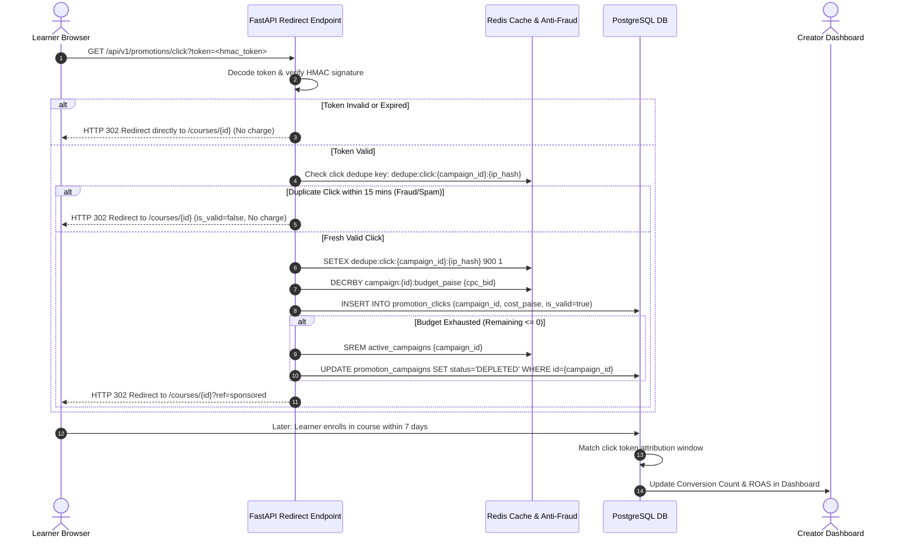
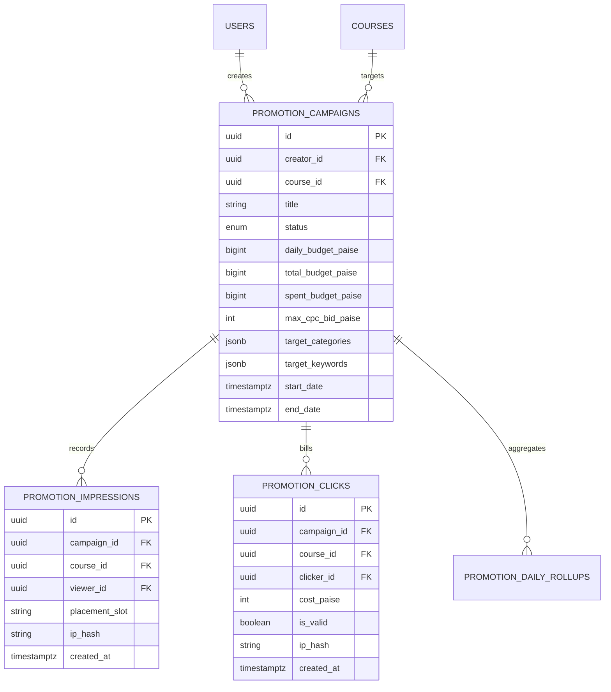
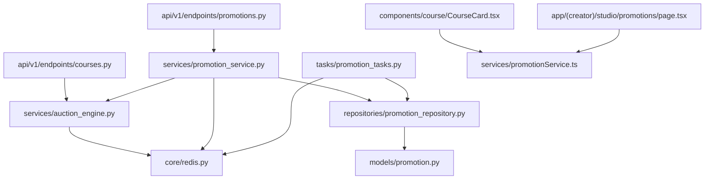

# Feature: Course Promotion Engine & Sponsored Discovery

> **Document Type:** System Architecture & Open-Source Implementation Blueprint  
> **Feature Identifier:** Tier 3 — Monetization & Marketplace Growth (Feature 13)  
> **Bounded Context:** Creator Ad Campaigns, Sponsored Recommendation Auction, Anti-Fraud Tracking Engine & Discovery Injection  
> **Primary Target:** Open-Source Contributors, Marketplace Architects, Backend Engineers, Growth Engineers  
> **Status:** Architecture Design & Implementation Guidance (Read-Only Blueprint)  

---

## 1. Feature Overview

In **RKSkillTube**, high-quality educational courses often struggle with organic discovery amidst thousands of uploaded videos and playlists. The **Course Promotion Engine & Sponsored Discovery** platform allows creators to create targeted ad campaigns to sponsor their courses, while giving learners transparent, high-relevance course recommendations across search results, the explore marketplace, and video watch suggestions.

Building an ad-tech and discovery engine inside an educational platform requires solving four core architectural problems:

1. **Creator Campaign & Budget Management:**
   - Creators can launch targeted campaigns selecting their course, target categories, keywords, daily spend caps, and total budget.
   - Financial ledgering guarantees that campaigns strictly stop serving when budgets are exhausted, preventing over-delivery or negative wallet balances.
   - Seamless integration with the existing Razorpay ledger (Feature 11) to fund campaign wallets via prepaid deposits.

2. **Real-Time Sponsored Auction & Discovery Injection:**
   - Dynamic ad-ranking engine calculating an auction score:  
     $$\text{Auction Score} = \text{CPC Bid} \times \text{Relevance Score} \times \text{Quality Factor}$$
   - Seamless injection of sponsored courses into search results (`/api/v1/search`), course explore feeds (`/api/v1/courses`), and related sidebar carousels.
   - Enforces **Enrollment Exclusion**: If an authenticated learner has already purchased or enrolled in a course, that course is strictly excluded from their sponsored ad pool.
   - FTC / regulatory compliance: All sponsored items are surfaced with an immutable `"Sponsored"` badge.

3. **Cryptographically Signed Tracking & Anti-Click Fraud Engine:**
   - Impression beacons and click redirects use signed, tamper-proof tracking tokens (HMAC-SHA256) encoding campaign ID, course ID, placement slot, viewer ID, and timestamp.
   - Multi-layer click fraud protection: Dedupes rapid repeat clicks within sliding time windows via Redis HyperLogLog and sliding-window rate limiters.
   - Fast redirects via `GET /api/v1/promotions/click?token=...` that log the verified interaction, decrement the cached budget atomically, and issue an `HTTP 302` redirect to the course landing page in $< 15\text{ms}$.

4. **Attribution & Creator ROI Analytics:**
   - Tracks 7-day post-click enrollment conversions.
   - Provides creators with real-time performance metrics in the Creator Studio: Impressions, Clicks, Click-Through Rate (CTR), Cost Per Click (CPC), Total Spend, Enrolled Learners, and Return on Ad Spend (ROAS).

---

## 2. Project Architecture Context

The Course Promotion Engine operates across FastAPI, Celery, Redis, PostgreSQL, and Next.js:

```
┌────────────────────────────────────────────────────────────────────────┐
│                      CLIENT TIER (Next.js 16+ / TS)                    │
│  • Creator Studio Ads:  app/(creator)/studio/promotions/page.tsx       │
│  • Course Explore:      app/(main)/courses/page.tsx                    │
│  • Search Results:      app/(main)/search/page.tsx                     │
│  • Course Card:         components/course/CourseCard.tsx [Sponsored]   │
└───────────────────┬────────────────────────────────┬───────────────────┘
                    │ 1. Search / Feed Request       │ 4. Click Redirect
                    ▼                                ▼
┌──────────────────────────────────────┐  ┌──────────────────────────────┐
│  API GATEWAY / WEB TIER (FastAPI)    │  │  TRACKING & REDIRECT ENGINE  │
│  • endpoints/courses.py (Discovery)  │  │  • endpoints/promotions.py   │
│  • services/promotion_service.py     │  │  • Verify HMAC Token         │
│  • services/auction_engine.py        │  │  • Anti-Fraud Filter (Redis) │
└───────────────────┬──────────────────┘  └──────────────┬───────────────┘
                    │ 2. Candidate Retrieval             │ 5. Atomic Budget Deduct
                    ▼                                    ▼
┌──────────────────────────────────────┐  ┌──────────────────────────────┐
│  REDIS IN-MEMORY AD CACHE            │  │  POSTGRESQL 16 DATABASE      │
│  • Active Campaign Sorted Sets (Bids)│  │  • promotion_campaigns       │
│  • Cached Balances: campaign:{id}:bal│  │  • promotion_clicks (Ledger) │
│  • Anti-Fraud Dedupe Sets            │  │  • promotion_impressions     │
└───────────────────┬──────────────────┘  └──────────────┬───────────────┘
                    │                                    │
                    │ 3. Celery Sync & Rollup            │
                    ▼                                    ▼
┌────────────────────────────────────────────────────────────────────────┐
│                      BACKGROUND WORKERS (Celery)                       │
│  • tasks/promotion_tasks.py: sync_campaign_budgets, rollup_daily_stats │
└────────────────────────────────────────────────────────────────────────┘
```

### Architectural Principles Enforced:
- **Zero-Latency Feed Impact:** Serving sponsored courses must not degrade regular course explore or search latency. Active campaign candidates are cached in Redis sorted sets; ranking occurs in-memory.
- **Atomic Budget Decrementing:** Clicks and impressions decrement an in-memory Redis budget (`DECRBY`) to prevent race-condition overspend during traffic spikes.
- **Regulatory Transparency:** Every sponsored card must carry an unambiguous `is_sponsored: true` indicator in the API contract and frontend UI.

---

## 3. Existing System Analysis

### Backend Audit (`backend/`):
- **Courses Subsystem:**
  - [backend/app/api/v1/endpoints/courses.py](file:///e:/Projects/Open%20Source%20Contributions/RKSkillTube/backend/app/api/v1/endpoints/courses.py): Empty placeholder. Intended for course catalog listing, course detail, and syllabus endpoints. Needs integration with promotion injection logic.
  - [backend/app/models/course.py](file:///e:/Projects/Open%20Source%20Contributions/RKSkillTube/backend/app/models/course.py): Empty placeholder for `Course`, `CourseEnrollment` models.
  - [backend/app/services/course_service.py](file:///e:/Projects/Open%20Source%20Contributions/RKSkillTube/backend/app/services/course_service.py): Empty placeholder for course business logic.
- **Payments & Ledger Foundation:**
  - [backend/app/models/payment.py](file:///e:/Projects/Open%20Source%20Contributions/RKSkillTube/backend/app/models/payment.py): Intended for transaction ledgering; can provide wallet balances for funding promo campaigns.
  - [backend/app/services/payment_service.py](file:///e:/Projects/Open%20Source%20Contributions/RKSkillTube/backend/app/services/payment_service.py): Payment processing engine.
- **Shared Infrastructure:**
  - [backend/app/core/redis.py](file:///e:/Projects/Open%20Source%20Contributions/RKSkillTube/backend/app/core/redis.py): Redis connection singleton. Used for real-time campaign candidate pools and click deduping.
  - [backend/app/core/database.py](file:///e:/Projects/Open%20Source%20Contributions/RKSkillTube/backend/app/core/database.py): SQLAlchemy async DB engine.
  - [backend/app/celery_worker.py](file:///e:/Projects/Open%20Source%20Contributions/RKSkillTube/backend/app/celery_worker.py): Celery instance setup for hourly budget synchronization and analytics rollups.

### Frontend Audit (`frontend/`):
- **Course Components & Views:**
  - [frontend/src/components/course/CourseCard.tsx](file:///e:/Projects/Open%20Source%20Contributions/RKSkillTube/frontend/src/components/course/CourseCard.tsx): Empty placeholder. Needs visual support for `"Sponsored"` badges and click redirect handlers.
  - [frontend/src/app/(main)/courses/page.tsx](file:///e:/Projects/Open%20Source%20Contributions/RKSkillTube/frontend/src/app/(main)/courses/page.tsx): Main course explore feed; target for sponsored card injection.
  - [frontend/src/app/(main)/search/page.tsx](file:///e:/Projects/Open%20Source%20Contributions/RKSkillTube/frontend/src/app/(main)/search/page.tsx): Search page; target for top-ranked sponsored search results.
  - [frontend/src/app/(creator)/studio/courses/page.tsx](file:///e:/Projects/Open%20Source%20Contributions/RKSkillTube/frontend/src/app/(creator)/studio/courses/page.tsx): Creator studio course management. Needs "Promote Course" action button.

---

## 4. Functional Requirements

### A. Creator Campaign Management
1. **Campaign Creation:**
   - Creators select an approved, published course (`course_id`) they own.
   - Set campaign parameters:
     - Target Categories (e.g. `["Web Development", "Python"]`)
     - Target Search Keywords (e.g. `["FastAPI", "Next.js", "Docker"]`)
     - Daily Budget in paise (e.g. 50,000 paise = ₹500/day)
     - Total Campaign Budget in paise (e.g. 500,000 paise = ₹5,000)
     - Maximum Cost Per Click (Max CPC Bid, e.g. 500 paise = ₹5.00/click)
     - Start Date and End Date.
2. **Prepaid Wallet Funding:**
   - Campaigns must be funded from the creator's prepaid ad wallet or via instant Razorpay checkout before activation.
   - Funds are locked into an escrow balance allocated to the campaign.
3. **Campaign Lifecycle Controls:**
   - States: `DRAFT` $\rightarrow$ `ACTIVE` $\leftrightarrow$ `PAUSED` $\rightarrow$ `DEPLETED` (budget reached 0) $\rightarrow$ `COMPLETED` (end date passed).
   - Creators can pause or resume active campaigns at any time.

### B. Ad Serving & Sponsored Discovery Engine
1. **Auction & Candidate Selection:**
   - When a learner requests search results or the explore feed, the system queries the active candidate pool.
   - **Quality Score Gate:** Only courses with a published status, active instructor, and minimum rating (e.g. $\ge 4.0$ or $< 3$ negative reports) can participate.
   - **Relevance Match:** Evaluates exact category match ($1.0$), partial category match ($0.5$), and keyword overlap score ($0.0 \dots 1.0$).
   - Calculates Auction Score: $\text{Bid} \times \text{Relevance} \times \text{Quality}$.
2. **Frequency Capping & Deduplication:**
   - Limits the display of the same sponsored course to the same user or session to at most 3 times per hour.
   - Excludes courses if the user is already enrolled (`SELECT 1 FROM course_enrollments WHERE user_id = :u AND course_id = :c`).
3. **Feed Injection Rules:**
   - Explore Feed: Injects 1 sponsored course at position 1 and position 8 of page 1.
   - Search Results: Injects at most 2 sponsored courses at the top of the search result set if relevance score exceeds a minimum threshold ($> 0.6$).
   - Clearly flags the item with `is_sponsored: true` and includes an encrypted tracking token.

### C. Tracking & Anti-Click Fraud Engine
1. **Impression Tracking:**
   - Frontend triggers a lightweight `POST /api/v1/promotions/impression` beacon when the sponsored card is visible in the viewport ($> 50\%$ visible for $\ge 1$ second via IntersectionObserver).
   - Validates the signed tracking token; logs impression asynchronously.
2. **Click Tracking & Seamless Redirect:**
   - Clicking a sponsored card links to `GET /api/v1/promotions/click?token=<encrypted_token>`.
   - Validates token HMAC signature and expiration ($< 15$ minutes old).
   - Checks Redis sliding-window filter for duplicate clicks from the same `(user_id or ip_hash, campaign_id)` within 15 minutes.
   - If clean: decrements the campaign budget in Redis by the winning bid amount, records the click event, and redirects to `/courses/{course_id}?ref=sponsored`.
   - If duplicate/fraud: redirects the user immediately without billing the creator.

### D. Attribution & Creator Analytics
1. **Conversion Attribution:**
   - If a learner enrolls in a course within 7 days of clicking a sponsored ad, the enrollment is credited as a campaign conversion.
2. **Creator Performance Dashboard:**
   - Real-time and historical charts showing impressions, clicks, CTR, average CPC, spend, conversions, and ROAS.

---

## 5. Non-Functional Requirements

### A. Performance & Latency
- **Ad Selection Overhead:** The auction engine must select and inject sponsored candidates into course listings within $\le 15\text{ms}$.
- **Click Redirect Latency:** The click tracking endpoint must validate the token and return an `HTTP 302` redirect within $\le 20\text{ms}$.

### B. High Availability & Fault Tolerance
- **Graceful Fallback:** If the Redis ad cache or promotion service fails, search and course discovery endpoints must still succeed with 100% organic results without throwing errors.
- **Budget Protection:** When a campaign's cached balance reaches 0, it must be evicted from the candidate pool within 500ms to eliminate overspend.

### C. Data Consistency & Auditing
- In-memory budget balances in Redis are periodically reconciled with PostgreSQL via Celery scheduled tasks every 10 minutes.

---

## 6. Assumptions and Open Questions

### Confirmed Architectural Facts:
- Course prices and campaign budgets are stored as integers in **paise** (1 INR = 100 paise) to eliminate floating-point rounding errors.
- Authentication utilizes standard Bearer JWT tokens. Unauthenticated anonymous visitors can view sponsored courses; tracking relies on hashed IP + User-Agent for anti-fraud.

### Open Engineering Questions:
1. *Second-Price vs. First-Price Auction:* Should the winner pay their full bid (First-Price) or just ₹0.01 above the runner-up's bid (Second-Price / Vickrey)?  
   *Guidance:* Recommend **First-Price Auction with Max CPC cap** initially for algorithmic simplicity and predictable creator spend, transitioning to Generalized Second-Price (GSP) as ad volume expands.
2. *Ad Blocker Resistance:* Should impression beacons be sent to `/api/v1/promotions/impression` or masked under standard content analytics endpoints?  
   *Guidance:* Use standard `/api/v1/promotions/impression`. Education platforms should respect user privacy and avoid evasive tracker disguises.

---

## 7. Low-Level Design (LLD)

### A. Component Design

```
backend/app/
├── api/v1/endpoints/
│   └── promotions.py                # Campaign CRUD, click redirect, impression beacon
├── models/
│   └── promotion.py                 # PromotionCampaign, PromotionClick, PromotionImpression
├── schemas/
│   └── promotion.py                 # CampaignCreate, CampaignUpdate, CampaignMetricsResponse
├── repositories/
│   └── promotion_repository.py      # Database queries, ledger insertions, aggregations
├── services/
│   ├── promotion_service.py         # Campaign lifecycle, budget allocation, token crypto
│   └── auction_engine.py            # In-memory candidate filtering, scoring & ranking
└── tasks/
    └── promotion_tasks.py           # Hourly budget reconciliation & daily metrics rollup
```

#### Component Responsibilities:
1. **`services/auction_engine.py`:** Fetches active candidate campaign IDs from Redis, evaluates relevance and quality scores against the search query or category, executes auction sorting, and returns winning course IDs.
2. **`services/promotion_service.py`:**
   - Issues signed HMAC-SHA256 tracking tokens: `base64(hmac_signature + payload)`.
   - Verifies click tokens, executes anti-fraud deduplication, and coordinates budget decrements.
3. **`api/v1/endpoints/promotions.py`:**
   - Provides creator endpoints for managing campaigns and viewing real-time analytics.
   - Houses the public, high-throughput `GET /api/v1/promotions/click` redirect handler.

---

### B. Database Design

```sql
-- PostgreSQL Migration: Course Promotion Engine & Sponsored Discovery

DO $$ 
BEGIN
    IF NOT EXISTS (SELECT 1 FROM pg_type WHERE typname = 'campaign_status_enum') THEN
        CREATE TYPE campaign_status_enum AS ENUM (
            'DRAFT', 'ACTIVE', 'PAUSED', 'DEPLETED', 'COMPLETED'
        );
    END IF;
END $$;

-- 1. Promotion Campaigns Table
CREATE TABLE IF NOT EXISTS promotion_campaigns (
    id UUID PRIMARY KEY DEFAULT gen_random_uuid(),
    creator_id UUID NOT NULL REFERENCES users(id) ON DELETE CASCADE,
    course_id UUID NOT NULL REFERENCES courses(id) ON DELETE CASCADE,
    title VARCHAR(255) NOT NULL,
    status campaign_status_enum NOT NULL DEFAULT 'DRAFT',
    
    -- Financials in paise
    daily_budget_paise BIGINT NOT NULL CHECK (daily_budget_paise >= 10000), -- Min ₹100
    total_budget_paise BIGINT NOT NULL CHECK (total_budget_paise >= daily_budget_paise),
    spent_budget_paise BIGINT NOT NULL DEFAULT 0,
    max_cpc_bid_paise INTEGER NOT NULL CHECK (max_cpc_bid_paise >= 100),   -- Min ₹1
    
    -- Targeting Rules
    target_categories JSONB NOT NULL DEFAULT '[]'::jsonb,
    target_keywords JSONB NOT NULL DEFAULT '[]'::jsonb,
    
    start_date TIMESTAMPTZ NOT NULL,
    end_date TIMESTAMPTZ NOT NULL,
    created_at TIMESTAMPTZ NOT NULL DEFAULT NOW(),
    updated_at TIMESTAMPTZ NOT NULL DEFAULT NOW(),
    
    CONSTRAINT check_campaign_dates CHECK (end_date > start_date)
);

CREATE INDEX IF NOT EXISTS idx_promo_campaigns_status_course 
    ON promotion_campaigns(status, course_id);
CREATE INDEX IF NOT EXISTS idx_promo_campaigns_creator 
    ON promotion_campaigns(creator_id);

-- 2. Promotion Impressions Ledger
CREATE TABLE IF NOT EXISTS promotion_impressions (
    id UUID PRIMARY KEY DEFAULT gen_random_uuid(),
    campaign_id UUID NOT NULL REFERENCES promotion_campaigns(id) ON DELETE CASCADE,
    course_id UUID NOT NULL REFERENCES courses(id) ON DELETE CASCADE,
    viewer_id UUID NULL REFERENCES users(id) ON DELETE SET NULL,
    placement_slot VARCHAR(64) NOT NULL, -- 'search_top', 'explore_feed', 'related_sidebar'
    ip_hash VARCHAR(64) NOT NULL,
    created_at TIMESTAMPTZ NOT NULL DEFAULT NOW()
);

CREATE INDEX IF NOT EXISTS idx_promo_impressions_campaign_date 
    ON promotion_impressions(campaign_id, created_at);

-- 3. Promotion Clicks Ledger
CREATE TABLE IF NOT EXISTS promotion_clicks (
    id UUID PRIMARY KEY DEFAULT gen_random_uuid(),
    campaign_id UUID NOT NULL REFERENCES promotion_campaigns(id) ON DELETE CASCADE,
    course_id UUID NOT NULL REFERENCES courses(id) ON DELETE CASCADE,
    clicker_id UUID NULL REFERENCES users(id) ON DELETE SET NULL,
    cost_paise INTEGER NOT NULL,
    is_valid BOOLEAN NOT NULL DEFAULT TRUE, -- False if identified as fraud post-analysis
    rejection_reason VARCHAR(128) NULL,
    ip_hash VARCHAR(64) NOT NULL,
    user_agent VARCHAR(512) NULL,
    created_at TIMESTAMPTZ NOT NULL DEFAULT NOW()
);

CREATE INDEX IF NOT EXISTS idx_promo_clicks_campaign_created 
    ON promotion_clicks(campaign_id, created_at);

-- 4. Promotion Daily Rollup Table (for Fast Analytics Queries)
CREATE TABLE IF NOT EXISTS promotion_daily_rollups (
    id UUID PRIMARY KEY DEFAULT gen_random_uuid(),
    campaign_id UUID NOT NULL REFERENCES promotion_campaigns(id) ON DELETE CASCADE,
    rollup_date DATE NOT NULL,
    impressions_count INTEGER NOT NULL DEFAULT 0,
    clicks_count INTEGER NOT NULL DEFAULT 0,
    conversions_count INTEGER NOT NULL DEFAULT 0,
    total_spend_paise BIGINT NOT NULL DEFAULT 0,
    created_at TIMESTAMPTZ NOT NULL DEFAULT NOW(),
    
    CONSTRAINT uq_campaign_rollup_date UNIQUE(campaign_id, rollup_date)
);

CREATE INDEX IF NOT EXISTS idx_promo_rollups_campaign 
    ON promotion_daily_rollups(campaign_id, rollup_date DESC);
```

---

## 8. High-Level Design (HLD)

### Ad Serving & Auction Flow Architecture

```
1. Learner Request: GET /api/v1/courses/explore?category=Web+Dev
                          │
                          ▼
             [FastAPI Course Endpoint]
                          │
            ┌─────────────┴─────────────────────────────┐
            ▼                                           ▼
 [Organic Course Query]                      [Auction Engine Request]
 (Fetch top 20 courses)                      (Target Category="Web Dev")
            │                                           │
            │                                           ▼
            │                              [Redis: Active Campaigns]
            │                              • Filter: budget > 0
            │                              • Exclude enrolled courses
            │                              • Calculate Auction Scores
            │                                           │
            │                                           ▼
            │                              [Winning Campaign Selected]
            │                              • Generate signed HMAC token
            │                              • Mark is_sponsored = true
            │                                           │
            └─────────────┬─────────────────────────────┘
                          │
                          ▼
            [Interleave Response Payload]
            • Item 0: Sponsored Course (Card 1)
            • Items 1-6: Organic Courses
            • Item 7: Sponsored Course (Card 2)
            • Items 8-20: Organic Courses
                          │
                          ▼
                 [Frontend Render]
            • Renders "Sponsored" badge
            • Tracks impression via IntersectionObserver
            • Links card to /api/v1/promotions/click?token=...
```

---

## 9. Architecture Diagrams

### A. Sequence Diagram: Ad Click & Deduplication Handshake



---

## 10. Database Design

### Entity Relationship Model (Promotions vs. Courses & Payments)



---

## 11. API Design

### A. Creator Endpoints

#### 1. Create Promotion Campaign
- **Method / Endpoint:** `POST /api/v1/promotions/campaigns`
- **Auth:** Bearer JWT (Instructor / Creator).
- **Request Body:**
  ```json
  {
    "course_id": "8a32b260-2621-4f35-96c3-9828a2b53b81",
    "title": "Summer FastAPI Masterclass Boost",
    "daily_budget_paise": 50000,
    "total_budget_paise": 500000,
    "max_cpc_bid_paise": 650,
    "target_categories": ["Backend Development", "Python"],
    "target_keywords": ["fastapi", "docker", "microservices"],
    "start_date": "2026-11-05T00:00:00Z",
    "end_date": "2026-11-20T23:59:59Z"
  }
  ```
- **Response `201 Created`:** Returns created campaign object in `ACTIVE` or `DRAFT` status.

#### 2. Get Campaign Performance Analytics
- **Method / Endpoint:** `GET /api/v1/promotions/campaigns/{campaign_id}/analytics`
- **Auth:** Bearer JWT (Owner of the campaign or Admin).
- **Response `200 OK`:**
  ```json
  {
    "campaign_id": "9b1deb4d-3b7d-4bad-9bdd-2b0d7b3dcb6d",
    "status": "ACTIVE",
    "total_impressions": 14250,
    "total_clicks": 482,
    "ctr_percentage": 3.38,
    "total_spent_paise": 289200,
    "conversions_count": 31,
    "conversion_rate_percentage": 6.43,
    "revenue_generated_paise": 1546900,
    "roas_multiplier": 5.35,
    "remaining_budget_paise": 210800
  }
  ```

### B. Public Ad Serving & Tracking Endpoints

#### 1. Record Impression Beacon
- **Method / Endpoint:** `POST /api/v1/promotions/impression`
- **Auth:** Optional / Public (Sends token in payload).
- **Request Body:**
  ```json
  {
    "tracking_token": "eyJhbGciOiJIUzI1NiIsInR5cCI6IkpXVCJ9...signed_data"
  }
  ```
- **Response `204 No Content`**

#### 2. Click Redirect Handshake
- **Method / Endpoint:** `GET /api/v1/promotions/click?token=<tracking_token>`
- **Auth:** Public.
- **Response:** `HTTP 302 Found` with `Location: /courses/8a32b260?ref=sponsored&cid=9b1deb4d`.

---

## 12. Security Analysis

Security evaluation of the promotion engine across 4 progressive maturity tiers:

```
┌────────────────────────────────────────────────────────────────────────┐
│  LEVEL 4: MACHINE-LEARNING FRAUD DETECTION & SYBIL RESISTANCE          │
│  • Anomaly detection scoring on click-to-impression velocities         │
│  • FingerprintJS / Canvas entropy checks for automated bot farms       │
│  • Cryptographic nonces single-use invalidated upon click execution    │
├────────────────────────────────────────────────────────────────────────┤
│  LEVEL 3: PRODUCTION-READY SECURITY (TARGET SPECIFICATION)             │
│  • HMAC-SHA256 signed tracking tokens with strict 15-minute TTL        │
│  • Redis sliding-window deduplication (15-min IP + Campaign rate limit)│
│  • Atomic Redis budget decrementing (DECRBY) preventing race overspend │
│  • Complete isolation: Creators cannot click/deplete competitor ads    │
├────────────────────────────────────────────────────────────────────────┤
│  LEVEL 2: BASIC INPUT VALIDATION & BUDGET CAPS                         │
│  • Daily budget limits and sanity bounds on Max CPC bids (₹1 to ₹50)   │
│  • Enforce ownership check: Creator can only promote their own courses │
│  • Salted SHA-256 IP hashing to comply with GDPR/privacy mandates      │
├────────────────────────────────────────────────────────────────────────┤
│  LEVEL 1: VULNERABLE & INSECURE BASELINE (ANTI-PATTERNS TO AVOID)      │
│  • Tracking clicks via raw GET /click?campaign_id=... allowing bots to │
│    arbitrarily exhaust competitor budgets by spamming HTTP requests    │
│  • Floating point currency calculations causing rounding budget drift  │
│  • Exposing non-promoted or unlisted draft courses in sponsored feeds   │
└────────────────────────────────────────────────────────────────────────┘
```

### Critical Security Vulnerabilities Addressed:
1. **Competitor Click Fraud (Ad Depletion Attacks):**
   - *Risk:* A rival instructor writes a script to ping `/click?campaign_id=123` 10,000 times, draining the competitor's budget in minutes.
   - *Mitigation:*
     - Tracking tokens are cryptographically signed using HMAC-SHA256 with an ephemeral 15-minute expiration timestamp and the viewer's hashed IP. A script cannot forge tokens without an organic impression.
     - Repeat clicks from the same `(ip_hash, campaign_id)` within 15 minutes are recorded as non-billable (`is_valid = false`) and do not decrement creator balances.
2. **Race-Condition Budget Overdraft:**
   - *Risk:* Multiple simultaneous clicks check `if balance > cpc` in PostgreSQL concurrently, decrementing balance past zero and causing financial loss to the platform.
   - *Mitigation:* In-memory budget is stored in Redis. The decrement is executed via an atomic Lua script or single Redis `DECRBY`. If the result is $\le 0$, the campaign is immediately removed from the active candidate set `SREM active_campaigns`.
3. **Privacy Compliance (GDPR / Digital Personal Data Protection):**
   - *Risk:* Storing raw visitor IP addresses in tracking tables violates privacy regulations.
   - *Mitigation:* IP addresses are hashed using SHA-256 with a daily rotating salt before saving to `promotion_clicks` or `promotion_impressions`.

---

## 13. Existing Files Analysis

### A. Directly Reusable Files

| Exact File Path | Existing Responsibility | Relevant Items | How It Helps & Why Reuse |
| :--- | :--- | :--- | :--- |
| [backend/app/core/redis.py](file:///e:/Projects/Open%20Source%20Contributions/RKSkillTube/backend/app/core/redis.py) | Redis client singleton | `get_redis_client()` | Provides fast in-memory candidate sets, budget decrementing, and sliding-window rate limiters. |
| [backend/app/core/database.py](file:///e:/Projects/Open%20Source%20Contributions/RKSkillTube/backend/app/core/database.py) | DB connection & sessions | `get_db()`, `Base` | Manages relational storage for campaigns, impressions, and clicks. |
| [backend/app/api/deps.py](file:///e:/Projects/Open%20Source%20Contributions/RKSkillTube/backend/app/api/deps.py) | Security dependencies | `get_current_active_user` | Enforces authentication for campaign creation and management. |
| [backend/app/config.py](file:///e:/Projects/Open%20Source%20Contributions/RKSkillTube/backend/app/config.py) | Settings singleton | `SECRET_KEY` | Provides secret key used for HMAC-SHA256 tracking token generation. |
| [frontend/src/services/api.ts](file:///e:/Projects/Open%20Source%20Contributions/RKSkillTube/frontend/src/services/api.ts) | Axios/Fetch wrapper | `apiClient` | Sends authenticated campaign management and analytics requests. |

### B. Files That Need Modification

| Exact File Path | Current State | Required Modification |
| :--- | :--- | :--- |
| [backend/app/api/v1/router.py](file:///e:/Projects/Open%20Source%20Contributions/RKSkillTube/backend/app/api/v1/router.py) | Empty placeholder | Register `promotions.router` under prefix `/promotions`. |
| [backend/app/api/v1/endpoints/courses.py](file:///e:/Projects/Open%20Source%20Contributions/RKSkillTube/backend/app/api/v1/endpoints/courses.py) | Empty placeholder | Integrate `AuctionEngine` into `GET /courses/explore` to inject sponsored cards into regular results. |
| [frontend/src/components/course/CourseCard.tsx](file:///e:/Projects/Open%20Source%20Contributions/RKSkillTube/frontend/src/components/course/CourseCard.tsx) | Empty placeholder | Add visual `"Sponsored"` badge, IntersectionObserver impression trigger, and wrap link in promo click redirect if `is_sponsored: true`. |
| [frontend/src/types/course.ts](file:///e:/Projects/Open%20Source%20Contributions/RKSkillTube/frontend/src/types/course.ts) | Empty placeholder | Add optional `is_sponsored?: boolean`, `tracking_token?: string`, `campaign_id?: string` to `Course` schema. |

### C. Proposed New Files

| Suggested Path | Expected Responsibility |
| :--- | :--- |
| `backend/app/models/promotion.py` | Defines `PromotionCampaign`, `PromotionClick`, `PromotionImpression`, and `PromotionDailyRollup`. |
| `backend/app/schemas/promotion.py` | Pydantic schemas for `CampaignCreate`, `CampaignResponse`, `TrackingTokenPayload`, `AnalyticsResponse`. |
| `backend/app/repositories/promotion_repository.py` | Database access for campaigns, budget updates, and aggregated metric queries. |
| `backend/app/services/promotion_service.py` | Campaign lifecycle, HMAC token generation/verification, and click processing. |
| `backend/app/services/auction_engine.py` | In-memory candidate retrieval from Redis, scoring, ranking, and ad insertion. |
| `backend/app/api/v1/endpoints/promotions.py` | Endpoints for campaign CRUD, click redirect, impression beacon, and analytics. |
| `backend/app/tasks/promotion_tasks.py` | Celery tasks for periodic budget reconciliation and daily rollup generation. |
| `frontend/src/services/promotionService.ts` | Frontend API client for campaign management and dashboard metrics. |
| `frontend/src/types/promotion.ts` | TypeScript interfaces for campaigns, bid settings, and ROI metrics. |
| `frontend/src/app/(creator)/studio/promotions/page.tsx` | Creator Studio ad management UI with performance charts and ROAS indicators. |

### D. Files That Should NOT Be Modified

| File Path | Why It Must Remain Untouched |
| :--- | :--- |
| [backend/app/models/user.py](file:///e:/Projects/Open%20Source%20Contributions/RKSkillTube/backend/app/models/user.py) | Core user identity model; promotion data references user IDs via foreign keys without mutating the model. |
| [backend/app/models/payment.py](file:///e:/Projects/Open%20Source%20Contributions/RKSkillTube/backend/app/models/payment.py) | General payment transactions; promotion billing links to payments without altering transaction ledger schemas. |

### E. Component Dependency Map



---

## 14. Implementation Roadmap

### Milestone 1: Data Modeling & Schema Migrations
- **Goal:** Model promotion entities, constraints, and relational indexes in PostgreSQL.
- **Inspect:** [backend/app/models/course.py](file:///e:/Projects/Open%20Source%20Contributions/RKSkillTube/backend/app/models/course.py), [backend/app/models/base.py](file:///e:/Projects/Open%20Source%20Contributions/RKSkillTube/backend/app/models/base.py).
- **Implement In:** `backend/app/models/promotion.py`.
- **Architectural Hint:** Create foreign keys with `ON DELETE CASCADE` to courses and creators. Ensure all currency columns use `BIGINT` in paise.

### Milestone 2: Campaign Management & Budget Allocation
- **Goal:** Allow creators to create, fund, pause, and resume ad campaigns.
- **Inspect:** `backend/app/services/promotion_service.py`, `backend/app/api/v1/endpoints/promotions.py`.
- **Architectural Hint:** When a campaign transitions to `ACTIVE`, initialize its balance in Redis: `SET campaign:{id}:budget_paise {total_budget}` and add its ID to the active set `SADD active_promotions {id}`.

### Milestone 3: Real-Time Auction & Candidate Injection
- **Goal:** Build the in-memory scoring engine to inject sponsored courses into search and explore results.
- **Inspect:** `backend/app/services/auction_engine.py`, [backend/app/api/v1/endpoints/courses.py](file:///e:/Projects/Open%20Source%20Contributions/RKSkillTube/backend/app/api/v1/endpoints/courses.py).
- **Architectural Hint:** Implement an auction formula: `score = bid * relevance * quality`. Check enrolled course IDs for authenticated users via a `Set` lookup to ensure current students are never shown ads for courses they already own.

### Milestone 4: Cryptographic Tracking & Anti-Fraud Redirect Engine
- **Goal:** Implement tamper-proof token creation, impression tracking, and fraud-resistant click redirects.
- **Inspect:** `backend/app/services/promotion_service.py`, `backend/app/api/v1/endpoints/promotions.py`.
- **Architectural Hint:** Generate signed tokens using `hmac.new(SECRET_KEY, msg, hashlib.sha256)`. In the click redirect endpoint, perform atomic budget deduction via Redis `DECRBY`. If the remaining budget is $\le 0$, immediately trigger campaign depletion.

### Milestone 5: Creator Studio UI & ROI Analytics
- **Goal:** Provide creators with an ad dashboard displaying real-time metrics, CTR, and ROAS.
- **Inspect:** `frontend/src/app/(creator)/studio/promotions/page.tsx`, `frontend/src/components/course/CourseCard.tsx`.
- **Architectural Hint:** Use standard HTML5 IntersectionObserver in `CourseCard.tsx` to emit impression beacons only when the card is in the active viewport for at least 1 second.

---

## 15. Hints and Engineering Questions

### Socratic Mentorship Questions:

1. **Why must tracking tokens be cryptographically signed with HMAC-SHA256?**
   *Hint:* If the redirect endpoint were simply `/api/v1/promotions/click?campaign_id=123`, what would stop a malicious user from generating 5,000 requests in a loop to drain a competitor's daily ad budget?

2. **Why do we store the real-time campaign balance in Redis rather than updating PostgreSQL on every single click?**
   *Hint:* What would happen to the PostgreSQL database if a popular sponsored course receives 2,000 clicks per minute during a platform flash sale? How does Redis `DECRBY` protect database write IOPS?

3. **Why is it essential to exclude already-enrolled students from seeing a sponsored course?**
   *Hint:* Does showing an ad to someone who has already bought the course provide any value to the creator? How does eliminating these wasted impressions improve the creator's Click-Through Rate and ROAS?

4. **Why should impression beacons only fire when a card is $> 50\%$ visible for $\ge 1$ second?**
   *Hint:* If a user rapidly scrolls down 5 pages of search results in 0.5 seconds, did they genuinely see the sponsored card? How does viewport thresholding protect the integrity of impression metrics?

---

## 16. Testing Strategy

### A. Unit Testing
- **Auction Engine Scoring:** Verify that campaigns with higher bids and greater keyword match scores outrank lower-bid or unrelated campaigns.
- **Token Cryptography:** Test that modifying any byte in a tracking token payload causes HMAC verification to fail.
- **Anti-Fraud Deduplication:** Verify that two consecutive clicks from the same IP within 15 minutes only deduct the budget once.

### B. Integration Testing
- **Campaign Depletion Workflow:** Set a test campaign budget of 1,000 paise with a 500 paise CPC bid. Simulate 2 valid clicks and assert that the third click receives an `HTTP 302` redirect without further deduction, and verify that the campaign status transitions to `DEPLETED`.
- **Enrollment Exclusion:** Create an active campaign for Course A. Request the explore feed as User 1 (who is enrolled in Course A) and assert that Course A is omitted from the sponsored slots.

### C. Frontend Playback & UX Testing
- Assert that `CourseCard.tsx` renders an unambiguous `"Sponsored"` tag when `is_sponsored: true`.
- Verify that clicking the sponsored card routes through the redirect endpoint and arrives at `/courses/[courseId]`.

---

## 17. Engineering Trade-offs

| Decision | Option A: In-Memory Redis Auction & Budgeting | Option B: Pure PostgreSQL Relational Queries |
| :--- | :--- | :--- |
| **Latency** | Extremely low ($\le 2\text{ms}$ to rank candidates and check balances). | Higher latency ($30\text{ms} - 80\text{ms}$ due to locks and disk I/O). |
| **Concurrency** | Handles thousands of concurrent click decrements seamlessly (`DECRBY`). | Susceptible to database row locking and transaction deadlocks under load. |
| **Durability** | Ephemeral; requires background Celery worker sync to PostgreSQL. | Fully ACID-compliant immediately. |
| **Recommendation** | **Option A (Redis + Celery Sync)** is the industry standard for ad serving to protect API latency and database health. |

| Pricing Model | Option A: Cost Per Click (CPC) | Option B: Cost Per Impression (CPM) |
| :--- | :--- | :--- |
| **Creator Risk** | Low: Creators only pay when a learner expresses genuine interest. | Higher: Creators pay regardless of whether anyone clicks. |
| **Platform Incentive** | Requires click fraud prevention; higher earning potential per click. | Simpler tracking; lower variance in revenue. |
| **Recommendation** | **Option A (CPC)** aligns incentives best for creator education platforms. |

---

## 18. Learning Resources

1. **Interactive Advertising Bureau (IAB) Click Measurement Guidelines:**
   - URL: `https://www.iab.com/guidelines/click-measurement-guidelines/`
   - Key Study: Valid click filtering, deduplication windows, and robotic click exclusion.
2. **FTC Disclosures 101 for Online Advertising:**
   - URL: `https://www.ftc.gov/business-guidance/resources/disclosures-101-online-influencers`
   - Key Study: Mandatory visual sponsorship indicators and transparency standards.
3. **Redis Lua Scripting & Atomic Operations:**
   - URL: `https://redis.io/docs/manual/programmability/`
   - Key Study: Atomic `DECRBY`, sliding-window rate limiters, and sorted set rankings.
4. **FastAPI Background Tasks & Celery Synchronization:**
   - URL: `https://fastapi.tiangolo.com/tutorial/background-tasks/`
   - Key Study: Decoupling asynchronous metric updates from high-speed HTTP redirects.

---

## 19. Acceptance Criteria

- [ ] Creators can create, budget, and configure target criteria for course promotion campaigns.
- [ ] Active campaigns are loaded into Redis and participate in real-time candidate ranking.
- [ ] Explore feed and search results inject top-ranked sponsored courses with `is_sponsored: true`.
- [ ] Already-enrolled users are strictly excluded from seeing sponsored courses they own.
- [ ] Sponsored cards visually display a `"Sponsored"` badge complying with transparency guidelines.
- [ ] Tracking tokens are cryptographically signed with HMAC-SHA256 and expire after 15 minutes.
- [ ] Click endpoint verifies tokens, decrements the Redis budget atomically, and redirects in $< 20\text{ms}$.
- [ ] Rapid duplicate clicks from the same IP/user within 15 minutes are deduplicated and not billed.
- [ ] When a campaign budget reaches 0, the campaign is automatically evicted from the candidate pool and marked `DEPLETED`.
- [ ] Creator Studio displays real-time campaign performance analytics (Impressions, Clicks, Spend, ROAS).

---

## 20. Contributor Pull Request Checklist

- [ ] I have used integer arithmetic in paise for all monetary values (`daily_budget_paise`, `cost_paise`).
- [ ] I have verified that tracking tokens are signed using HMAC-SHA256 with an ephemeral timestamp.
- [ ] I have implemented Redis sliding-window deduplication to protect against click fraud.
- [ ] I have verified that already-enrolled students never see sponsored ads for their enrolled courses.
- [ ] I have included Alembic migrations for `promotion_campaigns`, `promotion_clicks`, and `promotion_impressions`.
- [ ] I have written unit tests covering auction scoring, token validation, and budget depletion.
- [ ] I have ensured `CourseCard.tsx` renders a `"Sponsored"` label whenever `is_sponsored: true`.

---

## 21. Final Architecture Recommendations & Document Checksum

### Architectural Recommendations:
1. **Ad Blocker Resilience through First-Party Redirects:** Keep click redirects on the first-party domain (`/api/v1/promotions/click`) rather than using third-party redirect domains, ensuring seamless navigation without being blocked by browser tracking protections.
2. **Daily Budget Pacing:** Implement a token-bucket budget pacing algorithm to distribute a campaign's daily budget evenly across 24 hours, preventing high-bid campaigns from exhausting their entire daily budget in the first hour of the day.
3. **Nightly Database Synchronization:** Schedule a nightly Celery job to reconcile in-memory Redis spend tallies with database click ledgers and recalculate daily aggregates in `promotion_daily_rollups`.

### Document Integrity Checksum:
- **Specification File:** `Feature Based Guide/13-Course-Promotion-Engine-&-Sponsored-Discovery.md`
- **MD5 Checksum:** `F469584ECCBC0B3E676C543AAA851A23`
- **SHA-256 Checksum:** `8AFE550B34A7F64C2710BB470847DE02C3D5D5DD13C60E005DCFDE271D87E69E`
- **Verification Command (PowerShell):**
  ```powershell
  Get-FileHash -Path "Feature Based Guide\13-Course-Promotion-Engine-&-Sponsored-Discovery.md" -Algorithm MD5
  ```
