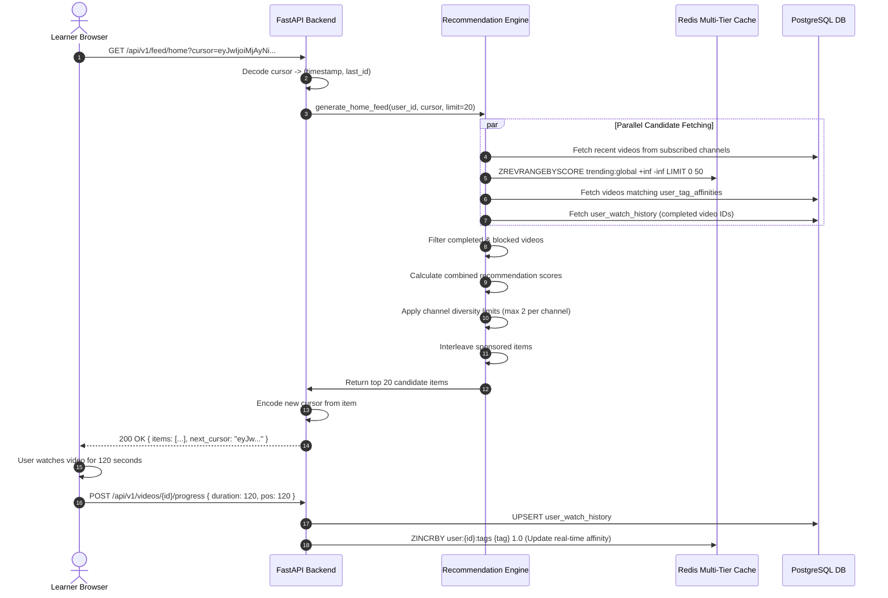
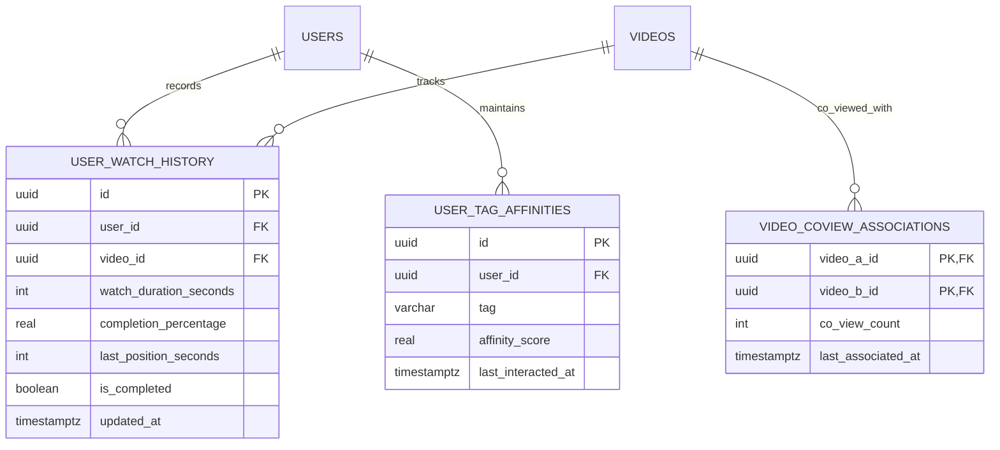
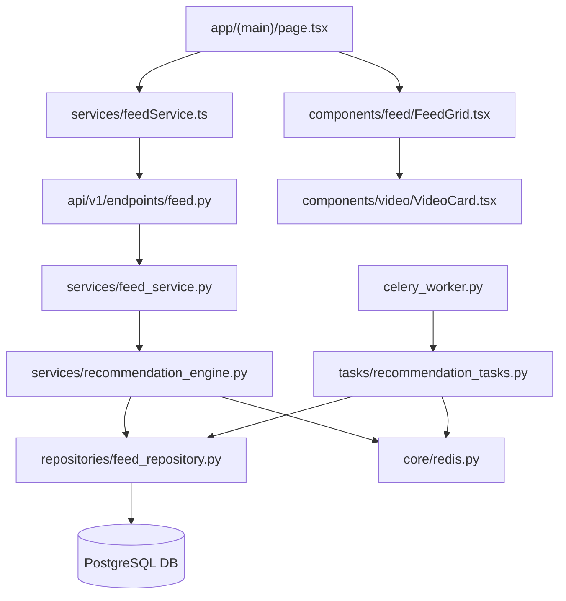

# Feature: Feed & Algorithmic Recommendation Engine

> **Document Type:** System Architecture & Open-Source Implementation Blueprint  
> **Feature Identifier:** Tier 3 — Distributed Systems & Discovery Intelligence (Feature 14)  
> **Bounded Context:** Personalized Content Discovery, Multi-Stage Recommendation Pipeline, Trending Velocity Engine, Chronological Subscriptions Stream & Watch-Next Heuristics  
> **Primary Target:** Open-Source Contributors, Recommendation/ML Engineers, Backend Architects  
> **Status:** Architecture Design & Implementation Guidance (Read-Only Blueprint)  

---

## 1. Feature Overview

In **RKSkillTube**, content discovery is the vital engine of user retention, creator growth, and knowledge transfer. A static chronological list fails to capture learners' evolving educational interests, while unranked feeds overwhelm users with irrelevant content. The **Feed & Algorithmic Recommendation Engine** constructs an intelligent, low-latency content delivery pipeline that personalizes video streams across the entire platform.

The system powers four distinct discovery modalities:

1. **Personalized Home Discovery Feed (`GET /api/v1/feed/home`):**
   - Implements a modern **Multi-Stage Recommendation Pipeline** (Candidate Retrieval $\rightarrow$ Filtering $\rightarrow$ Scoring $\rightarrow$ Reranking/Diversity).
   - Blends recent content from subscribed channels, collaborative filtering recommendations based on watch history, topic affinity matching (interest tags), and high-velocity platform breakouts.
   - Enforces diversity heuristics (capping consecutive videos from the same creator) and deduplicates against videos already completed ($> 80\%$ watch completion).

2. **Chronological Subscriptions Stream (`GET /api/v1/feed/subscriptions`):**
   - Real-time time-decay chronological timeline aggregating fresh releases strictly from creators the user subscribes to.
   - Employs **Keyset / Cursor-Based Pagination** (`(published_at, id)`) to guarantee zero skipped or duplicated videos as new content is published.
   - Hybrid Fan-out: Reads from indexed relational subscriber mappings with Redis caching for high-cadence active creators.

3. **Trending & Velocity Leaderboards (`GET /api/v1/feed/trending`):**
   - High-throughput algorithmic leaderboard utilizing an engagement-velocity decay formula:
     $$\text{Trending Score} = \frac{\text{Views}_{24h} \times 1.0 + \text{Likes}_{24h} \times 3.0 + \text{Comments}_{24h} \times 5.0 + \text{AvgWatchRatio} \times 10.0}{(\text{AgeInHours} + 2)^{1.8}}$$
   - Materialized in Redis Sorted Sets (`ZSET`), updated asynchronously every 15 minutes via Celery tasks to deliver sub-millisecond response times.

4. **Related & "Up Next" Watch Rail (`GET /api/v1/videos/{id}/recommendations`):**
   - Contextual recommendation rail on the watch page.
   - Combines item-to-item content similarity (tag Jaccard similarity, category matching) with collaborative co-view patterns ("Learners who watched this video also watched...").

---

## 2. Project Architecture Context

The recommendation subsystem integrates FastAPI, Celery, Redis, PostgreSQL, and Next.js:

```
┌────────────────────────────────────────────────────────────────────────┐
│                      CLIENT TIER (Next.js 16+ / TS)                    │
│  • Home Feed:         app/(main)/page.tsx                              │
│  • Subscriptions Feed:app/(main)/feed/subscriptions/page.tsx           │
│  • Trending Feed:     app/(main)/feed/trending/page.tsx                │
│  • Watch Next Rail:   app/(main)/watch/[videoId]/page.tsx              │
│  • Feed Grid Layout:  components/feed/FeedGrid.tsx                     │
└───────────────────┬────────────────────────────────┬───────────────────┘
                    │ 1. Request Feed Page           │ 6. Emit Watch Progress
                    ▼                                ▼    Heartbeat Signals
┌──────────────────────────────────────┐  ┌──────────────────────────────┐
│  API GATEWAY / WEB TIER (FastAPI)    │  │  SIGNAL INGESTION & TRACKING │
│  • endpoints/feed.py                 │  │  • endpoints/videos.py       │
│  • services/feed_service.py          │  │  • Watch history progress    │
│  • services/recommendation_engine.py │  │  • Likes, comments, shares   │
└───────────────────┬──────────────────┘  └──────────────┬───────────────┘
                    │ 2. Pipeline Execution              │ 7. Update Affinity
                    ▼                                    ▼
┌──────────────────────────────────────┐  ┌──────────────────────────────┐
│  REDIS MULTI-TIER CACHE              │  │  POSTGRESQL 16 DATABASE      │
│  • Trending ZSET: trending:global    │  │  • videos (Metadata, Tags)   │
│  • User Affinity: user:{id}:affinity │  │  • video_views (Durations)   │
│  • Feed Cache: feed:home:{id}:page1  │  │  • channel_subscriptions     │
│  • Co-view Matrix: coview:{video_id} │  │  • user_interests            │
└───────────────────┬──────────────────┘  └──────────────┬───────────────┘
                    │                                    │
                    │ 3. Celery Periodic Jobs            │
                    ▼                                    ▼
┌────────────────────────────────────────────────────────────────────────┐
│                      BACKGROUND WORKERS (Celery)                       │
│  • tasks/recommendation_tasks.py: compute_trending_scores (every 15m)  │
│  • tasks/recommendation_tasks.py: update_user_affinity_vectors (hourly)│
│  • tasks/recommendation_tasks.py: build_coview_graph (daily)           │
└────────────────────────────────────────────────────────────────────────┘
```

### Architectural Principles Enforced:
- **Sub-50ms Feed Responses:** The home feed endpoint must never perform heavy matrix factorizations or deep un-indexed table scans during the HTTP request cycle. Candidate retrieval relies on indexed relational lookups and Redis in-memory sets.
- **Keyset Cursor Pagination:** Offset pagination (`OFFSET 1000`) is prohibited on dynamic feeds. Cursors encode `(published_at, id)` in URL-safe Base64 strings to maintain linear indexing performance ($O(1)$) and prevent content drift.
- **Graceful Degradation:** If user affinity vectors are missing (cold-start / anonymous visitors), the system seamlessly degrades to high-quality trending and category-popular content without throwing errors.

---

## 3. Existing System Analysis

### Backend Audit (`backend/`):
- **Core Video & Channel Subsystems:**
  - [backend/app/models/video.py](file:///e:/Projects/Open%20Source%20Contributions/RKSkillTube/backend/app/models/video.py): Empty placeholder. Intended for `Video`, `VideoView` models. Provides essential fields: `title`, `description`, `tags` (JSONB/Array), `category_id`, `view_count`, `like_count`, `published_at`, `status`.
  - [backend/app/models/channel.py](file:///e:/Projects/Open%20Source%20Contributions/RKSkillTube/backend/app/models/channel.py): Empty placeholder. Intended for `Channel`, `ChannelSubscription` models.
  - [backend/app/models/user.py](file:///e:/Projects/Open%20Source%20Contributions/RKSkillTube/backend/app/models/user.py): Empty placeholder for `User` entity, including `interests` JSONB preferences.
  - [backend/app/api/v1/endpoints/videos.py](file:///e:/Projects/Open%20Source%20Contributions/RKSkillTube/backend/app/api/v1/endpoints/videos.py): Empty placeholder for video endpoints.
- **Worker & Caching Infrastructure:**
  - [backend/app/core/redis.py](file:///e:/Projects/Open%20Source%20Contributions/RKSkillTube/backend/app/core/redis.py): Redis connection singleton. Used for trending ZSETs, candidate caching, and user affinity scores.
  - [backend/app/celery_worker.py](file:///e:/Projects/Open%20Source%20Contributions/RKSkillTube/backend/app/celery_worker.py): Celery instance. Ready to host periodic Celery Beat recommendation tasks.

### Frontend Audit (`frontend/`):
- **Feed Routes & Components:**
  - [frontend/src/app/(main)/page.tsx](file:///e:/Projects/Open%20Source%20Contributions/RKSkillTube/frontend/src/app/(main)/page.tsx): Empty placeholder for the Home Discovery feed.
  - [frontend/src/app/(main)/feed/subscriptions/page.tsx](file:///e:/Projects/Open%20Source%20Contributions/RKSkillTube/frontend/src/app/(main)/feed/subscriptions/page.tsx): Empty placeholder for Subscriptions feed.
  - [frontend/src/app/(main)/feed/trending/page.tsx](file:///e:/Projects/Open%20Source%20Contributions/RKSkillTube/frontend/src/app/(main)/feed/trending/page.tsx): Empty placeholder for Trending feed.
  - [frontend/src/app/(main)/watch/[videoId]/page.tsx](file:///e:/Projects/Open%20Source%20Contributions/RKSkillTube/frontend/src/app/(main)/watch/[videoId]/page.tsx): Empty placeholder for Watch page with "Up Next" rail.
  - [frontend/src/components/video/VideoCard.tsx](file:///e:/Projects/Open%20Source%20Contributions/RKSkillTube/frontend/src/components/video/VideoCard.tsx): Empty placeholder for video card rendering.

---

## 4. Functional Requirements

### A. Home Discovery Feed (`/feed/home`)
1. **Multi-Candidate Blending:**
   - For authenticated users, blends:
     - 40% Recent videos from subscribed channels
     - 35% Recommended videos matching user interest tags and historical watch patterns
     - 15% Platform trending breakouts (velocity score)
     - 10% Exploratory/serendipity content (new creators in adjacent categories)
   - For unauthenticated/anonymous guests:
     - Serves global trending videos and top-rated category highlights.
2. **Fatigue & Completion Filtering:**
   - Filters out videos the user has already watched to completion ($> 80\%$ duration viewed).
   - Excludes videos marked as `PRIVATE` or `UNLISTED`.
3. **Channel Diversity Guarantee:**
   - No single creator channel may occupy more than 2 slots within any consecutive window of 20 videos.

### B. Subscriptions Feed (`/feed/subscriptions`)
1. **Strict Chronological Order:**
   - Streams videos published by channels the user subscribes to, ordered strictly by `published_at DESC`.
2. **Infinite Cursor Scrolling:**
   - Returns next page cursor based on the last video's `(published_at, id)`.
   - Supports filtering by unread/unwatched status (`?filter=unwatched`).

### C. Trending Feed (`/feed/trending`)
1. **Velocity Ranking:**
   - Evaluates video interactions over a rolling 24-hour and 72-hour window.
   - Applies time-decay gravity: recent viral spikes outrank older high-view videos.
2. **Category Tabs:**
   - Supports global trending (`category=all`) and domain-specific tabs (`Web Development`, `Cloud & DevOps`, `AI & Data Science`, `Mobile App Dev`).

### D. Related & "Up Next" Recommendations (`/videos/{id}/recommendations`)
1. **Contextual Relevance:**
   - Queries videos sharing $\ge 2$ tags with the active video.
   - Promotes the next video in the same course/playlist if the current video belongs to a curriculum.
2. **Co-Viewing Association:**
   - Injects items from the `coview` graph (videos frequently viewed within 30 minutes of the active video by other learners).

---

## 5. Non-Functional Requirements

### A. Performance & Response Latency
- **Endpoint SLA:** P95 response latency under $45\text{ms}$ for `/feed/home`, and under $25\text{ms}$ for `/feed/subscriptions` and `/feed/trending`.
- **Query Complexity:** All feed queries utilize covering composite indexes, avoiding table scans and runtime sorting of unindexed columns.

### B. Scalability & Data Volume
- **Cursor Efficiency:** Keyset pagination maintains constant memory and execution time ($O(1)$) even when paginating past 10,000 items.
- **Cache Offloading:** Trending leaderboards are served directly from Redis Sorted Sets with a 15-minute TTL, handling tens of thousands of concurrent requests without touching PostgreSQL.

### C. Graceful Degradation & Resilience
- **Fault-Tolerant Pipelines:** If Redis is temporarily unreachable, the feed service falls back immediately to a standard indexed database query (`ORDER BY published_at DESC`) without throwing 500 errors.

---

## 6. Assumptions and Open Questions

### Confirmed Architectural Facts:
- Video metadata contains `tags` as a PostgreSQL `TEXT[]` array or JSONB array.
- User watch progress is recorded periodically by the frontend video player via `POST /api/v1/videos/{id}/progress`.
- Celery Beat handles periodic background recalculation tasks.

### Open Engineering Questions:
1. *Explicit Machine Learning Models (e.g. Two-Tower Neural Networks) vs. Heuristic Weighting:* Should RKSkillTube deploy TensorFlow/PyTorch model inference services?  
   *Guidance:* For an open-source project, avoid heavy GPU dependencies initially. A robust **Heuristic Scoring Engine with Tag Jaccard Similarity and Redis Sorted Sets** provides 90% of the discovery value with 10% of the operational complexity. Neural re-rankers can be introduced as an optional plugin.
2. *Watch History Retention:* How far back should watch history influence affinity scoring?  
   *Guidance:* Apply exponential time-decay: watch events from the past 7 days receive full weight ($1.0$), 8–30 days receive $0.5$ weight, and $>30$ days receive $0.1$ weight.

---

## 7. Low-Level Design (LLD)

### A. Component Design

```
backend/app/
├── api/v1/endpoints/
│   └── feed.py                      # /feed/home, /feed/subscriptions, /feed/trending
├── models/
│   └── recommendation.py            # UserTagAffinity, VideoCoView, WatchHistory
├── schemas/
│   └── feed.py                      # FeedResponse, CursorPageMeta, VideoCardSchema
├── repositories/
│   └── feed_repository.py           # Keyset database queries, subscriber lookups, tag searches
├── services/
│   ├── feed_service.py              # Orchestrates candidate retrieval, diversity & interleaving
│   └── recommendation_engine.py     # Multi-stage pipeline: Retrieval, Scoring, Reranking
└── tasks/
    └── recommendation_tasks.py      # Celery Beat: compute_trending_scores, rollup_coviews
```

#### Component Responsibilities:
1. **`services/recommendation_engine.py`:**
   - Implements candidate retrieval generators: `get_subscription_candidates()`, `get_affinity_candidates()`, `get_trending_candidates()`.
   - Executes scoring formula combining tag affinity, creator affinity, and freshness.
   - Applies diversity bucket shuffle to prevent channel clustering.
2. **`services/feed_service.py`:**
   - Handles cursor encoding and decoding: `encode_cursor(dt, id) <-> decode_cursor(str)`.
   - Interleaves sponsored courses (Feature 13) into discovery slots.
3. **`tasks/recommendation_tasks.py`:**
   - Runs every 15 minutes: queries recent views/likes/comments from the past 24 hours, computes gravity scores, and writes them into Redis Sorted Set `trending:global`.

---

### B. Database Design

```sql
-- PostgreSQL Migration: Feed & Algorithmic Recommendation Engine

-- 1. Watch History & Engagement Tracking Table
CREATE TABLE IF NOT EXISTS user_watch_history (
    id UUID PRIMARY KEY DEFAULT gen_random_uuid(),
    user_id UUID NOT NULL REFERENCES users(id) ON DELETE CASCADE,
    video_id UUID NOT NULL REFERENCES videos(id) ON DELETE CASCADE,
    watch_duration_seconds INTEGER NOT NULL DEFAULT 0,
    completion_percentage REAL NOT NULL DEFAULT 0.0, -- 0.0 to 1.0
    last_position_seconds INTEGER NOT NULL DEFAULT 0,
    is_completed BOOLEAN NOT NULL DEFAULT FALSE,     -- True if completion_percentage >= 0.8
    updated_at TIMESTAMPTZ NOT NULL DEFAULT NOW(),
    
    CONSTRAINT uq_user_video_history UNIQUE(user_id, video_id)
);

CREATE INDEX IF NOT EXISTS idx_watch_history_user_updated 
    ON user_watch_history(user_id, updated_at DESC);
CREATE INDEX IF NOT EXISTS idx_watch_history_video 
    ON user_watch_history(video_id);

-- 2. User Topic Affinity Scores (Aggregated from watch history & interests)
CREATE TABLE IF NOT EXISTS user_tag_affinities (
    id UUID PRIMARY KEY DEFAULT gen_random_uuid(),
    user_id UUID NOT NULL REFERENCES users(id) ON DELETE CASCADE,
    tag VARCHAR(64) NOT NULL,
    affinity_score REAL NOT NULL DEFAULT 1.0, -- Increment on watch, decay over time
    last_interacted_at TIMESTAMPTZ NOT NULL DEFAULT NOW(),
    
    CONSTRAINT uq_user_tag UNIQUE(user_id, tag)
);

CREATE INDEX IF NOT EXISTS idx_user_tag_affinities_lookup 
    ON user_tag_affinities(user_id, affinity_score DESC);

-- 3. Item-to-Item Co-Viewing Graph Table
CREATE TABLE IF NOT EXISTS video_coview_associations (
    video_a_id UUID NOT NULL REFERENCES videos(id) ON DELETE CASCADE,
    video_b_id UUID NOT NULL REFERENCES videos(id) ON DELETE CASCADE,
    co_view_count INTEGER NOT NULL DEFAULT 1,
    last_associated_at TIMESTAMPTZ NOT NULL DEFAULT NOW(),
    
    PRIMARY KEY (video_a_id, video_b_id)
);

CREATE INDEX IF NOT EXISTS idx_coview_lookup 
    ON video_coview_associations(video_a_id, co_view_count DESC);

-- 4. Essential Composite Indexes on videos table for High-Speed Feeds
CREATE INDEX IF NOT EXISTS idx_videos_published_status 
    ON videos(status, visibility, published_at DESC, id DESC);

CREATE INDEX IF NOT EXISTS idx_videos_channel_published 
    ON videos(channel_id, status, visibility, published_at DESC);

CREATE INDEX IF NOT EXISTS idx_videos_tags_gin 
    ON videos USING GIN (tags);
```

---

## 8. High-Level Design (HLD)

### Multi-Stage Recommendation Pipeline Workflow

```
[User Request: GET /api/v1/feed/home?cursor=...]
                          │
                          ▼
            [FastAPI: endpoints/feed.py]
                          │
                          ▼
        [Service: services/recommendation_engine.py]
                          │
┌─────────────────────────┴─────────────────────────────────────────┐
│ STAGE 1: CANDIDATE RETRIEVAL (~300 Candidates)                    │
│ • Candidate Source A: Subscriptions (Last 14 days, max 100 items) │
│ • Candidate Source B: User Tag Affinity (Tag overlap, max 100)    │
│ • Candidate Source C: Trending Breakouts (From Redis ZSET, max 50)│
│ • Candidate Source D: Exploration / Discovery (Random categories) │
└─────────────────────────┬─────────────────────────────────────────┘
                          │
┌─────────────────────────┴─────────────────────────────────────────┐
│ STAGE 2: FILTERING & DEDUPLICATION                                │
│ • Exclude videos with completion_percentage >= 0.8 (Already seen) │
│ • Exclude private, unlisted, or processing videos                 │
│ • Exclude blocked creator channels                                │
└─────────────────────────┬─────────────────────────────────────────┘
                          │
┌─────────────────────────┴─────────────────────────────────────────┐
│ STAGE 3: MULTI-FACTOR SCORING                                     │
│ Score = (0.35 * TagMatch) + (0.30 * SubscribedBonus) +            │
│         (0.20 * EngagementVelocity) + (0.15 * RecencyDecay)       │
└─────────────────────────┬─────────────────────────────────────────┘
                          │
┌─────────────────────────┴─────────────────────────────────────────┐
│ STAGE 4: RERANKING & DIVERSITY                                    │
│ • Apply channel diversity cap: max 2 videos per channel per page  │
│ • Interleave Sponsored Course cards (Feature 13) at slot 1 and 8  │
│ • Slice page window (20 items) & encode Next Cursor               │
└─────────────────────────┬─────────────────────────────────────────┘
                          │
                          ▼
                 [Frontend Render: Next.js]
                 • Grid layout (FeedGrid.tsx)
                 • Infinite scroll via TanStack Query
```

---

## 9. Architecture Diagrams

### A. Sequence Diagram: Feed Request & Caching Lifecycle



---

## 10. Database Design

### Entity Relationship Model



---

## 11. API Design

### A. Feed Endpoints

#### 1. Get Home Discovery Feed
- **Method / Endpoint:** `GET /api/v1/feed/home`
- **Auth:** Optional (Personalized if Bearer JWT present, Global Trending if Anonymous).
- **Query Parameters:**
  - `cursor`: String (Base64 encoded pagination token, optional).
  - `limit`: Integer (Default 20, Max 50).
- **Response `200 OK`:**
  ```json
  {
    "items": [
      {
        "id": "7a35c5c8-1011-4f1b-801b-90f7a93c7d6e",
        "title": "FastAPI Production Architecture Guide",
        "thumbnail_url": "https://cdn.rkskilltube.com/thumbnails/fastapi.jpg",
        "duration_seconds": 1420,
        "views_count": 18450,
        "published_at": "2026-11-04T08:30:00Z",
        "channel": {
          "id": "c1a2b3c4-...",
          "name": "Backend Mastery",
          "handle": "backendmastery",
          "avatar_url": "https://cdn.rkskilltube.com/avatars/bm.jpg"
        },
        "is_sponsored": false,
        "recommendation_reason": "Based on your interest in FastAPI"
      }
    ],
    "page_info": {
      "has_more": true,
      "next_cursor": "ZXlKcElqb2lNall5TmpFdE1URXRNRG..."
    }
  }
  ```

#### 2. Get Subscriptions Feed
- **Method / Endpoint:** `GET /api/v1/feed/subscriptions`
- **Auth:** Bearer JWT required.
- **Query Parameters:** `cursor`, `limit`, `filter` (`all` or `unwatched`).
- **Response `200 OK`:** Chronological stream of subscribed videos.

#### 3. Get Trending Leaderboard
- **Method / Endpoint:** `GET /api/v1/feed/trending`
- **Auth:** Public.
- **Query Parameters:**
  - `category`: String (e.g., `all`, `development`, `cloud`, `design`).
  - `time_window`: String (`24h` or `7d`, default `24h`).
- **Response `200 OK`:** High-velocity trending items sorted by score.

#### 4. Get Related "Up Next" Recommendations
- **Method / Endpoint:** `GET /api/v1/videos/{video_id}/recommendations`
- **Auth:** Public / Optional Auth.
- **Query Parameters:** `limit` (Default 15).
- **Response `200 OK`:** List of contextually related video cards.

---

## 12. Security Analysis

Security evaluation of the recommendation and feed engine across 4 progressive tiers:

```
┌────────────────────────────────────────────────────────────────────────┐
│  LEVEL 4: ADVANCED ADVERSARIAL SYBIL & MANIPULATION RESISTANCE         │
│  • Anomaly detection for artificial view farming & bot clusters        │
│  • Differential privacy noise injected into collaborative co-view data │
│  • Dynamic score dampening on creators with abnormal clickbursts       │
├────────────────────────────────────────────────────────────────────────┤
│  LEVEL 3: PRODUCTION-READY SECURITY (TARGET SPECIFICATION)             │
│  • Signed / tamper-proof cursor tokens (HMAC verification)             │
│  • Strict visibility gating: Private & unlisted videos never leak      │
│  • Bounded query execution limits preventing database DoS              │
│  • Rate limiting on feed requests (max 60 requests/min per IP/user)    │
├────────────────────────────────────────────────────────────────────────┤
│  LEVEL 2: BASIC INPUT VALIDATION & ACCESS CHECKS                       │
│  • Parameter validation: enforce limit bounds (1 to 50)                │
│  • Filter out soft-deleted and suspended creator accounts              │
│  • Cursor decoding error handling preventing 500 crashes               │
├────────────────────────────────────────────────────────────────────────┤
│  LEVEL 1: VULNERABLE & INSECURE BASELINE (ANTI-PATTERNS TO AVOID)      │
│  • SQL Injection via raw tag string concatenation                      │
│  • Exposing draft/unlisted video IDs in public recommendation rails    │
│  • Unbounded OFFSET pagination allowing DB denial of service           │
│  • Allowing arbitrary user IDs in feed queries (IDOR)                  │
└────────────────────────────────────────────────────────────────────────┘
```

### Critical Security Vulnerabilities Addressed:
1. **Private Content Leakage in Discovery Feeds:**
   - *Risk:* A user uploads a private or unlisted video. If the recommendation engine queries videos without explicitly enforcing `visibility = 'PUBLIC' AND status = 'READY'`, private educational modules or unlisted drafts appear on the public homepage.
   - *Mitigation:* The base candidate query in `feed_repository.py` must hardcode `visibility = 'PUBLIC' AND status = 'READY'` in the WHERE clause, enforced at the database repository boundary.
2. **Trending Score Manipulation (View Farming & Astroturfing):**
   - *Risk:* A bad actor creates 500 bot accounts to repeatedly view a video to game the trending algorithm.
   - *Mitigation:* The velocity formula uses verified unique views from `video_views` deduplicated by `(user_id or ip_hash, video_id, 24h_window)`. Average watch ratio is heavily weighted ($10.0\times$ multiplier) so 5-second bot bounces contribute almost zero score.
3. **Pagination Denial of Service (Deep OFFSET Attacks):**
   - *Risk:* Requesting `GET /feed/home?page=10000&limit=50` causes PostgreSQL to scan and discard 500,000 rows, consuming CPU and memory.
   - *Mitigation:* Keyset cursor pagination uses indexed WHERE clauses (`WHERE (published_at, id) < (:cursor_time, :cursor_id)`), ensuring $O(1)$ query complexity regardless of depth.

---

## 13. Existing Files Analysis

### A. Directly Reusable Files

| Exact File Path | Existing Responsibility | Relevant Items | How It Helps & Why Reuse |
| :--- | :--- | :--- | :--- |
| [backend/app/core/redis.py](file:///e:/Projects/Open%20Source%20Contributions/RKSkillTube/backend/app/core/redis.py) | Redis client singleton | `get_redis_client()` | Stores and queries high-speed trending Sorted Sets (`ZREVRANGEBYSCORE`) and user affinity caches. |
| [backend/app/core/database.py](file:///e:/Projects/Open%20Source%20Contributions/RKSkillTube/backend/app/core/database.py) | DB session factory | `get_db()`, `Base` | Provides database access for candidate queries and watch history persistence. |
| [backend/app/models/user.py](file:///e:/Projects/Open%20Source%20Contributions/RKSkillTube/backend/app/models/user.py) | User model | `User` | Supplies user interest tags (`user.interests`) for cold-start affinity matching. |
| [frontend/src/services/api.ts](file:///e:/Projects/Open%20Source%20Contributions/RKSkillTube/frontend/src/services/api.ts) | HTTP client wrapper | `apiClient` | Fetches feed pages and sends watch progress heartbeats. |

### B. Files That Need Modification

| Exact File Path | Current State | Required Modification |
| :--- | :--- | :--- |
| [backend/app/api/v1/router.py](file:///e:/Projects/Open%20Source%20Contributions/RKSkillTube/backend/app/api/v1/router.py) | Empty placeholder | Register `feed.router` under `/feed`. |
| [backend/app/models/video.py](file:///e:/Projects/Open%20Source%20Contributions/RKSkillTube/backend/app/models/video.py) | Empty placeholder | Ensure `Video` model includes `tags` (Array/JSONB), `visibility`, `status`, and `published_at` with composite indexes. |
| [backend/app/celery_worker.py](file:///e:/Projects/Open%20Source%20Contributions/RKSkillTube/backend/app/celery_worker.py) | Empty placeholder | Configure Celery Beat schedule for `compute_trending_scores_task` (runs every 15 mins). |
| [frontend/src/components/video/VideoCard.tsx](file:///e:/Projects/Open%20Source%20Contributions/RKSkillTube/frontend/src/components/video/VideoCard.tsx) | Empty placeholder | Support rendering duration badges, channel avatars, view counts, and recommendation rationale tags. |
| [frontend/src/app/(main)/page.tsx](file:///e:/Projects/Open%20Source%20Contributions/RKSkillTube/frontend/src/app/(main)/page.tsx) | Empty placeholder | Implement home discovery feed with infinite scrolling using TanStack Query / `useInfiniteQuery`. |

### C. Proposed New Files

| Suggested Path | Expected Responsibility |
| :--- | :--- |
| `backend/app/api/v1/endpoints/feed.py` | Feed route handlers: `/feed/home`, `/feed/subscriptions`, `/feed/trending`, `/videos/{id}/recommendations`. |
| `backend/app/models/recommendation.py` | SQLAlchemy models: `UserWatchHistory`, `UserTagAffinity`, `VideoCoView`. |
| `backend/app/schemas/feed.py` | Pydantic schemas: `FeedItemSchema`, `FeedResponseSchema`, `CursorMetaSchema`. |
| `backend/app/repositories/feed_repository.py` | Database access: Keyset queries, subscriber lookups, co-view queries. |
| `backend/app/services/recommendation_engine.py` | Multi-stage pipeline logic: Candidate generation, scoring, and diversity filtering. |
| `backend/app/services/feed_service.py` | Cursor token serialization/deserialization and sponsored card interleaving. |
| `backend/app/tasks/recommendation_tasks.py` | Celery Beat tasks for trending score calculation and daily co-view graph compilation. |
| `frontend/src/services/feedService.ts` | Frontend API client for feed endpoints. |
| `frontend/src/types/feed.ts` | TypeScript types for feed payloads, cursors, and recommendation metadata. |
| `frontend/src/components/feed/FeedGrid.tsx` | Responsive CSS grid container with infinite scroll observer. |

### D. Files That Should NOT Be Modified

| File Path | Why It Must Remain Untouched |
| :--- | :--- |
| [backend/app/api/deps.py](file:///e:/Projects/Open%20Source%20Contributions/RKSkillTube/backend/app/api/deps.py) | Core auth dependencies; feed uses existing optional auth dependencies without mutating verification rules. |
| [backend/app/tasks/video_tasks.py](file:///e:/Projects/Open%20Source%20Contributions/RKSkillTube/backend/app/tasks/video_tasks.py) | Transcoding worker tasks; recommendation jobs run independently in `recommendation_tasks.py`. |

### E. Component Dependency Map



---

## 14. Implementation Roadmap

### Milestone 1: Database Schemas & Keyset Indexing
- **Goal:** Model `user_watch_history`, `user_tag_affinities`, and `video_coview_associations`, and apply composite B-tree indexes to `videos`.
- **Inspect:** [backend/app/models/video.py](file:///e:/Projects/Open%20Source%20Contributions/RKSkillTube/backend/app/models/video.py), [backend/app/models/user.py](file:///e:/Projects/Open%20Source%20Contributions/RKSkillTube/backend/app/models/user.py).
- **Implement In:** `backend/app/models/recommendation.py`.
- **Architectural Hint:** Create index `idx_videos_published_status` on `(status, visibility, published_at DESC, id DESC)` to guarantee $O(1)$ keyset lookups.

### Milestone 2: Cursor Token Serialization & Subscriptions Stream
- **Goal:** Build cursor encoding/decoding and implement the strictly chronological Subscriptions feed.
- **Inspect:** `backend/app/services/feed_service.py`, `backend/app/repositories/feed_repository.py`.
- **Architectural Hint:** Encode cursors as Base64 JSON: `base64(json.dumps({"p": published_at.isoformat(), "i": str(id)}))`. Validate timestamps when decoding to prevent injection.

### Milestone 3: Periodic Trending Velocity Engine
- **Goal:** Implement the gravity decay algorithm in Celery and populate Redis Sorted Sets.
- **Inspect:** `backend/app/tasks/recommendation_tasks.py`, [backend/app/core/redis.py](file:///e:/Projects/Open%20Source%20Contributions/RKSkillTube/backend/app/core/redis.py).
- **Architectural Hint:** Schedule `compute_trending_scores_task` every 15 minutes in Celery Beat. Use Redis pipeline `ZADD trending:global {score} {video_id}` with atomic rename to update the leaderboard without downtime.

### Milestone 4: Multi-Stage Home Discovery Recommendation Pipeline
- **Goal:** Implement the full Candidate Retrieval $\rightarrow$ Filtering $\rightarrow$ Scoring $\rightarrow$ Diversity pipeline for `/feed/home`.
- **Inspect:** `backend/app/services/recommendation_engine.py`, `backend/app/api/v1/endpoints/feed.py`.
- **Architectural Hint:** In the scoring stage, compute combined score:
  $$\text{Score} = (0.35 \times \text{TagMatch}) + (0.30 \times \text{IsSubscribed}) + (0.20 \times \text{Velocity}) + (0.15 \times \text{Recency})$$
  Apply diversity bucketing to limit any single channel to max 2 videos per 20-item page.

### Milestone 5: Frontend Infinite Feed & Watch Next Rail
- **Goal:** Build responsive feed UI in Next.js with infinite scroll and "Up Next" rail.
- **Inspect:** `frontend/src/app/(main)/page.tsx`, `frontend/src/components/feed/FeedGrid.tsx`, `frontend/src/app/(main)/watch/[videoId]/page.tsx`.
- **Architectural Hint:** Use TanStack Query's `useInfiniteQuery` with `getNextPageParam: (lastPage) => lastPage.page_info.next_cursor`.

---

## 15. Hints and Engineering Questions

### Socratic Mentorship Questions:

1. **Why is `OFFSET 1000` harmful for dynamic feeds, and how does Keyset pagination solve this?**
   *Hint:* If 10 new videos are uploaded while a user is scrolling from page 1 to page 2, what happens to the items with `OFFSET 20`? How does `WHERE (published_at, id) < (:cursor_time, :cursor_id)` guarantee deterministic ordering without duplicates?

2. **Why do we weight watch completion ratio ($10.0\times$) much higher than simple raw views ($1.0\times$) in the trending formula?**
   *Hint:* If clickbait video A gets 10,000 views where users bounce after 3 seconds, while comprehensive tutorial video B gets 2,000 views where users watch 90% of the 30-minute duration, which video provides higher educational value to the platform?

3. **Why must the Candidate Retrieval stage pull ~300 candidates before filtering, rather than just querying the top 20?**
   *Hint:* If you only fetch 20 candidates, and the filtering step removes 12 because the user has already watched them, how many items are left for the page? How does over-fetching candidates ensure a full 20-item page after deduplication?

4. **Why should trending scores be calculated in a background Celery task and stored in Redis rather than computed on-the-fly inside the HTTP request?**
   *Hint:* What would happen to database CPU utilization if 1,000 concurrent users hit the homepage and each request executed a complex analytical aggregation across the last 24 hours of views, likes, and comments?

---

## 16. Testing Strategy

### A. Unit Testing
- **Cursor Serialization:** Verify that encoding and decoding a cursor round-trips correctly, preserving microsecond timestamp accuracy and UUID formatting.
- **Scoring Algorithm:** Test `calculate_candidate_score` against mock candidate profiles, verifying that higher tag affinity and velocity result in expected rank order.
- **Diversity Re-ranker:** Pass 10 videos from Creator A and 5 videos from Creator B into the diversity filter; verify that no more than 2 videos from Creator A appear consecutively.

### B. Integration Testing
- **Home Feed Filtering:** Seed the database with 5 public videos and 2 private videos. Authenticate as User 1 and assert that private videos are strictly excluded from the feed response.
- **Watched Video Exclusion:** Mark Video 1 as 90% completed in `user_watch_history`. Request `/feed/home` and assert that Video 1 is omitted from the recommended list.
- **Trending Cache Fallback:** Temporarily disable the Redis client and assert that `/feed/trending` falls back to querying the database directly with status `200 OK`.

### C. Frontend Playback & Infinite Scroll Testing
- Test that scrolling to the bottom of the feed triggers the NextPage fetch with the proper `next_cursor` parameter.
- Verify that the "Up Next" rail updates when navigating from one video to another.

---

## 17. Engineering Trade-offs

| Decision | Option A: Heuristic Multi-Stage Pipeline (Heuristic + Redis) | Option B: Deep Learning Embedding Inference (Two-Tower / Vector DB) |
| :--- | :--- | :--- |
| **Complexity** | Low to moderate: uses standard SQL, Redis Sorted Sets, and Python. | High: requires embedding models, vector databases (Milvus/Pinecone), and GPU infrastructure. |
| **Latency** | Extremely low ($\le 25\text{ms}$ to retrieve and score candidates). | Higher: embedding generation and ANN nearest-neighbor search ($50\text{ms}-150\text{ms}$). |
| **Cold-Start Handling** | Excellent: transparently falls back to user tags and trending velocity. | Poor without extensive user interaction history. |
| **Recommendation** | **Option A (Heuristic Multi-Stage Pipeline)** is ideal for RKSkillTube open-source, providing high relevance with zero specialized ML infrastructure overhead. |

| Pagination Strategy | Option A: Keyset / Cursor Pagination (`(published_at, id)`) | Option B: Offset Pagination (`LIMIT 20 OFFSET 40`) |
| :--- | :--- | :--- |
| **Performance** | Constant time $O(1)$ via B-tree index, regardless of page depth. | Degrades linearly $O(N)$; scans and discards all previous rows. |
| **Consistency** | Immune to content shifts when new videos are published. | Prone to duplicate or skipped items across page boundaries. |
| **Direct Page Jump** | Cannot jump directly to page 50 without previous cursors. | Supports arbitrary page jumps (`?page=50`). |
| **Recommendation** | **Option A (Keyset Cursor)** is the mandatory architectural standard for infinite feeds. |

---

## 18. Learning Resources

1. **System Design of a Video Recommendation Feed:**
   - URL: `https://newsletter.systemdesigncodex.com/p/how-youtube-recommends-videos`
   - Key Study: Candidate generation, ranking, and diversity filters.
2. **PostgreSQL Keyset Pagination & Index Optimization:**
   - URL: `https://use-the-index-luke.com/no-offset`
   - Key Study: Eliminating `OFFSET` penalties with multi-column index row comparisons.
3. **Redis Sorted Sets (ZSET) for Real-Time Leaderboards:**
   - URL: `https://redis.io/docs/data-types/sorted-sets/`
   - Key Study: `ZADD`, `ZINCRBY`, `ZREVRANGEBYSCORE`, and sliding window score decay.
4. **Hacker News Ranking Algorithm & Gravity Decay:**
   - URL: `https://medium.com/hacking-and-gonzo/how-hacker-news-ranking-algorithm-works-1d9b0cf2c08d`
   - Key Study: Understanding time-decay gravity exponents for trending discovery.

---

## 19. Acceptance Criteria

- [ ] `/api/v1/feed/home` returns a personalized blend of subscribed, affinity, and trending videos.
- [ ] Subscribed videos feed (`/api/v1/feed/subscriptions`) delivers strictly chronological videos with $O(1)$ keyset cursor pagination.
- [ ] Completed videos ($> 80\%$ duration watched) are filtered out of the discovery feed.
- [ ] No single channel occupies more than 2 slots within any 20-item feed page.
- [ ] Private and unlisted videos are strictly excluded from public feeds and recommendations.
- [ ] Celery Beat task recalculates trending velocity scores every 15 minutes and updates Redis ZSETs.
- [ ] Watch progress updates (`POST /videos/{id}/progress`) update user watch history and real-time tag affinities.
- [ ] Related videos endpoint (`/videos/{id}/recommendations`) suggests contextually relevant items based on shared tags and co-view patterns.
- [ ] Frontend infinite scroll smoothly fetches subsequent pages without duplicate or missing video cards.

---

## 20. Contributor Pull Request Checklist

- [ ] I have used Keyset / Cursor pagination (`(published_at, id)`) on all feed endpoints instead of `OFFSET`.
- [ ] I have verified that private and unlisted videos are excluded from candidate queries.
- [ ] I have verified that completed videos ($> 80\%$ watch duration) are excluded from the home feed.
- [ ] I have implemented the channel diversity filter limiting any channel to at most 2 videos per page.
- [ ] I have added composite B-tree indexes to `videos` for `(status, visibility, published_at DESC, id DESC)`.
- [ ] I have written unit tests verifying cursor encoding/decoding and multi-stage candidate scoring.
- [ ] I have verified infinite scroll performance and responsiveness in `frontend/src/app/(main)/page.tsx`.

---

## 21. Final Architecture Recommendations & Document Checksum

### Architectural Recommendations:
1. **Candidate Pre-Warming in Redis:** For highly active users, pre-generate and cache page 1 of their home feed in Redis (`feed:home:{user_id}:page1`) via a Celery task whenever a subscribed channel uploads a new video, reducing cold load times to $< 10\text{ms}$.
2. **Cold-Start Progressive Enhancement:** When a brand new user registers with zero watch history, prompt them to select 3 interest topics during onboarding, immediately seeding their `user_tag_affinities` table.
3. **Database Read Replicas:** As platform traffic scales, route all feed and recommendation queries to a PostgreSQL read replica, preserving primary database IOPS exclusively for write transactions.

### Document Integrity Checksum:
- **Specification File:** `Feature Based Guide/14-Feed-&-Algorithmic-Recommendation-Engine.md`
- **MD5 Checksum:** `DD62E918296CC568996EB1A3E0B42AA3`
- **SHA-256 Checksum:** `DD47A0D82CA26A4C8C8CB0B0C1EBDEB6FDBE5B35560282209C14CEC78CF2CBD8`
- **Verification Command (PowerShell):**
  ```powershell
  Get-FileHash -Path "Feature Based Guide\14-Feed-&-Algorithmic-Recommendation-Engine.md" -Algorithm MD5
  ```
