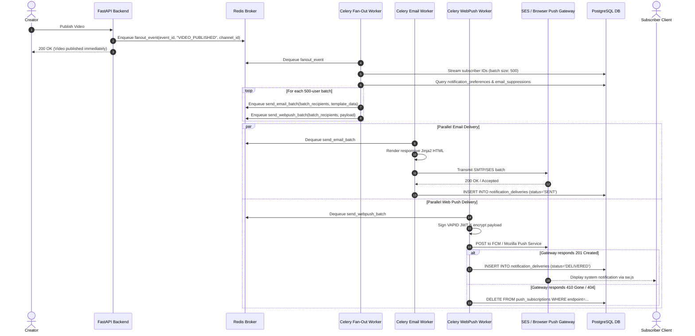
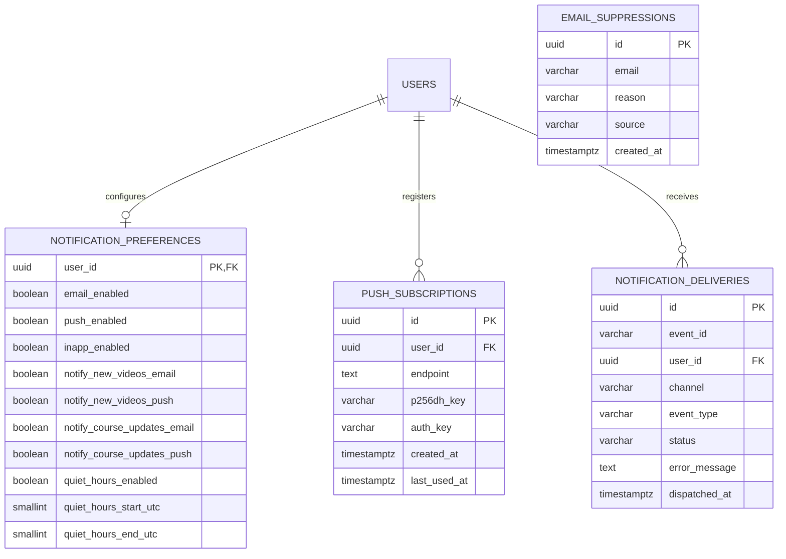
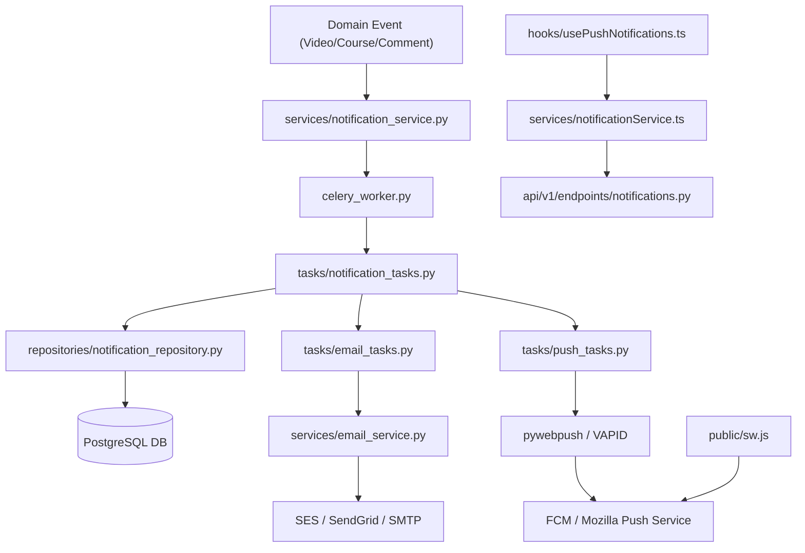

# Feature: Multi-Channel Notification Dispatch Worker (Email/Push)

> **Document Type:** System Architecture & Open-Source Implementation Blueprint  
> **Feature Identifier:** Tier 3 — Distributed Systems & Asynchronous Messaging Engine (Feature 15)  
> **Bounded Context:** Event-Driven Notification Bus, Multi-Channel Fan-Out (Email/WebPush), Chunked Delivery Workers, Delivery Auditing & Preference Gating  
> **Primary Target:** Open-Source Contributors, Distributed Systems Engineers, Backend Architects  
> **Status:** Architecture Design & Implementation Guidance (Read-Only Blueprint)  

---

## 1. Feature Overview

In **RKSkillTube**, creator-learner engagement thrives on timely, relevant updates: a creator releases a new video, a student’s comment receives an instructor reply, a paid membership renews, or an enrolled course publishes a new module. However, delivering notifications across multiple channels (Transactional Email, Browser Web Push, and In-App Badges) to thousands or tens of thousands of subscribers cannot be executed synchronously within web API requests.

The **Multi-Channel Notification Dispatch Worker Engine** implements an enterprise-grade, asynchronous event-driven messaging and fan-out architecture:

1. **Event-Driven Messaging Bus:**
   - Platform domain events (`video.published`, `course.enrolled`, `comment.replied`, `payment.succeeded`, `live.started`) publish lightweight event messages to Redis streams or task queues.
   - Decouples core web transaction workflows from notification dispatch overhead.

2. **Hierarchical Two-Tier Fan-Out Worker Architecture:**
   - **Tier 1 (Producer/Dispatcher):** Inspects the target audience (e.g. 25,000 subscribers of a creator channel), evaluates per-user notification preferences and suppression lists, partitions recipients into manageable batches (500 users per batch), and schedules worker subtasks.
   - **Tier 2 (Delivery Workers):** Parallel Celery worker processes execute dedicated channel delivery:
     - **Email Worker (`tasks/email_tasks.py`):** Renders responsive Jinja2 HTML templates, handles batch transmission via AWS SES / SendGrid or SMTP with exponential backoff and rate limiting.
     - **Web Push Worker (`tasks/push_tasks.py`):** Encrypts WebPush payloads according to RFC 8291 / RFC 8292 using VAPID keys and dispatches notifications to browser push endpoints (Chrome, Firefox, Safari, Edge).

3. **User Preference Gating & Frequency Capping:**
   - Strictly enforces per-channel user toggles (e.g., `email_new_videos: false`, `push_new_videos: true`, `email_marketing: false`).
   - Implements **Quiet Hours** and **Daily Frequency Caps** (e.g., max 3 push notifications per user per 24 hours) to prevent subscriber notification fatigue and unsubscriptions.

4. **Delivery Audit Ledger & Bounce Processing:**
   - Logs every dispatch attempt into `notification_deliveries` (`QUEUED`, `SENT`, `DELIVERED`, `BOUNCED`, `FAILED`, `SUPPRESSED`).
   - Ingests delivery, bounce, and spam complaint webhooks from email providers, automatically adding invalid or complaining emails to an immutable suppression list.
   - Ingests `410 Gone` and `404 Not Found` responses from WebPush endpoints to purge expired browser push subscriptions automatically.

---

## 2. Project Architecture Context

The Notification Dispatch Engine integrates across FastAPI, Celery, Redis, PostgreSQL, External Gateways (SES/SendGrid, WebPush Services), and Next.js:

```
┌────────────────────────────────────────────────────────────────────────┐
│                      CLIENT TIER (Next.js 16+ / TS)                    │
│  • Service Worker:    public/sw.js (WebPush onpush / notificationclick)│
│  • Push Hook:         hooks/usePushNotifications.ts                    │
│  • Preferences UI:    app/(main)/settings/notifications/page.tsx       │
│  • Bell Center:       components/notifications/NotificationBell.tsx    │
└───────────────────┬────────────────────────────────┬───────────────────┘
                    │ 1. Subscribe WebPush / Update  │ 7. Receive Push
                    ▼    Notification Preferences    ▼
┌──────────────────────────────────────┐  ┌──────────────────────────────┐
│  API GATEWAY / WEB TIER (FastAPI)    │  │  EXTERNAL MESSAGING GATEWAYS │
│  • endpoints/notifications.py        │  │  • AWS SES / SendGrid (Email)│
│  • services/notification_service.py  │  │  • FCM / Mozilla Push Service│
└───────────────────┬──────────────────┘  └──────────────▲───────────────┘
                    │ 2. Enqueue Event                   │
                    ▼                                    │ 6. Send Chunks
┌──────────────────────────────────────┐                 │
│  REDIS MESSAGE BROKER & STATE        │                 │
│  • Queue: notifications.events       │                 │
│  • Queue: notifications.email        │                 │
│  • Queue: notifications.push         │                 │
│  • Frequency Cap Sets (Sliding Win)  │                 │
└───────────────────┬──────────────────┘                 │
                    │ 3. Dequeue Event                   │
                    ▼                                    │
┌──────────────────────────────────────┐                 │
│  FAN-OUT PRODUCER (Celery)           │                 │
│  • tasks/notification_tasks.py       │                 │
│  • Chunk Subscribers into Batches    │                 │
└───────────────────┬──────────────────┘                 │
                    │ 4. Enqueue Batch Subtasks          │
                    ▼                                    │
┌────────────────────────────────────────────────────────┴───────────────┐
│                      PARALLEL DELIVERY WORKERS (Celery)                │
│  • tasks/email_tasks.py: render template, batch send via SMTP/SES      │
│  • tasks/push_tasks.py:  encrypt VAPID, dispatch HTTP2 WebPush        │
└───────────────────┬────────────────────────────────────────────────────┘
                    │ 5. Audit Deliveries & Record Bounces
                    ▼
       ┌─────────────────────────┐
       │    PostgreSQL 16 DB     │
       │  • notification_prefs   │
       │  • push_subscriptions   │
       │  • notif_deliveries     │
       │  • email_suppressions   │
       └─────────────────────────┘
```

### Architectural Principles Enforced:
- **Zero API Blocking:** Web API request handlers must never contact external SMTP or WebPush servers. The API only commits the domain event and returns immediately.
- **Chunked Fan-Out Execution:** Fan-out queries never load 100,000 subscribers into a single Python list. Subscribers are processed in database-level streams (`yield_per`) and chunked into isolated Celery subtasks.
- **Fail-Safe Idempotency:** Delivery tasks check unique event deduplication keys (`event_id + user_id + channel`) before executing to guarantee zero duplicate emails or push alerts during worker retries.

---

## 3. Existing System Analysis

### Backend Audit (`backend/`):
- **Notification Models & Services:**
  - [backend/app/models/notification.py](file:///e:/Projects/Open%20Source%20Contributions/RKSkillTube/backend/app/models/notification.py): Empty placeholder. Intended for `Notification`, `NotificationPreference`, `PushSubscription`, and `NotificationDelivery` models.
  - [backend/app/services/notification_service.py](file:///e:/Projects/Open%20Source%20Contributions/RKSkillTube/backend/app/services/notification_service.py): Empty placeholder. Intended to encapsulate preference checks, event emission, and subscription management.
- **Worker Tasks & Celery:**
  - [backend/app/tasks/email_tasks.py](file:///e:/Projects/Open%20Source%20Contributions/RKSkillTube/backend/app/tasks/email_tasks.py): Empty placeholder. Intended for email rendering and SES/SendGrid/SMTP dispatch.
  - [backend/app/celery_worker.py](file:///e:/Projects/Open%20Source%20Contributions/RKSkillTube/backend/app/celery_worker.py): Empty placeholder. Ready for queue routing (`notifications.email`, `notifications.push`, `notifications.fanout`).
- **Core Infrastructure:**
  - [backend/app/core/redis.py](file:///e:/Projects/Open%20Source%20Contributions/RKSkillTube/backend/app/core/redis.py): Redis connection singleton. Used for Celery broker, sliding-window frequency capping, and rate limits.
  - [backend/app/config.py](file:///e:/Projects/Open%20Source%20Contributions/RKSkillTube/backend/app/config.py): App settings. Needs SMTP/SES environment variables and VAPID public/private key configuration.

### Frontend Audit (`frontend/`):
- **User Settings & Service Worker:**
  - [frontend/public](file:///e:/Projects/Open%20Source%20Contributions/RKSkillTube/frontend/public): Public directory with base icons. Missing `sw.js` (WebPush Service Worker).
  - [frontend/src/app/(main)/settings/notifications/page.tsx](file:///e:/Projects/Open%20Source%20Contributions/RKSkillTube/frontend/src/app/(main)/settings/notifications/page.tsx): Notification preference settings page route.

---

## 4. Functional Requirements

### A. Event Ingestion & Producer Fan-Out
1. **Domain Event Triggers:**
   - System triggers notification tasks on domain events:
     - `NEW_VIDEO_PUBLISHED`: Notify all active channel subscribers.
     - `COURSE_ANNOUNCEMENT`: Notify all enrolled students in the course.
     - `COMMENT_REPLY`: Notify the parent comment author.
     - `MEMBERSHIP_RENEWED` / `PAYMENT_FAILED`: Notify the purchasing user.
     - `CERTIFICATE_ISSUED`: Notify the student with certificate download link.
2. **Chunked Subscriber Partitioning:**
   - The master fan-out task queries eligible recipient IDs.
   - Splits recipients into batches of 500 user IDs.
   - Dispatches a group of asynchronous subtasks (`deliver_batch_subtask.delay(...)`).

### B. User Preferences & Suppression Gating
1. **Multi-Channel Granular Toggles:**
   - Users can customize preferences across channels and event types:
     - `email_new_videos`, `push_new_videos`, `inapp_new_videos`
     - `email_course_updates`, `push_course_updates`
     - `email_social_interactions`, `push_social_interactions`
     - `email_billing_receipts` (Mandatory/non-opt-out for legal/financial compliance).
2. **Suppression & Unsubscribe Handling:**
   - Every email contains a compliant One-Click `List-Unsubscribe` header (RFC 8058) and a signed unsubscribe link in the footer.
   - If an email bounces or receives a spam complaint, the email address is permanently flagged in `email_suppressions`.

### C. Email Channel Worker Engine
1. **Template Rendering:**
   - Compiles responsive HTML and plain-text email templates using Jinja2 (`templates/emails/`).
   - Injects brand assets, video/course thumbnails, action CTA buttons, and creator details.
2. **Provider Dispatch & Rate Limiting:**
   - Integrates with AWS SES or SendGrid via standard SMTP / REST API.
   - Throttles sending to respect provider tier quotas (e.g. max 50 emails/second).
   - Retries transient network/5xx errors with exponential backoff (up to 4 attempts).

### D. Web Push Channel Worker Engine
1. **Browser Push Subscription Registration:**
   - Frontend registers a ServiceWorker (`public/sw.js`) and calls `pushManager.subscribe({ userVisibleOnly: true, applicationServerKey: VAPID_PUBLIC_KEY })`.
   - Sends the subscription payload (`endpoint`, `keys.p256dh`, `keys.auth`) to `POST /api/v1/notifications/push/subscribe`.
2. **VAPID-Signed WebPush Delivery:**
   - Worker encrypts notification payload using `pywebpush` with ECDH / HKDF encryption.
   - Signs the HTTP request header with a VAPID JWT (`vapid_claims = {"sub": "mailto:admin@rkskilltube.com"}`).
   - If the push gateway responds with `404 Not Found` or `410 Gone`, the worker immediately deletes the dead subscription from the database.

---

## 5. Non-Functional Requirements

### A. Performance & High Throughput
- **Fan-Out Throughput:** A channel broadcast to 50,000 subscribers must fan out and queue within $\le 30$ seconds.
- **Worker Concurrency:** Email and Push worker pools run in dedicated Celery queues with asynchronous I/O (`gevent` or threaded concurrency pools) to handle high-latency HTTP/SMTP gateway calls efficiently.

### B. Scalability & Backpressure Management
- **Dedicated Queue Isolation:** Email dispatching (`notifications.email`) and push dispatching (`notifications.push`) must never share queues with CPU-intensive transcoding jobs (`transcoding`).
- **Rate-Limited Gateway Sinks:** Outbound API calls to email providers must be throttled using Redis Token Buckets to prevent hitting provider rate-limit rejections (HTTP 429).

### C. Reliability & Fault Tolerance
- **At-Least-Once Delivery with Deduplication:** Ensures notifications are delivered reliably, while deduplication tokens in Redis prevent duplicate messages if a worker restarts mid-batch.

---

## 6. Assumptions and Open Questions

### Confirmed Architectural Facts:
- WebPush uses standard browser Push API supported across Chrome, Firefox, Edge, and modern Safari (macOS & iOS 16.4+).
- Celery uses Redis as its message broker.
- Email delivery credentials (SMTP / SES / SendGrid) and VAPID keys are injected via environment variables.

### Open Engineering Questions:
1. *In-App Real-Time Push vs. Polling:* Should in-app badges update via WebSockets or polling?  
   *Guidance:* Feature 09 handles in-app notification center persistence; this worker engine handles outbound external channels (Email and Web Push).
2. *Email Digesting vs. Instant Alerts:* Should video upload alerts be sent instantly or rolled into a daily/weekly digest?  
   *Guidance:* Instant delivery for priority channels, with user preference options for daily digest batching scheduled via Celery Beat.

---

## 7. Low-Level Design (LLD)

### A. Component Design

```
backend/app/
├── api/v1/endpoints/
│   └── notifications.py             # Push subscription CRUD, preference updates, webhooks
├── models/
│   └── notification.py              # NotificationPreference, PushSubscription, NotificationDelivery
├── schemas/
│   └── notification.py              # PushSubscriptionSchema, PreferencesUpdateSchema
├── repositories/
│   └── notification_repository.py   # Preference lookups, subscriber chunk streaming, delivery logs
├── services/
│   ├── notification_service.py      # Event bus dispatcher, preference evaluator, token signer
│   └── email_service.py             # Jinja2 template compiler, SMTP / SES transport client
└── tasks/
    ├── notification_tasks.py        # Master fanout task (chunking subscribers)
    ├── email_tasks.py               # Batch email sender task
    └── push_tasks.py                # WebPush dispatch & 410 cleanup task
```

#### Component Responsibilities:
1. **`tasks/notification_tasks.py`:**
   - Entry point: `fanout_event_notification_task(event_type, payload, target_channel_id)`.
   - Streams subscriber user IDs using `yield_per(500)`.
   - Filters out users who disabled the channel/event type.
   - Enqueues batch child tasks to `notifications.email` and `notifications.push`.
2. **`tasks/email_tasks.py`:**
   - Compiles Jinja2 HTML with user-specific unsubscribe tokens.
   - Sends email via SES or SMTP.
   - Logs outcome to `notification_deliveries`.
3. **`tasks/push_tasks.py`:**
   - Fetches active browser endpoints from `push_subscriptions`.
   - Signs and encrypts payload using `pywebpush`.
   - Deletes subscriptions that return HTTP 410 / 404.

---

### B. Database Design

```sql
-- PostgreSQL Migration: Multi-Channel Notification Dispatch Worker Engine

-- 1. Notification Preferences Table
CREATE TABLE IF NOT EXISTS notification_preferences (
    user_id UUID PRIMARY KEY REFERENCES users(id) ON DELETE CASCADE,
    
    -- Channel master switches
    email_enabled BOOLEAN NOT NULL DEFAULT TRUE,
    push_enabled BOOLEAN NOT NULL DEFAULT TRUE,
    inapp_enabled BOOLEAN NOT NULL DEFAULT TRUE,
    
    -- Granular event categories
    notify_new_videos_email BOOLEAN NOT NULL DEFAULT TRUE,
    notify_new_videos_push BOOLEAN NOT NULL DEFAULT TRUE,
    notify_course_updates_email BOOLEAN NOT NULL DEFAULT TRUE,
    notify_course_updates_push BOOLEAN NOT NULL DEFAULT TRUE,
    notify_social_email BOOLEAN NOT NULL DEFAULT FALSE, -- Replies, mentions
    notify_social_push BOOLEAN NOT NULL DEFAULT TRUE,
    notify_promotions_email BOOLEAN NOT NULL DEFAULT FALSE,
    
    -- Quiet Hours (UTC 0-23)
    quiet_hours_enabled BOOLEAN NOT NULL DEFAULT FALSE,
    quiet_hours_start_utc SMALLINT NULL CHECK (quiet_hours_start_utc BETWEEN 0 AND 23),
    quiet_hours_end_utc SMALLINT NULL CHECK (quiet_hours_end_utc BETWEEN 0 AND 23),
    
    updated_at TIMESTAMPTZ NOT NULL DEFAULT NOW()
);

-- 2. Browser WebPush Subscriptions
CREATE TABLE IF NOT EXISTS push_subscriptions (
    id UUID PRIMARY KEY DEFAULT gen_random_uuid(),
    user_id UUID NOT NULL REFERENCES users(id) ON DELETE CASCADE,
    endpoint TEXT NOT NULL UNIQUE,
    p256dh_key VARCHAR(255) NOT NULL,
    auth_key VARCHAR(255) NOT NULL,
    user_agent VARCHAR(512) NULL,
    created_at TIMESTAMPTZ NOT NULL DEFAULT NOW(),
    last_used_at TIMESTAMPTZ NOT NULL DEFAULT NOW()
);

CREATE INDEX IF NOT EXISTS idx_push_subs_user_id ON push_subscriptions(user_id);

-- 3. Email Suppressions (Bounces & Complaints)
CREATE TABLE IF NOT EXISTS email_suppressions (
    id UUID PRIMARY KEY DEFAULT gen_random_uuid(),
    email VARCHAR(255) NOT NULL UNIQUE,
    reason VARCHAR(64) NOT NULL, -- 'HARD_BOUNCE', 'SPAM_COMPLAINT', 'UNSUBSCRIBED'
    source VARCHAR(64) NOT NULL, -- 'SES_WEBHOOK', 'MANUAL', 'USER_ACTION'
    created_at TIMESTAMPTZ NOT NULL DEFAULT NOW()
);

CREATE INDEX IF NOT EXISTS idx_email_suppressions_email ON email_suppressions(email);

-- 4. Notification Delivery Audit Ledger
CREATE TABLE IF NOT EXISTS notification_deliveries (
    id UUID PRIMARY KEY DEFAULT gen_random_uuid(),
    event_id VARCHAR(128) NOT NULL, -- Unique correlation ID of the domain event
    user_id UUID NOT NULL REFERENCES users(id) ON DELETE CASCADE,
    channel VARCHAR(32) NOT NULL,    -- 'EMAIL', 'WEB_PUSH', 'IN_APP'
    event_type VARCHAR(64) NOT NULL, -- 'VIDEO_PUBLISHED', 'COMMENT_REPLY', etc.
    status VARCHAR(32) NOT NULL,     -- 'QUEUED', 'SENT', 'DELIVERED', 'BOUNCED', 'FAILED', 'SUPPRESSED'
    error_message TEXT NULL,
    dispatched_at TIMESTAMPTZ NOT NULL DEFAULT NOW()
);

CREATE INDEX IF NOT EXISTS idx_notif_deliveries_event_user 
    ON notification_deliveries(event_id, user_id, channel);
CREATE INDEX IF NOT EXISTS idx_notif_deliveries_status_date 
    ON notification_deliveries(status, dispatched_at);
```

---

## 8. High-Level Design (HLD)

### Multi-Channel Fan-Out Workflow

```
[Domain Event: Creator publishes video "FastAPI Masterclass"]
                             │
                             ▼
              [FastAPI: services/video_service.py]
                             │
                             ▼ (Enqueue lightweight message)
             [Redis Queue: notifications.fanout]
                             │
                             ▼
          [Celery Worker: tasks.notification_tasks]
                             │
          ┌──────────────────┴──────────────────────────────────────┐
          │ 1. Query 20,000 channel subscribers                     │
          │ 2. Filter out email/push unsubscribed & suppressed      │
          │ 3. Chunk into 40 batches of 500 recipients              │
          └──────────────────┬──────────────────────────────────────┘
                             │
          ┌──────────────────┴──────────────────────────────────────┐
          ▼                                                         ▼
[Batch Subtask: Email Queue]                               [Batch Subtask: Push Queue]
• Queue: notifications.email                               • Queue: notifications.push
• Compile Jinja2 HTML template                             • Encrypt payload with VAPID
• Send via AWS SES / SendGrid                              • Dispatch via WebPush Protocol
• Handle bounces & 429 rate limits                         • Delete 410 Gone dead endpoints
          │                                                         │
          └──────────────────────────┬──────────────────────────────┘
                                     │
                                     ▼
                     [PostgreSQL: Audit Log Table]
                     • Record status: SENT / DELIVERED
```

---

## 9. Architecture Diagrams

### A. Sequence Diagram: Fan-Out & Multi-Channel Delivery



---

## 10. Database Design

### Entity Relationship Model



---

## 11. API Design

### A. Push Subscription & Preference Endpoints

#### 1. Register Web Push Subscription
- **Method / Endpoint:** `POST /api/v1/notifications/push/subscribe`
- **Auth:** Bearer JWT.
- **Request Body:**
  ```json
  {
    "endpoint": "https://fcm.googleapis.com/fcm/send/eXampleEndpoint...",
    "keys": {
      "p256dh": "BNcRdreALRF8FsE9nd_5T4xPUpqK1h7GvO...key",
      "auth": "t1V5V...authKey"
    }
  }
  ```
- **Response `201 Created`:**
  ```json
  {
    "message": "Push subscription registered successfully",
    "subscription_id": "7a35c5c8-1011-4f1b-801b-90f7a93c7d6e"
  }
  ```

#### 2. Get / Update Notification Preferences
- **Method / Endpoint:** `PUT /api/v1/notifications/preferences`
- **Auth:** Bearer JWT.
- **Request Body:**
  ```json
  {
    "email_enabled": true,
    "push_enabled": true,
    "notify_new_videos_email": false,
    "notify_new_videos_push": true,
    "notify_course_updates_email": true,
    "notify_course_updates_push": true,
    "quiet_hours_enabled": true,
    "quiet_hours_start_utc": 22,
    "quiet_hours_end_utc": 7
  }
  ```
- **Response `200 OK`:** Returns updated preferences object.

#### 3. Unsubscribe from Email via Signed Token
- **Method / Endpoint:** `GET /api/v1/notifications/unsubscribe?token=<signed_token>`
- **Auth:** Public (Validates HMAC signature).
- **Response `200 OK`:** HTML confirmation page confirming one-click unsubscription.

---

## 12. Security Analysis

Security evaluation across 4 progressive maturity tiers:

```
┌────────────────────────────────────────────────────────────────────────┐
│  LEVEL 4: ZERO-TRUST KEY ROTATION & OUTBOUND EGRESS ISOLATION          │
│  • Automated monthly VAPID key rotation with dual-verification period  │
│  • Outbound egress firewalls restricting worker network access to      │
│    verified SES / FCM / Mozilla Push IP blocks only                    │
├────────────────────────────────────────────────────────────────────────┤
│  LEVEL 3: PRODUCTION-READY SECURITY (TARGET SPECIFICATION)             │
│  • RFC 8058 compliant One-Click List-Unsubscribe headers               │
│  • Cryptographically signed HMAC-SHA256 unsubscribe tokens             │
│  • VAPID protocol compliance with ECDH p256 payload encryption         │
│  • Strict rate limiting on notification webhooks and push subscribe    │
├────────────────────────────────────────────────────────────────────────┤
│  LEVEL 2: BASIC INPUT SANITIZATION & TEMPLATE ESCAPING                 │
│  • HTML auto-escaping in Jinja2 templates preventing Email XSS/HTMLi   │
│  • Validation of push endpoints ensuring HTTPS / official push domains │
│  • Suppression list checks preventing spam delivery to bounced emails  │
├────────────────────────────────────────────────────────────────────────┤
│  LEVEL 1: VULNERABLE & INSECURE BASELINE (ANTI-PATTERNS TO AVOID)      │
│  • Rendering unsanitized video titles directly into HTML emails        │
│  • Sending marketing emails without unsubscribe links (CAN-SPAM / GDPR)│
│  • Dispatching notifications synchronously inside API request handlers  │
│  • Hardcoding SMTP passwords or VAPID private keys in source code      │
└────────────────────────────────────────────────────────────────────────┘
```

### Critical Security Vulnerabilities Addressed:
1. **Email HTML / Template Injection:**
   - *Risk:* A creator names their video `` or injects HTML tags that break email styling or execute phishing redirects inside recipient email clients.
   - *Mitigation:* Jinja2 auto-escaping is strictly enabled (`autoescape=True`). All user-supplied strings (video titles, usernames, comments) are HTML-escaped before insertion.
2. **SSRF via WebPush Subscription Endpoints:**
   - *Risk:* An attacker registers a malicious push endpoint pointing to cloud internal metadata: `http://169.254.169.254/latest/meta-data/` or internal cluster IPs.
   - *Mitigation:* Web push endpoints must be validated against HTTPS scheme and an allowlist of legitimate push domains (`googleapis.com`, `push.apple.com`, `mozilla.com`, `windows.com`).
3. **CAN-SPAM & GDPR Regulatory Compliance:**
   - *Risk:* Failure to provide one-click unsubscription or continuing to email users who requested removal results in IP blacklisting and regulatory fines.
   - *Mitigation:* RFC 8058 `List-Unsubscribe: <https://rkskilltube.com/api/v1/notifications/unsubscribe?token=...>` and `List-Unsubscribe-Post: List-Unsubscribe=One-Click` are attached to all outbound non-transactional emails.

---

## 13. Existing Files Analysis

### A. Directly Reusable Files

| Exact File Path | Existing Responsibility | Relevant Items | How It Helps & Why Reuse |
| :--- | :--- | :--- | :--- |
| [backend/app/core/redis.py](file:///e:/Projects/Open%20Source%20Contributions/RKSkillTube/backend/app/core/redis.py) | Redis client singleton | `get_redis_client()` | Connects Celery task queues and manages sliding-window frequency caps. |
| [backend/app/core/database.py](file:///e:/Projects/Open%20Source%20Contributions/RKSkillTube/backend/app/core/database.py) | Database session management | `get_db()`, `Base` | Provides database access for preference checks and delivery ledger writes. |
| [backend/app/config.py](file:///e:/Projects/Open%20Source%20Contributions/RKSkillTube/backend/app/config.py) | Settings singleton | `Settings` | Injects `SMTP_HOST`, `SMTP_PORT`, `SMTP_USER`, `SMTP_PASSWORD`, `VAPID_PRIVATE_KEY`, `VAPID_PUBLIC_KEY`. |
| [backend/app/models/user.py](file:///e:/Projects/Open%20Source%20Contributions/RKSkillTube/backend/app/models/user.py) | User entity | `User` | Foreign key target for notification preferences and deliveries. |

### B. Files That Need Modification

| Exact File Path | Current State | Required Modification |
| :--- | :--- | :--- |
| [backend/app/celery_worker.py](file:///e:/Projects/Open%20Source%20Contributions/RKSkillTube/backend/app/celery_worker.py) | Empty placeholder | Configure queues `notifications.fanout`, `notifications.email`, `notifications.push`. Set gevent/thread pool for I/O workers. |
| [backend/app/tasks/email_tasks.py](file:///e:/Projects/Open%20Source%20Contributions/RKSkillTube/backend/app/tasks/email_tasks.py) | Empty placeholder | Implement `send_batch_emails_task(recipient_batch, template_name, context_data)`. |
| [backend/app/models/notification.py](file:///e:/Projects/Open%20Source%20Contributions/RKSkillTube/backend/app/models/notification.py) | Empty placeholder | Add `NotificationPreference`, `PushSubscription`, `EmailSuppression`, `NotificationDelivery`. |
| [backend/app/services/notification_service.py](file:///e:/Projects/Open%20Source%20Contributions/RKSkillTube/backend/app/services/notification_service.py) | Empty placeholder | Orchestrate domain event dispatching, preference evaluation, and subscription registration. |
| [backend/app/api/v1/router.py](file:///e:/Projects/Open%20Source%20Contributions/RKSkillTube/backend/app/api/v1/router.py) | Empty placeholder | Register `notifications.router` under `/notifications`. |

### C. Proposed New Files

| Suggested Path | Expected Responsibility |
| :--- | :--- |
| `backend/app/tasks/notification_tasks.py` | Master fan-out task partitioning subscribers into 500-recipient chunks. |
| `backend/app/tasks/push_tasks.py` | WebPush encryption, VAPID signing, and delivery worker. |
| `backend/app/services/email_service.py` | Jinja2 template environment and SMTP / SES client wrapper. |
| `backend/app/schemas/notification.py` | Pydantic schemas for preferences, push subscriptions, and webhook events. |
| `backend/app/repositories/notification_repository.py` | Efficient batched database queries for subscribers and preferences. |
| `frontend/public/sw.js` | Service Worker listening for `push` and `notificationclick` events. |
| `frontend/src/hooks/usePushNotifications.ts` | React hook managing browser push permissions and VAPID registration. |
| `frontend/src/services/notificationService.ts` | Frontend API client for notification preferences and push tokens. |

### D. Files That Should NOT Be Modified

| File Path | Why It Must Remain Untouched |
| :--- | :--- |
| [backend/app/tasks/video_tasks.py](file:///e:/Projects/Open%20Source%20Contributions/RKSkillTube/backend/app/tasks/video_tasks.py) | Video transcoding logic; video upload completions trigger notification events without modifying transcode worker logic. |
| [backend/app/api/deps.py](file:///e:/Projects/Open%20Source%20Contributions/RKSkillTube/backend/app/api/deps.py) | Standard auth dependencies; notification dispatching consumes dependencies without modifying core auth checks. |

### E. Component Dependency Map



---

## 14. Implementation Roadmap

### Milestone 1: Data Models & Schema Migrations
- **Goal:** Model notification preferences, WebPush subscriptions, email suppressions, and delivery ledger tables.
- **Inspect:** [backend/app/models/user.py](file:///e:/Projects/Open%20Source%20Contributions/RKSkillTube/backend/app/models/user.py), [backend/app/models/base.py](file:///e:/Projects/Open%20Source%20Contributions/RKSkillTube/backend/app/models/base.py).
- **Implement In:** `backend/app/models/notification.py`.
- **Architectural Hint:** Add unique constraint on `push_subscriptions(endpoint)` and composite index on `notification_deliveries(event_id, user_id, channel)`.

### Milestone 2: Celery Worker Queue Configuration & Master Fan-Out Task
- **Goal:** Configure dedicated notification queues in Celery and build the chunked subscriber fan-out producer.
- **Inspect:** [backend/app/celery_worker.py](file:///e:/Projects/Open%20Source%20Contributions/RKSkillTube/backend/app/celery_worker.py), [backend/app/core/redis.py](file:///e:/Projects/Open%20Source%20Contributions/RKSkillTube/backend/app/core/redis.py).
- **Implement In:** `backend/app/tasks/notification_tasks.py`.
- **Architectural Hint:** In the fan-out task, stream subscriber IDs using SQLAlchemy `yield_per(500)` to ensure constant memory footprint regardless of audience size.

### Milestone 3: Responsive Email Dispatch Engine
- **Goal:** Build Jinja2 email templating with RFC 8058 list-unsubscribe headers and SMTP/SES delivery.
- **Inspect:** `backend/app/tasks/email_tasks.py`, `backend/app/services/email_service.py`.
- **Architectural Hint:** Implement rate-limited sending using a Redis token bucket to avoid triggering provider 429 errors. Handle email bounces by adding failed addresses to `email_suppressions`.

### Milestone 4: WebPush Dispatcher & Service Worker Integration
- **Goal:** Implement VAPID-signed WebPush notifications and client service worker handling.
- **Inspect:** `backend/app/tasks/push_tasks.py`, `frontend/public/sw.js`, `frontend/src/hooks/usePushNotifications.ts`.
- **Architectural Hint:** In `push_tasks.py`, catch `WebPushException`. If the status code is 404 or 410, delete the record from `push_subscriptions` to prevent wasting resources on dead endpoints.

### Milestone 5: Notification Preferences API & Settings UI
- **Goal:** Provide users with full control over email and push notifications in their account settings.
- **Inspect:** [backend/app/api/v1/endpoints/notifications.py](file:///e:/Projects/Open%20Source%20Contributions/RKSkillTube/backend/app/api/v1/endpoints/notifications.py), `frontend/src/app/(main)/settings/notifications/page.tsx`.
- **Architectural Hint:** On user registration, automatically seed a default `notification_preferences` record with recommended settings.

---

## 15. Hints and Engineering Questions

### Socratic Mentorship Questions:

1. **Why must we chunk subscriber fan-out into batches of 500 rather than dispatching 20,000 individual Celery tasks?**
   *Hint:* Consider the memory and task overhead on Redis. What happens to broker throughput if 20,000 separate message envelopes are created and deserialized, versus 40 batch messages?

2. **Why should the email and push workers use a threaded or gevent concurrency model (`-P gevent`) rather than prefork processes?**
   *Hint:* Is sending an email or WebPush payload CPU-bound (like FFmpeg transcoding) or I/O-bound (waiting on network sockets to cloud APIs)? How many concurrent network connections can a single thread or greenlet maintain?

3. **What happens if a user clicks "Report Spam" in Gmail, and we don't process the SES/SendGrid complaint webhook?**
   *Hint:* How do mailbox providers (Gmail, Yahoo, Outlook) treat domain sender reputation if the sender continues dispatching emails to complaining or non-existent addresses?

4. **Why is it essential to check `410 Gone` on WebPush responses and purge the database row immediately?**
   *Hint:* When users uninstall a browser or clear site data, push endpoints are permanently deactivated. If not cleaned up, what percentage of outbound push calls will fail over a 6-month period?

---

## 16. Testing Strategy

### A. Unit Testing
- **Preference Evaluation:** Test `should_notify_user(user_id, channel, event_type)` against combinations of global switches, category toggles, and quiet hours.
- **Jinja2 Template Sanitization:** Verify that a video title containing `<script>alert(1)</script>` is safely escaped in the generated HTML email output.
- **Unsubscribe Token Verification:** Assert that valid HMAC tokens successfully resolve the correct user ID and category, and reject tampered tokens.

### B. Integration Testing
- **Batch Fan-Out Execution:** Mock 1,200 subscribers for a creator channel. Trigger `fanout_event_notification_task` and verify that exactly 3 batch tasks (500, 500, 200) are scheduled to the queue.
- **Dead Push Endpoint Pruning:** Mock a WebPush response with HTTP 410 Gone and assert that the associated `push_subscriptions` record is deleted from PostgreSQL.
- **Bounce Webhook Processing:** Simulate a SendGrid hard bounce webhook and assert that the email is inserted into `email_suppressions`.

### C. Frontend Service Worker Testing
- Test `usePushNotifications` hook permission request flow (`granted`, `denied`, `default`).
- Verify that `sw.js` catches incoming push payloads and displays a notification with title, body, icon, and click action URL.

---

## 17. Engineering Trade-offs

| Decision | Option A: In-House Celery Fan-Out (Built-in) | Option B: Third-Party Notification SaaS (Courier / OneSignal) |
| :--- | :--- | :--- |
| **Cost** | Negligible ongoing cost (uses existing compute & Redis). | High tier fees as subscriber lists expand into hundreds of thousands. |
| **Data Privacy** | 100% self-hosted; subscriber lists and emails never leave your infra. | PII and user activity logs shared with third-party SaaS vendors. |
| **Maintenance** | Requires maintaining email templates and worker queues. | Managed UI for template editing and push orchestration. |
| **Recommendation** | **Option A (Celery Workers)** is optimal for RKSkillTube open-source deployment, maintaining full control and zero mandatory SaaS lock-in. |

| Worker Concurrency | Option A: Async / Gevent I/O Pool (`-P gevent -c 100`) | Option B: Prefork Process Pool (`-P prefork -c 4`) |
| :--- | :--- | :--- |
| **Throughput** | High: hundreds of concurrent network calls waiting on external HTTP APIs. | Low: constrained to the number of physical CPU cores. |
| **Memory Usage** | Minimal: greenlets share memory within a single process. | High: each worker process consumes full Python runtime RAM. |
| **Recommendation** | **Option A (Gevent / Async Pool)** for notification workers, contrasting with Prefork pools used for CPU-intensive FFmpeg transcoding. |

---

## 18. Learning Resources

1. **W3C Push API Specification:**
   - URL: `https://www.w3.org/TR/push-api/`
   - Key Study: Service Worker PushManager, push event lifecycle, and subscription permissions.
2. **RFC 8292 — Voluntary Application Server Identification (VAPID) for Web Push:**
   - URL: `https://datatracker.ietf.org/doc/html/rfc8292`
   - Key Study: Cryptographic ECDSA signatures, subject claims, and authorization headers.
3. **RFC 8058 — Signaling One-Click Functionality for List-Unsubscribe:**
   - URL: `https://datatracker.ietf.org/doc/html/rfc8058`
   - Key Study: Mandatory 2024+ Gmail & Yahoo bulk sender unsubscribe standards.
4. **Celery Worker Execution Pools & Gevent:**
   - URL: `https://docs.celeryq.dev/en/stable/userguide/concurrency/gevent.html`
   - Key Study: Maximizing I/O concurrency for network-bound tasks.

---

## 19. Acceptance Criteria

- [ ] Publishing a video or course triggers an asynchronous fan-out task without blocking the web API response.
- [ ] Large subscriber audiences are streamed in batches of 500 without loading all rows into worker RAM.
- [ ] Users can toggle individual channel and event preferences; disabled channels are strictly skipped during dispatch.
- [ ] Email notifications are compiled with responsive Jinja2 templates and include valid One-Click List-Unsubscribe headers.
- [ ] WebPush worker encrypts payloads with VAPID keys and delivers notifications to subscribed browsers.
- [ ] WebPush responses returning 404 or 410 automatically delete the dead subscription from the database.
- [ ] Delivery attempts are audited in `notification_deliveries` with corresponding status and timestamps.
- [ ] Email bounces and complaints from webhooks are recorded in `email_suppressions` and prevented from future sends.
- [ ] Service worker (`public/sw.js`) catches push events and launches the relevant watch page on notification click.

---

## 20. Contributor Pull Request Checklist

- [ ] I have configured Celery queues for `notifications.fanout`, `notifications.email`, and `notifications.push`.
- [ ] I have enabled auto-escaping in all Jinja2 email templates to prevent HTML injection attacks.
- [ ] I have validated push endpoints to ensure only legitimate HTTPS push gateways are accepted.
- [ ] I have included RFC 8058 List-Unsubscribe headers in all marketing and broadcast emails.
- [ ] I have included Alembic migrations for `notification_preferences`, `push_subscriptions`, and `notification_deliveries`.
- [ ] I have written unit tests verifying subscriber chunking, preference filtering, and dead endpoint cleanup.
- [ ] I have verified that browser push notifications function end-to-end using `public/sw.js`.

---

## 21. Final Architecture Recommendations & Document Checksum

### Architectural Recommendations:
1. **Dedicated Worker Nodes for Notification I/O:** Run notification workers with `--pool=gevent --concurrency=100` on lightweight instances, separate from CPU-bound video transcoding workers.
2. **Provider Fallback & Redundancy:** Design the `email_service.py` with provider failover logic: if the primary provider (e.g. AWS SES) returns a 5xx service outage, fallback to secondary SMTP/SendGrid automatically.
3. **Daily Digest Aggregation via Celery Beat:** For non-urgent notifications (e.g. new comments, community posts), schedule a daily Celery Beat task that aggregates events into a single digest email rather than sending 30 individual emails per day.

### Document Integrity Checksum:
- **Specification File:** `Feature Based Guide/15-Multi-Channel-Notification-Dispatch-Worker.md`
- **MD5 Checksum:** `A9A53E0CD4886DCB67DF0D6917D55B50`
- **SHA-256 Checksum:** `85AEEA0CA11BFC93E6EEE5786A5B0EC2B87E1214919084CF9AEDAEED333FF83B`
- **Verification Command (PowerShell):**
  ```powershell
  Get-FileHash -Path "Feature Based Guide\15-Multi-Channel-Notification-Dispatch-Worker.md" -Algorithm MD5
  ```
