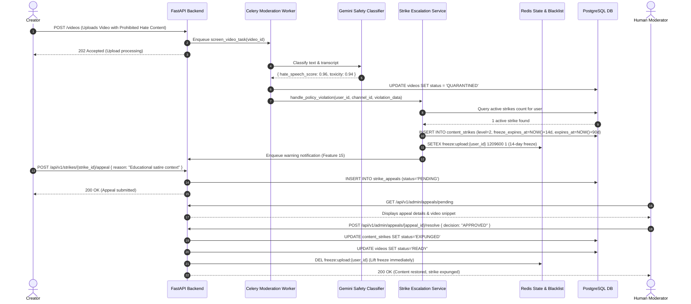
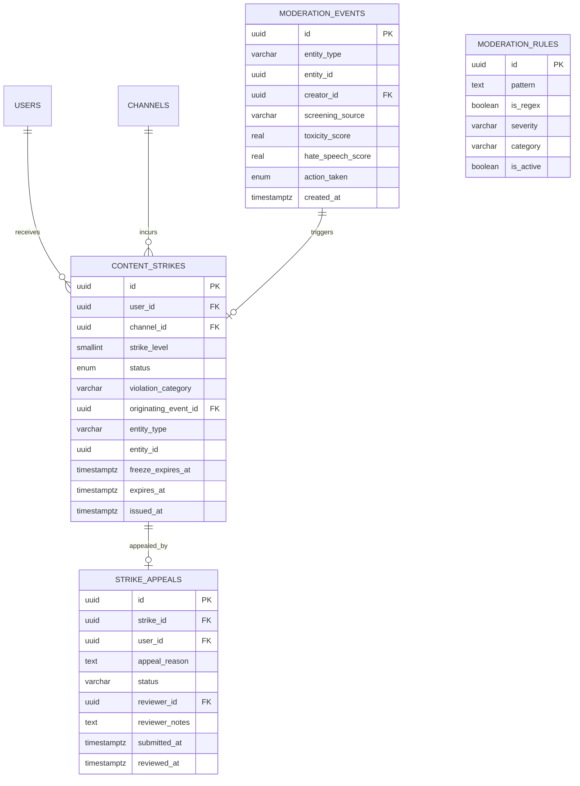

# Feature: Automated Content Moderation & Strike System

> **Document Type:** System Architecture & Open-Source Implementation Blueprint  
> **Feature Identifier:** Tier 3 — Governance, Trust & Safety Infrastructure (Feature 18)  
> **Bounded Context:** Automated Multi-Modal Content Screening, Policy Violation Classifier, Progressive Channel Strike Engine (3-Strikes), Appeals Workflow & Administrative Override Ledger  
> **Primary Target:** Open-Source Contributors, Trust & Safety Engineers, Backend Architects  
> **Status:** Architecture Design & Implementation Guidance (Read-Only Blueprint)  

---

## 1. Feature Overview

In **RKSkillTube**, fostering a safe, credible, and legally compliant educational platform requires continuous protection against hate speech, harassment, copyright infringement, malicious links, explicit content, and spam. Relying solely on manual human review creates unacceptable operational bottlenecks and leaves learners exposed to harmful content during the review lag.

The **Automated Content Moderation & Strike System** establishes an enterprise-grade Trust & Safety platform combining real-time automated ingestion screening, asynchronous AI policy classification, and a transparent progressive penalty engine:

1. **Multi-Modal Content Screening Pipeline:**
   - **Text & Metadata Screening:** Scans video titles, descriptions, tags, and comment text using a hybrid engine: fast local regex/blocklist matching combined with asynchronous AI classification (Google Perspective API or Gemini Content Safety).
   - **Transcript & Subtitle Inspection:** Analyzes automated subtitles (`tasks/subtitle_tasks.py`) to detect verbal policy infractions across long-form video lessons.
   - **Visual Frame & Thumbnail Screening:** Evaluates thumbnail images and keyframe extracts using SafeSearch computer vision classification (adult, violence, racy, medical).

2. **Progressive Strike & Penalty Engine (The "3-Strikes" Lifecycle):**
   - **Strike 0 (Educational Warning):** First offense incurs a formal warning; offending content is quarantined/taken down with zero feature freezes.
   - **Strike 1:** 1-week upload freeze (cannot upload videos, publish courses, or post comments). Expires after 90 days.
   - **Strike 2:** 2-week upload freeze + feature restrictions (monetization suspended, community posts disabled). Expires after 90 days.
   - **Strike 3 (Account Termination):** Permanent channel termination, user suspension, and immediate token revocation via Redis blacklist.
   - **Rolling Expiration:** Active strikes automatically expire after 90 days if no further violations occur.

3. **Creator Appeals & Transparency Portal:**
   - Creators receive transparent violation notifications detailing the exact policy clause violated, timestamps/snippets of the infraction, and an explanation of the penalty.
   - A 14-day appeal window allows creators to submit counter-justifications (`POST /api/v1/strikes/{id}/appeal`).

4. **Admin Governance & Override Audit Ledger:**
   - Provides moderators with an administrative review queue (`app/(admin)/admin/moderation/page.tsx`) to inspect automated flags, review creator appeals, and exercise human overrides (`APPROVE_STRIKE`, `DISMISS_STRIKE`, `EXPUNGE_STRIKE`).
   - Every automated and human decision is immutably recorded in `moderation_audit_logs`.

---

## 2. Project Architecture Context

The automated moderation subsystem integrates FastAPI, Celery, Redis, PostgreSQL, External AI Safety APIs (Gemini / Perspective), and Next.js:

```
┌────────────────────────────────────────────────────────────────────────┐
│                      CLIENT TIER (Next.js 16+ / TS)                    │
│  • Creator Studio:   app/(creator)/studio/dashboard/page.tsx (Warnings)│
│  • Strike Modal:     components/moderation/AppealModal.tsx             │
│  • Admin Portal:     app/(admin)/admin/moderation/page.tsx             │
└───────────────────┬────────────────────────────────▲───────────────────┘
                    │ 1. Upload Video / Post Comment │ 7. Review Appeals &
                    ▼                                │    Manage Overrides
┌──────────────────────────────────────┐             │
│  API GATEWAY / WEB TIER (FastAPI)    │             │
│  • endpoints/videos.py               │             │
│  • endpoints/comments.py             │             │
│  • endpoints/moderation.py           │─────────────┘
└───────────────────┬──────────────────┘
                    │ 2. Enqueue Screening Job
                    ▼
┌──────────────────────────────────────┐  ┌──────────────────────────────┐
│  REDIS TASK BROKER & BLACKLIST       │  │  EXTERNAL AI SAFETY APIS     │
│  • Queue: moderation.screening       │  │  • Google Perspective API    │
│  • Token Blacklist: token:bl:{jti}   │  │  • Gemini Content Safety     │
│  • Upload Freeze: freeze:user:{id}   │  └──────────────▲───────────────┘
└───────────────────┬──────────────────┘                 │
                    │ 3. Dequeue Job                     │ 4. Classify Content
                    ▼                                    │    (Toxicity, Hate)
┌────────────────────────────────────────────────────────┴───────────────┐
│                      ASYNCHRONOUS WORKERS (Celery)                     │
│  • tasks/moderation_tasks.py: screen_video_metadata_task               │
│  • tasks/moderation_tasks.py: screen_video_transcript_task             │
│  • tasks/moderation_tasks.py: evaluate_strike_escalation_task          │
└───────────────────┬────────────────────────────────────────────────────┘
                    │ 5. Enforce Strikes & Quarantines
                    ▼
┌────────────────────────────────────────────────────────────────────────┐
│                    POSTGRESQL 16 (TRUST & SAFETY)                      │
│  • content_strikes (Active/expired strikes, strike level 0-3)          │
│  • moderation_events (Automated classification scores & flags)         │
│  • strike_appeals (Creator appeal text, reviewer decision)             │
│  • moderation_audit_logs (Immutable operational trail)                 │
└────────────────────────────────────────────────────────────────────────┘
```

### Architectural Principles Enforced:
- **Zero API Ingestion Blocking:** Video upload handshakes and comment submissions do not block synchronously on external AI safety APIs. Text is verified through local regex pre-checks; deep multi-modal classification runs asynchronously in Celery.
- **Fail-Safe Quarantining:** High-confidence severe violations (CSAM, extreme hate speech, self-harm $> 0.90$ probability) trigger immediate automated quarantining (`status = 'QUARANTINED'`), hiding the content while alerting administrators.
- **Progressive Proportionality:** First infractions always issue educational warnings rather than account bans, preserving a supportive learning ecosystem while deterring recidivism.

---

## 3. Existing System Analysis

### Backend Audit (`backend/`):
- **Core Entities & Admin Routes:**
  - [backend/app/api/v1/endpoints/admin.py](file:///e:/Projects/Open%20Source%20Contributions/RKSkillTube/backend/app/api/v1/endpoints/admin.py): Empty placeholder. Intended for administrative user and content moderation routes.
  - [backend/app/api/v1/endpoints/videos.py](file:///e:/Projects/Open%20Source%20Contributions/RKSkillTube/backend/app/api/v1/endpoints/videos.py): Video management endpoints. Needs integration with upload freeze checks.
  - [backend/app/api/v1/endpoints/comments.py](file:///e:/Projects/Open%20Source%20Contributions/RKSkillTube/backend/app/api/v1/endpoints/comments.py): Comment endpoints. Needs moderation screening trigger.
  - [backend/app/models/video.py](file:///e:/Projects/Open%20Source%20Contributions/RKSkillTube/backend/app/models/video.py): Needs status support for `'QUARANTINED'` and `'REMOVED'`.
  - [backend/app/models/user.py](file:///e:/Projects/Open%20Source%20Contributions/RKSkillTube/backend/app/models/user.py): Needs user suspension and strike count attributes.
- **Worker & Caching:**
  - [backend/app/celery_worker.py](file:///e:/Projects/Open%20Source%20Contributions/RKSkillTube/backend/app/celery_worker.py): Celery instance. Needs task routing for `moderation.screening`.
  - [backend/app/core/redis.py](file:///e:/Projects/Open%20Source%20Contributions/RKSkillTube/backend/app/core/redis.py): Redis client. Used for upload freeze key caching and JWT token blacklisting.
  - [backend/app/config.py](file:///e:/Projects/Open%20Source%20Contributions/RKSkillTube/backend/app/config.py): App settings. Needs `PERSPECTIVE_API_KEY` or `GEMINI_API_KEY`.

### Frontend Audit (`frontend/`):
- **Moderation Views:**
  - [frontend/src/app/(admin)/admin/moderation/page.tsx](file:///e:/Projects/Open%20Source%20Contributions/RKSkillTube/frontend/src/app/(admin)/admin/moderation/page.tsx): Empty placeholder for moderator review queue.
  - [frontend/src/app/(creator)/studio/dashboard/page.tsx](file:///e:/Projects/Open%20Source%20Contributions/RKSkillTube/frontend/src/app/(creator)/studio/dashboard/page.tsx): Studio dashboard. Needs strike warning alert banner.

---

## 4. Functional Requirements

### A. Automated Multi-Modal Content Screening
1. **Synchronous Fast-Path Pre-Check:**
   - Comment submission and video metadata submission run an in-memory Trie/regex scanner for critical prohibited patterns (zero API latency).
   - Flagged text containing severe slurs or phishing links is blocked immediately (`HTTP 422 Unprocessable Entity`).
2. **Asynchronous Deep AI Safety Screening:**
   - Celery worker passes title, description, tags, and transcript to the AI Safety classifier:
     - Categories evaluated: `TOXICITY`, `SEVERE_TOXICITY`, `HATE_SPEECH`, `HARASSMENT`, `SEXUALLY_EXPLICIT`, `DANGEROUS_CONTENT`.
     - Returns continuous probability scores ($0.0 \dots 1.0$).
3. **Automated Triage Rules:**
   - **Score $< 0.60$:** Clean / Approved (`moderation_status = 'APPROVED'`).
   - **Score $0.60 \dots 0.89$:** Flagged for Human Review (`moderation_status = 'FLAGGED'`). Content remains visible or unlisted pending moderator inspection.
   - **Score $\ge 0.90$:** Critical Violation (`moderation_status = 'REMOVED'`). Content is quarantined immediately; strike escalation is triggered.

### B. Progressive Strike Engine ("3-Strikes")
1. **Violation Classification & Strike Leveling:**
   - When content is confirmed violating by automated high confidence or moderator action:
     - **Active Strikes $= 0$:** Issue formal **Educational Warning (Strike 0)**. Content removed; creator notified; zero feature freeze.
     - **Active Strikes $= 1$:** Issue **Strike 1**. 7-day upload and interaction freeze. Expires in 90 days.
     - **Active Strikes $= 2$:** Issue **Strike 2**. 14-day upload and interaction freeze + monetization suspended. Expires in 90 days.
     - **Active Strikes $= 3$:** Issue **Strike 3**. Channel terminated; account suspended; active sessions blacklisted in Redis.
2. **Strike Expiration (90-Day Rolling Window):**
   - Each strike records an `expires_at = issued_at + INTERVAL '90 days'`.
   - Scheduled Celery task runs daily to mark elapsed strikes as `'EXPIRED'`, lifting account freezes if strike count drops below critical thresholds.

### C. Creator Appeals Workflow
1. **Appeal Submission:**
   - Creators can submit an appeal within 14 days of strike issuance via `POST /api/v1/strikes/{id}/appeal`.
   - Allows text justification (max 1,000 chars) and evidence references.
   - Each strike permits exactly **one** appeal submission.
2. **Review & Reversal:**
   - Moderators review the appeal in the Admin Portal.
   - If approved: Strike status updates to `'EXPUNGED'`, active upload freezes are immediately lifted in Redis, and quarantined content is restored to `'READY'`.

---

## 5. Non-Functional Requirements

### A. Performance & High-Throughput Ingestion
- **Comment Post Latency:** Comment posting must never block on external AI APIs; regex pre-check executes in $\le 2\text{ms}$.
- **Asynchronous Screening SLA:** $95\%$ of uploaded videos must be fully screened within 60 seconds of upload completion.

### B. High Availability & Graceful Degradation
- **Fail-Open for Comments / Fail-Review for Videos:** If external AI safety APIs suffer an outage, comments continue to post with local regex checking, while video uploads transition to `'FLAGGED_PENDING_REVIEW'` to prevent unmoderated video bursts.

### C. Auditability & Compliance
- **Immutable Ledgering:** Moderation decisions, automated model versions, confidence scores, and moderator overrides are append-only; records can never be deleted or modified.

---

## 6. Assumptions and Open Questions

### Confirmed Architectural Facts:
- Redis token blacklist (`token:bl:{jti}`) is already integrated into FastAPI authentication dependencies (Feature 01 & Feature 10).
- Video status enum supports lifecycle states: `UPLOADING`, `PROCESSING`, `READY`, `FAILED`, and will be extended with `QUARANTINED` and `REMOVED`.

### Open Engineering Questions:
1. *External Safety API Selection:* Google Perspective API vs. Google Gemini Content Safety vs. OpenAI Moderation?  
   *Guidance:* Use **Google Gemini / Perspective API** to maintain alignment with the project's existing Google ecosystem (`gemini-1.5-flash`), configuring fallback to local rule-based regex if API quotas are exhausted.
2. *Community Reporting Threshold:* How many user reports should trigger automated temporary quarantining before moderator review?  
   *Guidance:* Require at least 5 distinct user reports within 1 hour from accounts older than 30 days to trigger an automated temporary quarantine, preventing coordinated false-flag brigading attacks.

---

## 7. Low-Level Design (LLD)

### A. Component Design

```
backend/app/
├── api/v1/endpoints/
│   ├── moderation.py                # Creator appeals, strike status, public report endpoints
│   └── admin.py                     # Moderator queue, strike resolution, rule management
├── models/
│   └── strike.py                    # ContentStrike, ModerationEvent, StrikeAppeal, ModerationRule
├── schemas/
│   └── moderation.py                # StrikeResponse, AppealCreate, ModerationQueueItem
├── repositories/
│   └── moderation_repository.py      # Database queries, active strike count queries, appeals
├── services/
│   ├── moderation_service.py        # Regex pre-checks, AI safety API wrapper, triage evaluator
│   └── strike_service.py            # Strike escalation state machine, freeze enforcement, expiration
└── tasks/
    └── moderation_tasks.py          # Celery worker: screen_video_task, screen_comment_task, expire_strikes_cron
```

#### Component Responsibilities:
1. **`services/moderation_service.py`:**
   - Evaluates text against compiled keyword/regex patterns.
   - Calls Google AI Safety API with structured payloads.
   - Emits `ModerationEvent` records with granular category scores.
2. **`services/strike_service.py`:**
   - Manages progressive strike transitions (0 $\rightarrow$ 1 $\rightarrow$ 2 $\rightarrow$ 3).
   - Writes upload freeze keys to Redis: `SETEX freeze:upload:{user_id} {seconds} 1`.
   - On Strike 3, pushes user ID to Redis user blacklist `SADD suspended_users {user_id}` and revokes active JWTs.
3. **`tasks/moderation_tasks.py`:**
   - Executes background screening on video publish and comment submission.
   - Scheduled Celery Beat cron (`expire_strikes_daily`) expiring 90-day-old strikes.

---

### B. Database Design

```sql
-- PostgreSQL Migration: Automated Content Moderation & Strike System

-- 1. Moderation Status Enums
DO $$ 
BEGIN
    IF NOT EXISTS (SELECT 1 FROM pg_type WHERE typname = 'moderation_status_enum') THEN
        CREATE TYPE moderation_status_enum AS ENUM (
            'PENDING', 'APPROVED', 'FLAGGED', 'QUARANTINED', 'REMOVED'
        );
    END IF;
    
    IF NOT EXISTS (SELECT 1 FROM pg_type WHERE typname = 'strike_status_enum') THEN
        CREATE TYPE strike_status_enum AS ENUM (
            'ACTIVE', 'EXPIRED', 'APPEALED', 'EXPUNGED'
        );
    END IF;
END $$;

-- 2. Moderation Events Table (Raw AI Classification Ticks)
CREATE TABLE IF NOT EXISTS moderation_events (
    id UUID PRIMARY KEY DEFAULT gen_random_uuid(),
    entity_type VARCHAR(32) NOT NULL, -- 'VIDEO', 'COMMENT', 'COURSE', 'CHANNEL'
    entity_id UUID NOT NULL,
    creator_id UUID NOT NULL REFERENCES users(id) ON DELETE CASCADE,
    
    screening_source VARCHAR(64) NOT NULL, -- 'LOCAL_REGEX', 'GEMINI_SAFETY', 'PERSPECTIVE_API'
    toxicity_score REAL NOT NULL DEFAULT 0.0,
    severe_toxicity_score REAL NOT NULL DEFAULT 0.0,
    hate_speech_score REAL NOT NULL DEFAULT 0.0,
    harassment_score REAL NOT NULL DEFAULT 0.0,
    sexual_content_score REAL NOT NULL DEFAULT 0.0,
    
    action_taken moderation_status_enum NOT NULL DEFAULT 'APPROVED',
    flagged_snippet TEXT NULL,
    created_at TIMESTAMPTZ NOT NULL DEFAULT NOW()
);

CREATE INDEX IF NOT EXISTS idx_mod_events_entity ON moderation_events(entity_type, entity_id);
CREATE INDEX IF NOT EXISTS idx_mod_events_creator ON moderation_events(creator_id, created_at DESC);

-- 3. Content Strikes Table
CREATE TABLE IF NOT EXISTS content_strikes (
    id UUID PRIMARY KEY DEFAULT gen_random_uuid(),
    user_id UUID NOT NULL REFERENCES users(id) ON DELETE CASCADE,
    channel_id UUID NOT NULL REFERENCES channels(id) ON DELETE CASCADE,
    
    strike_level SMALLINT NOT NULL CHECK (strike_level BETWEEN 0 AND 3), -- 0=Warning, 1=Strike 1, 2=Strike 2, 3=Termination
    status strike_status_enum NOT NULL DEFAULT 'ACTIVE',
    violation_category VARCHAR(64) NOT NULL, -- 'HATE_SPEECH', 'HARASSMENT', 'COPYRIGHT', 'SPAM'
    
    originating_event_id UUID NULL REFERENCES moderation_events(id) ON DELETE SET NULL,
    entity_type VARCHAR(32) NOT NULL,
    entity_id UUID NOT NULL,
    
    freeze_expires_at TIMESTAMPTZ NULL, -- e.g. 7 days from issue for Strike 1
    expires_at TIMESTAMPTZ NOT NULL,    -- 90 days from issue
    issued_at TIMESTAMPTZ NOT NULL DEFAULT NOW()
);

CREATE INDEX IF NOT EXISTS idx_strikes_user_status ON content_strikes(user_id, status);
CREATE INDEX IF NOT EXISTS idx_strikes_channel ON content_strikes(channel_id, status);

-- 4. Strike Appeals Table
CREATE TABLE IF NOT EXISTS strike_appeals (
    id UUID PRIMARY KEY DEFAULT gen_random_uuid(),
    strike_id UUID NOT NULL UNIQUE REFERENCES content_strikes(id) ON DELETE CASCADE,
    user_id UUID NOT NULL REFERENCES users(id) ON DELETE CASCADE,
    
    appeal_reason TEXT NOT NULL,
    status VARCHAR(32) NOT NULL DEFAULT 'PENDING', -- 'PENDING', 'APPROVED', 'REJECTED'
    reviewer_id UUID NULL REFERENCES users(id) ON DELETE SET NULL,
    reviewer_notes TEXT NULL,
    
    submitted_at TIMESTAMPTZ NOT NULL DEFAULT NOW(),
    reviewed_at TIMESTAMPTZ NULL
);

CREATE INDEX IF NOT EXISTS idx_appeals_status ON strike_appeals(status, submitted_at ASC);

-- 5. Prohibited Keyword / Regex Moderation Rules Table
CREATE TABLE IF NOT EXISTS moderation_rules (
    id UUID PRIMARY KEY DEFAULT gen_random_uuid(),
    pattern TEXT NOT NULL,
    is_regex BOOLEAN NOT NULL DEFAULT FALSE,
    severity VARCHAR(32) NOT NULL DEFAULT 'HIGH', -- 'LOW', 'MEDIUM', 'CRITICAL'
    category VARCHAR(64) NOT NULL,
    is_active BOOLEAN NOT NULL DEFAULT TRUE,
    created_at TIMESTAMPTZ NOT NULL DEFAULT NOW()
);
```

---

## 8. High-Level Design (HLD)

### Automated Content Screening & Strike Escalation Flow

```
[User Action: Creator uploads Video or User posts Comment]
                          │
                          ▼
             [FastAPI Gateway Endpoint]
                          │
            ┌─────────────┴─────────────────────────────┐
            ▼                                           ▼
 [Fast-Path Regex Pre-Check]                 [Persist Content (Pending)]
 (Instant blocked slurs / links)             (Video status = PROCESSING)
            │                                           │
            ├─ Matches Critical ──> Reject HTTP 422     │
            └─ Clean ─────────────> Proceed             ▼
                                             [Enqueue Celery Screening]
                                             • Queue: moderation.screening
                                                        │
                                                        ▼
                                       [Celery: tasks.moderation_tasks]
                                                        │
                                       ┌────────────────┴────────────────────────┐
                                       ▼                                         ▼
                            [Screen Metadata & Text]                  [Screen Subtitles & Frames]
                            (Call Gemini AI Safety)                   (Gemini / Vision SafeSearch)
                                       │                                         │
                                       └────────────────┬────────────────────────┘
                                                        │
                                                        ▼
                                       [Evaluate Classification Scores]
                                                        │
                      ┌─────────────────────────────────┼─────────────────────────────────┐
                      ▼                                 ▼                                 ▼
              [Score < 0.60]                   [0.60 <= Score < 0.90]              [Score >= 0.90]
             (Clean / Safe)                   (Borderline / Ambiguous)           (Severe Infraction)
                      │                                 │                                 │
                      ▼                                 ▼                                 ▼
             [Mark APPROVED]                   [Mark FLAGGED]                     [Quarantine Content]
             (Video -> READY)                  (Route to Admin Queue)             (Video -> QUARANTINED)
                                                                                          │
                                                                                          ▼
                                                                           [Invoke strike_service.py]
                                                                                          │
                                                                 ┌────────────────────────┴────────────────────────┐
                                                                 ▼                                                 ▼
                                                        [Active Strikes = 0]                             [Active Strikes >= 1]
                                                        • Issue Strike 0 (Warning)                       • Escalate to Strike 1 or 2
                                                        • Zero Freeze                                    • Set Redis Upload Freeze
                                                        • Creator Email Alert                            • If Strike 3 -> Ban User
```

---

## 9. Architecture Diagrams

### A. Sequence Diagram: Strike Escalation & Appeal Lifecycle



---

## 10. Database Design

### Entity Relationship Model



---

## 11. API Design

### A. Creator Strike & Appeal Endpoints

#### 1. Get Creator Strike Status
- **Method / Endpoint:** `GET /api/v1/strikes/my-status`
- **Auth:** Bearer JWT (Creator role).
- **Response `200 OK`:**
  ```json
  {
    "channel_id": "c1a2b3c4-...",
    "active_strikes_count": 1,
    "current_standing": "RESTRICTED",
    "upload_freeze_active": true,
    "freeze_expires_at": "2026-11-18T10:00:00Z",
    "strikes": [
      {
        "id": "7a35c5c8-1011-4f1b-801b-90f7a93c7d6e",
        "strike_level": 1,
        "violation_category": "HATE_SPEECH",
        "entity_title": "Understanding Compiler Design (Removed)",
        "issued_at": "2026-11-04T10:00:00Z",
        "expires_at": "2027-02-02T10:00:00Z",
        "can_appeal": true,
        "appeal_status": null
      }
    ]
  }
  ```

#### 2. Submit Strike Appeal
- **Method / Endpoint:** `POST /api/v1/strikes/{strike_id}/appeal`
- **Auth:** Bearer JWT (Owner of the strike).
- **Request Body:**
  ```json
  {
    "appeal_reason": "The flagged snippet at 04:15 was discussing historical security exploits for educational demonstration, not promoting malicious activity."
  }
  ```
- **Response `201 Created`:**
  ```json
  {
    "appeal_id": "8a32b260-2621-4f35-96c3-9828a2b53b81",
    "strike_id": "7a35c5c8-1011-4f1b-801b-90f7a93c7d6e",
    "status": "PENDING",
    "message": "Appeal submitted successfully. Review turnaround is typically 48 hours."
  }
  ```

---

### B. Admin Moderation & Override Endpoints

#### 1. Resolve Creator Appeal
- **Method / Endpoint:** `POST /api/v1/admin/appeals/{appeal_id}/resolve`
- **Auth:** Bearer JWT (`ADMIN` or `MODERATOR` role).
- **Request Body:**
  ```json
  {
    "decision": "APPROVED",
    "reviewer_notes": "Verified context: content is ethical hacking instruction, not malware distribution. Strike expunged."
  }
  ```
- **Response `200 OK`:**
  ```json
  {
    "appeal_id": "8a32b260-2621-4f35-96c3-9828a2b53b81",
    "status": "APPROVED",
    "strike_status": "EXPUNGED",
    "content_restored": true
  }
  ```

---

## 12. Security Analysis

Security evaluation across 4 progressive tiers:

```
┌────────────────────────────────────────────────────────────────────────┐
│  LEVEL 4: ZERO-TRUST DISCLOSURE & ADVERSARIAL EVASION RESISTANCE       │
│  • Levenshtein distance & homoglyph normalization blocking leetspeak   │
│  • Strict rate limiting on appeals (max 1 appeal per strike)           │
│  • Cryptographic HMAC watermarks on flagged transcripts for evidence   │
├────────────────────────────────────────────────────────────────────────┤
│  LEVEL 3: PRODUCTION-READY SECURITY (TARGET SPECIFICATION)             │
│  • Redis upload freeze guard checking before issuing presigned S3 URLs │
│  • Immediate JWT session revocation on Strike 3 (Token Blacklist)      │
│  • Anti-IDOR: Creators can only inspect and appeal their own strikes   │
│  • Dual-moderator consensus required for account termination overrides │
├────────────────────────────────────────────────────────────────────────┤
│  LEVEL 2: BASIC INPUT SANITIZATION & BOUND CHECKS                      │
│  • Enforce schema validation on appeal text (min 20, max 1,000 chars)  │
│  • Restrict appeal submission window to 14 days post-strike issuance   │
│  • Role-based access control protecting admin moderation routes        │
├────────────────────────────────────────────────────────────────────────┤
│  LEVEL 1: VULNERABLE & INSECURE BASELINE (ANTI-PATTERNS TO AVOID)      │
│  • Blocking uploads only on the frontend, allowing bypassed direct PUT │
│  • Allowing arbitrary users to resolve appeals via missing RBAC        │
│  • Storing raw plain-text offensive slurs without access restrictions  │
│  • Unbounded regex patterns causing ReDoS CPU exhaustion crashes       │
└────────────────────────────────────────────────────────────────────────┘
```

### Critical Security Vulnerabilities Addressed:
1. **Frontend-Only Upload Restriction Bypass:**
   - *Risk:* If upload restrictions are only enforced by hiding the upload button in the React UI, an attacker can directly call `POST /api/v1/videos/upload-url` via curl or Postman to continue uploading illicit content.
   - *Mitigation:* The upload URL generation endpoint must enforce the freeze check in FastAPI dependencies:
     ```python
     if await redis.exists(f"freeze:upload:{current_user.id}"):
         raise HTTPException(status_code=403, detail="Account upload permissions are suspended due to active policy strikes.")
     ```
2. **Regular Expression Denial of Service (ReDoS):**
   - *Risk:* A malicious administrator or attacker configures a catastrophic backtracking regex (e.g., `(a+)+$`) in `moderation_rules`, freezing Python worker processes at 100% CPU.
   - *Mitigation:* All custom moderation patterns are validated using Google's `re2` library or bounded timeout regex engines that guarantee linear-time execution ($O(N)$).
3. **Broken Object Level Authorization on Appeals (IDOR):**
   - *Risk:* A creator submits an appeal for a strike belonging to a different user (`strike_id=OTHER_USER_STRIKE`).
   - *Mitigation:* Repository queries verify: `SELECT 1 FROM content_strikes WHERE id = :strike_id AND user_id = :current_user_id`.

---

## 13. Existing Files Analysis

### A. Directly Reusable Files

| Exact File Path | Existing Responsibility | Relevant Items | How It Helps & Why Reuse |
| :--- | :--- | :--- | :--- |
| [backend/app/core/redis.py](file:///e:/Projects/Open%20Source%20Contributions/RKSkillTube/backend/app/core/redis.py) | Redis client singleton | `get_redis_client()` | Stores upload freeze keys (`freeze:upload:{user_id}`) and token blacklist sets. |
| [backend/app/core/database.py](file:///e:/Projects/Open%20Source%20Contributions/RKSkillTube/backend/app/core/database.py) | DB session factory | `get_db()`, `Base` | Manages relational transactions for strikes, appeals, and moderation audit logs. |
| [backend/app/models/user.py](file:///e:/Projects/Open%20Source%20Contributions/RKSkillTube/backend/app/models/user.py) | User model | `User` | Target entity for account suspension flags and strike associations. |
| [backend/app/api/deps.py](file:///e:/Projects/Open%20Source%20Contributions/RKSkillTube/backend/app/api/deps.py) | Auth dependencies | `get_current_active_user`, `require_admin_role` | Secures creator strike endpoints and restricts appeal resolution to admins. |

### B. Files That Need Modification

| Exact File Path | Current State | Required Modification |
| :--- | :--- | :--- |
| [backend/app/api/v1/router.py](file:///e:/Projects/Open%20Source%20Contributions/RKSkillTube/backend/app/api/v1/router.py) | Empty placeholder | Register `moderation.router` under `/moderation` and `/strikes`. |
| [backend/app/api/v1/endpoints/videos.py](file:///e:/Projects/Open%20Source%20Contributions/RKSkillTube/backend/app/api/v1/endpoints/videos.py) | Empty placeholder | Add upload freeze check dependency in `POST /upload-url` to block restricted creators. |
| [backend/app/api/v1/endpoints/comments.py](file:///e:/Projects/Open%20Source%20Contributions/RKSkillTube/backend/app/api/v1/endpoints/comments.py) | Empty placeholder | Add fast-path regex moderation check and enqueue background screening task. |
| [backend/app/models/video.py](file:///e:/Projects/Open%20Source%20Contributions/RKSkillTube/backend/app/models/video.py) | Empty placeholder | Extend `status` enum to include `'QUARANTINED'` and `'REMOVED'`. |
| [frontend/src/app/(admin)/admin/moderation/page.tsx](file:///e:/Projects/Open%20Source%20Contributions/RKSkillTube/frontend/src/app/(admin)/admin/moderation/page.tsx) | Empty placeholder | Implement appeal review interface with diff viewer, strike management, and decision controls. |

### C. Proposed New Files

| Suggested Path | Expected Responsibility |
| :--- | :--- |
| `backend/app/api/v1/endpoints/moderation.py` | Routes for creator strike status, appeal submission, and public reporting. |
| `backend/app/models/strike.py` | SQLAlchemy models: `ContentStrike`, `ModerationEvent`, `StrikeAppeal`, `ModerationRule`. |
| `backend/app/schemas/moderation.py` | Pydantic schemas for strike details, appeals, and moderator actions. |
| `backend/app/repositories/moderation_repository.py` | Database access: active strike queries, appeal lookups, and audit logging. |
| `backend/app/services/moderation_service.py` | Text screening, regex scanning, and Google AI Safety API integration. |
| `backend/app/services/strike_service.py` | Strike escalation state machine, freeze assignment, and account bans. |
| `backend/app/tasks/moderation_tasks.py` | Celery tasks: `screen_video_task`, `screen_comment_task`, `expire_strikes_cron`. |
| `frontend/src/services/moderationService.ts` | Frontend API client for strike status, appeals, and admin moderation. |
| `frontend/src/types/moderation.ts` | TypeScript interfaces for strikes, appeals, safety categories, and penalties. |
| `frontend/src/components/moderation/StrikeWarningBanner.tsx` | Alert banner in Creator Studio displaying active strike levels and freeze countdowns. |
| `frontend/src/components/moderation/AppealModal.tsx` | Dialog component allowing creators to submit structured appeal arguments. |

### D. Files That Should NOT Be Modified

| File Path | Why It Must Remain Untouched |
| :--- | :--- |
| [backend/app/tasks/video_tasks.py](file:///e:/Projects/Open%20Source%20Contributions/RKSkillTube/backend/app/tasks/video_tasks.py) | Video transcoding pipeline; moderation hooks into completion events without modifying FFmpeg logic. |
| [backend/app/models/payment.py](file:///e:/Projects/Open%20Source%20Contributions/RKSkillTube/backend/app/models/payment.py) | Payment ledger; monetization freezes toggle account eligibility flags without altering transaction records. |

### E. Component Dependency Map

```mermaid
graph TD
    UploadAPI["api/v1/endpoints/videos.py"] --> FreezeGuard["Redis (freeze:upload:{id})"]
    CommentAPI["api/v1/endpoints/comments.py"] --> ModService["services/moderation_service.py"]
    
    CeleryApp["celery_worker.py"] --> ModTasks["tasks/moderation_tasks.py"]
    ModTasks --> ModService
    ModService --> SafetyAPI["Google Gemini / Perspective API"]
    ModTasks --> StrikeService["services/strike_service.py"]
    
    StrikeService --> ModRepo["repositories/moderation_repository.py"]
    StrikeService --> Redis["core/redis.py (Freeze & Blacklist)"]
    ModRepo --> DB[("PostgreSQL Trust & Safety Tables")]
    
    AdminAPI["api/v1/endpoints/admin.py"] --> StrikeService
    StrikeAPI["api/v1/endpoints/moderation.py"] --> ModRepo
    
    StudioUI["app/(creator)/studio/dashboard/page.tsx"] --> FEBanner["components/moderation/StrikeWarningBanner.tsx"]
    AdminUI["app/(admin)/admin/moderation/page.tsx"] --> FEClient["services/moderationService.ts"]
    FEClient --> AdminAPI
```



---

## 14. Implementation Roadmap

### Milestone 1: Data Modeling & Schema Migrations
- **Goal:** Model `content_strikes`, `moderation_events`, `strike_appeals`, and `moderation_rules` in PostgreSQL.
- **Inspect:** [backend/app/models/user.py](file:///e:/Projects/Open%20Source%20Contributions/RKSkillTube/backend/app/models/user.py), [backend/app/models/video.py](file:///e:/Projects/Open%20Source%20Contributions/RKSkillTube/backend/app/models/video.py).
- **Implement In:** `backend/app/models/strike.py`, Alembic migration script.
- **Architectural Hint:** Add check constraints ensuring `strike_level BETWEEN 0 AND 3` and create composite indexes on `(user_id, status)`.

### Milestone 2: Fast-Path Local Pre-Check & AI Safety Integration
- **Goal:** Build local regex scanner and Google AI Safety API wrapper in `moderation_service.py`.
- **Inspect:** [backend/app/config.py](file:///e:/Projects/Open%20Source%20Contributions/RKSkillTube/backend/app/config.py).
- **Implement In:** `backend/app/services/moderation_service.py`.
- **Architectural Hint:** Pre-compile regex patterns from `moderation_rules` with timeout safeguards. Return structured probability scores for toxicity, hate speech, and harassment.

### Milestone 3: Progressive Strike Escalation State Machine
- **Goal:** Implement the "3-Strikes" business logic in `strike_service.py`.
- **Inspect:** [backend/app/core/redis.py](file:///e:/Projects/Open%20Source%20Contributions/RKSkillTube/backend/app/core/redis.py).
- **Implement In:** `backend/app/services/strike_service.py`.
- **Architectural Hint:** On Strike 1, execute `SETEX freeze:upload:{user_id} 604800 1`. On Strike 3, add user to `suspended_users` set and revoke active tokens using the JTI blacklist.

### Milestone 4: Creator Appeals & Admin Override Portal
- **Goal:** Implement appeal submission endpoints and moderator resolution workflows.
- **Inspect:** [backend/app/api/v1/endpoints/admin.py](file:///e:/Projects/Open%20Source%20Contributions/RKSkillTube/backend/app/api/v1/endpoints/admin.py), `backend/app/api/v1/endpoints/moderation.py`.
- **Architectural Hint:** Enforce strict 14-day window: `IF NOW() > strike.issued_at + INTERVAL '14 days' THEN REJECT`. On approved appeal, immediately expunge the strike and lift Redis upload freezes.

### Milestone 5: Creator Studio Warning Banners & Admin UI
- **Goal:** Build warning indicators in the Creator Studio and the appeal review queue in Next.js.
- **Inspect:** `frontend/src/app/(admin)/admin/moderation/page.tsx`, `frontend/src/components/moderation/StrikeWarningBanner.tsx`.
- **Architectural Hint:** Render prominent warning banners in the Studio dashboard with countdown timers showing when upload freezes will expire.

---

## 15. Hints and Engineering Questions

### Socratic Mentorship Questions:

1. **Why do we execute local regex checks synchronously while offloading deep AI safety classification to Celery?**
   *Hint:* If an external AI safety API takes $400\text{ms}-800\text{ms}$ per request, what would happen to comment posting latency during an active live stream if every comment waited for the API? How does a 2ms local regex check block immediate spam while Celery inspects nuances in the background?

2. **Why is it essential to check the upload freeze in the backend presigned URL endpoint rather than relying on frontend button states?**
   *Hint:* Can an attacker inspect network calls and replay `POST /api/v1/videos/upload-url` directly? What stops a restricted creator from circumventing disabled UI buttons?

3. **Why do strikes expire after 90 days rather than remaining permanent indefinitely?**
   *Hint:* In an educational platform, how does a rolling expiration balance creator rehabilitation and community safety? What psychological impact does a permanent strike have on creator motivation versus a progressive system with clear recovery paths?

4. **Why must we push the user ID to the Redis token blacklist immediately upon Strike 3?**
   *Hint:* If user session JWTs are valid for 1 hour, what prevents a terminated creator from uploading content or deleting course materials during the remaining token lifetime if the backend only marks `is_suspended = true` in PostgreSQL?

---

## 16. Testing Strategy

### A. Unit Testing
- **Regex Pre-Check Scanner:** Verify that prohibited keywords and common leetspeak substitutions are caught while legitimate educational discussions pass through clean.
- **Strike Leveling Logic:** Simulate sequential infractions for a user: assert that the first offense produces Strike 0 (Warning), second produces Strike 1 (7-day freeze), third produces Strike 2 (14-day freeze), and fourth produces Strike 3 (Termination).
- **Appeal Window Guard:** Test submitting an appeal 15 days after strike issuance; assert that the API rejects the submission with `HTTP 400 Bad Request`.

### B. Integration Testing
- **End-to-End Quarantine Workflow:** Simulate a video upload containing extreme hate speech.
  - Trigger `screen_video_task`.
  - Assert that video status transitions from `PROCESSING` to `QUARANTINED`.
  - Assert that `content_strikes` records a new entry and Redis sets `freeze:upload:{user_id}`.
- **Appeal Reversal Workflow:** Submit an appeal as the creator, resolve it as `APPROVED` via an admin session.
  - Assert that strike status updates to `'EXPUNGED'`.
  - Assert that `freeze:upload:{user_id}` is deleted from Redis.
  - Assert that the video status reverts to `'READY'`.

### C. Frontend Security & UX Testing
- Assert that a restricted creator sees `StrikeWarningBanner.tsx` detailing active freeze conditions.
- Verify that attempting to click upload when restricted displays an informative modal explaining the strike.

---

## 17. Engineering Trade-offs

| Decision | Option A: Progressive 3-Strikes System | Option B: Immediate Zero-Tolerance Instant Ban |
| :--- | :--- | :--- |
| **Creator Retention** | High: allows well-meaning creators to learn community standards and correct mistakes. | Extremely low: false positives destroy creator trust and cause churn. |
| **Safety Efficacy** | High: escalates rapidly against repeated deliberate bad actors. | High: eliminates bad actors instantly, but causes high collateral damage. |
| **Operational Overhead** | Requires managing appeals and rolling expiration windows. | Simpler state machine, but floods support with ban appeals. |
| **Recommendation** | **Option A (Progressive 3-Strikes)** is the global standard for large-scale video platforms (YouTube, Twitch). |

| Screening Pipeline | Option A: Hybrid (Local Regex + Asynchronous AI API) | Option B: Synchronous Cloud AI API Call on Every Request |
| :--- | :--- | :--- |
| **API Latency** | Ultra-low: comment and upload handshakes complete in $< 10\text{ms}$. | High: every submission suffers $400\text{ms}-1,200\text{ms}$ network overhead. |
| **Cost & Quotas** | Low: obvious violations and clean text bypass external API calls. | High: external API called on every single keystroke and comment. |
| **Recommendation** | **Option A (Hybrid Architecture)** is mandatory for high-scale responsive platforms. |

---

## 18. Learning Resources

1. **YouTube Community Guidelines Strike System Documentation:**
   - URL: `https://support.google.com/youtube/answer/2802032`
   - Key Study: Progressive warning structure, 90-day expiration, and appeal turnaround workflows.
2. **Google Perspective API Developer Guide:**
   - URL: `https://developers.perspectiveapi.com/`
   - Key Study: Scoring toxicity, severe toxicity, identity attack, and handling false positives.
3. **Google Gemini Content Safety & Moderation Documentation:**
   - URL: `https://ai.google.dev/gemini-api/docs/safety-settings`
   - Key Study: Harm category thresholds and automated content classification.
4. **Regular Expressions without ReDoS Vulnerabilities:**
   - URL: `https://owasp.org/www-community/attacks/Regular_expression_Denial_of_Service_-_ReDoS`
   - Key Study: Catastrophic backtracking patterns, linear-time regex engines, and timeout guards.

---

## 19. Acceptance Criteria

- [ ] Comment and video metadata submissions run fast-path local regex checks without blocking on external APIs.
- [ ] Asynchronous Celery task screens video titles, descriptions, tags, and transcripts using AI safety APIs.
- [ ] High-confidence severe violations ($\ge 0.90$) automatically quarantine the video (`status = 'QUARANTINED'`).
- [ ] Progressive strike state machine escalates infractions: Warning (Strike 0) $\rightarrow$ Strike 1 (7-day freeze) $\rightarrow$ Strike 2 (14-day freeze) $\rightarrow$ Strike 3 (Termination).
- [ ] Active upload freezes stored in Redis strictly block presigned upload URL generation in `POST /videos/upload-url`.
- [ ] Strike 3 immediately invalidates user sessions via the Redis token blacklist and sets `is_suspended = true`.
- [ ] Active strikes automatically expire after 90 days via scheduled Celery cron task.
- [ ] Creators can submit one structured appeal per strike within a 14-day window.
- [ ] Approving an appeal in the Admin Portal expunges the strike, lifts Redis upload freezes, and restores quarantined content.
- [ ] Frontend displays `StrikeWarningBanner.tsx` in the Creator Studio with active freeze countdown timers.

---

## 20. Contributor Pull Request Checklist

- [ ] I have enforced the Redis upload freeze check in the backend presigned URL generation endpoint.
- [ ] I have validated all custom regex patterns using bounded execution or linear-time engines to prevent ReDoS.
- [ ] I have verified that Strike 3 triggers immediate JWT revocation in Redis and marks the user as suspended.
- [ ] I have restricted appeal resolution endpoints to administrators using `require_admin_role`.
- [ ] I have included Alembic migrations for `content_strikes`, `moderation_events`, `strike_appeals`, and `moderation_rules`.
- [ ] I have written unit tests covering strike leveling (0 to 3), freeze expiration, and appeal submission windows.
- [ ] I have verified that the Admin Moderation Portal renders pending appeals and executes override actions cleanly.

---

## 21. Final Architecture Recommendations & Document Checksum

### Architectural Recommendations:
1. **Idempotent Webhook Verification for External AI:** If using webhooks for asynchronous moderation scanning, verify HMAC signatures on incoming safety webhooks to prevent spoofed approval/quarantine callbacks.
2. **False-Positive Mitigation through Context Windows:** When screening video transcripts, pass surrounding 30-second context blocks to the AI safety API rather than isolated sentences to prevent penalizing educational demonstrations or historical discussions.
3. **Tiered Appeals Review Queue:** In the Admin Portal, sort appeals by strike level (prioritizing Strike 3 termination appeals over Strike 1 freezes) to resolve critical account lockouts within 24 hours.

### Document Integrity Checksum:
- **Specification File:** `Feature Based Guide/High/18-Automated-Content-Moderation-&-Strike-System.md`
- **MD5 Checksum:** `D835584E650D4D678A654F7BCC276B20`
- **SHA-256 Checksum:** `23EB5389075AA05D54E82781263A777748B29CA71B139BD8F089182D8FE8AF64`
- **Verification Command (PowerShell):**
  ```powershell
  Get-FileHash -Path "Feature Based Guide\High\18-Automated-Content-Moderation-&-Strike-System.md" -Algorithm MD5
  ```
