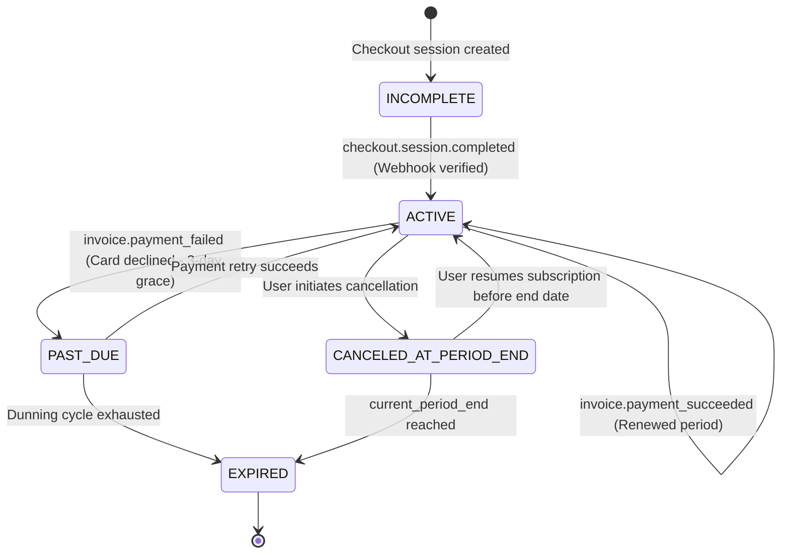
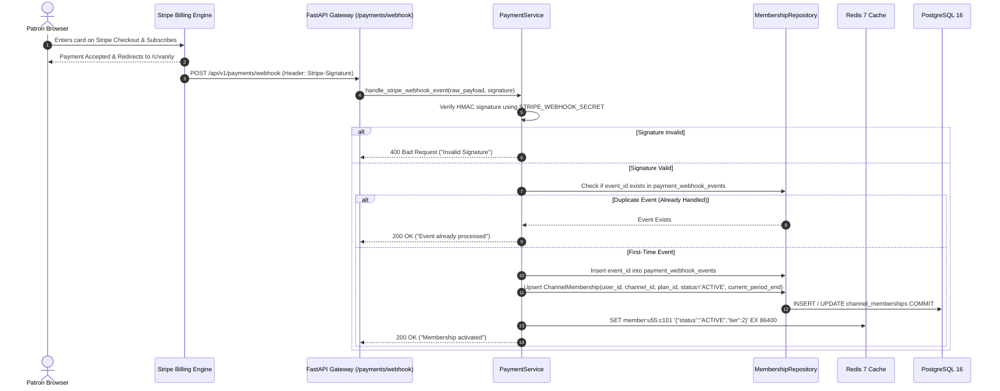
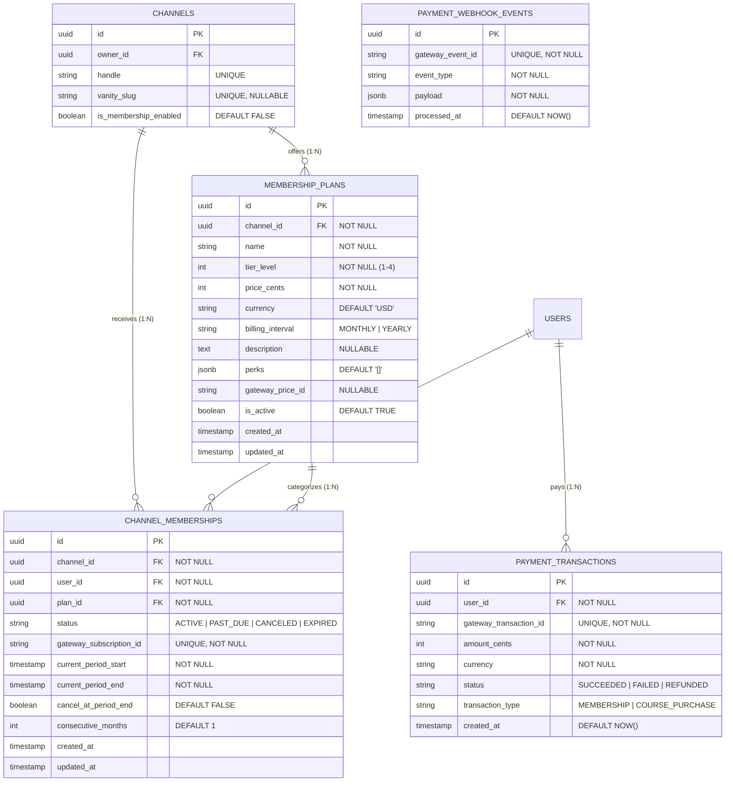
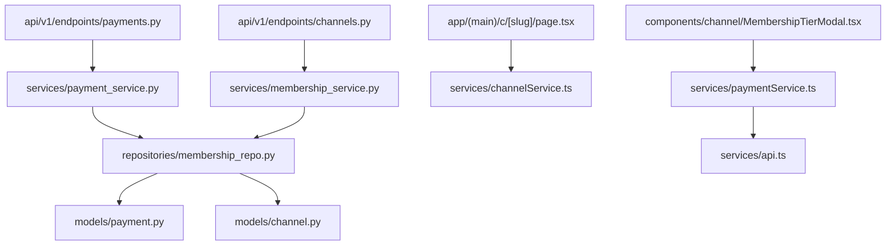

# Feature: Channel Memberships & Paid Perks (Tiers, Vanity URLs)

> **Document Type:** System Architecture & Open-Source Implementation Blueprint  
> **Feature Identifier:** Tier 2 — Creator Monetization & Premium Identity (Feature 08)  
> **Bounded Context:** Creator Monetization, Multi-Tier Subscriptions, Recurring Billing Lifecycle, Webhook Entitlements, Vanity Routing & Member-Only Content Gates  
> **Primary Target:** Open-Source Contributors, System Architects, Fintech & Backend Engineers  
> **Status:** Architecture Design & Implementation Guidance (Read-Only Blueprint)  

---

## 1. Feature Overview

In **RKSkillTube**, content creators require sustainable revenue models beyond one-off course sales. While Feature 02 established base free channels and Feature 04 provided free subscriber counts, the **Channel Memberships & Paid Perks** module introduces recurring patron-supported community tiers, exclusive member perks, and elite branding capabilities:

1. **Creator-Defined Membership Tiers & Pricing:**
   - Creators can configure up to 4 recurring membership tiers (e.g. *Tier 1: Supporter @ $2.99/mo*, *Tier 2: Insider @ $9.99/mo*, *Tier 3: VIP Mentorship @ $29.99/mo*).
   - Each tier defines custom pricing, billing intervals (`MONTHLY`, `YEARLY`), customizable descriptions, and a structured array of perks (e.g., loyalty badges, member-only videos, early access, and private community links).

2. **Recurring Billing Lifecycle & Webhook Entitlements:**
   - Integrates with modern payment gateways (**Stripe Billing / Razorpay Subscriptions**) to orchestrate recurring monthly/annual subscription cycles.
   - Enforces a webhook-driven, idempotent entitlement state machine tracking active periods (`current_period_start`, `current_period_end`), renewal states, grace periods (`PAST_DUE`), and cancellations at period end (`cancel_at_period_end = TRUE`).

3. **Premium Channel Vanity URLs (`/c/{vanity_slug}`):**
   - Verified creators offering paid memberships can unlock and claim a customized **Vanity URL slug** (e.g. `rkskilltube.com/c/fullstackmastery`).
   - Enforces strict collision resistance, namespace blacklisting, and SEO-optimized server-side redirects alongside base handle routes (`/@handle`).

4. **Member-Only Content Gating & Loyalty Badges:**
   - Videos and community posts can be restricted to members with a configurable minimum tier requirement (`is_member_only = TRUE, min_tier_id = ...`).
   - Streaming manifests for member-only videos are gated at the API layer, validating active membership before resolving stream keys.
   - Members receive dynamic loyalty badges in comment sections reflecting their consecutive months of membership.

---

## 2. Project Architecture Context

RKSkillTube utilizes **FastAPI** for asynchronous payment processing and webhook ingestion, **PostgreSQL 16** for ACID financial auditing, and **Next.js 16+** (React 19 App Router) for the client tier:

```
┌────────────────────────────────────────────────────────────────────────┐
│                      CLIENT TIER (Next.js 16+ / TS)                    │
│  • Public Channel Vanity: app/(main)/c/[slug]/page.tsx                 │
│  • Membership Modal:      components/channel/MembershipTierModal.tsx   │
│  • Studio Monetization:   app/(creator)/studio/memberships/page.tsx    │
│  • Member Badge UI:       components/comment/MemberBadge.tsx           │
│  • Services & Stores:     paymentService.ts, channelService.ts         │
└───────────────────┬────────────────────────────────┬───────────────────┘
                    │ 1. Checkout Session Request    │ Direct Gateway
                    ▼                                ▼
┌──────────────────────────────────────┐  ┌──────────────────────────────┐
│  API GATEWAY / BACKEND (FastAPI)     │  │  PAYMENT GATEWAY (Stripe)    │
│  • endpoints/channels.py (Plans/URL) │  │  • Hosted Checkout / Portal  │
│  • endpoints/payments.py (Webhooks)  │  │  • Recurring Card Processing │
│  • services/membership_service.py    │  │  • Dunning & Invoicing       │
│  • services/payment_service.py       │  └──────────────┬───────────────┘
└───────────────────┬──────────────────┘                 │
                    │ 2. Idempotent Webhook Events       │
                    ◄────────────────────────────────────┘
                    │
                    ▼
       ┌─────────────────────────┐     ┌────────────────────────┐
       │    PostgreSQL 16 DB     │     │     Redis 7 Cluster    │
       │   • membership_plans    │     │   • Entitlement cache  │
       │   • channel_memberships │     │   • Vanity slug cache  │
       │   • payment_events      │     │   • Webhook deduplic.  │
       │   • payment_transactions│     │   • Idempotency locks  │
       └─────────────────────────┘     └────────────────────────┘
```

### Architectural Principles Enforced:
- **Zero Client-Side Trust for Entitlements:** Membership access is NEVER granted based on frontend redirect URLs (e.g. `?payment=success`). Access is strictly activated via cryptographically verified server-side webhooks from the payment gateway.
- **Strict Idempotency:** Webhook listeners must handle at-least-once delivery guarantees without creating duplicate transactions or extending billing periods multiple times.
- **Graceful Dunning Lifecycle:** Subscriptions entering `PAST_DUE` state preserve a 3-day grace period for card updates before revoking member perks.

---

## 3. Existing System Analysis

An inspection of the repository reveals the scaffolded foundation ready for monetization:

### Backend Scaffolding (`backend/`):
- **Endpoints & Routing:**
  - [backend/app/api/v1/endpoints/channels.py](file:///e:/Projects/Open%20Source%20Contributions/RKSkillTube/backend/app/api/v1/endpoints/channels.py): Scaffolded channel endpoint placeholder. Ready to host membership plan definitions and vanity URL endpoints.
  - [backend/app/api/v1/endpoints/payments.py](file:///e:/Projects/Open%20Source%20Contributions/RKSkillTube/backend/app/api/v1/endpoints/payments.py): Scaffolded payment endpoint placeholder. Ready for checkout creation and webhook handlers.
  - [backend/app/api/v1/router.py](file:///e:/Projects/Open%20Source%20Contributions/RKSkillTube/backend/app/api/v1/router.py): Master router registering `/channels` and `/payments`.
- **Models & Repositories:**
  - [backend/app/models/channel.py](file:///e:/Projects/Open%20Source%20Contributions/RKSkillTube/backend/app/models/channel.py): Scaffolded channel model. Needs `vanity_slug` and `is_membership_enabled` flags.
  - [backend/app/models/payment.py](file:///e:/Projects/Open%20Source%20Contributions/RKSkillTube/backend/app/models/payment.py): Scaffolded payment model. Intended for `MembershipPlan`, `ChannelMembership`, `PaymentTransaction`, and `PaymentWebhookEvent`.
  - [backend/app/repositories/payment_repository.py](file:///e:/Projects/Open%20Source%20Contributions/RKSkillTube/backend/app/repositories/payment_repository.py): Scaffolded repository placeholder.
  - `backend/app/repositories/membership_repository.py`: **Does not exist yet.** Must be created.
- **Services & Schemas:**
  - [backend/app/services/payment_service.py](file:///e:/Projects/Open%20Source%20Contributions/RKSkillTube/backend/app/services/payment_service.py): Scaffolded payment service placeholder.
  - `backend/app/services/membership_service.py`: **Does not exist yet.** Must be created.
  - [backend/app/schemas/payment.py](file:///e:/Projects/Open%20Source%20Contributions/RKSkillTube/backend/app/schemas/payment.py): Pydantic schemas placeholder.
  - `backend/app/schemas/membership.py`: **Does not exist yet.** Must be created.

### Frontend Scaffolding (`frontend/`):
- **Studio & Channel Services:**
  - [frontend/src/services/channelService.ts](file:///e:/Projects/Open%20Source%20Contributions/RKSkillTube/frontend/src/services/channelService.ts): Channel API client placeholder.
  - [frontend/src/services/paymentService.ts](file:///e:/Projects/Open%20Source%20Contributions/RKSkillTube/frontend/src/services/paymentService.ts): Payment API client placeholder.
  - `frontend/src/types/membership.ts`: **Does not exist yet.** Must be created.
- **Pages & Components:**
  - `frontend/src/app/(creator)/studio/memberships/page.tsx`: **Does not exist yet.** Must be proposed for creator monetization dashboard.
  - `frontend/src/app/(main)/c/[slug]/page.tsx`: **Does not exist yet.** Must be proposed for vanity channel routing.
  - `frontend/src/components/channel/MembershipTierModal.tsx`: **Does not exist yet.** Must be proposed for patron tier selection.
  - `frontend/src/components/comment/MemberBadge.tsx`: **Does not exist yet.** Must be proposed for loyalty badge rendering.

---

## 4. Functional Requirements

### A. Membership Plans & Tier Configuration (Creator Studio)
1. **Tier Creation (`POST /api/v1/channels/{id}/membership-plans`):**
   - Verified creators can define up to 4 sequential tiers.
   - Each plan includes: `name` (e.g. "Bronze Supporter"), `price_cents` (minimum $1.99 / 199 cents), `currency` (`USD`, `EUR`, `INR`), `interval` (`MONTHLY`, `YEARLY`), `description`, and a list of `perks` (strings).
   - Automatically synchronizes or provisions corresponding Price/Product IDs on the connected Stripe/Razorpay account.
2. **Plan Editing & Archival:**
   - Creators can update tier descriptions and perk lists.
   - Price modifications create a new plan version while grandfathering existing active members at their original price tier.
   - Deactivating a plan hides it from new patrons without terminating existing recurring subscriptions.

### B. Patron Checkout & Subscription Lifecycle
1. **Checkout Session Creation (`POST /api/v1/channels/{id}/membership-plans/{plan_id}/checkout`):**
   - Authenticated user initiates checkout for a specific tier.
   - Generates a Stripe Checkout Session with `mode = 'subscription'` and metadata containing `user_id`, `channel_id`, and `plan_id`.
   - Returns the hosted checkout redirect URL.
2. **Webhook Entitlement Processing (`POST /api/v1/payments/webhook`):**
   - Ingests asynchronous gateway webhook events:
     - `checkout.session.completed`: Provisions initial `ChannelMembership` with `status = 'ACTIVE'` and sets `current_period_end`.
     - `invoice.payment_succeeded`: Renews active period and resets failure counts.
     - `invoice.payment_failed`: Transitions membership to `PAST_DUE` and sends dunning notification.
     - `customer.subscription.deleted`: Sets `status = 'EXPIRED'`.
3. **Cancellation & Self-Service Portal (`POST /api/v1/channels/{id}/membership/cancel`):**
   - Patrons can cancel their membership anytime.
   - Cancellation defaults to `cancel_at_period_end = TRUE` (patron retains access until their paid month completes).

### C. Vanity URL Routing (`/c/{vanity_slug}`)
1. **Vanity Slug Reservation (`PUT /api/v1/channels/{id}/vanity-slug`):**
   - Eligible channels (verified or active membership program) can claim a vanity slug (3–30 alphanumeric characters, hyphens allowed).
   - Validates against platform reserved namespaces (`api`, `admin`, `studio`, `feed`, `watch`, `settings`, `explore`).
2. **Dynamic Routing Resolution (`GET /api/v1/channels/by-vanity/{vanity_slug}`):**
   - Resolves the channel profile by its vanity slug.
   - Next.js dynamic route `/c/[slug]` renders the channel homepage with OpenGraph metadata.

### D. Member-Only Content Gating & Loyalty Badges
1. **Member-Only Video Gate:**
   - When creating or editing videos, creators can check `is_member_only = TRUE` and select `min_tier_id`.
   - Playback resolution (`GET /videos/{id}/playback`) asserts the calling user has an `ACTIVE` membership with `plan.tier_level >= video.min_tier_level`.
2. **Loyalty Badges:**
   - Active members display a customized tier badge next to their username in comment sections.
   - Calculates consecutive membership duration (e.g., *1 Month*, *3 Months*, *6 Months*, *1 Year*).

---

## 5. Non-Functional Requirements

- **Financial Integrity & Double-Spend Prevention:** Every webhook event is uniquely logged in a `payment_webhook_events` table with database unique constraints to guarantee strict idempotency.
- **Entitlement Lookup Latency (< 10ms):** Validating whether a user is an active member during video playback must be instantaneous. Active membership states are cached in Redis (`member:{user_id}:{channel_id}`).
- **Zero-Downtime Price Migration:** Creators altering tier pricing must not cause database migration locks or abrupt cancellations for existing recurring subscribers.
- **Vanity URL Caching:** Vanity slug lookups are cached in Redis (`vanity:{slug} -> {channel_id}`) with automatic cache invalidation upon slug mutation.

---

## 6. Assumptions and Open Questions

### Assumptions:
- Stripe Connect / Billing is configured with valid API keys in `backend/app/config.py` (`STRIPE_SECRET_KEY`, `STRIPE_WEBHOOK_SECRET`).
- Tier hierarchy is linear: Tier 3 includes all perks of Tier 2 and Tier 1.
- Creators receive payouts via Stripe Connect standard accounts, while the platform retains an application fee (e.g., $10\%$).

### Open Questions for Contributors & Maintainers:
1. *Proration on Tier Upgrades:* If a patron upgrades from Tier 1 ($2.99) to Tier 2 ($9.99) mid-cycle, should the gateway prorate the difference immediately or schedule the upgrade at next billing date? *(Recommendation: Use Stripe's default `proration_behavior = 'always_invoice'` for immediate access).*
2. *Vanity Slug Reassignment:* If a creator renames or loses their vanity slug, should the previous slug enter a 60-day quarantine period to prevent brand impersonation? *(Recommendation: Yes, enforce a 60-day reservation quarantine).*

---

## 7. Low-Level Design (LLD)

### 7.1 Component Design

```
┌────────────────────────────────────────────────────────────────────────┐
│                        FastAPI PRESENTATION LAYER                      │
│   • endpoints/channels.py                                              │
│       - POST   /api/v1/channels/{id}/membership-plans  (Create Tier)   │
│       - GET    /api/v1/channels/{id}/membership-plans  (List Tiers)    │
│       - PUT    /api/v1/channels/{id}/membership-plans/{pid} (Update)   │
│       - PUT    /api/v1/channels/{id}/vanity-slug       (Claim Slug)    │
│       - GET    /api/v1/channels/by-vanity/{slug}       (Resolve Slug)  │
│   • endpoints/payments.py                                              │
│       - POST   /api/v1/channels/{id}/membership-plans/{pid}/checkout   │
│       - POST   /api/v1/payments/webhook                (Stripe Ingest) │
│       - GET    /api/v1/channels/{id}/membership-status                 │
│       - POST   /api/v1/channels/{id}/membership/cancel                 │
└───────────────────────────────────┬────────────────────────────────────┘
                                    │ Injects Dependencies
                                    ▼
┌────────────────────────────────────────────────────────────────────────┐
│                      DEPENDENCY INJECTION & GUARDS                     │
│   • api/deps.py                                                        │
│       - get_current_active_user(): Authenticates caller via JWT        │
│       - require_channel_owner(): Asserts user owns channel or ADMIN    │
│       - require_active_membership(): Asserts user has valid tier       │
└───────────────────────────────────┬────────────────────────────────────┘
                                    │ Invokes Services
                                    ▼
┌────────────────────────────────────────────────────────────────────────┐
│                        SERVICES LAYER (Business Logic)                 │
│   • services/membership_service.py                                     │
│       - create_membership_plan(channel_id, user_id, plan_data)         │
│       - reserve_vanity_slug(channel_id, user_id, slug)                 │
│       - verify_member_entitlement(user_id, channel_id, min_tier)       │
│   • services/payment_service.py                                        │
│       - create_membership_checkout_session(user_id, plan_id)           │
│       - handle_stripe_webhook_event(raw_payload, sig_header)           │
│       - process_subscription_renewal(event_data)                       │
│       - cancel_membership_subscription(user_id, channel_id)           │
└───────────────────┬───────────────────────────────┬────────────────────┘
                    │ Database Operations           │ Cache & Webhooks
                    ▼                               ▼
┌──────────────────────────────────────┐  ┌──────────────────────────────┐
│  REPOSITORIES (Data Access)          │  │  REDIS CACHE & LOCKS         │
│  • repositories/membership_repo.py   │  │  • member:{u}:{c}            │
│  • repositories/payment_repository.py│  │  • vanity:{slug}             │
└───────────────────┬──────────────────┘  │  • lock:webhook:{event_id}   │
                    │                     └──────────────────────────────┘
                    ▼
┌──────────────────────────────────────┐
│  PERSISTENCE LAYER (PostgreSQL 16)   │
│  • tables: membership_plans,         │
│            channel_memberships,      │
│            payment_webhook_events,   │
│            payment_transactions      │
└──────────────────────────────────────┘
```

### 7.2 Subscription Lifecycle State Machine



### 7.3 Webhook Ingestion & Entitlement Sequence Diagram



---

## 8. High-Level Design (HLD)

### 8.1 System Context

```
                     ┌────────────────────────┐
                     │    Creator / Patron    │
                     └───────────┬────────────┘
                                 │
         ┌───────────────────────┼───────────────────────┐
         │ 1. Plan CRUD / Vanity │ 2. Subscribe Checkout │ 4. Stream Member Video
         ▼                       ▼                       ▼
┌─────────────────┐     ┌─────────────────┐     ┌─────────────────┐
│ FastAPI Gateway │     │ Stripe Hosted   │     │ Cloudflare CDN  │
│ (Metadata/Auth) │     │ Checkout Page   │     │ (Member Gate)   │
└────────┬────────┘     └────────┬────────┘     └────────▲────────┘
         │                       │                       │
         │ Webhook Handshake     │ Card Success Webhook  │ Validate Token
         ▼                       ▼                       │
┌─────────────────┐     ┌─────────────────┐              │
│ Redis Cache     │◄────│ Payment Engine  │──────────────┘
│ (Entitlements)  │     │ (Service Layer) │
└─────────────────┘     └────────┬────────┘
                                 │ ACID State
                                 ▼
                        ┌─────────────────┐
                        │  PostgreSQL 16  │
                        │ (Financial DB)  │
                        └─────────────────┘
```

### 8.2 Architectural Decisions

1. **Webhook-Driven State Authority:**
   - The platform never trusts client-side redirect parameters (`success=true`).
   - All subscription activations, renewals, and cancellations are strictly governed by authenticated gateway webhooks, ensuring zero vulnerability to fraudulent parameter tampering.

2. **Idempotent Webhook Processing with Row Locks:**
   - Stripe sends webhooks with at-least-once delivery semantics.
   - The backend logs every `event_id` in `payment_webhook_events` with an immediate commit. If an event is re-delivered, it returns `200 OK` immediately without re-executing database mutations.

3. **Two-Tier Namespace Routing (`/@handle` vs `/c/{vanity_slug}`):**
   - Base free channels retain `@handle` routing (e.g. `rkskilltube.com/@coder`).
   - Verified channels offering memberships unlock custom vanity slugs (e.g. `rkskilltube.com/c/mastery`). Both route to the same core presentation components while allowing elite branding.

---

## 9. Architecture Diagrams

### 9.1 Entity-Relationship Diagram (ERD)



---

## 10. Database Design

### 10.1 `membership_plans` Table

| Column | Type | Constraints | Description |
| :--- | :--- | :--- | :--- |
| `id` | `UUID` | Primary Key, `default=gen_random_uuid()` | Immutable plan identifier. |
| `channel_id` | `UUID` | Foreign Key (`channels.id` ON DELETE CASCADE), **NOT NULL, Indexed** | Owning channel reference. |
| `name` | `VARCHAR(100)` | **NOT NULL** | Display tier title (e.g. "Bronze Supporter"). |
| `tier_level` | `INTEGER` | **NOT NULL** (`CHECK (tier_level BETWEEN 1 AND 4)`) | Relative ranking order (1 = lowest, 4 = highest). |
| `price_cents`| `INTEGER` | **NOT NULL** (`CHECK (price_cents >= 199)`) | Recurring charge in minor currency units (cents). |
| `currency` | `VARCHAR(3)` | **NOT NULL, Default 'USD'** | ISO-4217 currency code. |
| `billing_interval`| `VARCHAR(10)`| **NOT NULL, Default 'MONTHLY'** | Cadence: `'MONTHLY'`, `'YEARLY'`. |
| `description`| `TEXT` | Nullable | Detailed description of member benefits. |
| `perks` | `JSONB` | **NOT NULL, Default '[]'::jsonb** | Array of perk strings (e.g. `["Early Access", "Badges"]`). |
| `gateway_price_id`| `VARCHAR(100)`| Nullable | Stripe Price ID (`price_...`). |
| `is_active` | `BOOLEAN` | **NOT NULL, Default TRUE** | Active for new enrollments. |
| `created_at` | `TIMESTAMPTZ` | **NOT NULL, Default NOW()** | Creation timestamp. |
| `updated_at` | `TIMESTAMPTZ` | **NOT NULL, Auto-update NOW()** | Last update timestamp. |

#### Database Constraints:
- `CREATE UNIQUE INDEX uq_channel_tier_level ON membership_plans (channel_id, tier_level) WHERE is_active = TRUE;`  
  *(Guarantees a creator cannot define two active tiers with the identical rank level).*

---

### 10.2 `channel_memberships` Table

| Column | Type | Constraints | Description |
| :--- | :--- | :--- | :--- |
| `id` | `UUID` | Primary Key, `default=gen_random_uuid()` | Membership record identifier. |
| `channel_id` | `UUID` | Foreign Key (`channels.id` ON DELETE CASCADE), **NOT NULL, Indexed** | Target channel. |
| `user_id` | `UUID` | Foreign Key (`users.id` ON DELETE CASCADE), **NOT NULL, Indexed** | Patron user account. |
| `plan_id` | `UUID` | Foreign Key (`membership_plans.id` ON DELETE RESTRICT), **NOT NULL, Indexed** | Active subscribed plan. |
| `status` | `VARCHAR(20)` | **NOT NULL, Default 'ACTIVE'** | State: `'ACTIVE'`, `'PAST_DUE'`, `'CANCELED'`, `'EXPIRED'`. |
| `gateway_subscription_id`| `VARCHAR(100)`| **NOT NULL, UNIQUE, Indexed** | Stripe Subscription ID (`sub_...`). |
| `current_period_start`| `TIMESTAMPTZ`| **NOT NULL** | Start of current billing cycle. |
| `current_period_end`| `TIMESTAMPTZ`| **NOT NULL, Indexed** | Expiration timestamp of current cycle. |
| `cancel_at_period_end`| `BOOLEAN`| **NOT NULL, Default FALSE** | True if scheduled for cancellation at period end. |
| `consecutive_months`| `INTEGER`| **NOT NULL, Default 1** | Lifetime consecutive months subscribed. |
| `created_at` | `TIMESTAMPTZ` | **NOT NULL, Default NOW()** | First subscription timestamp. |
| `updated_at` | `TIMESTAMPTZ` | **NOT NULL, Auto-update NOW()** | Last renewal/mutation timestamp. |

#### Database Constraints:
- `CREATE UNIQUE INDEX uq_user_channel_membership ON channel_memberships (user_id, channel_id);`  
  *(Ensures a patron holds at most one active membership per channel).*

---

### 10.3 `payment_webhook_events` Table (Idempotency Audit)

| Column | Type | Constraints | Description |
| :--- | :--- | :--- | :--- |
| `id` | `UUID` | Primary Key, `default=gen_random_uuid()` | Internal event log UUID. |
| `gateway_event_id`| `VARCHAR(100)`| **NOT NULL, UNIQUE, Indexed** | Stripe Event ID (`evt_...`). |
| `event_type` | `VARCHAR(100)`| **NOT NULL** | Event name (e.g. `invoice.payment_succeeded`). |
| `payload` | `JSONB` | **NOT NULL** | Raw JSON payload from gateway. |
| `processed_at`| `TIMESTAMPTZ`| **NOT NULL, Default NOW()** | Timestamp of processing. |

---

## 11. API Design

### 11.1 Creator Studio Plan Management Endpoints

#### `POST /api/v1/channels/{id}/membership-plans`
- **Purpose:** Define a new patron membership tier.
- **Auth:** Bearer Token (Channel owner only).
- **Request Body:**
  ```json
  {
    "name": "Gold Mentorship",
    "tier_level": 3,
    "price_cents": 2999,
    "currency": "USD",
    "billing_interval": "MONTHLY",
    "description": "Exclusive live Q&A sessions and member-only code reviews.",
    "perks": [
      "Access to private Discord channel",
      "Member-only video streams",
      "Exclusive Gold loyalty badge"
    ]
  }
  ```
- **Response (201 Created):** Created `MembershipPlan` object.
- **Errors:** `400 Bad Request` (duplicate tier level), `403 Forbidden` (non-owner).

---

#### `GET /api/v1/channels/{id}/membership-plans`
- **Purpose:** List all active membership plans for a channel.
- **Auth:** Optional.
- **Response (200 OK):**
  ```json
  [
    {
      "id": "p-101",
      "name": "Bronze Supporter",
      "tier_level": 1,
      "price_cents": 299,
      "currency": "USD",
      "billing_interval": "MONTHLY",
      "perks": ["Member loyalty badge", "Early video access"]
    },
    {
      "id": "p-102",
      "name": "Gold Mentorship",
      "tier_level": 3,
      "price_cents": 2999,
      "currency": "USD",
      "billing_interval": "MONTHLY",
      "perks": ["All Tier 1 perks", "Member-only streams", "Private Discord"]
    }
  ]
  ```

---

### 11.2 Checkout & Subscription Lifecycle Endpoints

#### `POST /api/v1/channels/{id}/membership-plans/{plan_id}/checkout`
- **Purpose:** Initiate hosted checkout session for a membership plan.
- **Auth:** Bearer Token.
- **Behavior:**
  - Creates a Stripe Checkout session in `subscription` mode.
  - Attaches metadata: `{"user_id": caller.id, "channel_id": channel.id, "plan_id": plan.id}`.
- **Response (200 OK):**
  ```json
  {
    "checkout_url": "https://checkout.stripe.com/c/pay/cs_live_a1b2c3d4..."
  }
  ```

---

#### `POST /api/v1/payments/webhook`
- **Purpose:** Ingest asynchronous gateway events with cryptographic signature verification.
- **Auth:** Stripe Signature Header (`Stripe-Signature`).
- **Behavior:**
  - Verifies signature using `STRIPE_WEBHOOK_SECRET`.
  - Checks `gateway_event_id` in `payment_webhook_events`. Returns 200 immediately if duplicate.
  - Routes event to `handle_invoice_succeeded`, `handle_subscription_deleted`, etc.
- **Response (200 OK):** `{ "received": true }`.

---

#### `POST /api/v1/channels/{id}/membership/cancel`
- **Purpose:** Schedule membership cancellation at the end of the current billing cycle.
- **Auth:** Bearer Token (Active member only).
- **Behavior:** Calls Stripe API `stripe.Subscription.modify(sub_id, cancel_at_period_end=True)`.
- **Response (200 OK):** `{ "message": "Membership will expire at end of billing cycle", "expires_at": "2026-12-03T17:00:00Z" }`.

---

### 11.3 Vanity URL Endpoints

#### `PUT /api/v1/channels/{id}/vanity-slug`
- **Purpose:** Claim or update a custom vanity URL slug.
- **Auth:** Bearer Token (Channel owner only; requires verified status or active membership program).
- **Request Body:**
  ```json
  {
    "vanity_slug": "backend-mastery"
  }
  ```
- **Validation Rules:**
  - 3–30 characters, alphanumeric with hyphens (`^[a-zA-Z0-9-]{3,30}$`).
  - Cannot match reserved platform words (`api`, `admin`, `feed`, `watch`, `settings`, `explore`, `courses`).
- **Response (200 OK):** Updated channel record with `vanity_slug`.
- **Errors:** `409 Conflict` (vanity slug already claimed).

---

#### `GET /api/v1/channels/by-vanity/{vanity_slug}`
- **Purpose:** Resolve channel profile via vanity slug for Next.js route `/c/[slug]`.
- **Auth:** Optional.
- **Response (200 OK):** Full channel details with membership tiers and verified badges.

---

## 12. Security Analysis

### 12.0 Cryptographic Reference & Security Warnings
> [!CAUTION]
> **Cryptographic Webhook Signature & Constant-Time Validation:**
> - **Constant-Time Verification:** Webhook signatures (`Stripe-Signature`) must be verified using constant-time HMAC comparison (`hmac.compare_digest`) via official SDKs (`stripe.Webhook.construct_event`). Never compare signature strings with standard equality operators (`==`), which are vulnerable to timing attacks.
> - **Webhook Secret Isolation:** The `STRIPE_WEBHOOK_SECRET` must be kept strictly confidential in environment variables and never logged or exposed in client bundles.
> - **Vanity Slug Namespace Shield:** Malicious users claiming reserved system paths (`/c/admin`, `/c/login`, `/c/api`) could perform credential harvesting or shadow core application endpoints. A comprehensive reserved word dictionary must be strictly enforced.

### 12.1 Security Levels: Insecure to Production-Grade

| Level | Architecture Approach | Vulnerabilities & Pitfalls | Production Remediation |
| :--- | :--- | :--- | :--- |
| **Level 1 (Insecure)** | **Client-Triggered Subscription Activation** | • **Zero Payment Fraud:** Clients call `POST /memberships/activate` after client-side payment redirect without server-side verification.<br>• **BOLA / IDOR:** Attackers activate tiers for arbitrary user IDs. | Eliminate client-driven activation; grant entitlements exclusively via server-to-server webhook ingestion. |
| **Level 2 (Improved)** | **Webhooks Without Idempotency Tracking** | • **Duplicate Period Shifts:** Network retries cause billing periods to be extended multiple times.<br>• **Out-of-Order Execution:** An older cancellation event arriving after a renewal event cancels an active subscription. | Enforce database-level unique constraints on `gateway_event_id` and evaluate event timestamps. |
| **Level 3 (Production Ready)** | **Cryptographic SigV4 Webhooks + Redis Entitlement Cache + ACID Locks** | • Strict constant-time HMAC signature checks.<br>• Row-locking during membership updates.<br>• Sub-10ms Redis cached entitlement lookups for video player access gates. | Standard baseline for RKSkillTube production release. |
| **Level 4 (Advanced)** | **Stripe Connect Custom Accounts + Dynamic Dunning Hooks + Grace Caching** | • Automated multi-currency payout splits via Stripe Connect.<br>• Automated dunning notifications during card failure grace periods. | Enterprise-grade creator monetization infrastructure. |

### 12.2 Critical Attack Vectors & Mitigations

1. **Replay & Out-of-Order Webhook Attacks:**
   - *Risk:* An attacker captures an old webhook payload and replays it, or network delay causes a `subscription.deleted` event to arrive after an `invoice.paid` event.
   - *Mitigation:* Verify Stripe timestamps (rejecting events older than 5 minutes) and record every processed event ID in `payment_webhook_events`. Evaluate `created` timestamps on Stripe events to ensure older events do not overwrite newer state.

2. **Member-Only Video Paywall Bypass:**
   - *Risk:* Non-member directly requests the HLS master manifest for a member-only video.
   - *Mitigation:* The `GET /videos/{id}/playback` endpoint checks if `video.is_member_only == TRUE`. If so, it invokes `membership_service.verify_member_entitlement(user_id, video.channel_id, video.min_tier_level)`. If missing or expired, it immediately raises `HTTP 403 Forbidden`.

3. **Vanity Slug Impersonation / Squatting:**
   - *Risk:* Malicious creator claims `rkskilltube.com/c/stripe` or `rkskilltube.com/c/google` to mislead students.
   - *Mitigation:* Enforce a blacklist of tech brands and system routes. Require channels to be verified or reach a threshold of active members before unlocking vanity slug customization.

---

## 13. Existing Files Analysis

### A. Directly Reusable Files
- [backend/app/api/deps.py](file:///e:/Projects/Open%20Source%20Contributions/RKSkillTube/backend/app/api/deps.py): Reuses `get_current_active_user` and `get_optional_current_user`.
- [backend/app/config.py](file:///e:/Projects/Open%20Source%20Contributions/RKSkillTube/backend/app/config.py): Configuration settings placeholder; hosts `STRIPE_SECRET_KEY`, `STRIPE_WEBHOOK_SECRET`.
- [backend/app/models/base.py](file:///e:/Projects/Open%20Source%20Contributions/RKSkillTube/backend/app/models/base.py): Base declarative SQLAlchemy model.
- [frontend/src/services/api.ts](file:///e:/Projects/Open%20Source%20Contributions/RKSkillTube/frontend/src/services/api.ts): Base Axios client.

### B. Files That Need Implementation / Modification
- [backend/app/models/channel.py](file:///e:/Projects/Open%20Source%20Contributions/RKSkillTube/backend/app/models/channel.py): Add `vanity_slug` (unique, nullable), `is_membership_enabled`, and `membership_plans` relationship.
- [backend/app/models/payment.py](file:///e:/Projects/Open%20Source%20Contributions/RKSkillTube/backend/app/models/payment.py): Implement `MembershipPlan`, `ChannelMembership`, `PaymentWebhookEvent`, and `PaymentTransaction`.
- [backend/app/models/video.py](file:///e:/Projects/Open%20Source%20Contributions/RKSkillTube/backend/app/models/video.py): Add `is_member_only` (boolean) and `min_tier_level` (integer nullable).
- [backend/app/api/v1/endpoints/channels.py](file:///e:/Projects/Open%20Source%20Contributions/RKSkillTube/backend/app/api/v1/endpoints/channels.py): Implement plan CRUD and vanity slug endpoints.
- [backend/app/api/v1/endpoints/payments.py](file:///e:/Projects/Open%20Source%20Contributions/RKSkillTube/backend/app/api/v1/endpoints/payments.py): Implement membership checkout sessions and Stripe webhook listener.
- [backend/app/api/v1/router.py](file:///e:/Projects/Open%20Source%20Contributions/RKSkillTube/backend/app/api/v1/router.py): Mount channels and payments routers.
- [backend/app/services/payment_service.py](file:///e:/Projects/Open%20Source%20Contributions/RKSkillTube/backend/app/services/payment_service.py): Implement webhook signature verification and Stripe session generation.
- [frontend/src/services/channelService.ts](file:///e:/Projects/Open%20Source%20Contributions/RKSkillTube/frontend/src/services/channelService.ts): Implement vanity slug and plan query methods.
- [frontend/src/services/paymentService.ts](file:///e:/Projects/Open%20Source%20Contributions/RKSkillTube/frontend/src/services/paymentService.ts): Implement checkout redirect and cancellation methods.

### C. Proposed New Files Required
- `backend/app/services/membership_service.py`: Business logic for tier management, entitlement evaluation, and vanity slug validation.
- `backend/app/repositories/membership_repository.py`: Database operations for plans, active memberships, and status updates.
- `backend/app/schemas/membership.py`: Pydantic request/response schemas (`MembershipPlanCreate`, `MembershipPlanResponse`, `VanitySlugRequest`, `MembershipStatusResponse`).
- `frontend/src/types/membership.ts`: TypeScript interfaces for membership tiers, plans, and subscriber statuses.
- `frontend/src/app/(main)/c/[slug]/page.tsx`: Dynamic vanity URL channel landing page.
- `frontend/src/app/(creator)/studio/memberships/page.tsx`: Creator studio tier management and revenue analytics.
- `frontend/src/components/channel/MembershipTierModal.tsx`: Patron tier selection and checkout trigger modal.
- `frontend/src/components/comment/MemberBadge.tsx`: Visual loyalty badge for active patrons in comment threads.

### D. Files That Should NOT Be Modified
- `backend/app/models/user.py`: Keep core user authentication clean; memberships reference `user_id` as foreign key.
- `backend/app/core/security.py`: JWT token signing is decoupled from payment billing.

### E. Architectural Dependency Map



---

## 14. Implementation Roadmap (Milestones)

### Milestone 1: Database Models & Alembic Migration
- **Goal:** Model `membership_plans`, `channel_memberships`, and `payment_webhook_events`.
- **Inspect:** [backend/app/models/channel.py](file:///e:/Projects/Open%20Source%20Contributions/RKSkillTube/backend/app/models/channel.py), [backend/app/models/payment.py](file:///e:/Projects/Open%20Source%20Contributions/RKSkillTube/backend/app/models/payment.py).
- **Implement In:** [backend/app/models/payment.py](file:///e:/Projects/Open%20Source%20Contributions/RKSkillTube/backend/app/models/payment.py), [backend/app/models/channel.py](file:///e:/Projects/Open%20Source%20Contributions/RKSkillTube/backend/app/models/channel.py).
- **Architectural Hint:** Add unique composite index `(channel_id, tier_level)` on `membership_plans` and unique index on `gateway_event_id` in `payment_webhook_events`.

### Milestone 2: Pydantic Validation & DTO Contracts
- **Goal:** Define strict validation schemas for tier creation, vanity slugs, and checkout responses.
- **Implement In:** `backend/app/schemas/membership.py`, [backend/app/schemas/payment.py](file:///e:/Projects/Open%20Source%20Contributions/RKSkillTube/backend/app/schemas/payment.py).
- **Architectural Hint:** Enforce `price_cents >= 199` and regex validation `^[a-zA-Z0-9-]{3,30}$` on `vanity_slug`.

### Milestone 3: Membership Plan CRUD & Vanity Slug Service
- **Goal:** Build tier management and vanity slug reservation logic.
- **Implement In:** `backend/app/services/membership_service.py`, `backend/app/repositories/membership_repository.py`.
- **Architectural Hint:** Validate vanity slugs against a static `RESERVED_SLUGS` dictionary (`admin`, `api`, `studio`, `feed`, etc.) before updating the database.

### Milestone 4: Payment Gateway Checkout & Webhook Pipeline
- **Goal:** Implement Stripe checkout session creation and cryptographically verified webhook listener.
- **Implement In:** [backend/app/services/payment_service.py](file:///e:/Projects/Open%20Source%20Contributions/RKSkillTube/backend/app/services/payment_service.py), [backend/app/api/v1/endpoints/payments.py](file:///e:/Projects/Open%20Source%20Contributions/RKSkillTube/backend/app/api/v1/endpoints/payments.py).
- **Architectural Hint:** Read raw request body as bytes (`await request.body()`) to compute the HMAC signature; never parse JSON before validating the signature.

### Milestone 5: Content Paywall Gating & Entitlement Caching
- **Goal:** Protect member-only videos and cache active statuses in Redis.
- **Implement In:** [backend/app/api/v1/endpoints/videos.py](file:///e:/Projects/Open%20Source%20Contributions/RKSkillTube/backend/app/api/v1/endpoints/videos.py), `backend/app/services/membership_service.py`.
- **Architectural Hint:** In `GET /videos/{id}/playback`, check Redis key `member:{user_id}:{channel_id}`; if missing, query database and populate Redis with a 24-hour TTL.

### Milestone 6: Frontend API Services & Types
- **Goal:** Establish TypeScript interfaces and client API methods.
- **Implement In:** `frontend/src/types/membership.ts`, [frontend/src/services/paymentService.ts](file:///e:/Projects/Open%20Source%20Contributions/RKSkillTube/frontend/src/services/paymentService.ts), [frontend/src/services/channelService.ts](file:///e:/Projects/Open%20Source%20Contributions/RKSkillTube/frontend/src/services/channelService.ts).
- **Architectural Hint:** Create a method `redirectToCheckout(checkoutUrl: string)` to navigate the patron to Stripe.

### Milestone 7: Creator Studio Tier Builder & Patron UI
- **Goal:** Build the studio membership management dashboard, patron modal, and vanity URL route.
- **Implement In:** `frontend/src/app/(creator)/studio/memberships/page.tsx`, `frontend/src/app/(main)/c/[slug]/page.tsx`, `frontend/src/components/channel/MembershipTierModal.tsx`, `frontend/src/components/comment/MemberBadge.tsx`.
- **Architectural Hint:** In `/c/[slug]/page.tsx`, implement Next.js `generateMetadata` to dynamically inject OpenGraph title and banner tags for social sharing.

---

## 15. Hints and Socratic Engineering Questions

1. *Why should payment webhooks read the raw byte string from `request.body()` rather than parsed JSON? How does JSON deserialization alter whitespace and break HMAC signature verification?*
2. *If Stripe sends the same `invoice.payment_succeeded` webhook three times due to network retries, how does checking `payment_webhook_events.gateway_event_id` prevent duplicate billing period extensions?*
3. *Why should vanity URLs (`/c/{slug}`) enforce a reserved word blacklist, and what security vulnerabilities arise if a creator is allowed to register `/c/login` or `/c/api`?*
4. *How does caching active membership status in Redis (`member:{user_id}:{channel_id}`) prevent database lock contention during viral live streams or high-traffic member video releases?*
5. *Why should patrons who cancel their membership retain access until `current_period_end` rather than having their entitlements revoked immediately?*

---

## 16. Testing Strategy

### A. Unit Tests (`backend/tests/unit/test_membership_service.py`)
- **Vanity Slug Blacklist:** Attempting to claim reserved slug `admin` or `studio` raises `BadRequestException`.
- **Tier Level Range:** Creating a tier with `tier_level: 5` or `price_cents: 50` fails schema validation.
- **Entitlement Logic:** A user with Tier 2 membership successfully accesses a Tier 1 or Tier 2 video, but is rejected for a Tier 3 video.

### B. Integration Tests (`backend/tests/integration/test_payments_api.py`)
- **Checkout Initiation:**
  - `POST /channels/{id}/membership-plans/{plan_id}/checkout` returns valid checkout URL.
- **Webhook Idempotency:**
  - Sending a mock `checkout.session.completed` event provisions `channel_memberships` record with `status = 'ACTIVE'`.
  - Re-sending the identical event payload returns `200 OK` without creating duplicate records or modifying timestamps.
- **Vanity Slug Resolution:**
  - `GET /channels/by-vanity/{slug}` returns full channel details and membership tiers.

### C. Security & Authorization Tests (`backend/tests/integration/test_membership_security.py`)
- **Webhook Signature Tampering:** Webhook requests with invalid or missing `Stripe-Signature` headers receive `400 Bad Request`.
- **BOLA Protection:** Creator B attempting to mutate Creator A's membership plans receives `403 Forbidden`.
- **Member Video Shield:** Non-member requesting playback for a member-only video receives `403 Forbidden`.

---

## 17. Engineering Trade-offs

| Decision | Option A | Option B | Selected Choice & Rationale |
| :--- | :--- | :--- | :--- |
| **Entitlement Activation** | Client-triggered after browser payment redirect | Server-to-server gateway webhook ingestion | **Option B (Webhook-Driven):** Eliminates payment bypass vulnerabilities where users forge redirect parameters. |
| **Cancellation Handling** | Immediate access termination with proration | Retain access until `current_period_end` | **Option B (End-of-Period):** Standard subscription industry practice; avoids complex proration calculations and disputes. |
| **Perks Data Modeling** | Normalized `membership_perks` relational table | `JSONB` array of strings on `membership_plans` | **Option B (JSONB Perks):** Highly flexible, avoids unnecessary multi-table joins, and matches UI display requirements. |
| **Vanity URL Storage** | Separate `vanity_urls` lookup table | `vanity_slug` column directly on `channels` table | **Option B (Channel Column):** 1-to-1 cardinality keeps schema simple; unique indexed column guarantees sub-millisecond lookups. |

---

## 18. Learning Resources

1. **Payment Gateways & Subscription Architecture:**
   - [Stripe Subscriptions Integration Guide](https://stripe.com/docs/billing/subscriptions/overview) — Lifecycle states and webhook events.
   - [Stripe Webhook Signature Verification in Python](https://stripe.com/docs/webhooks/signatures) — Secure HMAC verification techniques.
2. **FastAPI & Async Database Design:**
   - [FastAPI Dependency Injection](https://fastapi.tiangolo.com/tutorial/dependencies/) — Scoping plan ownership and membership guards.
   - [SQLAlchemy 2.0 JSONB Queries in PostgreSQL](https://docs.sqlalchemy.org/en/20/dialects/postgresql.html#json-jsonb) — Querying and indexing JSONB perks.
3. **Frontend & Next.js Dynamic Routing:**
   - [Next.js App Router Dynamic Segments (`/c/[slug]`)](https://nextjs.org/docs/app/building-your-application/routing/dynamic-routes) — Building clean vanity URL routing.
   - [Stripe Elements React Integration](https://stripe.com/docs/stripe-js/react) — Embedding checkout components.
4. **Security Standards:**
   - [OWASP Secure Payment Architecture Guidelines](https://cheatsheetseries.owasp.org/cheatsheets/Financial_Transaction_Security_Cheat_Sheet.html) — Idempotency and webhook replay mitigation.

---

## 19. Acceptance Criteria (Definition of Done)

- [ ] Database migration successfully creates `membership_plans`, `channel_memberships`, and `payment_webhook_events` tables with unique indexes.
- [ ] Creators can create, update, and deactivate up to 4 membership tiers via API.
- [ ] Patrons can initiate checkout sessions and receive Stripe hosted payment links.
- [ ] Webhook receiver cryptographically validates signatures and idempotently processes subscription activations, renewals, and cancellations.
- [ ] Eligible creators can claim custom vanity slugs (`/c/{slug}`) with reserved namespace validation.
- [ ] Member-only videos reject non-members with `403 Forbidden` on playback resolution.
- [ ] Active patrons display loyalty badges in comment sections.
- [ ] Automated integration tests achieve $\ge 85\%$ test coverage across tier creation, webhook idempotency, and paywall gating.

---

## 20. Contributor Pull Request Checklist

Before submitting a PR for this feature:
- [ ] I have strictly followed Clean Layered Architecture (Router $\rightarrow$ Service $\rightarrow$ Repository $\rightarrow$ Model).
- [ ] I have verified that webhook signatures are checked in constant time using `STRIPE_WEBHOOK_SECRET`.
- [ ] I have logged all webhook event IDs in `payment_webhook_events` to enforce idempotency.
- [ ] I have verified that vanity slugs are sanitized and checked against the reserved word blacklist.
- [ ] I have included Alembic migrations under `backend/app/alembic/versions/`.
- [ ] I have written comprehensive unit and integration tests covering positive, negative, and replayed webhook cases.
- [ ] I have verified that all TypeScript interfaces in `frontend/src/types/membership.ts` align with backend Pydantic schemas.

---

## 21. Final Architecture Recommendations & Document Checksum

### Architectural Recommendations:
1. **Raw Body Webhook Parsing:** In FastAPI, define the webhook handler using `request: Request` and extract `payload = await request.body()` to preserve raw byte formatting for signature verification.
2. **Redis Entitlement Caching:** Cache active membership status in Redis (`SET member:{user_id}:{channel_id} {tier_level} EX 86400`) and invalidate the key whenever a webhook updates membership state.
3. **Vanity URL Redirect Fallbacks:** If a visitor accesses `/channel/[handle]` on a channel that possesses a vanity slug, issue a 301 Permanent Redirect to `/c/[slug]` to consolidate SEO domain authority.

### Document Integrity Checksum:
- **Specification File:** `Feature Based Guide/08-Channel-Memberships-&-Paid-Perks.md`
- **MD5 Checksum:** `180AB53CDB299BC4AD0A987C48D26850`
- **SHA-256 Checksum:** `7B728C5F35CF3C4A1C9818610E82EECB88840690381DB09A1F4AE4B0E9A4CA82`
- **Verification Command (PowerShell):**
  ```powershell
  Get-FileHash -Path "Feature Based Guide\08-Channel-Memberships-&-Paid-Perks.md" -Algorithm MD5
  ```
