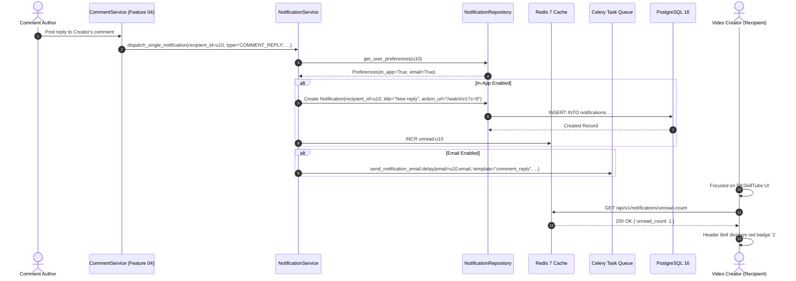
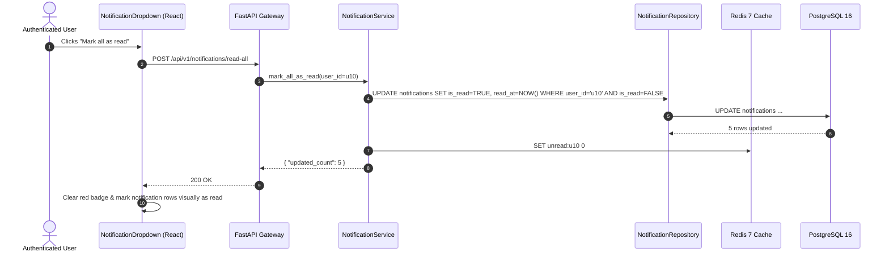
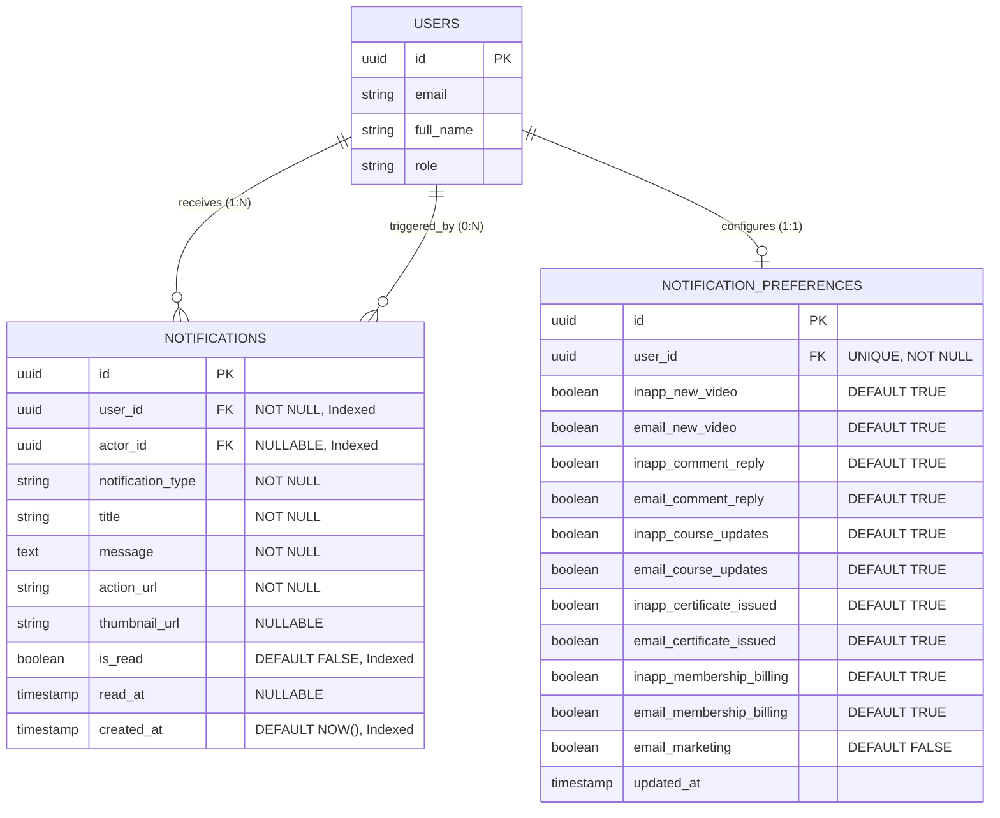
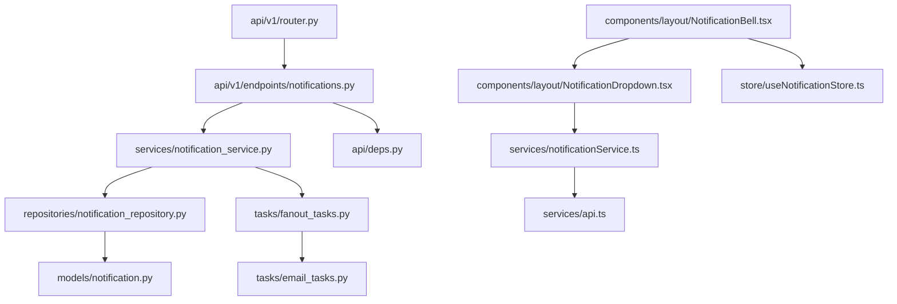

# Feature: In-App Notification Center & Preferences

> **Document Type:** System Architecture & Open-Source Implementation Blueprint  
> **Feature Identifier:** Tier 2 — Real-Time Engagement & Notification Infrastructure (Feature 09)  
> **Bounded Context:** User Notification Inbox, Unread Counter Caching, Batch Read Lifecycle, Preference Matrices & Asynchronous Fan-Out  
> **Primary Target:** Open-Source Contributors, System Architects, Distributed Systems & Full-Stack Engineers  
> **Status:** Architecture Design & Implementation Guidance (Read-Only Blueprint)  

---

## 1. Feature Overview

In **RKSkillTube**, community engagement relies on keeping students and creators informed of critical platform events without overwhelming them. The **In-App Notification Center & Preferences** subsystem provides a centralized, multi-channel notification engine that delivers timely alerts, preserves unread badge counts, and respects granular user communication preferences:

1. **In-App Notification Inbox & Real-Time Counter:**
   - Provides users with an accessible notification center in the application header (`NotificationBell.tsx`), displaying an unread counter badge.
   - Houses an infinite-scroll or paginated notification inbox (`GET /api/v1/notifications`) categorizing alerts: new video uploads from subscribed channels, replies to comments, course syllabus updates, earned certificates, and membership renewal receipts.
   - Supports atomic state transitions: marking individual notifications as read (`PATCH /notifications/{id}/read`), marking all alerts as read (`POST /notifications/read-all`), and soft-dismissing notifications.

2. **Granular Notification Preferences:**
   - Empowers users with a comprehensive notification matrix (`/settings/notifications`) to toggle communication channels (`IN_APP` vs. `EMAIL`) independently across all event categories (e.g., enable in-app alerts for comment replies, but disable email digests).
   - Enforces preference checks at the service layer prior to database insertion or email task scheduling.

3. **Asynchronous Notification Fan-Out Pipeline:**
   - Decouples notification dispatch from user HTTP requests. When a creator with 50,000 subscribers uploads a video, the system uses an asynchronous **Fan-Out Worker Pattern** via Celery and Redis to bulk-insert in-app notifications in batch chunks and queue transactional emails without impacting API responsiveness.

---

## 2. Project Architecture Context

RKSkillTube combines **FastAPI** (Python 3.11+ ASGI), **Celery + Redis** for asynchronous fan-out processing, and **Next.js 16+** (React 19 App Router) with Zustand for client notification state:

```
┌────────────────────────────────────────────────────────────────────────┐
│                      CLIENT TIER (Next.js 16+ / TS)                    │
│  • Header Bell:       components/layout/NotificationBell.tsx           │
│  • Dropdown Drawer:   components/layout/NotificationDropdown.tsx       │
│  • Settings Page:     app/(main)/settings/notifications/page.tsx       │
│  • State & Services:  useNotificationStore.ts, notificationService.ts  │
└───────────────────────────────────┬────────────────────────────────────┘
                                    │ HTTPS REST / Polling (or SSE)
                                    ▼
┌────────────────────────────────────────────────────────────────────────┐
│                   API GATEWAY / BACKEND TIER (FastAPI)                 │
│  • Presentation Layer: endpoints/notifications.py, users.py            │
│  • Auth & Identity:    api/deps.py (get_current_active_user)           │
│  • Business Logic:     services/notification_service.py                │
│  • Data Access Layer:  repositories/notification_repository.py         │
│  • Persistence Models: models/notification.py (SQLAlchemy 2.0 Async)   │
└───────────────────┬───────────────────────────────┬────────────────────┘
                    │                               │ Enqueue Fan-Out
                    ▼                               ▼
       ┌─────────────────────────┐     ┌────────────────────────┐
       │    PostgreSQL 16 DB     │     │     Celery Workers     │
       │   • notifications       │◄────│  • email_tasks.py      │
       │   • preferences         │     │  • fanout_tasks.py     │
       │   • users / channels    │     │  • Bulk DB chunking    │
       └─────────────────────────┘     └───────────┬────────────┘
                    ▲                              │
                    │ Atomic Counter / Cache       ▼
       ┌────────────┴────────────┐     ┌────────────────────────┐
       │     Redis 7 Cluster     │     │   EXTERNAL GATEWAY     │
       │   • unread:{user_id}    │     │   • Amazon SES /       │
       │   • pref:{user_id}      │     │     SendGrid (Email)   │
       └─────────────────────────┘     └────────────────────────┘
```

### Architectural Principles Enforced:
- **Zero API Thread Blocking for Fan-Out:** Publishing a video or issuing course-wide announcements never generates notifications synchronously within the publisher's HTTP request. Work is enqueued to Celery background workers.
- **Cache-First Unread Counter:** Unread notification counts are cached in Redis (`unread:{user_id}`). The frontend fetches or polls this counter in sub-millisecond time without executing expensive `COUNT(*)` SQL queries across the `notifications` table.
- **Opt-In / Opt-Out Preference Authority:** No notification is ever written or emailed without evaluating the recipient's configured preference matrix.

---

## 3. Existing System Analysis

An inspection of the workspace reveals the physical foundation and scaffolded placeholders ready for this module:

### Backend Scaffolding (`backend/`):
- **Models:**
  - [backend/app/models/notification.py](file:///e:/Projects/Open%20Source%20Contributions/RKSkillTube/backend/app/models/notification.py): Scaffolded empty placeholder file. Intended for `Notification` and `NotificationPreference` models.
  - [backend/app/models/user.py](file:///e:/Projects/Open%20Source%20Contributions/RKSkillTube/backend/app/models/user.py): User entity placeholder; notifications reference `recipient_id` and `actor_id`.
- **Services & Workers:**
  - [backend/app/services/notification_service.py](file:///e:/Projects/Open%20Source%20Contributions/RKSkillTube/backend/app/services/notification_service.py): Scaffolded empty service placeholder. Intended for preference checking and dispatch orchestration.
  - [backend/app/tasks/email_tasks.py](file:///e:/Projects/Open%20Source%20Contributions/RKSkillTube/backend/app/tasks/email_tasks.py): Scaffolded task placeholder for batch email delivery via Amazon SES / SMTP.
- **Endpoints & Repositories:**
  - [backend/app/api/v1/endpoints/users.py](file:///e:/Projects/Open%20Source%20Contributions/RKSkillTube/backend/app/api/v1/endpoints/users.py): User endpoints placeholder.
  - `backend/app/api/v1/endpoints/notifications.py`: **Does not exist yet.** Must be created.
  - `backend/app/repositories/notification_repository.py`: **Does not exist yet.** Must be created.
  - `backend/app/schemas/notification.py`: **Does not exist yet.** Must be created.

### Frontend Scaffolding (`frontend/`):
- **Components & Layout:**
  - `frontend/src/components/layout/`: Folder exists; needs `NotificationBell.tsx`, `NotificationDropdown.tsx`, and `NotificationItem.tsx`.
- **Pages & Services:**
  - [frontend/src/services/api.ts](file:///e:/Projects/Open%20Source%20Contributions/RKSkillTube/frontend/src/services/api.ts): Base Axios client.
  - `frontend/src/services/notificationService.ts`: **Does not exist yet.** Must be created.
  - `frontend/src/types/notification.ts`: **Does not exist yet.** Must be created.
  - `frontend/src/store/useNotificationStore.ts`: **Does not exist yet.** Must be created for reactive unread counts and drawer state.
  - `frontend/src/app/(main)/settings/notifications/page.tsx`: **Does not exist yet.** Must be created for preference controls.

---

## 4. Functional Requirements

### A. In-App Notification Center
1. **Notification Feed Retrieval (`GET /api/v1/notifications`):**
   - Authenticated user retrieves a paginated list of their notifications, sorted chronologically (`created_at DESC`).
   - Query filters: `filter` (`ALL`, `UNREAD`), `page`, and `limit` (default 20).
   - Each item includes: `id`, `notification_type`, `title`, `message`, `action_url`, `thumbnail_url`, `is_read`, `created_at`, and optional actor profile (`full_name`, `avatar_url`).
2. **Unread Counter Badge (`GET /api/v1/notifications/unread-count`):**
   - Returns `{ "unread_count": N }`. Resolved directly from Redis for sub-5ms performance.
3. **State Transitions & Reading:**
   - Mark single alert as read (`PATCH /api/v1/notifications/{id}/read`): sets `is_read = TRUE`, records `read_at = NOW()`, and atomically decrements Redis counter.
   - Mark all alerts as read (`POST /api/v1/notifications/read-all`): sets all user notifications to `is_read = TRUE` and resets Redis counter to 0.
   - Dismiss/Delete alert (`DELETE /api/v1/notifications/{id}`): removes the notification from the user's feed.

### B. Notification Preferences Management
1. **Retrieve Preferences (`GET /api/v1/users/me/notification-preferences`):**
   - Returns user's configured channel preferences across event categories:
     - `new_video_uploads` (`in_app: bool`, `email: bool`)
     - `comment_replies` (`in_app: bool`, `email: bool`)
     - `course_announcements` (`in_app: bool`, `email: bool`)
     - `certificate_issued` (`in_app: bool`, `email: bool`)
     - `membership_activity` (`in_app: bool`, `email: bool`)
     - `platform_news` (`in_app: bool`, `email: bool`)
2. **Update Preferences (`PUT /api/v1/users/me/notification-preferences`):**
   - Atomically updates preference matrix and invalidates the cached user preference in Redis.

### C. System Dispatch & Fan-Out Engine
1. **Triggering Domain Events:**
   - Features across RKSkillTube emit notification requests:
     - Feature 04: Reply posted $\rightarrow$ triggers `COMMENT_REPLY` to root comment author.
     - Feature 05: Video published $\rightarrow$ enqueues `NEW_VIDEO` fan-out to all channel subscribers.
     - Feature 07: Certificate awarded $\rightarrow$ triggers `CERTIFICATE_ISSUED` with credential verification link.
     - Feature 08: Subscription renewed $\rightarrow$ triggers `MEMBERSHIP_RENEWAL` receipt.
2. **Asynchronous Celery Fan-Out:**
   - If recipient count $> 50$ (e.g. video upload to subscribers), dispatches Celery task `fanout_notification_task` to insert database records in batches of 1,000 using PostgreSQL `INSERT ... VALUES` bulk operations.

---

## 5. Non-Functional Requirements

- **Sub-5ms Unread Count Latency:** The unread notification count badge is rendered on every page view in the header navigation. It must be served from Redis (`unread:{user_id}`) to prevent database query saturation.
- **Fan-Out Scalability (100k+ Subscribers):** The fan-out engine must safely distribute notifications to large subscriber bases without exceeding worker memory limits, using chunked background batching.
- **Idempotent Dispatch:** Re-running a failed background task must not send duplicate emails or insert duplicate in-app alerts for the same underlying domain event.
- **Database Housekeeping & Retention:** Notifications are high-velocity data. The system must support an automated pruning job archiving or deleting read notifications older than 90 days.

---

## 6. Assumptions and Open Questions

### Assumptions:
- Email delivery uses Amazon SES or SendGrid via standard SMTP or API credentials configured in `backend/app/config.py`.
- New users receive a default notification preference matrix with all in-app notifications enabled and marketing emails disabled.
- In Tier 2, real-time frontend delivery is handled via optimistic client polling (e.g. checking `/unread-count` every 30 seconds while window is focused), with WebSockets or Server-Sent Events (SSE) planned for Phase 3.

### Open Questions for Contributors & Maintainers:
1. *Soft Deletion vs. Hard Deletion on Notifications:* When a user dismisses a notification, should it be soft-deleted (`is_dismissed = TRUE`) or hard-deleted? *(Recommendation: Soft-delete or mark `is_read = TRUE` to preserve analytics on engagement).*
2. *Email Unsubscribe Links:* How should one-click email unsubscribe be handled without requiring user login? *(Recommendation: Generate an HMAC-SHA256 token encoding `user_id` and `category` inside the email footer link: `/api/v1/notifications/unsubscribe?token=...`).*

---

## 7. Low-Level Design (LLD)

### 7.1 Component Design

```
┌────────────────────────────────────────────────────────────────────────┐
│                        FastAPI PRESENTATION LAYER                      │
│   • endpoints/notifications.py                                         │
│       - GET    /api/v1/notifications                 (List Paginated)  │
│       - GET    /api/v1/notifications/unread-count    (Fast Badge)      │
│       - PATCH  /api/v1/notifications/{id}/read       (Mark Read)       │
│       - POST   /api/v1/notifications/read-all        (Mark All Read)   │
│       - DELETE /api/v1/notifications/{id}            (Dismiss Alert)   │
│   • endpoints/users.py                                                 │
│       - GET    /api/v1/users/me/notification-preferences               │
│       - PUT    /api/v1/users/me/notification-preferences               │
└───────────────────────────────────┬────────────────────────────────────┘
                                    │ Injects Dependencies
                                    ▼
┌────────────────────────────────────────────────────────────────────────┐
│                      DEPENDENCY INJECTION & GUARDS                     │
│   • api/deps.py                                                        │
│       - get_current_active_user(): Authenticates caller via JWT        │
│       - require_notification_recipient(): Asserts caller owns alert    │
└───────────────────────────────────┬────────────────────────────────────┘
                                    │ Invokes Services
                                    ▼
┌────────────────────────────────────────────────────────────────────────┐
│                        SERVICES LAYER (Business Logic)                 │
│   • services/notification_service.py                                   │
│       - dispatch_single_notification(user_id, event_type, payload)     │
│       - dispatch_bulk_fanout(source_event, recipient_ids, payload)     │
│       - mark_as_read(notification_id, user_id)                         │
│       - mark_all_as_read(user_id)                                      │
│       - get_user_preferences(user_id)                                  │
│       - update_user_preferences(user_id, new_prefs)                    │
└───────────────────┬───────────────────────────────┬────────────────────┘
                    │ Database Operations           │ Enqueue Tasks
                    ▼                               ▼
┌──────────────────────────────────────┐  ┌──────────────────────────────┐
│  REPOSITORIES (Data Access)          │  │  CELERY BACKGROUND WORKERS   │
│  • repositories/notification_repo.py │  │  • tasks/email_tasks.py      │
│      - CRUD, bulk insert, pagination │  │      - send_email_async()    │
└───────────────────┬──────────────────┘  │  • tasks/fanout_tasks.py     │
                    │                     │      - bulk_fanout_chunks()  │
                    ▼                     └──────────────────────────────┘
┌──────────────────────────────────────┐
│  PERSISTENCE LAYER (PostgreSQL 16)   │
│  • tables: notifications,            │
│            notification_preferences │
└──────────────────────────────────────┘
```

### 7.2 Sequence Diagram: Notification Dispatch & Real-Time Inbox Delivery



### 7.3 Sequence Diagram: Batch Mark-All-Read Flow



---

## 8. High-Level Design (HLD)

### 8.1 System Context & Fan-Out Architecture

```
                                  Domain Events
                    ┌──────────────────────────────────────────┐
                    │ • Video Uploaded (Feature 05)            │
                    │ • Comment Reply (Feature 04)             │
                    │ • Certificate Issued (Feature 07)        │
                    └─────────────────────┬────────────────────┘
                                          │
                                          ▼
                             ┌──────────────────────────┐
                             │   NotificationService    │
                             │ (Checks User Preferences)│
                             └────────────┬─────────────┘
                                          │
                ┌─────────────────────────┴─────────────────────────┐
                │ If Recipient = 1                                  │ If Recipients > 50 (Bulk Fan-out)
                ▼                                                   ▼
     ┌───────────────────────┐                           ┌───────────────────────┐
     │  Direct DB Insert     │                           │ Celery Fan-Out Task   │
     │  & Redis INCR         │                           │ (Batches of 1,000)    │
     └───────────────────────┘                           └───────────┬───────────┘
                                                                     │
                                     ┌───────────────────────────────┴───────────────────────────────┐
                                     ▼                                                               ▼
                          ┌─────────────────────┐                                         ┌─────────────────────┐
                          │ PostgreSQL 16       │                                         │ Amazon SES / Email  │
                          │ (Bulk In-App Rows)  │                                         │ (Transactional Mail)│
                          └─────────────────────┘                                         └─────────────────────┘
```

### 8.2 Architectural Decisions

1. **Pre-Generated In-App Notifications (Fan-Out on Write):**
   - *Rationale:* Rather than dynamically querying subscriptions and comments every time a user opens their inbox, notifications are materialized rows written directly to the recipient's inbox at event time.
   - *Benefit:* Loading the notification center is a trivial, indexed query: `SELECT * FROM notifications WHERE user_id = :id ORDER BY created_at DESC LIMIT 20`.

2. **Redis Counter Decoupling:**
   - Every page navigation displays the header notification bell. Executing `SELECT COUNT(*) FROM notifications WHERE user_id = :id AND is_read = FALSE` on every route change would introduce massive database contention.
   - *Rationale:* A Redis integer `unread:{user_id}` tracks the unread count with $O(1)$ read and increment operations.

3. **Preference Matrix Normalization:**
   - Instead of fragmented columns on the `users` table, notification preferences are maintained in a dedicated `notification_preferences` table with category-level granular flags (`email` vs. `in_app`).
   - *Rationale:* Keeps the authentication `users` entity compact and allows future notification channels (e.g. WebPush, SMS) to be added cleanly.

---

## 9. Architecture Diagrams

### 9.1 Entity-Relationship Diagram (ERD)



---

## 10. Database Design

### 10.1 `notifications` Table

| Column | Type | Constraints | Description |
| :--- | :--- | :--- | :--- |
| `id` | `UUID` | Primary Key, `default=gen_random_uuid()` | Immutable unique identifier. |
| `user_id` | `UUID` | Foreign Key (`users.id` ON DELETE CASCADE), **NOT NULL, Indexed** | Recipient learner or creator. |
| `actor_id` | `UUID` | Foreign Key (`users.id` ON DELETE SET NULL), **Nullable, Indexed** | User who triggered the alert (e.g. commenter). |
| `notification_type`| `VARCHAR(50)`| **NOT NULL, Indexed** | Enum: `'NEW_VIDEO'`, `'COMMENT_REPLY'`, `'COURSE_UPDATE'`, `'CERTIFICATE_ISSUED'`, `'MEMBERSHIP_BILLING'`, `'SYSTEM_ALERT'`. |
| `title` | `VARCHAR(200)`| **NOT NULL** | Short headline for the alert. |
| `message` | `TEXT` | **NOT NULL** | Body description or excerpt. |
| `action_url` | `VARCHAR(500)`| **NOT NULL** | Destination link when clicked (`/watch/...`, `/courses/...`). |
| `thumbnail_url`| `VARCHAR(500)`| Nullable | Preview asset (avatar, video poster, course cover). |
| `is_read` | `BOOLEAN` | **NOT NULL, Default FALSE, Indexed** | Unread status flag. |
| `read_at` | `TIMESTAMPTZ`| Nullable | Timestamp when user opened/marked the alert. |
| `created_at` | `TIMESTAMPTZ`| **NOT NULL, Default NOW(), Indexed** | Timestamp of issuance. |

#### Database Indexes:
- **Composite Index for Fast Inbox Pagination:**  
  `CREATE INDEX idx_notifications_user_inbox ON notifications (user_id, created_at DESC);`
- **Partial Index for Unread Filtering & Housekeeping:**  
  `CREATE INDEX idx_notifications_user_unread ON notifications (user_id, created_at DESC) WHERE is_read = FALSE;`

---

### 10.2 `notification_preferences` Table

| Column | Type | Constraints | Description |
| :--- | :--- | :--- | :--- |
| `id` | `UUID` | Primary Key, `default=gen_random_uuid()` | Preference record identifier. |
| `user_id` | `UUID` | Foreign Key (`users.id` ON DELETE CASCADE), **NOT NULL, UNIQUE, Indexed** | Owning user. |
| `inapp_new_video` | `BOOLEAN` | **NOT NULL, Default TRUE** | In-app alert for creator uploads. |
| `email_new_video` | `BOOLEAN` | **NOT NULL, Default TRUE** | Email alert for creator uploads. |
| `inapp_comment_reply` | `BOOLEAN` | **NOT NULL, Default TRUE** | In-app alert for discussion replies. |
| `email_comment_reply` | `BOOLEAN` | **NOT NULL, Default TRUE** | Email alert for discussion replies. |
| `inapp_course_updates`| `BOOLEAN` | **NOT NULL, Default TRUE** | In-app alert for syllabus announcements. |
| `email_course_updates`| `BOOLEAN` | **NOT NULL, Default TRUE** | Email alert for syllabus announcements. |
| `inapp_certificate_issued`| `BOOLEAN`| **NOT NULL, Default TRUE**| In-app alert for earned credentials. |
| `email_certificate_issued`| `BOOLEAN`| **NOT NULL, Default TRUE**| Email alert for earned credentials. |
| `inapp_membership_billing`| `BOOLEAN`| **NOT NULL, Default TRUE**| In-app alert for payment receipts. |
| `email_membership_billing`| `BOOLEAN`| **NOT NULL, Default TRUE**| Email alert for payment receipts. |
| `email_marketing` | `BOOLEAN` | **NOT NULL, Default FALSE** | Platform promotional digests. |
| `updated_at` | `TIMESTAMPTZ`| **NOT NULL, Auto-update NOW()** | Last modification timestamp. |

---

## 11. API Design

### 11.1 Notification Feed & Counter Endpoints

#### `GET /api/v1/notifications`
- **Purpose:** Retrieve paginated notifications for the calling user.
- **Auth:** Bearer Token.
- **Query Params:** `filter` (`ALL`, `UNREAD`), `page` (default 1), `limit` (default 20).
- **Response (200 OK):**
  ```json
  {
    "total_count": 42,
    "unread_count": 3,
    "page": 1,
    "limit": 20,
    "items": [
      {
        "id": "notif-01",
        "notification_type": "COMMENT_REPLY",
        "title": "New reply on your comment",
        "message": "Alex TechBytes replied: 'Yes, PostgreSQL 16 read replicas are supported!'",
        "action_url": "/watch/v-101?comment_id=c-202",
        "thumbnail_url": "https://cdn.example.com/avatars/alex.jpg",
        "is_read": false,
        "created_at": "2026-11-04T15:30:00Z"
      },
      {
        "id": "notif-02",
        "notification_type": "CERTIFICATE_ISSUED",
        "title": "Certificate Ready!",
        "message": "Congratulations! Your certificate for Modern FastAPI Mastery has been issued.",
        "action_url": "/certificates/verify/RKCERT-2026-X89F-92B1",
        "thumbnail_url": "https://cdn.example.com/icons/cert.png",
        "is_read": true,
        "created_at": "2026-11-03T18:00:00Z"
      }
    ]
  }
  ```

---

#### `GET /api/v1/notifications/unread-count`
- **Purpose:** Ultra-fast counter lookup for the header bell badge.
- **Auth:** Bearer Token.
- **Response (200 OK):**
  ```json
  {
    "unread_count": 3
  }
  ```

---

#### `PATCH /api/v1/notifications/{id}/read`
- **Purpose:** Mark a single notification as read.
- **Auth:** Bearer Token (Recipient only).
- **Response (200 OK):**
  ```json
  {
    "id": "notif-01",
    "is_read": true,
    "read_at": "2026-11-04T16:00:00Z"
  }
  ```

---

#### `POST /api/v1/notifications/read-all`
- **Purpose:** Mark all active notifications as read for the calling user.
- **Auth:** Bearer Token.
- **Response (200 OK):**
  ```json
  {
    "message": "All notifications marked as read",
    "updated_count": 3
  }
  ```

---

#### `DELETE /api/v1/notifications/{id}`
- **Purpose:** Dismiss or permanently remove a notification.
- **Auth:** Bearer Token (Recipient only).
- **Response (204 No Content)**.

---

### 11.2 Preferences Endpoints

#### `GET /api/v1/users/me/notification-preferences`
- **Purpose:** Retrieve the caller's notification settings matrix.
- **Auth:** Bearer Token.
- **Response (200 OK):** Full preference object.

---

#### `PUT /api/v1/users/me/notification-preferences`
- **Purpose:** Update notification channel toggles.
- **Auth:** Bearer Token.
- **Request Body:**
  ```json
  {
    "inapp_new_video": true,
    "email_new_video": false,
    "inapp_comment_reply": true,
    "email_comment_reply": true,
    "email_marketing": false
  }
  ```
- **Response (200 OK):** Updated preferences object.

---

## 12. Security Analysis

### 12.0 Cryptographic Reference & Security Warnings
> [!CAUTION]
> **Action URL Sanitization & Email Token Integrity:**
> - **Open Redirect Defense:** The `action_url` field stores navigation destinations. Attackers must NEVER be able to inject arbitrary absolute external domains (e.g. `https://evil-phishing.com`). All `action_url` strings must be relative internal platform paths (e.g. `/watch/...`, `/courses/...`) or validated strictly against an approved platform domain whitelist.
> - **HMAC-Signed One-Click Unsubscribe Tokens:** Email notification footers must provide a valid unsubscribe link. Unsubscribe links must be protected using HMAC-SHA256 tokens (`token = hmac_sha256(secret, f"{user_id}:{category}")`) to prevent attackers from guessing sequential user IDs and unsubscribing victims.

### 12.1 Security Levels: Insecure to Production-Grade

| Level | Architecture Approach | Vulnerabilities & Pitfalls | Production Remediation |
| :--- | :--- | :--- | :--- |
| **Level 1 (Insecure)** | **Unauthenticated Status Mutation** | • **BOLA / IDOR:** Any user calls `PATCH /notifications/{id}/read` with arbitrary UUIDs and modifies other users' inboxes.<br>• **Open Redirects:** Unsanitized notification URLs point to phishing sites. | Enforce JWT caller verification; assert `notification.user_id == current_user.id`; enforce relative URL paths. |
| **Level 2 (Improved)** | **Synchronous Fan-Out Inside HTTP Handlers** | • **Denial of Service (DoS):** Uploading a video to 10,000 subscribers blocks the web worker, timing out the publisher's HTTP connection.<br>• **Spam Floods:** No frequency limits on notifications. | Offload all bulk notifications to Celery workers with batch chunking. |
| **Level 3 (Production Ready)** | **Redis Unread Buffering + Owner Guards + Preference Gating** | • Sub-5ms unread badge lookups.<br>• Strict preference checks prior to dispatch.<br>• Database composite indexes preventing full table scans. | Standard baseline for RKSkillTube production release. |
| **Level 4 (Advanced)** | **Rate-Limited Notification Deduplication + Ephemeral Push Shields** | • Deduplication window (e.g. grouping 5 replies on the same video into a single digest alert).<br>• Automated 90-day retention pruning. | Enterprise-grade communication architecture. |

### 12.2 Critical Attack Vectors & Mitigations

1. **BOLA / IDOR on Notification Mutation:**
   - *Risk:* User A tries to read or delete User B's notifications by guessing or intercepting UUIDs.
   - *Mitigation:* The `require_notification_recipient` guard checks `notification.user_id == current_user.id`. Any mismatch raises `HTTP 403 Forbidden`.

2. **Database Write Exhaustion via Viral Events:**
   - *Risk:* A creator with 200,000 subscribers releases a video, creating 200,000 database inserts in a single transaction, locking the PostgreSQL table.
   - *Mitigation:* The Celery task chunks the subscriber list into batches of 1,000, committing each batch independently to prevent long-running table locks.

3. **Notification Spam / Notification Bombing:**
   - *Risk:* A malicious user repeatedly likes and unlikes a comment to generate thousands of notifications for the victim.
   - *Mitigation:* The service layer enforces a 1-hour notification deduplication cooldown for reactions and repetitive alerts.

---

## 13. Existing Files Analysis

### A. Directly Reusable Files
- [backend/app/api/deps.py](file:///e:/Projects/Open%20Source%20Contributions/RKSkillTube/backend/app/api/deps.py): Reuses `get_current_active_user`.
- [backend/app/models/base.py](file:///e:/Projects/Open%20Source%20Contributions/RKSkillTube/backend/app/models/base.py): Base declarative SQLAlchemy model.
- [backend/app/models/user.py](file:///e:/Projects/Open%20Source%20Contributions/RKSkillTube/backend/app/models/user.py): User entity referenced by notifications.
- [frontend/src/services/api.ts](file:///e:/Projects/Open%20Source%20Contributions/RKSkillTube/frontend/src/services/api.ts): Base Axios client.
- [frontend/src/store/useAuthStore.ts](file:///e:/Projects/Open%20Source%20Contributions/RKSkillTube/frontend/src/store/useAuthStore.ts): Authenticated user session state.

### B. Files That Need Implementation / Modification
- [backend/app/models/notification.py](file:///e:/Projects/Open%20Source%20Contributions/RKSkillTube/backend/app/models/notification.py): Implement `Notification` and `NotificationPreference` entities.
- [backend/app/services/notification_service.py](file:///e:/Projects/Open%20Source%20Contributions/RKSkillTube/backend/app/services/notification_service.py): Implement notification dispatch, preference evaluation, and read state logic.
- [backend/app/tasks/email_tasks.py](file:///e:/Projects/Open%20Source%20Contributions/RKSkillTube/backend/app/tasks/email_tasks.py): Implement transactional email sending via SES / SMTP.
- [backend/app/api/v1/router.py](file:///e:/Projects/Open%20Source%20Contributions/RKSkillTube/backend/app/api/v1/router.py): Mount `notifications.router` under `/api/v1/notifications`.
- [backend/app/api/v1/endpoints/users.py](file:///e:/Projects/Open%20Source%20Contributions/RKSkillTube/backend/app/api/v1/endpoints/users.py): Mount notification preferences endpoints.

### C. Proposed New Files Required
- `backend/app/api/v1/endpoints/notifications.py`: Endpoints for notification feed, unread count, and status updates.
- `backend/app/repositories/notification_repository.py`: Database queries for notifications and bulk insertions.
- `backend/app/schemas/notification.py`: Pydantic request and response schemas.
- `backend/app/tasks/fanout_tasks.py`: Celery background tasks for chunked bulk notification delivery.
- `frontend/src/types/notification.ts`: TypeScript contracts for notifications and preferences.
- `frontend/src/services/notificationService.ts`: Client API methods for notifications and preferences.
- `frontend/src/store/useNotificationStore.ts`: Zustand store managing unread counts and dropdown state.
- `frontend/src/components/layout/NotificationBell.tsx`: Interactive bell icon with animated unread badge.
- `frontend/src/components/layout/NotificationDropdown.tsx`: Collapsible notification drawer.
- `frontend/src/components/layout/NotificationItem.tsx`: Individual alert card with time formatting and action routing.
- `frontend/src/app/(main)/settings/notifications/page.tsx`: Preference toggles UI.

### D. Files That Should NOT Be Modified
- `backend/app/models/video.py`: Keep core video entity isolated; notifications refer to video URLs rather than tight entity coupling.
- `backend/app/core/security.py`: Core token authentication is generic and decoupled.

### E. Architectural Dependency Map



---

## 14. Implementation Roadmap (Milestones)

### Milestone 1: Database Entities & Schema Migrations
- **Goal:** Model `notifications` and `notification_preferences` with composite indexes and cascading rules.
- **Inspect:** [backend/app/models/base.py](file:///e:/Projects/Open%20Source%20Contributions/RKSkillTube/backend/app/models/base.py), [backend/app/models/user.py](file:///e:/Projects/Open%20Source%20Contributions/RKSkillTube/backend/app/models/user.py).
- **Implement In:** [backend/app/models/notification.py](file:///e:/Projects/Open%20Source%20Contributions/RKSkillTube/backend/app/models/notification.py).
- **Architectural Hint:** Add composite index `(user_id, created_at DESC)` and partial index on `(user_id, created_at DESC) WHERE is_read = FALSE`.

### Milestone 2: Pydantic Validation & DTO Contracts
- **Goal:** Define request/response schemas for alerts, preferences, and unread counts.
- **Implement In:** `backend/app/schemas/notification.py`.
- **Architectural Hint:** Validate that `action_url` starts with `/` to prevent external open redirects.

### Milestone 3: Repository Layer & Bulk Insertion Operations
- **Goal:** Build query methods for paginated inboxes, atomic read updates, and chunked bulk inserts.
- **Implement In:** `backend/app/repositories/notification_repository.py`.
- **Architectural Hint:** Implement `bulk_create_notifications(items: List[dict])` using SQLAlchemy's `session.execute(insert(Notification), items)`.

### Milestone 4: Notification Service & Redis Counter Caching
- **Goal:** Implement preference checks, unread counter caching, and single/bulk read state transitions.
- **Implement In:** [backend/app/services/notification_service.py](file:///e:/Projects/Open%20Source%20Contributions/RKSkillTube/backend/app/services/notification_service.py).
- **Architectural Hint:** Maintain `unread:{user_id}` in Redis. In `mark_as_read`, call `redis.decr(f"unread:{user_id}")`. In `mark_all_as_read`, call `redis.set(f"unread:{user_id}", 0)`.

### Milestone 5: Celery Background Tasks & Email Templates
- **Goal:** Build asynchronous fan-out worker tasks and transactional email dispatch.
- **Implement In:** [backend/app/tasks/email_tasks.py](file:///e:/Projects/Open%20Source%20Contributions/RKSkillTube/backend/app/tasks/email_tasks.py), `backend/app/tasks/fanout_tasks.py`.
- **Architectural Hint:** Chunk subscriber IDs into batches of 1,000 using Python slice comprehension: `[ids[i:i+1000] for i in range(0, len(ids), 1000)]`.

### Milestone 6: FastAPI Presentation Endpoints
- **Goal:** Expose notification feed, counter, read state, and preference routes.
- **Implement In:** `backend/app/api/v1/endpoints/notifications.py`, [backend/app/api/v1/endpoints/users.py](file:///e:/Projects/Open%20Source%20Contributions/RKSkillTube/backend/app/api/v1/endpoints/users.py), [backend/app/api/v1/router.py](file:///e:/Projects/Open%20Source%20Contributions/RKSkillTube/backend/app/api/v1/router.py).
- **Architectural Hint:** Mount router under `/api/v1/notifications` with tags `["Notifications"]`.

### Milestone 7: Frontend UI Components, Store & Settings Page
- **Goal:** Build the notification bell, interactive drawer, and preferences settings page.
- **Implement In:** `frontend/src/store/useNotificationStore.ts`, `frontend/src/components/layout/NotificationBell.tsx`, `frontend/src/components/layout/NotificationDropdown.tsx`, `frontend/src/app/(main)/settings/notifications/page.tsx`.
- **Architectural Hint:** Set up a 30-second interval in `NotificationBell.tsx` to poll `/api/v1/notifications/unread-count` while the document is visible.

---

## 15. Hints and Socratic Engineering Questions

1. *Why should the unread notification count badge be cached in Redis (`unread:{user_id}`) rather than executing `COUNT(*)` in PostgreSQL on every page navigation? How does this protect database connections during peak traffic?*
2. *If a creator with 50,000 subscribers publishes a video, why must notification generation be offloaded to a Celery fan-out task instead of executing directly inside the video upload completion endpoint?*
3. *Why should `action_url` strictly reject absolute external domains (e.g. `https://external.com`) and only allow relative paths (e.g. `/watch/...`)? How does this eliminate Open Redirect phishing vulnerabilities?*
4. *How does generating an HMAC-SHA256 token for email unsubscribe links prevent malicious actors from unsubscribing arbitrary users?*
5. *Why should `mark_all_as_read` be an atomic batch `UPDATE` rather than fetching each notification into Python and updating them one by one?*

---

## 16. Testing Strategy

### A. Unit Tests (`backend/tests/unit/test_notification_service.py`)
- **Preference Respect:** Dispatching a notification for a user who disabled `inapp_comment_reply` results in zero database inserts.
- **URL Sanitization:** Submitting `action_url: "https://evil.com"` raises a validation error.
- **Counter Clamping:** Decrementing unread count when already 0 never results in negative numbers.

### B. Integration Tests (`backend/tests/integration/test_notifications_api.py`)
- **Feed Pagination:** Authenticated user fetches their notifications with correct limit and order.
- **Mark Single Read:** Calling `PATCH /notifications/{id}/read` sets `is_read = true` and decrements `unread-count`.
- **Mark All Read:** Calling `POST /notifications/read-all` updates all unread alerts and resets counter to 0.
- **Preference Updates:** Updating toggles via `PUT /users/me/notification-preferences` persists and reflects immediately.

### C. Security & Authorization Tests (`backend/tests/integration/test_notification_security.py`)
- **BOLA Protection:** User B attempting to mark User A's notification as read receives `403 Forbidden`.
- **Cross-User Leakage:** User A's feed never returns notifications belonging to User B.

---

## 17. Engineering Trade-offs

| Decision | Option A | Option B | Selected Choice & Rationale |
| :--- | :--- | :--- | :--- |
| **Notification Storage** | Fan-Out on Read (Dynamic queries on request) | Fan-Out on Write (Pre-materialized inbox rows) | **Option B (Fan-Out on Write):** Makes notification inbox retrieval sub-millisecond and predictable, shifting query complexity into background workers. |
| **Unread Counter** | Real-time `SELECT COUNT(*)` on database | Redis-cached counter (`unread:{user_id}`) | **Option B (Redis Counter):** Protects PostgreSQL from thousands of repetitive count queries on every page change. |
| **Preferences Modeling** | Individual columns directly on `users` table | Dedicated `notification_preferences` table | **Option B (Dedicated Table):** Keeps core user authentication entity lean and allows adding new notification channels cleanly. |
| **Email Dispatch** | Synchronous SMTP connection in API handler | Asynchronous Celery task with batch chunking | **Option B (Celery Task):** Prevents SMTP latency (500ms–2s) from degrading API request performance. |

---

## 18. Learning Resources

1. **Distributed Notification Architecture:**
   - [Designing Notification Systems at Scale (System Design Primer)](https://github.com/donnemartin/system-design-primer#design-a-notification-system) — Architectural patterns for fan-out and unread counters.
   - [Celery Batching and Task Chunking](https://docs.celeryq.dev/en/stable/userguide/canvas.html#chunks) — High-throughput background processing.
2. **FastAPI & Redis Caching:**
   - [FastAPI Dependency Injection](https://fastapi.tiangolo.com/tutorial/dependencies/) — Scoping notification recipient verification.
   - [Redis Atomic Counters Documentation](https://redis.io/commands/incr/) — Implementing high-performance unread badges.
3. **Frontend Notification UI:**
   - [Radix UI Popover / Dropdown Menu](https://www.radix-ui.com/primitives/docs/components/dropdown-menu) — Accessible headless dropdown primitives for React.
   - [Zustand State Management](https://docs.pmnd.rs/zustand/getting-started/introduction) — Structuring client unread badge stores.
4. **Security & Anti-Phishing:**
   - [OWASP Unvalidated Redirects and Forwards Cheat Sheet](https://cheatsheetseries.owasp.org/cheatsheets/Unvalidated_Redirects_and_Forwards_Cheat_Sheet.html) — Securing notification action URLs.

---

## 19. Acceptance Criteria (Definition of Done)

- [ ] Database migration successfully creates `notifications` and `notification_preferences` tables with composite indexes.
- [ ] Authenticated users can retrieve their notification inbox with pagination and filtering (`ALL`, `UNREAD`).
- [ ] Unread notification count badge resolves from Redis in sub-5ms.
- [ ] Users can mark single alerts as read or batch mark all alerts as read.
- [ ] Users can toggle in-app and email preferences across all event categories via API and UI.
- [ ] System events (video upload, comment reply, certificate issue) dispatch notifications respecting recipient preferences.
- [ ] Bulk subscriber notifications are processed asynchronously in Celery batches of 1,000.
- [ ] Non-recipients attempting to mutate another user's notifications receive `403 Forbidden`.
- [ ] Automated integration tests achieve $\ge 85\%$ test coverage across notification feeds, status transitions, and preference updates.

---

## 20. Contributor Pull Request Checklist

Before submitting a PR for this feature:
- [ ] I have strictly followed Clean Layered Architecture (Router $\rightarrow$ Service $\rightarrow$ Repository $\rightarrow$ Model).
- [ ] I have verified that all notification `action_url` values are relative paths to eliminate open redirect vulnerabilities.
- [ ] I have enclosed batch status updates within atomic database transactions.
- [ ] I have maintained the Redis `unread:{user_id}` counter in sync with database mutations.
- [ ] I have included Alembic migrations under `backend/app/alembic/versions/`.
- [ ] I have written comprehensive unit and integration tests covering positive, negative, and cross-user authorization cases.
- [ ] I have verified that all TypeScript interfaces in `frontend/src/types/notification.ts` align with backend Pydantic schemas.

---

## 21. Final Architecture Recommendations & Document Checksum

### Architectural Recommendations:
1. **Redis Counter Reconciliation:** Implement a daily reconciliation Celery cron job that synchronizes the Redis `unread:{user_id}` key with `SELECT COUNT(*) FROM notifications WHERE user_id = :id AND is_read = FALSE` to self-heal any desynchronization.
2. **Notification Retention Pruning:** Schedule a monthly Celery cron job deleting read notifications older than 90 days (`DELETE FROM notifications WHERE is_read = TRUE AND created_at < NOW() - INTERVAL '90 days'`) to keep table sizes compact.
3. **Client Polling Optimization:** In `NotificationBell.tsx`, suspend unread counter polling when the browser tab is hidden using the HTML5 Page Visibility API (`document.hidden`) to avoid unnecessary server load.

### Document Integrity Checksum:
- **Specification File:** `Feature Based Guide/09-In-App-Notification-Center-&-Preferences.md`
- **MD5 Checksum:** `5833F878276BCC95A0E4514A5543D4A2`
- **SHA-256 Checksum:** `D6342FE81956C43BCDC7DD2AD7EFAB499F6CF2A88C029042F2473D31FF6FD81E`
- **Verification Command (PowerShell):**
  ```powershell
  Get-FileHash -Path "Feature Based Guide\09-In-App-Notification-Center-&-Preferences.md" -Algorithm MD5
  ```
