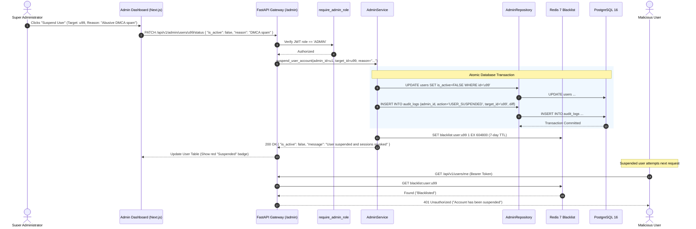
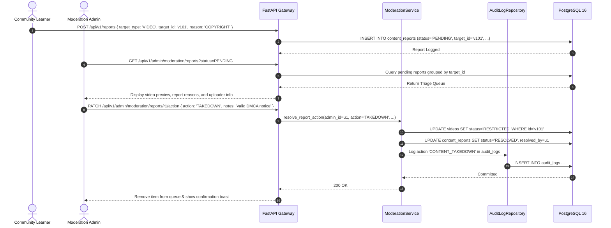
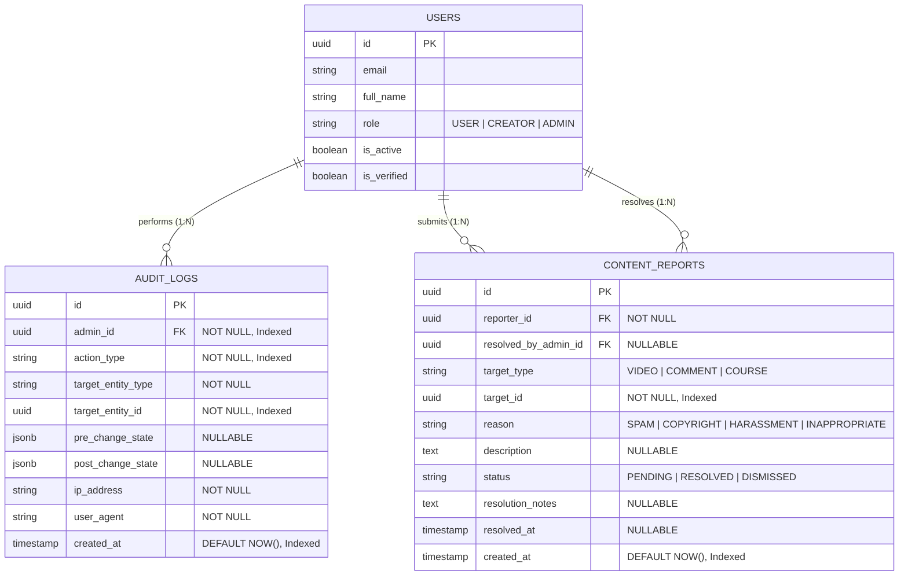
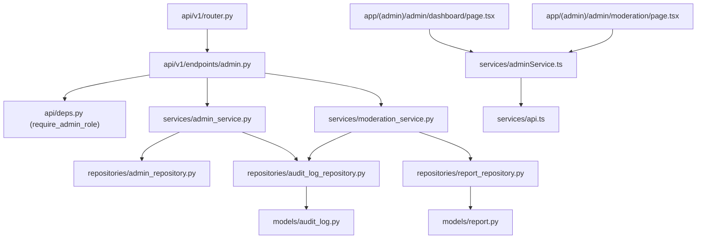

# Feature: Admin Governance & Platform Operations Portal

> **Document Type:** System Architecture & Open-Source Implementation Blueprint  
> **Feature Identifier:** Tier 2 — Platform Governance & Operations (Feature 10)  
> **Bounded Context:** Platform Operations, Role Governance, Content Moderation Queues, High-Level System Metrics & Immutable Audit Logging  
> **Primary Target:** Open-Source Contributors, System Architects, Security Auditors & Senior Full-Stack Engineers  
> **Status:** Architecture Design & Implementation Guidance (Read-Only Blueprint)  

---

## 1. Feature Overview

In **RKSkillTube**, scaling from an initial community to thousands of creators and millions of learners requires rigorous operational controls, automated moderation workflows, and tamper-proof governance. The **Admin Governance & Platform Operations Portal** serves as the command center for platform administrators, security reviewers, and compliance teams:

1. **Platform Operational Dashboard & Aggregated Metrics (`/admin/dashboard`):**
   - Provides real-time visibility into global platform health: total registered users, active students, verified creators, uploaded videos, total course enrollments, platform object storage consumption (TB), and gross platform revenue.
   - Employs cache-accelerated aggregation in Redis with background worker recalculation, preventing expensive multi-million-row `COUNT(*)` or `SUM()` queries from locking production database tables.

2. **User Governance & Role-Based Access Control (RBAC):**
   - Provides a centralized user directory with multi-attribute filtering (by role `USER`, `CREATOR`, `ADMIN`, verification state, and active status).
   - Allows administrators to elevate/demote accounts, approve creator channel verification badges, and execute emergency user suspensions.
   - Enforces immediate token and session revocation in Redis when an account is suspended (`is_active = FALSE`).

3. **Content Moderation & DMCA Takedown Queue (`/admin/moderation`):**
   - Ingests user-submitted reports on abusive videos, spam comments, and copyright infringements.
   - Surfaces a prioritized moderation triage queue allowing reviewers to inspect reported media, review report reasons, and execute atomic moderation decisions: **Dismiss Report**, **Issue Warning**, **Takedown Content** (soft-deleting media and restricting CDN delivery), or **Suspend Creator Channel**.

4. **Immutable Audit Logging System (`/admin/audit-logs`):**
   - Automatically intercepts and records every administrative mutation (role modifications, account suspensions, content takedowns, verification grants, and financial adjustments).
   - Captures actor identity, target entity, pre-mutation vs. post-mutation JSON state snapshots, client IP, and UTC timestamps in an append-only, tamper-resistant audit ledger.

---

## 2. Project Architecture Context

RKSkillTube uses a secure layered architecture with **FastAPI** on the backend and **Next.js 16+** (React 19 App Router) on the client tier. The Admin Portal is isolated under dedicated administrative route boundaries and strict security filters:

```
┌────────────────────────────────────────────────────────────────────────┐
│                      CLIENT TIER (Next.js 16+ / TS)                    │
│  • Route Group:       app/(admin)/admin/dashboard/page.tsx             │
│  • Moderation Queue:  app/(admin)/admin/moderation/page.tsx            │
│  • Financial Audit:   app/(admin)/admin/payments/page.tsx              │
│  • Edge Middleware:   middleware.ts (Strict Role=='ADMIN' Route Guard) │
│  • Services:          adminService.ts, useAuthStore.ts                 │
└───────────────────────────────────┬────────────────────────────────────┘
                                    │ HTTPS REST JSON (Bearer JWT)
                                    ▼
┌────────────────────────────────────────────────────────────────────────┐
│                   API GATEWAY / BACKEND TIER (FastAPI)                 │
│  • Presentation Layer: endpoints/admin.py (/api/v1/admin/...)          │
│  • Security Dependency:api/deps.py (require_admin_role)                │
│  • Business Logic:     services/admin_service.py, moderation_service   │
│  • Data Access Layer:  repositories/admin_repo, audit_log_repository   │
│  • Persistence Models: models/audit_log.py, report.py, user.py         │
└───────────────────┬───────────────────────────────┬────────────────────┘
                    │                               │
                    ▼                               ▼
       ┌─────────────────────────┐     ┌────────────────────────┐
       │    PostgreSQL 16 DB     │     │     Redis 7 Cluster    │
       │   • users / channels    │     │   • Token Blacklist    │
       │   • content_reports     │     │   • Active Sessions    │
       │   • audit_logs (Append) │     │   • Cached KPI Metrics │
       └─────────────────────────┘     └────────────────────────┘
```

### Architectural Principles Enforced:
- **Defense in Depth (Dual-Layer Guards):** Access to admin capabilities is guarded at both the Next.js edge router layer (preventing unauthorized bundle loading) and the FastAPI API gateway layer (evaluating cryptographically signed JWT claims and active database status).
- **Append-Only Immutability:** Audit log tables strictly disallow `UPDATE` and `DELETE` operations via database permissions, guaranteeing an unalterable forensic trail.
- **Fail-Closed Session Invalidation:** When an admin suspends a user, all active JWT refresh tokens and session tokens are immediately pushed to the Redis revocation blacklist.

---

## 3. Existing System Analysis

An inspection of the workspace reveals the physical foundation and scaffolded placeholders ready for this module:

### Backend Scaffolding (`backend/`):
- **Endpoints & Routing:**
  - [backend/app/api/v1/endpoints/admin.py](file:///e:/Projects/Open%20Source%20Contributions/RKSkillTube/backend/app/api/v1/endpoints/admin.py): Scaffolded empty placeholder file. Intended for administrative routes (`/admin/stats`, `/admin/users`, `/admin/moderation`, `/admin/audit-logs`).
  - [backend/app/api/v1/router.py](file:///e:/Projects/Open%20Source%20Contributions/RKSkillTube/backend/app/api/v1/router.py): Master router ready to register `admin.router`.
  - [backend/app/api/deps.py](file:///e:/Projects/Open%20Source%20Contributions/RKSkillTube/backend/app/api/deps.py): Dependency injection placeholder; needs `require_admin_role` guard.
- **Models & Repositories:**
  - [backend/app/models/user.py](file:///e:/Projects/Open%20Source%20Contributions/RKSkillTube/backend/app/models/user.py): User entity with role flags (`USER`, `CREATOR`, `ADMIN`).
  - `backend/app/models/audit_log.py`: **Does not exist yet.** Must be created.
  - `backend/app/models/report.py`: **Does not exist yet.** Must be created for user-submitted content reports.
  - `backend/app/repositories/admin_repository.py`: **Does not exist yet.** Must be created.
  - `backend/app/repositories/audit_log_repository.py`: **Does not exist yet.** Must be created.
- **Services & Schemas:**
  - `backend/app/services/admin_service.py`: **Does not exist yet.** Must be created.
  - `backend/app/schemas/admin.py`: **Does not exist yet.** Must be created.

### Frontend Scaffolding (`frontend/`):
- **Pages:**
  - [frontend/src/app/(admin)/admin/dashboard/page.tsx](file:///e:/Projects/Open%20Source%20Contributions/RKSkillTube/frontend/src/app/(admin)/admin/dashboard/page.tsx): Scaffolded empty admin dashboard page.
  - [frontend/src/app/(admin)/admin/moderation/page.tsx](file:///e:/Projects/Open%20Source%20Contributions/RKSkillTube/frontend/src/app/(admin)/admin/moderation/page.tsx): Scaffolded empty content moderation queue page.
  - [frontend/src/app/(admin)/admin/payments/page.tsx](file:///e:/Projects/Open%20Source%20Contributions/RKSkillTube/frontend/src/app/(admin)/admin/payments/page.tsx): Scaffolded empty financial audit page.
- **Components & Services:**
  - [frontend/src/services/api.ts](file:///e:/Projects/Open%20Source%20Contributions/RKSkillTube/frontend/src/services/api.ts): Base Axios client.
  - `frontend/src/services/adminService.ts`: **Does not exist yet.** Must be created.
  - `frontend/src/types/admin.ts`: **Does not exist yet.** Must be created.
  - `frontend/src/components/admin/ReportTriageCard.tsx`: **Does not exist yet.** Must be created.
  - `frontend/src/components/admin/MetricKpiCard.tsx`: **Does not exist yet.** Must be created.

---

## 4. Functional Requirements

### A. Operational Metrics & Platform Health
1. **Aggregated Platform Stats (`GET /api/v1/admin/stats`):**
   - Returns real-time platform KPIs:
     - `total_users`, `active_users_30d`, `total_creators`.
     - `total_videos`, `total_courses`, `total_enrollments`.
     - `storage_utilized_bytes` (cumulative video assets in Cloudflare R2 / S3).
     - `gross_revenue_cents`, `creator_payouts_cents`, `platform_net_revenue_cents`.
   - Resolves metrics from Redis cache (`admin:platform_stats`) with an automated hourly background aggregation worker.

### B. User Governance & Role Management
1. **User Directory (`GET /api/v1/admin/users`):**
   - Paginated list of users with search (email, name) and filtering (`role = USER | CREATOR | ADMIN`, `is_active = TRUE | FALSE`, `is_verified = TRUE | FALSE`).
2. **Role Elevation & Demotion (`PATCH /api/v1/admin/users/{id}/role`):**
   - Allows super-admins to modify a user's role (`role: 'CREATOR'`, `role: 'ADMIN'`, `role: 'USER'`).
   - Automatically writes an immutable record to the audit log.
3. **Account Suspension & Enforcement (`PATCH /api/v1/admin/users/{id}/status`):**
   - Toggles `is_active = FALSE`.
   - Immediately revokes active user sessions and blacklists all refresh tokens in Redis (`blacklist:user:{id}`).
   - Automatically hides the user's published videos and courses from public catalog listings.
4. **Channel Verification Badge (`PATCH /api/v1/admin/channels/{id}/verify`):**
   - Approves or revokes the verified creator badge (`is_verified: boolean`).

### C. Content Moderation & Takedowns
1. **User Report Submission (`POST /api/v1/reports`):**
   - Authenticated learners can report videos or comments with `target_type` (`VIDEO`, `COMMENT`, `COURSE`), `reason` (`SPAM`, `COPYRIGHT_INFRINGEMENT`, `HARASSMENT`, `INAPPROPRIATE_CONTENT`), and optional `description`.
2. **Moderation Queue Listing (`GET /api/v1/admin/moderation/reports`):**
   - Returns open reports sorted by report frequency and submission date.
   - Groups multiple reports against the same video into a single triage item showing aggregate report count.
3. **Moderation Action (`PATCH /api/v1/admin/moderation/reports/{id}/action`):**
   - Reviewer executes action:
     - `DISMISS`: Rejects the report as invalid.
     - `TAKEDOWN`: Soft-deletes the video (`status = 'RESTRICTED'`), hides it from search/catalog, and notifies the creator via email with DMCA / policy explanation.
     - `SUSPEND_CREATOR`: Takes down content AND suspends the creator's channel.

### D. System Audit Ledger
1. **Audit Log Feed (`GET /api/v1/admin/audit-logs`):**
   - Paginated, searchable feed of all administrative actions.
   - Filterable by `admin_id`, `action_type`, `target_entity_type`, and date range.
   - Returns structured `changes_payload` showing pre-mutation vs. post-mutation diffs.

---

## 5. Non-Functional Requirements

- **Sub-100ms Admin Operations Latency:** Admin search and moderation queues must execute quickly using composite indexes on `(status, created_at DESC)`.
- **Zero-Loss Audit Logging:** Audit logging must execute within the same database transaction as the administrative mutation. If writing the audit log fails, the administrative action rolls back.
- **Session Revocation Speed (< 50ms):** When an admin suspends a user, the Redis blacklist key must be populated immediately so that sub-sequent requests from the suspended user's token are rejected on their very next API call.
- **Strict Separation of Privileges:** Standard creators and students cannot access `/api/v1/admin/*` endpoints under any circumstance. Requests must be rejected with `HTTP 403 Forbidden`.

---

## 6. Assumptions and Open Questions

### Assumptions:
- System bootstrap: The initial super-admin account is created via a database seeding script (`app/commands/create_superuser.py`) or environment variables on first platform boot.
- Content takedowns are reversible by administrators (soft-takedown via status flags rather than immediate permanent deletion of cloud storage files).

### Open Questions for Contributors & Maintainers:
1. *Admin Action Dual-Control (Four-Eyes Principle):* Should high-risk administrative actions (e.g. permanently deleting a creator channel or issuing large refunds) require approval from two separate administrators? *(Recommendation: Implement standard single-admin actions in Tier 2; introduce dual-approval workflows in Tier 3 enterprise hardening).*
2. *Audit Log Retention:* Should audit logs be retained indefinitely or archived to cold object storage (S3 Glacier) after 1 year? *(Recommendation: Retain all audit logs indefinitely in PostgreSQL with monthly partition tables to satisfy compliance).*

---

## 7. Low-Level Design (LLD)

### 7.1 Component Design

```
┌────────────────────────────────────────────────────────────────────────┐
│                        FastAPI PRESENTATION LAYER                      │
│   • endpoints/admin.py                                                 │
│       - GET    /api/v1/admin/stats                 (Platform KPIs)     │
│       - GET    /api/v1/admin/users                 (Directory Search)  │
│       - PATCH  /api/v1/admin/users/{id}/role       (Elevate/Demote)    │
│       - PATCH  /api/v1/admin/users/{id}/status     (Suspend/Unban)     │
│       - PATCH  /api/v1/admin/channels/{id}/verify  (Verification Badge)│
│       - GET    /api/v1/admin/moderation/reports    (Triage Queue)      │
│       - PATCH  /api/v1/admin/moderation/reports/{id}/action (Takedown) │
│       - GET    /api/v1/admin/audit-logs            (Security Feed)     │
└───────────────────────────────────┬────────────────────────────────────┘
                                    │ Injects Dependencies
                                    ▼
┌────────────────────────────────────────────────────────────────────────┐
│                      SECURITY & RBAC DEPENDENCY                        │
│   • api/deps.py                                                        │
│       - require_admin_role(): Asserts caller has active role == 'ADMIN'│
└───────────────────────────────────┬────────────────────────────────────┘
                                    │ Invokes Services
                                    ▼
┌────────────────────────────────────────────────────────────────────────┐
│                        SERVICES LAYER (Business Logic)                 │
│   • services/admin_service.py                                          │
│       - get_platform_metrics()                                         │
│       - update_user_role(admin_id, target_id, new_role)                │
│       - suspend_user_account(admin_id, target_id, reason)              │
│       - toggle_channel_verification(admin_id, channel_id, is_verified) │
│   • services/moderation_service.py                                     │
│       - submit_report(user_id, data)                                   │
│       - resolve_report_action(admin_id, report_id, action, notes)      │
└───────────────────┬───────────────────────────────┬────────────────────┘
                    │ Database Operations           │ Session Revocation
                    ▼                               ▼
┌──────────────────────────────────────┐  ┌──────────────────────────────┐
│  REPOSITORIES (Data Access)          │  │  REDIS 7 CACHE & BLACKLIST   │
│  • repositories/admin_repository.py  │  │  • blacklist:user:{id}       │
│  • repositories/audit_log_repo.py    │  │  • admin:platform_stats      │
│  • repositories/report_repository.py │  └──────────────────────────────┘
└───────────────────┬──────────────────┘
                    │ Executes SQL
                    ▼
┌──────────────────────────────────────┐
│  PERSISTENCE LAYER (PostgreSQL 16)   │
│  • tables: users, channels, videos,  │
│            content_reports,          │
│            audit_logs (Immutable)    │
└──────────────────────────────────────┘
```

### 7.2 Sequence Diagram: Account Suspension & Instant Session Revocation



### 7.3 Sequence Diagram: Content Moderation & Takedown Triage



---

## 8. High-Level Design (HLD)

### 8.1 System Context

```
                     ┌────────────────────────┐
                     │  Super Admin / Auditor │
                     └───────────┬────────────┘
                                 │
         ┌───────────────────────┼───────────────────────┐
         │ 1. View Dashboard KPIs│ 2. Takedown Media     │ 3. Inspect Audit Trail
         ▼                       ▼                       ▼
┌────────────────────────────────────────────────────────┐
│             FastAPI Gateway (/api/v1/admin)            │
│  • RBAC Guard (`require_admin_role`)                   │
│  • Transaction Coordinator                             │
│  • Audit Interceptor                                   │
└────────────────────────────┬───────────────────────────┘
                             │
            ┌────────────────┴────────────────┐
            ▼                                 ▼
┌─────────────────────────┐       ┌─────────────────────────┐
│     PostgreSQL 16 DB    │       │     Redis 7 Cluster     │
│   • users / channels    │       │   • Token Blacklist     │
│   • content_reports     │       │   • Cached Stats        │
│   • audit_logs (Append) │       │   • Session Revocation  │
└─────────────────────────┘       └─────────────────────────┘
```

### 8.2 Architectural Decisions

1. **Transactional Audit Logging:**
   - Administrative actions and their corresponding audit log entries MUST execute within the same database transaction.
   - *Rationale:* If the system permits user suspensions or content takedowns without recording who performed the action, forensic accountability is lost. If the audit log fails to write, the mutation aborts.

2. **Redis-Based Token Revocation Blacklist:**
   - JWTs are stateless by design and normally valid until expiration.
   - *Rationale:* Waiting 15 minutes for an access token to expire after banning a malicious user is unacceptable. When a user is suspended, `blacklist:user:{user_id}` is set in Redis. The authentication dependency checks this key on every incoming request in sub-millisecond time.

3. **Hourly Pre-Aggregated Platform Metrics:**
   - As RKSkillTube scales to millions of videos and views, calculating `SUM(duration)` or `COUNT(users)` in real-time degrades database I/O.
   - *Rationale:* A scheduled Celery task runs hourly, computing platform KPIs and caching the JSON structure in Redis (`admin:platform_stats`).

---

## 9. Architecture Diagrams

### 9.1 Entity-Relationship Diagram (ERD)



---

## 10. Database Design

### 10.1 `content_reports` Table

| Column | Type | Constraints | Description |
| :--- | :--- | :--- | :--- |
| `id` | `UUID` | Primary Key, `default=gen_random_uuid()` | Unique report identifier. |
| `reporter_id` | `UUID` | Foreign Key (`users.id` ON DELETE CASCADE), **NOT NULL, Indexed** | Reporting user. |
| `resolved_by_admin_id`| `UUID`| Foreign Key (`users.id` ON DELETE SET NULL), **Nullable, Indexed** | Admin who resolved the report. |
| `target_type` | `VARCHAR(20)` | **NOT NULL** | Entity: `'VIDEO'`, `'COMMENT'`, `'COURSE'`. |
| `target_id` | `UUID` | **NOT NULL, Indexed** | Identifier of reported entity. |
| `reason` | `VARCHAR(50)` | **NOT NULL, Indexed** | Violation category: `'SPAM'`, `'COPYRIGHT'`, etc. |
| `description` | `TEXT` | Nullable | Additional context provided by reporter. |
| `status` | `VARCHAR(20)` | **NOT NULL, Default 'PENDING', Indexed** | Workflow: `'PENDING'`, `'RESOLVED'`, `'DISMISSED'`. |
| `resolution_notes`| `TEXT`| Nullable | Admin findings and action explanation. |
| `resolved_at` | `TIMESTAMPTZ` | Nullable | Timestamp of resolution. |
| `created_at` | `TIMESTAMPTZ` | **NOT NULL, Default NOW(), Indexed** | Timestamp of submission. |

#### Database Indexes:
- `CREATE INDEX idx_reports_triage ON content_reports (status, created_at ASC);`
- `CREATE INDEX idx_reports_target ON content_reports (target_type, target_id);`

---

### 10.2 `audit_logs` Table (Immutable Audit Ledger)

| Column | Type | Constraints | Description |
| :--- | :--- | :--- | :--- |
| `id` | `UUID` | Primary Key, `default=gen_random_uuid()` | Immutable log record UUID. |
| `admin_id` | `UUID` | Foreign Key (`users.id` ON DELETE RESTRICT), **NOT NULL, Indexed** | Admin who performed the action. |
| `action_type` | `VARCHAR(50)` | **NOT NULL, Indexed** | Action: `'USER_ROLE_CHANGED'`, `'USER_SUSPENDED'`, `'CONTENT_TAKEDOWN'`, `'VERIFICATION_GRANTED'`. |
| `target_entity_type`| `VARCHAR(30)` | **NOT NULL** | Target table/model name. |
| `target_entity_id`| `UUID` | **NOT NULL, Indexed** | Target entity record ID. |
| `pre_change_state`| `JSONB` | Nullable | Snapshot of record before mutation. |
| `post_change_state`| `JSONB` | Nullable | Snapshot of record after mutation. |
| `ip_address` | `VARCHAR(45)` | **NOT NULL** | Client IPv4/IPv6 address. |
| `user_agent` | `VARCHAR(500)`| **NOT NULL** | Client browser / device user agent. |
| `created_at` | `TIMESTAMPTZ` | **NOT NULL, Default NOW(), Indexed** | Immutable creation timestamp. |

#### Database Indexes:
- `CREATE INDEX idx_audit_logs_timeline ON audit_logs (created_at DESC);`
- `CREATE INDEX idx_audit_logs_target ON audit_logs (target_entity_type, target_entity_id);`

---

## 11. API Design

### 11.1 Platform Metrics & User Governance Endpoints

#### `GET /api/v1/admin/stats`
- **Purpose:** Retrieve platform high-level KPIs and operational counters.
- **Auth:** Bearer Token (`ADMIN` role strictly required).
- **Response (200 OK):**
  ```json
  {
    "total_users": 142500,
    "active_users_30d": 89200,
    "total_creators": 1840,
    "total_videos": 34200,
    "total_courses": 510,
    "total_enrollments": 284000,
    "storage_utilized_bytes": 14285000000000,
    "gross_revenue_cents": 14250000,
    "creator_payouts_cents": 12825000,
    "last_updated_at": "2026-11-04T16:00:00Z"
  }
  ```

---

#### `GET /api/v1/admin/users`
- **Purpose:** Search and filter the global user directory.
- **Auth:** Bearer Token (`ADMIN` role strictly required).
- **Query Params:** `query` (search name/email), `role`, `is_active`, `page`, `limit`.
- **Response (200 OK):** Paginated array of user governance cards.

---

#### `PATCH /api/v1/admin/users/{id}/role`
- **Purpose:** Elevate or demote user role.
- **Auth:** Bearer Token (`ADMIN` role required).
- **Request Body:**
  ```json
  {
    "new_role": "CREATOR",
    "reason": "Approved instructor application with verified credentials."
  }
  ```
- **Response (200 OK):** Updated user object with new role and audit log confirmation.

---

#### `PATCH /api/v1/admin/users/{id}/status`
- **Purpose:** Suspend or unban a user account and revoke active sessions.
- **Auth:** Bearer Token (`ADMIN` role required).
- **Request Body:**
  ```json
  {
    "is_active": false,
    "reason": "Repeated copyright violations on course material."
  }
  ```
- **Behavior:** Updates database, logs to `audit_logs`, and sets Redis token blacklist.
- **Response (200 OK):** `{ "is_active": false, "message": "Account suspended and sessions revoked" }`.

---

### 11.2 Content Moderation & Audit Endpoints

#### `POST /api/v1/reports`
- **Purpose:** Submit a report against abusive content.
- **Auth:** Bearer Token (`USER` or higher).
- **Request Body:**
  ```json
  {
    "target_type": "VIDEO",
    "target_id": "v-101",
    "reason": "COPYRIGHT",
    "description": "Unauthorized re-upload of my lecture series."
  }
  ```
- **Response (201 Created):** `{ "report_id": "r-55", "message": "Report submitted for moderation" }`.

---

#### `GET /api/v1/admin/moderation/reports`
- **Purpose:** Fetch moderation triage queue.
- **Auth:** Bearer Token (`ADMIN` role required).
- **Query Params:** `status` (`PENDING`, `RESOLVED`, `DISMISSED`), `target_type`, `page`.
- **Response (200 OK):** Paginated array of triage items with report counts and target previews.

---

#### `PATCH /api/v1/admin/moderation/reports/{id}/action`
- **Purpose:** Resolve a moderation report and execute content action.
- **Auth:** Bearer Token (`ADMIN` role required).
- **Request Body:**
  ```json
  {
    "action": "TAKEDOWN",
    "notes": "Verified DMCA notice from rights owner."
  }
  ```
- **Response (200 OK):** `{ "status": "RESOLVED", "action_taken": "TAKEDOWN" }`.

---

#### `GET /api/v1/admin/audit-logs`
- **Purpose:** Search and inspect the immutable audit ledger.
- **Auth:** Bearer Token (`ADMIN` role required).
- **Query Params:** `admin_id`, `action_type`, `from_date`, `to_date`, `page`.
- **Response (200 OK):** Paginated list of audit records with pre/post change state diffs.

---

## 12. Security Analysis

### 12.0 Cryptographic Reference & Security Warnings
> [!CAUTION]
> **Audit Immutability & Administrative Privilege Protection:**
> - **Append-Only Database Grants:** In production, the database user utilized by the application should be restricted on the `audit_logs` table (granting only `INSERT` and `SELECT`, with `UPDATE` and `DELETE` revoked at the PostgreSQL role level).
> - **Super-Admin Protection:** An administrator cannot demote or suspend themselves (`admin.id != target_user.id`), preventing accidental lockout of the primary administrative authority.
> - **Immediate Redis Token Blacklisting:** JWT stateless validation must be augmented by a Redis lookup (`blacklist:user:{id}`) to ensure account suspensions take effect instantaneously.

### 12.1 Security Levels: Insecure to Production-Grade

| Level | Architecture Approach | Vulnerabilities & Pitfalls | Production Remediation |
| :--- | :--- | :--- | :--- |
| **Level 1 (Insecure)** | **Client-Side Role Checking Only** | • **Privilege Escalation:** Non-admin users modify client JavaScript to view `/admin/dashboard` and issue API requests.<br>• **BOLA / IDOR:** Regular users invoke `/admin/users/{id}/role`. | Enforce strict FastAPI dependency injection (`require_admin_role`) on every admin router. |
| **Level 2 (Improved)** | **Server Role Check Without Session Invalidation** | • Suspended users continue streaming video or posting content until their short-lived JWT expires (up to 15–60 mins).<br>• No audit logging of who took moderation actions. | Integrate Redis token blacklist and write every mutation to the audit log. |
| **Level 3 (Production Ready)** | **Dual-Layer Guards + Redis Blacklist + Atomic Transactional Audit Logging** | • Edge Next.js middleware blocks bundle loading.<br>• Sub-millisecond session invalidation via Redis.<br>• Pre/post change JSON diffing in immutable audit ledger. | Standard baseline for RKSkillTube production release. |
| **Level 4 (Advanced)** | **Multi-Admin Dual Control (Four-Eyes) + IP Whitelisting / Hardware MFA (FIDO2)** | • Takedowns and payouts require cryptographic hardware key signatures (WebAuthn/FIDO2) and two independent admin approvals. | Enterprise-grade governance hardening. |

### 12.2 Critical Attack Vectors & Mitigations

1. **Privilege Escalation via Parameter Tampering:**
   - *Risk:* A malicious user sends `{ "role": "ADMIN" }` in standard profile update endpoints (`PUT /users/me`).
   - *Mitigation:* User profile update schemas (`UserUpdate`) strictly omit the `role` field. Role modifications can ONLY be processed through the dedicated `/api/v1/admin/users/{id}/role` endpoint guarded by `require_admin_role`.

2. **Self-Lockout Vulnerability:**
   - *Risk:* The last administrator accidentally demotes their own account to `USER` or suspends themselves.
   - *Mitigation:* The `AdminService` asserts `admin.id != target_user.id` and checks that the platform maintains at least one active super-admin before permitting demotions.

3. **Audit Log Tampering / Deletion:**
   - *Risk:* A compromised administrator account modifies or deletes audit log rows to hide unauthorized actions.
   - *Mitigation:* The `audit_logs` table has no API endpoints for `PUT` or `DELETE`, and PostgreSQL role permissions disallow updates and deletions.

---

## 13. Existing Files Analysis

### A. Directly Reusable Files
- [backend/app/api/deps.py](file:///e:/Projects/Open%20Source%20Contributions/RKSkillTube/backend/app/api/deps.py): Reuses `get_current_active_user`.
- [backend/app/models/base.py](file:///e:/Projects/Open%20Source%20Contributions/RKSkillTube/backend/app/models/base.py): Base declarative SQLAlchemy model.
- [backend/app/models/user.py](file:///e:/Projects/Open%20Source%20Contributions/RKSkillTube/backend/app/models/user.py): User entity with role definitions.
- [backend/app/models/channel.py](file:///e:/Projects/Open%20Source%20Contributions/RKSkillTube/backend/app/models/channel.py): Channel model for verification status updates.
- [backend/app/models/video.py](file:///e:/Projects/Open%20Source%20Contributions/RKSkillTube/backend/app/models/video.py): Video model for takedown status updates.
- [frontend/src/services/api.ts](file:///e:/Projects/Open%20Source%20Contributions/RKSkillTube/frontend/src/services/api.ts): Base Axios client.

### B. Files That Need Implementation / Modification
- [backend/app/api/v1/endpoints/admin.py](file:///e:/Projects/Open%20Source%20Contributions/RKSkillTube/backend/app/api/v1/endpoints/admin.py): Implement all admin stats, user governance, moderation, and audit endpoints.
- [backend/app/api/v1/router.py](file:///e:/Projects/Open%20Source%20Contributions/RKSkillTube/backend/app/api/v1/router.py): Mount `admin.router` under `/api/v1/admin`.
- [backend/app/api/deps.py](file:///e:/Projects/Open%20Source%20Contributions/RKSkillTube/backend/app/api/deps.py): Implement `require_admin_role` dependency guard.
- [frontend/src/app/(admin)/admin/dashboard/page.tsx](file:///e:/Projects/Open%20Source%20Contributions/RKSkillTube/frontend/src/app/(admin)/admin/dashboard/page.tsx): Implement platform metrics overview dashboard.
- [frontend/src/app/(admin)/admin/moderation/page.tsx](file:///e:/Projects/Open%20Source%20Contributions/RKSkillTube/frontend/src/app/(admin)/admin/moderation/page.tsx): Implement moderation triage queue page.
- [frontend/src/app/(admin)/admin/payments/page.tsx](file:///e:/Projects/Open%20Source%20Contributions/RKSkillTube/frontend/src/app/(admin)/admin/payments/page.tsx): Implement transaction ledger and financial audit page.

### C. Proposed New Files Required
- `backend/app/models/audit_log.py`: SQLAlchemy entity for immutable audit logging.
- `backend/app/models/report.py`: SQLAlchemy entity for content reports.
- `backend/app/schemas/admin.py`: Pydantic schemas for admin stats, user management, moderation actions, and audit logs.
- `backend/app/repositories/admin_repository.py`: Aggregation queries for platform KPIs.
- `backend/app/repositories/audit_log_repository.py`: Append-only audit log queries.
- `backend/app/repositories/report_repository.py`: Triage queries and report resolution.
- `backend/app/services/admin_service.py`: Business logic for role governance, suspensions, and Redis blacklist pushes.
- `backend/app/services/moderation_service.py`: Business logic for report submission and content takedown.
- `frontend/src/types/admin.ts`: TypeScript contracts for admin metrics, reports, and audit logs.
- `frontend/src/services/adminService.ts`: Admin API client methods.
- `frontend/src/components/admin/ReportTriageCard.tsx`: Moderation queue review card component.
- `frontend/src/components/admin/MetricKpiCard.tsx`: Metric card component for dashboard KPIs.

### D. Files That Should NOT Be Modified
- `backend/app/core/security.py`: Core password hashing and token generation is generic and should remain untouched.
- `frontend/src/app/(auth)/login/page.tsx`: Standard auth login handles all roles without admin-specific alterations.

### E. Architectural Dependency Map



---

## 14. Implementation Roadmap (Milestones)

### Milestone 1: Database Models & Schema Migrations
- **Goal:** Model `audit_logs` and `content_reports` with indexes and cascading rules.
- **Inspect:** [backend/app/models/base.py](file:///e:/Projects/Open%20Source%20Contributions/RKSkillTube/backend/app/models/base.py), [backend/app/models/user.py](file:///e:/Projects/Open%20Source%20Contributions/RKSkillTube/backend/app/models/user.py).
- **Implement In:** `backend/app/models/audit_log.py`, `backend/app/models/report.py`.
- **Architectural Hint:** Create composite index on `(status, created_at ASC)` in `content_reports` and chronological index on `created_at DESC` in `audit_logs`.

### Milestone 2: Pydantic Validation & DTO Contracts
- **Goal:** Define request/response schemas for platform stats, role changes, moderation actions, and audit logs.
- **Implement In:** `backend/app/schemas/admin.py`.
- **Architectural Hint:** Enforce strict enum validation on `new_role` (`USER`, `CREATOR`, `ADMIN`) and report actions (`DISMISS`, `TAKEDOWN`, `SUSPEND_CREATOR`).

### Milestone 3: Security Dependency & RBAC Guards
- **Goal:** Build the `require_admin_role` dependency guard.
- **Implement In:** [backend/app/api/deps.py](file:///e:/Projects/Open%20Source%20Contributions/RKSkillTube/backend/app/api/deps.py).
- **Architectural Hint:** In `require_admin_role`, verify `user.role == 'ADMIN'` and `user.is_active == TRUE`. If either fails, immediately raise `HTTP 403 Forbidden`.

### Milestone 4: Admin Service & Session Revocation
- **Goal:** Implement user governance, suspension logic, and Redis blacklist integration.
- **Implement In:** `backend/app/services/admin_service.py`, `backend/app/repositories/admin_repository.py`.
- **Architectural Hint:** When suspending a user, execute the user status update and audit log creation in an atomic transaction, then push `blacklist:user:{target_id}` to Redis with a 7-day TTL.

### Milestone 5: Content Moderation & Takedown Engine
- **Goal:** Implement user reporting and reviewer triage resolution.
- **Implement In:** `backend/app/services/moderation_service.py`, `backend/app/repositories/report_repository.py`.
- **Architectural Hint:** In takedown actions, soft-update `video.status = 'RESTRICTED'` and record the admin's notes in both the report row and the audit log.

### Milestone 6: FastAPI Presentation Endpoints
- **Goal:** Expose all administrative routes under `/api/v1/admin`.
- **Implement In:** [backend/app/api/v1/endpoints/admin.py](file:///e:/Projects/Open%20Source%20Contributions/RKSkillTube/backend/app/api/v1/endpoints/admin.py), [backend/app/api/v1/router.py](file:///e:/Projects/Open%20Source%20Contributions/RKSkillTube/backend/app/api/v1/router.py).
- **Architectural Hint:** Apply `dependencies=[Depends(require_admin_role)]` at the router level so all sub-routes inherit the security guard automatically.

### Milestone 7: Frontend Admin UI Pages & Triage Components
- **Goal:** Deliver the dashboard, moderation queue, and financial audit pages.
- **Implement In:** `frontend/src/services/adminService.ts`, `frontend/src/types/admin.ts`, [frontend/src/app/(admin)/admin/dashboard/page.tsx](file:///e:/Projects/Open%20Source%20Contributions/RKSkillTube/frontend/src/app/(admin)/admin/dashboard/page.tsx), [frontend/src/app/(admin)/admin/moderation/page.tsx](file:///e:/Projects/Open%20Source%20Contributions/RKSkillTube/frontend/src/app/(admin)/admin/moderation/page.tsx).
- **Architectural Hint:** In Next.js middleware, check `token.role === 'ADMIN'` and redirect unauthorized callers to `/` before rendering any administrative page components.

---

## 15. Hints and Socratic Engineering Questions

1. *Why should administrative actions and audit log insertions be committed within the exact same database transaction? What compliance risks arise if an admin action succeeds but the audit log fails?*
2. *How does pushing a suspended user's ID to a Redis blacklist (`blacklist:user:{id}`) achieve sub-millisecond session revocation for stateless JWT access tokens?*
3. *Why should content takedowns default to soft-deactivation (`status = 'RESTRICTED'`) rather than immediate permanent deletion of video files from cloud object storage?*
4. *Why is caching platform metrics in Redis with an hourly background recalculation critical for preserving database performance on a high-traffic production application?*
5. *Why should the application prevent an administrator from suspending or demoting their own account?*

---

## 16. Testing Strategy

### A. Unit Tests (`backend/tests/unit/test_admin_service.py`)
- **Self-Modification Prevention:** Admin attempting to suspend or demote their own account raises `BadRequestException`.
- **Audit Diff Accuracy:** Updating a user's role records accurate `pre_change_state` and `post_change_state` snapshots.
- **Report Status Guard:** Resolving an already-resolved report raises a conflict error.

### B. Integration Tests (`backend/tests/integration/test_admin_api.py`)
- **RBAC Protection:** User with role `USER` or `CREATOR` calling `GET /api/v1/admin/stats` receives `403 Forbidden`.
- **Role Elevation:** Admin elevates user to `CREATOR` $\rightarrow$ returns 200, persists role, and creates audit log row.
- **Session Revocation:** Admin suspends user $\rightarrow$ user's subsequent API call receives `401 Unauthorized` due to Redis blacklist check.
- **Content Takedown:** Resolving report with `TAKEDOWN` transitions video status to `RESTRICTED`.

### C. Security & Authorization Tests (`backend/tests/integration/test_admin_security.py`)
- **Parameter Tampering:** Calling standard user update endpoints with `{ "role": "ADMIN" }` ignores the role field.
- **Audit Immutability:** Attempting direct SQL `UPDATE` or `DELETE` on `audit_logs` fails database permissions.

---

## 17. Engineering Trade-offs

| Decision | Option A | Option B | Selected Choice & Rationale |
| :--- | :--- | :--- | :--- |
| **KPI Metrics** | Live `COUNT(*)` SQL aggregation on every request | Hourly Redis-cached pre-aggregation | **Option B (Redis Cache):** Eliminates database lock contention across millions of video, user, and transaction records. |
| **Session Invalidation** | Wait for short-lived JWT expiration (15 mins) | Redis-based instant token revocation blacklist | **Option B (Redis Blacklist):** Necessary for security to ensure banned or abusive users lose platform access immediately. |
| **Audit Log Storage** | Separate external SIEM / Elasticsearch | PostgreSQL append-only relational table | **Option B (PostgreSQL Ledger):** Guarantees ACID transactional atomicity with the mutated entity; external streaming can be added later. |
| **Content Moderation** | Immediate hard file deletion from cloud storage | Soft status transition (`status = 'RESTRICTED'`) | **Option B (Soft Takedown):** Allows administrative review, appeals, or legal dispute resolution without permanent data loss. |

---

## 18. Learning Resources

1. **FastAPI Security & RBAC:**
   - [FastAPI Advanced Security & Scopes](https://fastapi.tiangolo.com/advanced/security/oauth2-scopes/) — Structuring enterprise role-based dependencies.
   - [Redis Token Blacklisting Strategies](https://redis.io/solutions/token-management/) — High-speed stateless session invalidation.
2. **Audit Logging & Compliance:**
   - [NIST Special Publication 800-92: Guide to Computer Security Log Management](https://csrc.nist.gov/publications/detail/sp/800-92/final) — Industry standards for immutable audit trails.
   - [PostgreSQL Row-Level Security & Role Permissions](https://www.postgresql.org/docs/current/ddl-rowsecurity.html) — Enforcing append-only database policies.
3. **Frontend Admin Dashboards:**
   - [Next.js App Router Route Groups & Edge Middleware](https://nextjs.org/docs/app/building-your-application/routing/middleware) — Shielding admin route hierarchies.
   - [Tremor React UI for Dashboards](https://www.tremor.so/) — Composable chart and metric card components.
4. **Security Standards:**
   - [OWASP Security Logging and Monitoring Cheat Sheet](https://cheatsheetseries.owasp.org/cheatsheets/Logging_Cheat_Sheet.html) — Secure logging and sensitive data redaction.

---

## 19. Acceptance Criteria (Definition of Done)

- [ ] Database migration successfully creates `audit_logs` and `content_reports` tables with indexes.
- [ ] Only users with role `ADMIN` can access endpoints mounted under `/api/v1/admin`.
- [ ] Admin dashboard returns aggregated platform metrics from Redis cache.
- [ ] Admins can search users, modify roles, and toggle account active status.
- [ ] Suspending a user immediately sets `blacklist:user:{id}` in Redis, revoking active sessions.
- [ ] Learners can report abusive content via `POST /api/v1/reports`.
- [ ] Admins can review the moderation queue and execute takedown actions.
- [ ] Every administrative mutation automatically generates an immutable audit log entry.
- [ ] Admins cannot suspend or demote their own account.
- [ ] Automated integration tests achieve $\ge 85\%$ test coverage across RBAC, user governance, moderation, and audit logging.

---

## 20. Contributor Pull Request Checklist

Before submitting a PR for this feature:
- [ ] I have strictly followed Clean Layered Architecture (Router $\rightarrow$ Service $\rightarrow$ Repository $\rightarrow$ Model).
- [ ] I have guarded all administrative endpoints with `require_admin_role`.
- [ ] I have enclosed administrative actions and audit log creations within atomic database transactions.
- [ ] I have pushed suspended user IDs to the Redis token blacklist.
- [ ] I have verified that audit log schemas snapshot both pre-change and post-change states.
- [ ] I have included Alembic migrations under `backend/app/alembic/versions/`.
- [ ] I have written comprehensive unit and integration tests covering RBAC boundaries and self-modification blocks.
- [ ] I have verified that all TypeScript interfaces in `frontend/src/types/admin.ts` align with backend Pydantic schemas.

---

## 21. Final Architecture Recommendations & Document Checksum

### Architectural Recommendations:
1. **Router-Level Dependency Injection:** Apply `dependencies=[Depends(require_admin_role)]` directly to the `admin.router` definition in `backend/app/api/v1/endpoints/admin.py` to prevent any endpoint from accidentally being exposed without admin verification.
2. **Next.js Edge Middleware Protection:** Configure `frontend/src/middleware.ts` to match `/admin/:path*` and verify the JWT payload role before allowing the route to render, preventing any administrative HTML or JS bundle delivery to non-admins.
3. **Automated Audit Partitioning:** In production, partition the `audit_logs` table by month (`PARTITION BY RANGE (created_at)`) to ensure fast query times and straightforward archival of multi-year operational records.

### Document Integrity Checksum:
- **Specification File:** `Feature Based Guide/10-Admin-Governance-&-Platform-Operations-Portal.md`
- **MD5 Checksum:** `D7FE39D51FEEDB725D7AE8E8F32E6C97`
- **SHA-256 Checksum:** `92EA2B9A1E5B0D8C77038197D2755CE647735022D7939FE5058931A061B87EA5`
- **Verification Command (PowerShell):**
  ```powershell
  Get-FileHash -Path "Feature Based Guide\10-Admin-Governance-&-Platform-Operations-Portal.md" -Algorithm MD5
  ```
